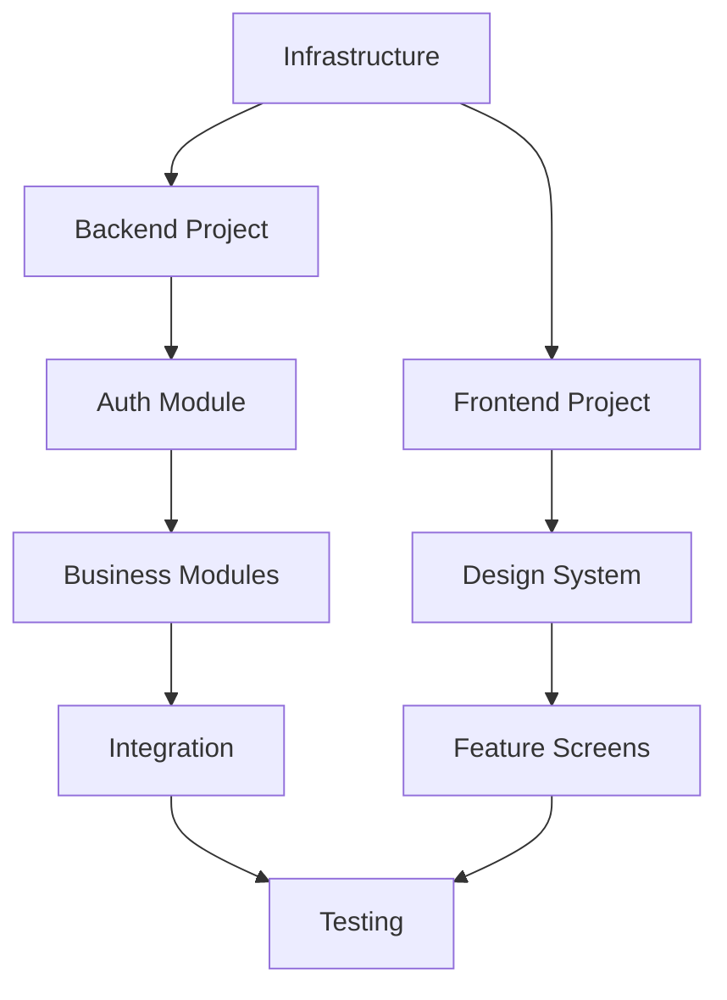

# Workflow: Create Master Plan

## Mục đích

Tạo Master Plan (kế hoạch tổng thể) từ tài liệu Detailed Design Document (DD). Master Plan chứa các **khối công việc lớn** (work packages) mà không đi vào chi tiết task nhỏ.

Master Plan sẽ làm input cho workflow `/create-detailed-plan` để tạo task list chi tiết.

---

## Input

| Tham số       | Mô tả                                 | Bắt buộc |
| ------------- | ------------------------------------- | -------- |
| DD_PATH       | Đường dẫn đến thư mục Detailed Design | ✅       |
| OUTPUT_FOLDER | Thư mục output cho Master Plan        | Optional |
| PROJECT_NAME  | Tên dự án                             | Optional |

**Ví dụ:**

```
Tạo master plan từ: docs/SpeakPal/詳細設計書
```

---

## Output

File `MASTER-PLAN.md` chứa:

1. **Project Overview** - Thông tin tổng quan dự án
2. **Technology Stack** - Stack công nghệ được sử dụng
3. **Work Packages** - Các khối công việc lớn (có DD References)
4. **Dependencies** - Phụ thuộc giữa các work packages
5. **Milestone Timeline** - Timeline các mốc chính (nếu có)

### Quan trọng: DD References

Mỗi Work Package **PHẢI** có cột **DD References** chứa danh sách các file DD liên quan. Điều này giúp workflow `/create-detailed-plan` biết cần đọc file nào để tạo tasks chi tiết.

Ví dụ:

- WP-BE-003 (Auth Module) → `05-module-design/auth-module.md`, `08-api-design.md#auth`
- WP-FE-004 (Auth Screens) → `09-ui-specifications.md#auth`, `06-component-design.md#uc001-005`

---

## Quy trình thực hiện

### Bước 1: Đọc và phân tích Detailed Design Document

1. Đọc file `_index.md` để hiểu cấu trúc tổng thể
2. Đọc file `03-system-overview.md` để hiểu:
   - Technology Stack (Frontend, Backend, Database, etc.)
   - Module Architecture
   - External Services
3. Đọc file `05-module-design.md` để xác định các module cần implement
4. Đọc file `07-database-design.md` để xác định các database tables
5. Đọc file `08-api-design.md` để xác định các API endpoints
6. Đọc file `13-deployment-design.md` để xác định infrastructure

### Bước 2: Xác định Work Packages

Dựa vào phân tích DD, xác định các Work Packages theo template sau:

#### 2.1. Infrastructure Work Packages

| ID         | Work Package     | Mô tả                                   | DD References                                                        |
| ---------- | ---------------- | --------------------------------------- | -------------------------------------------------------------------- |
| WP-INF-001 | Database Setup   | Khởi tạo database, schema, migrations   | `07-database-design.md`, `13-deployment-design.md`                   |
| WP-INF-002 | Cache Setup      | Khởi tạo Redis/cache layer              | `03-system-overview.md#tech-stack`, `13-deployment-design.md`        |
| WP-INF-003 | Storage Setup    | Khởi tạo file storage (S3, etc.)        | `03-system-overview.md#external-services`, `13-deployment-design.md` |
| WP-INF-004 | CI/CD Setup      | Thiết lập CI/CD pipelines               | `13-deployment-design.md`                                            |
| WP-INF-005 | Monitoring Setup | Thiết lập logging, monitoring, alerting | `12-logging-monitoring.md`, `13-deployment-design.md`                |

#### 2.2. Backend Work Packages

| ID        | Work Package  | Mô tả                                      | DD References                                                                                         |
| --------- | ------------- | ------------------------------------------ | ----------------------------------------------------------------------------------------------------- |
| WP-BE-001 | Project Init  | Khởi tạo backend project với framework     | `03-system-overview.md`, `05-module-design.md`                                                        |
| WP-BE-002 | Common Module | Shared utilities, base classes, exceptions | `05-module-design.md`, `11-error-handling.md`                                                         |
| WP-BE-003 | Auth Module   | Authentication, authorization, JWT         | `05-module-design/auth-module.md`, `08-api-design.md#auth`, `10-security-design.md`                   |
| WP-BE-XXX | [Module Name] | Từng business module từ DD                 | `05-module-design/[name]-module.md`, `06-component-design.md#[uc-ids]`, `08-api-design.md#[category]` |

#### 2.3. Frontend Work Packages

| ID        | Work Package      | Mô tả                            | DD References                                                                  |
| --------- | ----------------- | -------------------------------- | ------------------------------------------------------------------------------ |
| WP-FE-001 | Project Init      | Khởi tạo frontend project        | `03-system-overview.md#tech-stack`                                             |
| WP-FE-002 | Design System     | UI components, themes, styles    | `09-ui-specifications.md#design-system`                                        |
| WP-FE-003 | Auth Screens      | Login, Register, Forgot Password | `09-ui-specifications.md#auth-screens`, `06-component-design.md#uc001-005`     |
| WP-FE-XXX | [Feature Screens] | Từng feature module từ DD        | `09-ui-specifications.md#[screen-category]`, `06-component-design.md#[uc-ids]` |

#### 2.4. Integration Work Packages

| ID         | Work Package       | Mô tả                        | DD References                                                                    |
| ---------- | ------------------ | ---------------------------- | -------------------------------------------------------------------------------- |
| WP-INT-001 | External Service A | Tích hợp dịch vụ bên ngoài A | `03-system-overview.md#external-services`, `08-api-design.md#[service-category]` |
| WP-INT-XXX | [Service Name]     | Từng external service từ DD  | `03-system-overview.md#external-services`, relevant module/API docs              |

#### 2.5. Testing & QA Work Packages

| ID        | Work Package      | Mô tả                          | DD References                                                         |
| --------- | ----------------- | ------------------------------ | --------------------------------------------------------------------- |
| WP-QA-001 | Unit Tests Setup  | Setup unit testing framework   | `05-module-design.md`, `08-api-design.md`                             |
| WP-QA-002 | E2E Tests Setup   | Setup end-to-end testing       | `06-component-design.md`, `09-ui-specifications.md`                   |
| WP-QA-003 | Performance Tests | Setup performance/load testing | `04-design-considerations.md#performance`, `12-logging-monitoring.md` |

#### 2.6. Deployment Work Packages

| ID         | Work Package         | Mô tả                        | DD References                                         |
| ---------- | -------------------- | ---------------------------- | ----------------------------------------------------- |
| WP-DEP-001 | Kubernetes Setup     | Setup K8s cluster, manifests | `13-deployment-design.md`                             |
| WP-DEP-002 | Monitoring Setup     | Setup logging, alerting      | `12-logging-monitoring.md`, `13-deployment-design.md` |
| WP-DEP-XXX | App Store Submission | Deploy to stores             | `13-deployment-design.md`                             |

### Bước 3: Xác định Dependencies

Tạo dependency matrix giữa các work packages:



### Bước 4: Tạo Output File

Tạo file `MASTER-PLAN.md` trong thư mục output với format sau:

````markdown
# Master Plan - [Project Name]

## 1. Project Overview

| Item          | Value               |
| ------------- | ------------------- |
| Project Name  | [Từ DD]             |
| Technology    | [Tech stack từ DD]  |
| Total Modules | [Số module từ DD]   |
| Total APIs    | [Số API từ DD]      |
| Total Screens | [Số màn hình từ DD] |
| Total Tables  | [Số bảng DB từ DD]  |

## 2. Technology Stack

### Frontend

- Framework: [xxx]
- State Management: [xxx]
- ...

### Backend

- Framework: [xxx]
- ORM: [xxx]
- ...

### Database

- Main DB: [xxx]
- Cache: [xxx]

### External Services

- [Service 1]: [Purpose]
- [Service 2]: [Purpose]

## 3. Work Packages

### 3.1. Phase 0: Infrastructure (Prerequisite)

| ID         | Work Package   | Description            | Est. Days | DD References                                      |
| ---------- | -------------- | ---------------------- | --------- | -------------------------------------------------- |
| WP-INF-001 | Database Setup | PostgreSQL, migrations | 1-2       | `07-database-design.md`, `13-deployment-design.md` |
| WP-INF-002 | Cache Setup    | Redis cluster          | 1         | `03-system-overview.md`, `13-deployment-design.md` |
| ...        | ...            | ...                    | ...       | ...                                                |

### 3.2. Phase 1: Foundation

| ID        | Work Package          | Description                    | Est. Days | DD References                                      |
| --------- | --------------------- | ------------------------------ | --------- | -------------------------------------------------- |
| WP-BE-001 | Backend Project Init  | NestJS setup, folder structure | 1         | `03-system-overview.md`, `05-module-design.md`     |
| WP-FE-001 | Frontend Project Init | Flutter/React setup            | 1         | `03-system-overview.md`, `09-ui-specifications.md` |
| WP-BE-002 | Common Module         | Base classes, utilities        | 2         | `05-module-design.md`, `11-error-handling.md`      |
| WP-FE-002 | Design System         | Theme, components              | 2-3       | `09-ui-specifications.md#design-system`            |

### 3.3. Phase 2: Core Modules

| ID        | Work Package      | Description           | Est. Days | DD References                                                                       |
| --------- | ----------------- | --------------------- | --------- | ----------------------------------------------------------------------------------- |
| WP-BE-003 | Auth Module (BE)  | JWT, OAuth, guards    | 3-4       | `05-module-design/auth-module.md`, `08-api-design.md#auth`, `10-security-design.md` |
| WP-FE-003 | Auth Screens (FE) | Login, Register, etc. | 2-3       | `09-ui-specifications.md#auth`, `06-component-design.md#uc001-005`                  |
| ...       | ...               | ...                   | ...       | ...                                                                                 |

### 3.4. Phase 3: Business Modules

[Liệt kê từng module từ DD với estimate]

### 3.5. Phase 4: Integration & External Services

[Liệt kê từng integration]

### 3.6. Phase 5: Testing & QA

[Liệt kê testing work packages]

## 4. Dependency Graph

```mermaid
[Dependency diagram]
```
````

## 5. Summary

| Phase     | Work Packages | Est. Total Days |
| --------- | ------------- | --------------- |
| Phase 0   | X             | Y               |
| Phase 1   | X             | Y               |
| Phase 2   | X             | Y               |
| Phase 3   | X             | Y               |
| Phase 4   | X             | Y               |
| Phase 5   | X             | Y               |
| **Total** | **XX**        | **YY days**     |

---

_Generated from: [DD_PATH]_
_Created: [Date]_

```

---

## Checklist

Trước khi hoàn thành, verify:

- [ ] Đã đọc đủ các file DD quan trọng (_index, system-overview, module-design, database, api)
- [ ] Đã xác định đủ Work Packages cho tất cả các layer (Infra, BE, FE, Integration, QA)
- [ ] Mỗi Work Package có ID unique, mô tả rõ ràng
- [ ] Dependencies giữa Work Packages được xác định rõ
- [ ] Phases được sắp xếp hợp lý theo thứ tự implement
- [ ] File MASTER-PLAN.md được tạo và format đúng

---

## Lưu ý quan trọng

1. **Không đi vào chi tiết task** - Master Plan chỉ chứa các khối công việc LỚN
2. **Mỗi Work Package ~ 1-5 ngày** - Nếu quá lớn, cần tách nhỏ
3. **Dependencies phải hợp lý** - Không thể implement FE screens trước khi có Design System
4. **Estimate chỉ là ước lượng** - Sẽ được refine trong Detailed Plan
5. **Work Package ID format**:
   - `WP-INF-XXX`: Infrastructure
   - `WP-BE-XXX`: Backend
   - `WP-FE-XXX`: Frontend
   - `WP-INT-XXX`: Integration
   - `WP-QA-XXX`: Quality Assurance
   - `WP-DEP-XXX`: Deployment
6. **DD References là BẮT BUỘC** - Mỗi Work Package PHẢI có danh sách file DD tham chiếu
   - Dùng format: `filename.md` hoặc `filename.md#section`
   - Liệt kê tất cả các file liên quan để `/create-detailed-plan` có đủ thông tin

---

## Ví dụ Work Packages cho SpeakPal

Dựa vào DD của SpeakPal, Master Plan sẽ có các Work Packages như:

### Infrastructure
- WP-INF-001: PostgreSQL Database Setup
- WP-INF-002: Redis Cache Setup
- WP-INF-003: AWS S3 Storage Setup
- WP-INF-004: Firebase Auth Integration

### Backend (NestJS)
- WP-BE-001: NestJS Project Initialization
- WP-BE-002: Common Module (Utilities, Exceptions, DTOs)
- WP-BE-003: Auth Module
- WP-BE-004: User Module
- WP-BE-005: Conversation Module
- WP-BE-006: Feedback Module
- WP-BE-007: Learning Module
- WP-BE-008: Gamification Module
- WP-BE-009: Progress Module
- WP-BE-010: Social Module
- WP-BE-011: Subscription Module
- WP-BE-012: Notification Module

### Frontend (Flutter)
- WP-FE-001: Flutter Project Initialization
- WP-FE-002: Design System & Theme
- WP-FE-003: Auth Screens
- WP-FE-004: Home & Dashboard Screens
- WP-FE-005: Conversation Screens
- WP-FE-006: Learning Screens
- WP-FE-007: Profile & Settings Screens
- WP-FE-008: Gamification Screens
- WP-FE-009: Subscription Screens

### AI Integration
- WP-INT-001: Deepgram STT Integration
- WP-INT-002: OpenAI GPT-4o Integration
- WP-INT-003: ElevenLabs TTS Integration

### Testing
- WP-QA-001: Unit Testing Setup (Jest)
- WP-QA-002: E2E Testing Setup
- WP-QA-003: Mobile Testing (Flutter Test)

---

_Workflow version: 1.0_
_Last updated: 2025-12-29_
```
