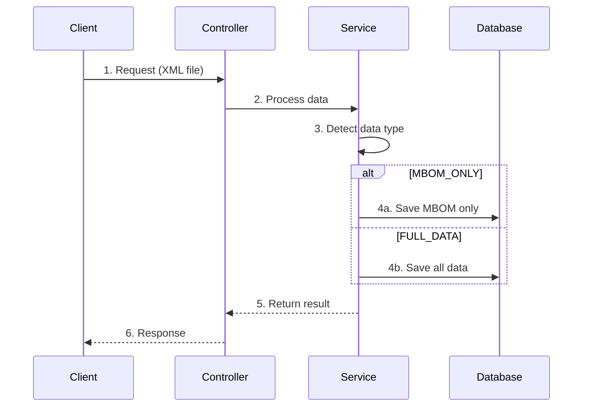
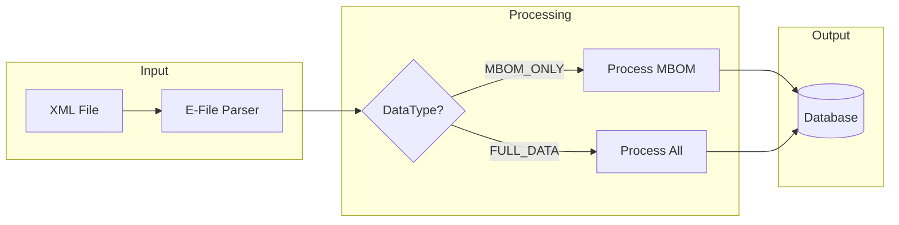

# Workflow: Present - Tạo Slide Presentation

## Mục đích

Chuyển đổi nội dung kỹ thuật/giải pháp thành các slide trình bày dễ hiểu, logic, súc tích với số lượng slide tối thiểu.

---

## Bước 1: Thu thập thông tin đầu vào

Hỏi người dùng các câu hỏi sau. Với mỗi câu hỏi, nếu người dùng chọn "AI tự quyết", ghi lại quyết định vào file log và tiếp tục.

### Câu hỏi bắt buộc:

1. **Nội dung chính**: "Nội dung bạn muốn trình bày là gì? (paste text, link file, hoặc mô tả)"
2. **Đối tượng**: "Ai là người nghe? (Technical team / Manager / Khách hàng / Mixed / AI tự quyết)"
3. **Thời lượng**: "Thời lượng trình bày dự kiến? (5 phút / 10 phút / 15 phút / 30 phút / AI tự quyết)"
4. **Ngôn ngữ trình bày**: "Ngôn ngữ chính của bài trình bày? (Tiếng Việt / Tiếng Anh / Tiếng Nhật / AI tự quyết dựa vào nội dung gốc)"
   - ⚠️ **BẮT BUỘC**: Chỉ được dùng **MỘT ngôn ngữ duy nhất** cho toàn bộ slides
   - Ngoại trừ: Thuật ngữ kỹ thuật (API names, class names, etc.) giữ nguyên tiếng Anh

### Câu hỏi tùy chọn (có thể AI tự quyết):

4. **Mục tiêu**: "Mục tiêu chính của bài trình bày? (Giải thích / Thuyết phục / Đào tạo / AI tự quyết)"
5. **Style**: "Phong cách slide? (Minimalist / Detailed / Visual-heavy / AI tự quyết)"
6. **Màu sắc/Theme**: "Theme màu sắc? (Dark / Light / Corporate / AI tự quyết)"

---

## Bước 2: Phân tích và cấu trúc nội dung

Dựa trên thông tin thu thập:

1. **Xác định key messages**: Tối đa 3-5 điểm chính
2. **Xây dựng story flow**:
   - Opening (Hook/Problem)
   - Body (Solution/Explanation)
   - Closing (Summary/Call-to-action)
3. **Tính số slide tối thiểu**:
   - 5 phút = 3-5 slides
   - 10 phút = 5-8 slides
   - 15 phút = 8-12 slides
   - 30 phút = 12-20 slides

---

## Bước 3: Tạo file output

Tạo file markdown tại: `docs/Presentations/[tên-presentation]-slides.md`

### Template cho mỗi slide:

```markdown
## Slide [số]: [Tiêu đề slide]

### Mục đích

[Mục đích của slide này trong flow]

### Layout

[Mô tả bố cục: Full-text / Split / Image-focus / Diagram]

### Nội dung

**Tiêu đề chính**: [Text]

**Bullets/Points**:

- Point 1
- Point 2
- Point 3

**Visual element**:

- Loại: [Icon / Image / Diagram / Chart / None]
- Mô tả: [Chi tiết về visual]
- Vị trí: [Left / Right / Center / Background]

### Speaker Notes

[Ghi chú cho người trình bày - những gì cần nói thêm]

---
```

---

## Bước 4: Tạo file log (nếu có AI decisions)

Nếu AI tự quyết bất kỳ mục nào, tạo file log tại:
`docs/Presentations/[tên-presentation]-decisions.log`

Format:

```
# AI Decisions Log
Ngày tạo: [timestamp]

## Các quyết định AI tự động

1. [Câu hỏi]: [Quyết định của AI] - [Lý do]
2. ...
```

---

## Bước 5: Review và xác nhận

Sau khi tạo xong, hỏi người dùng:

- "Bạn muốn thêm/bớt slide nào không?"
- "Có slide nào cần điều chỉnh nội dung không?"

Thực hiện chỉnh sửa nếu có yêu cầu.

---

## Output Structure

```
docs/Presentations/
├── [tên]-slides.md      # File chính - hướng dẫn từng slide
└── [tên]-decisions.log  # Log các quyết định AI (nếu có)
```

---

## Nguyên tắc thiết kế slide

1. **Một ý chính/slide**: Không quá 1 message chính
2. **Quy tắc 6x6**: Tối đa 6 bullets, mỗi bullet tối đa 6 từ
3. **Visual > Text**: Ưu tiên diagram, icon thay vì text dài
4. **Contrast**: Đảm bảo đọc được từ xa
5. **Flow logic**: Mỗi slide phải dẫn tự nhiên sang slide tiếp theo
6. **Minimal**: Bỏ mọi thứ không cần thiết

---

## 🌐 Quy tắc nhất quán ngôn ngữ (Language Consistency)

### Nguyên tắc vàng: **MỘT ngôn ngữ duy nhất**

Toàn bộ nội dung phải được viết bằng **MỘT ngôn ngữ chính** đã chọn. Điều này bao gồm:

- ✅ Tiêu đề slides
- ✅ Bullet points / nội dung chính
- ✅ Speaker notes
- ✅ Labels trong diagrams

### Ngoại lệ được phép:

| Loại               | Giữ nguyên tiếng Anh | Ví dụ                                         |
| ------------------ | -------------------- | --------------------------------------------- |
| Tên API/Endpoint   | ✅                   | `Synchronize API`, `GET /users`               |
| Tên Class/Service  | ✅                   | `DataTypeDetector`, `SynchronizeService`      |
| Tên bảng/field     | ✅                   | `MTO`, `PLANT_LOC`, `BP_PROC`                 |
| Tên package/module | ✅                   | `com.example.service`                         |
| Thuật ngữ chuẩn    | ✅                   | `NullPointerException`, `Backward compatible` |

### ❌ KHÔNG được làm:

```markdown
# ❌ SAI - Mix ngôn ngữ

Slide title: 用語定義 (Terminology)
Content:

- MBOM là Manufacturing BOM chứa thông tin về parts
- 新要件: Process XML with MBOM data only

# ✅ ĐÚNG - Nhất quán tiếng Nhật

Slide title: 用語定義
Content:

- MBOM: 製造部品表、部品と材料の情報を含む
- 新要件: MBOM データのみの XML 処理

# ✅ ĐÚNG - Nhất quán tiếng Việt

Slide title: Định nghĩa thuật ngữ
Content:

- MBOM: Bảng vật liệu sản xuất, chứa thông tin về linh kiện và nguyên liệu
- Yêu cầu mới: Xử lý XML chỉ chứa dữ liệu MBOM
```

---

## 🔧 Hướng dẫn cho Technical Presentations (Developer-focused)

Khi đối tượng là **Development Team** hoặc **Technical Team**, cần tuân thủ các quy tắc sau:

### 1. Bắt buộc có Sequence/Flow Diagrams

Mỗi bài trình bày technical **PHẢI** có ít nhất 1 slide mô tả processing flow:

**Template cho Sequence Diagram slide:**

````markdown
## Slide X: Processing Flow / Sequence Diagram

### Mục đích

Cho dev team thấy rõ luồng xử lý từng bước

### Layout

Full diagram (center)

### Nội dung

**Tiêu đề chính**: [Tên flow - bằng ngôn ngữ đã chọn]

**Sequence Diagram** (sử dụng Mermaid syntax):


````

**Giải thích các bước** (cùng ngôn ngữ với slide):

1. [Bước 1]: [Mô tả]
2. [Bước 2]: [Mô tả]
   ...

### Speaker Notes

[Giải thích chi tiết từng bước cho presenter]

````

### 2. Code Snippets phải có ngữ cảnh

Khi show code, **PHẢI** kèm theo:
- File path hoặc class name
- Giải thích bằng ngôn ngữ đã chọn
- Highlight điểm quan trọng

```markdown
### Visual element:

- Loại: Code block
- Mô tả: [Tên class/method] - [Mục đích, bằng ngôn ngữ đã chọn]
- File: `src/main/java/com/example/service/DataTypeDetector.java`
- Highlight: Dòng 5-7 (logic phân loại)
````

### 3. Data Flow / Architecture Diagrams

Cho slides về architecture, sử dụng format:

```markdown
### Visual element:

- Loại: Architecture Diagram
- Format: Mermaid flowchart hoặc HTML styled components
- Components: [Liệt kê các component]
- Arrows: [Mô tả flow direction]
```

**Mermaid Flowchart Template:**



### 4. Before/After Comparison

Khi trình bày changes/improvements, sử dụng format:

```markdown
## Slide X: Before/After Comparison

### Layout

Split (Left: Before, Right: After)

### Nội dung

**Left - Before (Hiện tại):**

- [Vấn đề 1]
- [Vấn đề 2]
- [Vấn đề 3]

**Right - After (Sau khi thay đổi):**

- [Giải pháp 1] ✓
- [Giải pháp 2] ✓
- [Giải pháp 3] ✓
```

---

## Ví dụ câu hỏi người dùng

Khi bắt đầu, hỏi theo format:

```
🎯 **Tạo Slide Presentation**

Để tạo bài trình bày tối ưu, tôi cần một số thông tin:

1. **Nội dung**: Bạn muốn trình bày về gì?
   (Paste nội dung, link file, hoặc mô tả ngắn gọn)

2. **Đối tượng nghe**: Ai sẽ nghe bài này?
   - [ ] Technical team
   - [ ] Manager/Leadership
   - [ ] Khách hàng
   - [ ] Mixed audience
   - [ ] AI tự quyết

3. **Thời lượng dự kiến**:
   - [ ] 5 phút (lightning talk)
   - [ ] 10 phút
   - [ ] 15 phút
   - [ ] 30 phút
   - [ ] AI tự quyết

4. **Ngôn ngữ trình bày** ⚠️ (BẮT BUỘC nhất quán):
   - [ ] Tiếng Việt
   - [ ] Tiếng Anh
   - [ ] Tiếng Nhật
   - [ ] AI tự quyết (dựa vào nội dung gốc)

5. **Mục tiêu chính**:
   - [ ] Giải thích kỹ thuật
   - [ ] Thuyết phục/Bán hàng
   - [ ] Đào tạo/Hướng dẫn
   - [ ] AI tự quyết

6. **Phong cách**:
   - [ ] Minimalist (ít chữ, nhiều visual)
   - [ ] Detailed (chi tiết hơn)
   - [ ] Visual-heavy (chủ yếu hình ảnh/diagram)
   - [ ] AI tự quyết
```
