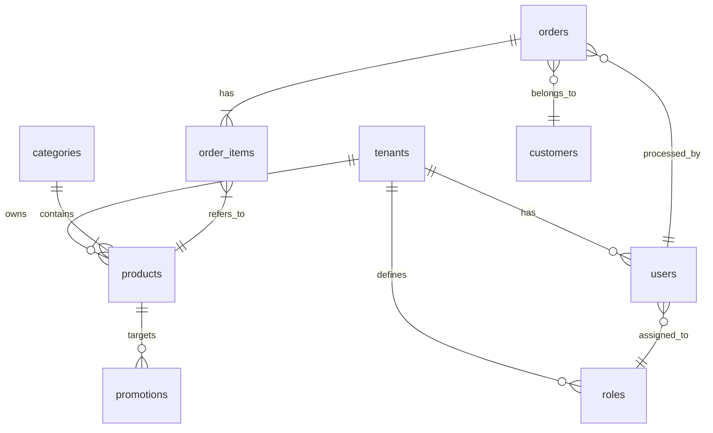

# HƯỚNG DẪN TOÀN DIỆN: TẠO TÀI LIỆU THIẾT KẾ CƠ SỞ (BASIC DESIGN) BẰNG AI

---

## 📋 MỤC LỤC

1. [Tổng quan về Basic Design](#1-tổng-quan)
2. [Cấu trúc thư mục tài liệu](#2-cấu-trúc-thư-mục)
3. [Quy trình phân tích yêu cầu](#3-quy-trình-phân-tích)
4. [Cấu trúc chuẩn tài liệu BD](#4-cấu-trúc-chuẩn)
5. [Hướng dẫn chi tiết từng phần](#5-hướng-dẫn-chi-tiết)
6. [Template và mẫu](#6-template)
7. [Prompt System cho AI](#7-prompt-system)
8. [Checklist và Quality Assurance](#8-checklist)
9. [Ví dụ minh họa](#9-ví-dụ)

---

## 1. TỔNG QUAN VỀ BASIC DESIGN

### 1.1 Định nghĩa

```
┌─────────────────────────────────────────────────────────────────┐
│                    VỊ TRÍ CỦA BASIC DESIGN                      │
├─────────────────────────────────────────────────────────────────┤
│                                                                 │
│   Requirements      Basic Design      Detail Design    Coding  │
│   (Yêu cầu)    →   (Thiết kế cơ sở) → (Thiết kế chi tiết) → (Code)│
│                                                                 │
│   ┌─────────┐      ┌─────────────┐    ┌──────────────┐         │
│   │ WHAT?   │  →   │   HOW?      │ →  │ HOW EXACTLY? │         │
│   │ (Làm gì)│      │(Làm thế nào)│    │(Chi tiết cách)│         │
│   └─────────┘      └─────────────┘    └──────────────┘         │
│                                                                 │
└─────────────────────────────────────────────────────────────────┘
```

### 1.2 Mục đích của Basic Design

| Mục đích               | Mô tả                                            |
| ---------------------- | ------------------------------------------------ |
| **Kiến trúc hệ thống** | Xác định cấu trúc tổng thể, các thành phần chính |
| **Thiết kế giao diện** | Định nghĩa UI/UX ở mức high-level                |
| **Thiết kế dữ liệu**   | Mô hình database, entity relationships           |
| **Thiết kế API**       | Định nghĩa interfaces giữa các modules           |
| **Luồng xử lý**        | Mô tả business logic flow                        |

---

## 2. CẤU TRÚC THƯ MỤC TÀI LIỆU

> ⚠️ **QUAN TRỌNG**: Tài liệu Basic Design KHÔNG nên viết tất cả vào một file duy nhất. Thay vào đó, hãy tổ chức thành thư mục với nhiều file riêng biệt để:
>
> - Giảm kích thước mỗi file, tránh quá tải
> - Dễ dàng quản lý và cập nhật từng phần
> - Cung cấp ngữ cảnh rõ ràng cho AI trong các giai đoạn tiếp theo

### 2.1 Cấu trúc thư mục chuẩn

Tên thư mục được đặt theo ngôn ngữ của tài liệu:

- Tiếng Việt: `Tài liệu Thiết kế Cơ sở`
- Tiếng Anh: `Basic Design Document`
- Tiếng Nhật: `基本設計書`

```
📁 [Tên thư mục chứa tài liệu]/
├── 📁 Basic Design Document/           # Hoặc tên theo ngôn ngữ phù hợp
│   ├── 📄 _index.md                     # File index - BẮT BUỘC
│   ├── 📄 01-system-overview.md         # Tổng quan hệ thống
│   ├── 📄 02-system-architecture.md     # Kiến trúc hệ thống
│   ├── 📄 03-functional-design.md       # Thiết kế chức năng
│   ├── 📄 04-screen-design.md           # Thiết kế giao diện
│   ├── 📄 05-data-design.md             # Thiết kế dữ liệu
│   ├── 📄 06-api-design.md              # Thiết kế API
│   ├── 📄 07-batch-design.md            # Thiết kế Batch (nếu có)
│   ├── 📄 08-non-functional.md          # Yêu cầu phi chức năng
│   ├── 📄 09-error-handling.md          # Xử lý lỗi
│   └── 📄 10-appendix.md                # Phụ lục
```

### 2.2 File Index (\_index.md) - BẮT BUỘC

File `_index.md` là file quan trọng nhất, giúp AI hiểu ngữ cảnh tổng thể của dự án khi thực hiện các công việc ở giai đoạn tiếp theo (Detail Design, Coding, Testing...).

#### Template cho \_index.md:

```markdown
# [TÊN DỰ ÁN] - Tài liệu Thiết kế Cơ sở

## Thông tin tài liệu

| Thông tin  | Giá trị                   |
| ---------- | ------------------------- |
| Tên dự án  | [Project Name]            |
| Mã dự án   | [Project Code]            |
| Phiên bản  | 1.0                       |
| Ngày tạo   | [DD/MM/YYYY]              |
| Trạng thái | Draft / Review / Approved |

## Tổng quan dự án

[Mô tả ngắn gọn về dự án, mục đích và phạm vi - 3-5 câu]

## Cấu trúc tài liệu

| STT | File                                                     | Nội dung chính        | Mô tả                                                 |
| --- | -------------------------------------------------------- | --------------------- | ----------------------------------------------------- |
| 1   | [01-system-overview.md](./01-system-overview.md)         | Tổng quan hệ thống    | Mục đích, phạm vi, đối tượng sử dụng, thuật ngữ       |
| 2   | [02-system-architecture.md](./02-system-architecture.md) | Kiến trúc hệ thống    | Sơ đồ kiến trúc, component diagram, technology stack  |
| 3   | [03-functional-design.md](./03-functional-design.md)     | Thiết kế chức năng    | Danh sách chức năng, use case, business flow          |
| 4   | [04-screen-design.md](./04-screen-design.md)             | Thiết kế giao diện    | Screen transition, screen list, screen specifications |
| 5   | [05-data-design.md](./05-data-design.md)                 | Thiết kế dữ liệu      | ERD, table definitions, data dictionary               |
| 6   | [06-api-design.md](./06-api-design.md)                   | Thiết kế API          | API list, API specifications, external interfaces     |
| 7   | [07-batch-design.md](./07-batch-design.md)               | Thiết kế Batch        | Batch job list, schedule, processing flow             |
| 8   | [08-non-functional.md](./08-non-functional.md)           | Yêu cầu phi chức năng | Performance, security, availability                   |
| 9   | [09-error-handling.md](./09-error-handling.md)           | Xử lý lỗi             | Error code system, error handling strategy            |
| 10  | [10-appendix.md](./10-appendix.md)                       | Phụ lục               | Traceability matrix, permission matrix, open issues   |

## Thông tin chính cho AI Context

### Actors/Users

- [Actor 1]: [Mô tả vai trò và quyền hạn chính]
- [Actor 2]: [Mô tả vai trò và quyền hạn chính]
- ...

### Modules/Services chính

- [Module 1]: [Chức năng chính]
- [Module 2]: [Chức năng chính]
- ...

### Technology Stack (Tóm tắt)

- Frontend: [Technologies]
- Backend: [Technologies]
- Database: [Technologies]
- Infrastructure: [Technologies]

### Ràng buộc và giả định quan trọng

- [Constraint 1]
- [Constraint 2]
- ...

## Tham chiếu đến tài liệu liên quan

| Loại tài liệu     | Đường dẫn                  |
| ----------------- | -------------------------- |
| Yêu cầu hệ thống  | [Link to requirements doc] |
| Detail Design     | [Link - nếu có]            |
| API Documentation | [Link - nếu có]            |

---

_File này được cập nhật tự động khi có thay đổi trong các file con._
```

### 2.3 Quy tắc phân chia nội dung

| Nguyên tắc            | Mô tả                                                                                      |
| --------------------- | ------------------------------------------------------------------------------------------ |
| **Kích thước file**   | Mỗi file không nên vượt quá 500-800 dòng. Nếu lớn hơn, cân nhắc tách thành nhiều file con. |
| **Một chủ đề/file**   | Mỗi file tập trung vào một chủ đề chính (architecture, screen, data...)                    |
| **Cross-reference**   | Sử dụng link relative để tham chiếu giữa các file khi cần                                  |
| **Consistent naming** | Đặt tên file theo format: `[số thứ tự]-[tên-kebab-case].md`                                |
| **Index đầy đủ**      | File index phải có đủ thông tin để AI hiểu context mà không cần đọc tất cả các file        |

### 2.4 Ví dụ tên thư mục theo ngôn ngữ

| Ngôn ngữ    | Tên thư mục               |
| ----------- | ------------------------- |
| Tiếng Việt  | `Tài liệu Thiết kế Cơ sở` |
| Tiếng Anh   | `Basic Design Document`   |
| Tiếng Nhật  | `基本設計書`              |
| Tiếng Hàn   | `기본설계서`              |
| Tiếng Trung | `基本设计文档`            |

### 2.5 Tách file theo quy mô dự án

#### Dự án nhỏ (5-10 màn hình, < 20 tables)

```
📁 Basic Design Document/
├── 📄 _index.md
├── 📄 01-overview-architecture.md    # Gộp overview + architecture
├── 📄 02-functional-screen.md        # Gộp functional + screen design
├── 📄 03-data-api-design.md          # Gộp data + API design
└── 📄 04-non-functional-appendix.md  # Gộp non-functional + appendix
```

#### Dự án trung bình (10-30 màn hình, 20-50 tables)

Sử dụng cấu trúc chuẩn ở mục 2.1

#### Dự án lớn (> 30 màn hình, > 50 tables)

```
📁 Basic Design Document/
├── 📄 _index.md
├── 📁 01-overview/
│   ├── 📄 _index.md
│   ├── 📄 purpose-scope.md
│   └── 📄 glossary.md
├── 📁 02-architecture/
│   ├── 📄 _index.md
│   ├── 📄 system-context.md
│   ├── 📄 component-diagram.md
│   └── 📄 deployment.md
├── 📁 03-functional/
│   ├── 📄 _index.md
│   ├── 📄 use-cases/
│   │   ├── 📄 auth-module.md
│   │   ├── 📄 user-module.md
│   │   └── 📄 ...
│   └── 📄 business-flow.md
├── 📁 04-screen/
│   ├── 📄 _index.md
│   ├── 📄 screen-transition.md
│   └── 📄 screens/
│       ├── 📄 auth-screens.md
│       ├── 📄 user-screens.md
│       └── 📄 ...
├── 📁 05-data/
│   ├── 📄 _index.md
│   ├── 📄 erd.md
│   └── 📄 tables/
│       ├── 📄 master-tables.md
│       ├── 📄 transaction-tables.md
│       └── 📄 ...
└── 📁 ...
```

---

## 3. QUY TRÌNH PHÂN TÍCH YÊU CẦU

### 3.1 Workflow xử lý

```
┌──────────────────────────────────────────────────────────────────┐
│                    QUY TRÌNH XỬ LÝ CỦA AI                        │
└──────────────────────────────────────────────────────────────────┘
                              │
                              ▼
┌──────────────────────────────────────────────────────────────────┐
│ BƯỚC 1: TIẾP NHẬN & PHÂN LOẠI YÊU CẦU                           │
├──────────────────────────────────────────────────────────────────┤
│ • Đọc toàn bộ tài liệu yêu cầu                                  │
│ • Phân loại: Functional / Non-functional requirements           │
│ • Xác định scope và boundary của hệ thống                       │
│ • Trích xuất actors và use cases                                │
└──────────────────────────────────────────────────────────────────┘
                              │
                              ▼
┌──────────────────────────────────────────────────────────────────┐
│ BƯỚC 1.5: TẠO REQUIREMENT MAPPING (BẮT BUỘC)                    │
├──────────────────────────────────────────────────────────────────┤
│ ⚠️ KHÔNG ĐƯỢC BỎ QUA BƯỚC NÀY                                    │
│ • Liệt kê TẤT CẢ FR IDs từ SRS                                   │
│ • Map mỗi FR → UC tương ứng                                      │
│ • Đánh dấu FR chưa có UC                                         │
│ • Validate coverage: Must=100%, Should≥80%                       │
│ • Tạo file requirement-mapping.md                                │
└──────────────────────────────────────────────────────────────────┘
                              │
                              ▼
┌──────────────────────────────────────────────────────────────────┐
│ BƯỚC 2: PHÂN TÍCH & MAPPING                                      │
├──────────────────────────────────────────────────────────────────┤
│ • Map requirements → Functions/Features                          │
│ • Xác định entities và relationships                             │
│ • Phân tích luồng dữ liệu (Data Flow)                           │
│ • Xác định external interfaces                                   │
└──────────────────────────────────────────────────────────────────┘
                              │
                              ▼
┌──────────────────────────────────────────────────────────────────┐
│ BƯỚC 3: THIẾT KẾ KIẾN TRÚC                                       │
├──────────────────────────────────────────────────────────────────┤
│ • Chọn architecture pattern (MVC, Microservices, etc.)          │
│ • Thiết kế component diagram                                     │
│ • Định nghĩa layer structure                                     │
│ • Xác định technology stack                                      │
└──────────────────────────────────────────────────────────────────┘
                              │
                              ▼
┌──────────────────────────────────────────────────────────────────┐
│ BƯỚC 4: THIẾT KẾ CHI TIẾT TỪNG MODULE                           │
├──────────────────────────────────────────────────────────────────┤
│ • Screen design (wireframe/mockup)                               │
│ • Database design (ERD, table definitions)                       │
│ • API design (endpoints, request/response)                       │
│ • Business logic flow                                            │
└──────────────────────────────────────────────────────────────────┘
                              │
                              ▼
┌──────────────────────────────────────────────────────────────────┐
│ BƯỚC 5: TỔNG HỢP & TẠO TÀI LIỆU                                 │
├──────────────────────────────────────────────────────────────────┤
│ • Compile tất cả sections                                        │
│ • Cross-reference và validate                                    │
│ • Format theo template chuẩn                                     │
│ • Review và hoàn thiện                                           │
└──────────────────────────────────────────────────────────────────┘
```

### 3.2 Ma trận trích xuất thông tin

```
┌─────────────────────┬──────────────────────┬─────────────────────┐
│  TỪ REQUIREMENT     │     TRÍCH XUẤT       │   ĐƯA VÀO BD       │
├─────────────────────┼──────────────────────┼─────────────────────┤
│ User stories        │ Actors, Use cases    │ Use Case Diagram    │
│ Business rules      │ Logic conditions     │ Business Logic Flow │
│ Data requirements   │ Entities, Attributes │ ERD, Table Design   │
│ UI requirements     │ Screens, Fields      │ Screen Design       │
│ Integration needs   │ External systems     │ System Context      │
│ Performance needs   │ NFRs                 │ Non-functional Spec │
│ Security needs      │ Auth/Author rules    │ Security Design     │
└─────────────────────┴──────────────────────┴─────────────────────┘
```

### 3.3 Requirement Mapping Guide (BẮT BUỘC)

> 🔴 **QUAN TRỌNG**: Bước này KHÔNG ĐƯỢC BỎ QUA. Đây là bước đảm bảo không có yêu cầu nào bị sót trong Basic Design.

#### 3.3.1 Mục đích

- Đảm bảo **100% yêu cầu Must** được cover bởi ít nhất 1 Use Case
- Đảm bảo **≥80% yêu cầu Should** được cover
- Ghi nhận các yêu cầu Could sẽ được defer

#### 3.3.2 Quy trình thực hiện

```
┌─────────────────────────────────────────────────────────────────┐
│            QUY TRÌNH TẠO REQUIREMENT MAPPING                     │
└─────────────────────────────────────────────────────────────────┘
                              │
                              ▼
    ┌─────────────────────────────────────────────────────────────┐
    │ 1. LIỆT KÊ TẤT CẢ FR                                        │
    │    Mở file SRS (03-functional-requirements.md)              │
    │    → Tìm bảng danh sách FR                                  │
    │    → Ghi lại: FR ID, Tên, Module, Priority                  │
    └────────────────────────────┬────────────────────────────────┘
                                 │
                                 ▼
    ┌─────────────────────────────────────────────────────────────┐
    │ 2. MAPPING FR → UC                                          │
    │    Với MỖI FR, xác định:                                    │
    │    → UC nào sẽ implement FR này?                            │
    │    → 1 FR có thể map đến nhiều UC                           │
    │    → 1 UC có thể cover nhiều FR                             │
    └────────────────────────────┬────────────────────────────────┘
                                 │
                                 ▼
    ┌─────────────────────────────────────────────────────────────┐
    │ 3. XÁC ĐỊNH FR CHƯA CÓ UC                                   │
    │    Liệt kê các FR không có UC                               │
    │    → Must: PHẢI thêm UC                                     │
    │    → Should: Thêm UC hoặc ghi lý do defer                   │
    │    → Could: Có thể defer, ghi vào Open Issues               │
    └────────────────────────────┬────────────────────────────────┘
                                 │
                                 ▼
    ┌─────────────────────────────────────────────────────────────┐
    │ 4. VALIDATE COVERAGE                                         │
    │    Tính coverage rate theo priority                          │
    │    → Must = 100%? → PASS                                     │
    │    → Should ≥ 80%? → PASS                                    │
    │    → Nếu FAIL → Quay lại bước 2                              │
    └────────────────────────────┬────────────────────────────────┘
                                 │
                                 ▼
    ┌─────────────────────────────────────────────────────────────┐
    │ 5. TÍCH HỢP MAPPING VÀO 03-functional-design.md             │
    │    Đưa kết quả mapping vào section đầu tiên của file        │
    │    → Dùng làm reference cho Use Cases bên dưới              │
    └─────────────────────────────────────────────────────────────┘
```

#### 3.3.3 Tích hợp FR→UC Mapping vào 03-functional-design.md

> 📌 **LƯU Ý**: FR→UC mapping được tích hợp trực tiếp vào file `03-functional-design.md` để giữ tất cả thông tin về chức năng ở một chỗ.

**Vị trí trong file `03-functional-design.md`:**

1. **Section đầu tiên** (sau tiêu đề chính): Thêm section "Requirement Coverage Summary"
2. **Trong bảng Use Case List**: Thêm cột "Mapped FR(s)" để trace ngược về SRS

**Template cho section Requirement Coverage (thêm vào đầu file 03-functional-design.md):**

```markdown
## 1. 要件カバレッジサマリー (Requirement Coverage Summary)

> このセクションは、SRS の機能要件が BD のユースケースで適切にカバーされていることを示します。

### 1.1 カバレッジ統計

| メトリック               | 値             |
| ------------------------ | -------------- |
| SRS 内 FR 総数           | [X]            |
| UC でカバーされた FR 数  | [Y]            |
| カバーされていない FR 数 | [Z]            |
| **カバレッジ率**         | **[Y/X*100]%** |

### 1.2 優先度別カバレッジ

| 優先度 | 総数 | カバー済み | 未カバー | カバレッジ率 | ステータス |
| ------ | ---- | ---------- | -------- | ------------ | ---------- |
| Must   | [n]  | [n]        | 0        | 100%         | ✅ PASS    |
| Should | [n]  | [n]        | [n]      | [x]%         | ✅/⚠️      |
| Could  | [n]  | [n]        | [n]      | [x]%         | ℹ️ INFO    |

### 1.3 FR→UC マッピングテーブル

| FR ID  | FR 機能名           | サブシステム | 優先度 | マッピング UC  | ステータス  |
| ------ | ------------------- | ------------ | ------ | -------------- | ----------- |
| FR-001 | ログイン/ログアウト | ユーザー管理 | Must   | UC-001, UC-002 | ✅ カバー済 |
| FR-002 | アカウント管理      | ユーザー管理 | Must   | UC-003         | ✅ カバー済 |
| FR-003 | ロール別権限管理    | ユーザー管理 | Must   | UC-003         | ✅ カバー済 |
| ...    | ...                 | ...          | ...    | ...            | ...         |

### 1.4 未カバー FR 一覧 (該当なしの場合は省略可)

| FR ID  | FR 機能名 | 優先度 | 未カバー理由 | 対応方針       |
| ------ | --------- | ------ | ------------ | -------------- |
| FR-XXX | [名前]    | Should | [理由]       | UC 追加 / 延期 |
```

**Template cho Use Case List (cập nhật bảng hiện có để thêm cột マッピング FR):**

```markdown
## 2. ユースケース一覧

| UC ID  | UC 名                  | アクター   | マッピング FR          | 優先度 |
| ------ | ---------------------- | ---------- | ---------------------- | ------ |
| UC-001 | システムにログインする | 全ユーザー | FR-001                 | Must   |
| UC-002 | パスワードを再設定する | 全ユーザー | FR-001                 | Must   |
| UC-003 | ユーザーを管理する     | Admin      | FR-002, FR-003, FR-004 | Must   |
| ...    | ...                    | ...        | ...                    | ...    |
```

#### 3.3.4 Tiêu chuẩn Coverage

> 🔴 **Basic Design yêu cầu 100% coverage cho TẤT CẢ FR**, không phân biệt priority.

| Priority   | Yêu cầu Coverage | Nếu không đạt                         |
| ---------- | ---------------- | ------------------------------------- |
| **Must**   | **= 100%**       | ❌ KHÔNG được tiếp tục. Phải thêm UC. |
| **Should** | **= 100%**       | ❌ KHÔNG được tiếp tục. Phải thêm UC. |
| **Could**  | **= 100%**       | ❌ KHÔNG được tiếp tục. Phải thêm UC. |

**Lý do:** Basic Design là tài liệu thiết kế toàn diện, phải cover 100% yêu cầu trong SRS.
Priority (Must/Should/Could) chỉ ảnh hưởng đến **thứ tự implementation**, không phải scope của BD.

#### 3.3.5 Ví dụ mapping hợp lệ

**Tốt:**

```
FR-001 (ログイン/ログアウト) → UC-001 (Login), UC-002 (Password Reset)
FR-006 (新規提案作成) → UC-004 (Create Proposal)
FR-019 (エスカレーション) → UC-019 (Escalate Proposal)  ← ✅ Có UC
```

**Không tốt:**

```
FR-019 (エスカレーション) → (không có UC)  ← ❌ FAIL - TẤT CẢ FR phải có UC!
```

---

## 4. CẤU TRÚC CHUẨN TÀI LIỆU BASIC DESIGN

### 4.1 Outline đầy đủ

```
BASIC DESIGN DOCUMENT
═══════════════════════════════════════════════════════════════

1. THÔNG TIN TÀI LIỆU (Document Information)
   1.1 Lịch sử thay đổi (Revision History)
   1.2 Người phê duyệt (Approvers)
   1.3 Tài liệu tham chiếu (References)
   1.4 Thuật ngữ và định nghĩa (Glossary)

2. TỔNG QUAN HỆ THỐNG (System Overview)
   2.1 Mục đích hệ thống (Purpose)
   2.2 Phạm vi (Scope)
   2.3 Đối tượng sử dụng (Target Users)
   2.4 Giả định và ràng buộc (Assumptions & Constraints)

3. KIẾN TRÚC HỆ THỐNG (System Architecture)
   3.1 Sơ đồ kiến trúc tổng quan (Architecture Overview)
   3.2 Sơ đồ ngữ cảnh hệ thống (System Context Diagram)
   3.3 Sơ đồ thành phần (Component Diagram)
   3.4 Sơ đồ triển khai (Deployment Diagram)
   3.5 Công nghệ sử dụng (Technology Stack)

4. THIẾT KẾ CHỨC NĂNG (Functional Design)
   4.1 Danh sách chức năng (Function List)
   4.2 Sơ đồ Use Case (Use Case Diagram)
   4.3 Mô tả chi tiết Use Case (Use Case Specifications)
   4.4 Luồng xử lý nghiệp vụ (Business Flow)

5. THIẾT KẾ GIAO DIỆN (Screen Design)
   5.1 Sơ đồ chuyển màn hình (Screen Transition Diagram)
   5.2 Danh sách màn hình (Screen List)
   5.3 Thiết kế từng màn hình (Screen Specifications)
       - Layout
       - Items definition
       - Validation rules
       - Events & Actions

6. THIẾT KẾ DỮ LIỆU (Data Design)
   6.1 Sơ đồ ERD (Entity Relationship Diagram)
   6.2 Định nghĩa bảng (Table Definitions)
   6.3 Mô tả chi tiết từng bảng (Table Specifications)
   6.4 Index Design
   6.5 Data Dictionary

7. THIẾT KẾ API/INTERFACE (API Design)
   7.1 Danh sách API (API List)
   7.2 Đặc tả API chi tiết (API Specifications)
       - Endpoint
       - Method
       - Request/Response format
       - Error handling
   7.3 External Interface Design

8. THIẾT KẾ BATCH/JOB (Batch Design)
   8.1 Danh sách batch jobs
   8.2 Đặc tả từng batch job
   8.3 Schedule design

9. YÊU CẦU PHI CHỨC NĂNG (Non-functional Requirements)
   9.1 Performance requirements (với cột Thiết kế đáp ứng)
   9.2 Security requirements (với cột Thiết kế đáp ứng)
   9.3 Availability requirements (với cột Thiết kế đáp ứng)
   9.4 Scalability requirements

10. XỬ LÝ LỖI (Error Handling)
    10.1 Error code system design (format: [SERVICE]-[CATEGORY]-[NUMBER])
    10.2 Error code list
    10.3 Error response format
    10.4 Exception handling strategy

11. PHỤ LỤC (Appendix)
    11.1 Requirement traceability matrix
    11.2 Permission matrix (ma trận phân quyền)
    11.3 Screen-API mapping table
    11.4 Open issues (với Deadline và Owner)
    11.5 Extended glossary (thuật ngữ kỹ thuật mở rộng)
```

---

## 5. HƯỚNG DẪN CHI TIẾT TỪNG PHẦN

### 5.1 System Architecture Design

```
┌─────────────────────────────────────────────────────────────────┐
│               SYSTEM CONTEXT DIAGRAM TEMPLATE                    │
└─────────────────────────────────────────────────────────────────┘

                    ┌─────────────────┐
                    │  External       │
                    │  System A       │
                    └────────┬────────┘
                             │
                             ▼
    ┌──────────────┐   ┌──────────────────┐   ┌──────────────┐
    │   User A     │──▶│                  │◀──│   User B     │
    │  (Actor 1)   │   │   TARGET SYSTEM  │   │  (Actor 2)   │
    └──────────────┘   │                  │   └──────────────┘
                       └────────┬─────────┘
                                │
                                ▼
                       ┌─────────────────┐
                       │  External       │
                       │  System B       │
                       └─────────────────┘

Mô tả:
• TARGET SYSTEM: [Tên hệ thống đang thiết kế]
• User A: [Mô tả actor và vai trò]
• User B: [Mô tả actor và vai trò]
• External System A: [Tên và mục đích tích hợp]
• External System B: [Tên và mục đích tích hợp]
```

### 5.2 Component Diagram Template

```
┌─────────────────────────────────────────────────────────────────┐
│                    COMPONENT DIAGRAM                             │
└─────────────────────────────────────────────────────────────────┘

┌─────────────────────────────────────────────────────────────────┐
│                      PRESENTATION LAYER                          │
├─────────────────┬─────────────────┬─────────────────────────────┤
│   Web Client    │  Mobile Client  │     Admin Portal            │
│   (React/Vue)   │  (React Native) │     (Angular)               │
└────────┬────────┴────────┬────────┴────────────┬────────────────┘
         │                 │                      │
         ▼                 ▼                      ▼
┌─────────────────────────────────────────────────────────────────┐
│                       API GATEWAY                                │
│                   (Kong/AWS API Gateway)                         │
└────────────────────────────┬────────────────────────────────────┘
                             │
         ┌───────────────────┼───────────────────┐
         ▼                   ▼                   ▼
┌─────────────────┐ ┌─────────────────┐ ┌─────────────────┐
│   Auth Service  │ │  User Service   │ │  Order Service  │
│                 │ │                 │ │                 │
└────────┬────────┘ └────────┬────────┘ └────────┬────────┘
         │                   │                   │
         ▼                   ▼                   ▼
┌─────────────────────────────────────────────────────────────────┐
│                        DATA LAYER                                │
├─────────────────┬─────────────────┬─────────────────────────────┤
│    PostgreSQL   │      Redis      │     Elasticsearch           │
│   (Main DB)     │    (Cache)      │      (Search)               │
└─────────────────┴─────────────────┴─────────────────────────────┘
```

### 5.3 Screen Design Template

```
╔═══════════════════════════════════════════════════════════════════╗
║  SCREEN DESIGN: [SCREEN_ID] - [SCREEN_NAME]                       ║
╠═══════════════════════════════════════════════════════════════════╣
║                                                                   ║
║  1. THÔNG TIN CƠ BẢN                                              ║
║  ┌──────────────────┬───────────────────────────────────────────┐ ║
║  │ Screen ID        │ SCR_XXX_001                               │ ║
║  │ Screen Name      │ [Tên màn hình]                            │ ║
║  │ Screen Type      │ List / Detail / Input / Report            │ ║
║  │ URL Pattern      │ /module/screen                            │ ║
║  │ Access Level     │ Admin / User / Guest                      │ ║
║  └──────────────────┴───────────────────────────────────────────┘ ║
║                                                                   ║
║  2. SCREEN LAYOUT                                                 ║
║  ┌─────────────────────────────────────────────────────────────┐  ║
║  │  ┌─────────────────────────────────────────────────────┐    │  ║
║  │  │                    HEADER                           │    │  ║
║  │  └─────────────────────────────────────────────────────┘    │  ║
║  │  ┌───────┐ ┌───────────────────────────────────────────┐    │  ║
║  │  │       │ │                                           │    │  ║
║  │  │ SIDE  │ │              MAIN CONTENT                 │    │  ║
║  │  │ BAR   │ │                                           │    │  ║
║  │  │       │ │  ┌─────────────────────────────────────┐  │    │  ║
║  │  │       │ │  │     Search/Filter Area              │  │    │  ║
║  │  │       │ │  └─────────────────────────────────────┘  │    │  ║
║  │  │       │ │  ┌─────────────────────────────────────┐  │    │  ║
║  │  │       │ │  │     Data Table/Form Area            │  │    │  ║
║  │  │       │ │  │                                     │  │    │  ║
║  │  │       │ │  └─────────────────────────────────────┘  │    │  ║
║  │  │       │ │  ┌─────────────────────────────────────┐  │    │  ║
║  │  │       │ │  │     Action Buttons Area             │  │    │  ║
║  │  │       │ │  └─────────────────────────────────────┘  │    │  ║
║  │  └───────┘ └───────────────────────────────────────────┘    │  ║
║  │  ┌─────────────────────────────────────────────────────┐    │  ║
║  │  │                    FOOTER                           │    │  ║
║  │  └─────────────────────────────────────────────────────┘    │  ║
║  └─────────────────────────────────────────────────────────────┘  ║
║                                                                   ║
╚═══════════════════════════════════════════════════════════════════╝
```

### 5.4 Screen Items Definition Template

```
┌─────────────────────────────────────────────────────────────────────────────┐
│                          SCREEN ITEMS DEFINITION                             │
├─────────────────────────────────────────────────────────────────────────────┤
│ Screen ID: SCR_XXX_001                                                      │
│ Screen Name: [Tên màn hình]                                                 │
└─────────────────────────────────────────────────────────────────────────────┘

┌────┬────────────┬──────────────┬────────┬─────┬─────┬──────────┬───────────┐
│ No │  Item ID   │  Item Name   │  Type  │ Req │ Edit│ Max Len  │ Validation│
├────┼────────────┼──────────────┼────────┼─────┼─────┼──────────┼───────────┤
│ 1  │ txt_userId │ User ID      │ Text   │ ○   │ ○   │ 20       │ Alphanumer│
│ 2  │ txt_name   │ User Name    │ Text   │ ○   │ ○   │ 100      │ -         │
│ 3  │ txt_email  │ Email        │ Text   │ ○   │ ○   │ 255      │ Email fmt │
│ 4  │ sel_role   │ Role         │ Select │ ○   │ ○   │ -        │ -         │
│ 5  │ dtp_birth  │ Birth Date   │ Date   │ -   │ ○   │ -        │ Past date │
│ 6  │ chk_active │ Active       │ Check  │ -   │ ○   │ -        │ -         │
│ 7  │ btn_save   │ Save         │ Button │ -   │ -   │ -        │ -         │
│ 8  │ btn_cancel │ Cancel       │ Button │ -   │ -   │ -        │ -         │
└────┴────────────┴──────────────┴────────┴─────┴─────┴──────────┴───────────┘

Legend:
- Req: Required (○: Yes, -: No)
- Edit: Editable (○: Yes, -: No)
- Type: Text/Number/Date/Select/Check/Radio/Button/Label/Grid
```

### 5.5 Database Table Definition Template

```
╔════════════════════════════════════════════════════════════════════════════╗
║                         TABLE DEFINITION                                    ║
╠════════════════════════════════════════════════════════════════════════════╣
║  Table Name (Physical) : m_users                                           ║
║  Table Name (Logical)  : Master Users                                      ║
║  Description          : Lưu trữ thông tin người dùng hệ thống              ║
╚════════════════════════════════════════════════════════════════════════════╝

┌────┬────────────────┬────────────────┬──────────────┬────┬────┬─────┬───────────────────────────┐
│ No │ Column Name    │ Logical Name   │ Data Type    │ PK │ FK │ NN  │ Description               │
├────┼────────────────┼────────────────┼──────────────┼────┼────┼─────┼───────────────────────────┤
│ 1  │ user_id        │ User ID        │ VARCHAR(20)  │ ○  │    │ ○   │ Primary key               │
│ 2  │ user_name      │ User Name      │ NVARCHAR(100)│    │    │ ○   │ Full name                 │
│ 3  │ email          │ Email Address  │ VARCHAR(255) │    │    │ ○   │ Unique email              │
│ 4  │ password_hash  │ Password Hash  │ VARCHAR(255) │    │    │ ○   │ Encrypted password        │
│ 5  │ role_id        │ Role ID        │ VARCHAR(10)  │    │ ○  │ ○   │ FK to m_roles             │
│ 6  │ status         │ Status         │ CHAR(1)      │    │    │ ○   │ 1:Active, 0:Inactive      │
│ 7  │ created_at     │ Created At     │ DATETIME     │    │    │ ○   │ Record creation timestamp │
│ 8  │ created_by     │ Created By     │ VARCHAR(20)  │    │    │ ○   │ Creator user ID           │
│ 9  │ updated_at     │ Updated At     │ DATETIME     │    │    │     │ Last update timestamp     │
│ 10 │ updated_by     │ Updated By     │ VARCHAR(20)  │    │    │     │ Last updater user ID      │
└────┴────────────────┴────────────────┴──────────────┴────┴────┴─────┴───────────────────────────┘

INDEX DEFINITION:
┌────┬─────────────────────┬─────────────────────────────┬──────────┐
│ No │ Index Name          │ Columns                     │ Unique   │
├────┼─────────────────────┼─────────────────────────────┼──────────┤
│ 1  │ PK_m_users          │ user_id                     │ ○        │
│ 2  │ UK_m_users_email    │ email                       │ ○        │
│ 3  │ IX_m_users_role     │ role_id                     │          │
└────┴─────────────────────┴─────────────────────────────┴──────────┘
```

### 5.6 API Specification Template

```
╔════════════════════════════════════════════════════════════════════════════╗
║                           API SPECIFICATION                                 ║
╠════════════════════════════════════════════════════════════════════════════╣
║  API ID      : API_USER_001                                                ║
║  API Name    : Create User                                                 ║
║  Description : API để tạo mới người dùng trong hệ thống                    ║
╚════════════════════════════════════════════════════════════════════════════╝

1. ENDPOINT INFORMATION
┌─────────────────────┬────────────────────────────────────────────┐
│ URL                 │ /api/v1/users                              │
│ Method              │ POST                                       │
│ Authentication      │ Bearer Token (JWT)                         │
│ Authorization       │ Admin role required                        │
│ Content-Type        │ application/json                           │
└─────────────────────┴────────────────────────────────────────────┘

2. REQUEST HEADERS
┌─────────────────────┬─────────────┬──────────────────────────────┐
│ Header Name         │ Required    │ Description                  │
├─────────────────────┼─────────────┼──────────────────────────────┤
│ Authorization       │ Yes         │ Bearer {access_token}        │
│ Content-Type        │ Yes         │ application/json             │
│ X-Request-ID        │ No          │ Request tracking ID          │
└─────────────────────┴─────────────┴──────────────────────────────┘

3. REQUEST BODY
{
    "userName": "string (required, max 100)",
    "email": "string (required, email format)",
    "password": "string (required, min 8 chars)",
    "roleId": "string (required)",
    "profile": {
        "firstName": "string (optional)",
        "lastName": "string (optional)",
        "phone": "string (optional, phone format)"
    }
}

4. REQUEST PARAMETERS
┌────┬─────────────┬──────────┬─────────┬──────────────────────────────────┐
│ No │ Parameter   │ Type     │ Required│ Validation                       │
├────┼─────────────┼──────────┼─────────┼──────────────────────────────────┤
│ 1  │ userName    │ String   │ Yes     │ Max 100 chars, not empty         │
│ 2  │ email       │ String   │ Yes     │ Valid email format, unique       │
│ 3  │ password    │ String   │ Yes     │ Min 8 chars, complexity rules    │
│ 4  │ roleId      │ String   │ Yes     │ Must exist in m_roles            │
│ 5  │ profile     │ Object   │ No      │ -                                │
└────┴─────────────┴──────────┴─────────┴──────────────────────────────────┘

5. RESPONSE - SUCCESS (200 OK)
{
    "success": true,
    "data": {
        "userId": "USR_20240101_001",
        "userName": "John Doe",
        "email": "john@example.com",
        "roleId": "ROLE_USER",
        "status": "1",
        "createdAt": "2024-01-01T10:00:00Z"
    },
    "message": "User created successfully"
}

6. RESPONSE - ERROR
┌───────┬────────────────────┬────────────────────────────────────────┐
│ Code  │ Error Code         │ Description                            │
├───────┼────────────────────┼────────────────────────────────────────┤
│ 400   │ VALIDATION_ERROR   │ Input validation failed                │
│ 401   │ UNAUTHORIZED       │ Missing or invalid token               │
│ 403   │ FORBIDDEN          │ Insufficient permissions               │
│ 409   │ DUPLICATE_EMAIL    │ Email already exists                   │
│ 500   │ INTERNAL_ERROR     │ Server internal error                  │
└───────┴────────────────────┴────────────────────────────────────────┘

7. BUSINESS LOGIC
┌──────────────────────────────────────────────────────────────────────┐
│ Step 1: Validate input parameters                                    │
│ Step 2: Check if email already exists                               │
│ Step 3: Validate roleId exists in master table                      │
│ Step 4: Hash password with bcrypt                                    │
│ Step 5: Generate unique userId                                       │
│ Step 6: Insert record to database                                    │
│ Step 7: Send welcome email (async)                                   │
│ Step 8: Return created user data                                     │
└──────────────────────────────────────────────────────────────────────┘

8. SEQUENCE DIAGRAM (Optional - cho API phức tạp)
```

Client API Gateway Service A Service B Database
│ │ │ │ │
│──POST /api────▶│ │ │ │
│ │──Forward─────▶│ │ │
│ │ │──gRPC Call───▶│ │
│ │ │◀──Response────│ │
│ │ │ │ │
│ │ │──Event: Created──────────────▶│
│ │ │ │ Processing │
│ │◀──201 Created─│ │ │
│◀──Response─────│ │ │ │

```

```

### 5.7 gRPC/Internal API Specification Template

```
╔════════════════════════════════════════════════════════════════════════════╗
║                       gRPC API SPECIFICATION                                ║
╠════════════════════════════════════════════════════════════════════════════╣
║  API ID      : GRPC_XXX_001                                                ║
║  API Name    : [Tên API nội bộ]                                            ║
║  Description : API gRPC cho giao tiếp nội bộ giữa các services             ║
╚════════════════════════════════════════════════════════════════════════════╝

1. ENDPOINT INFORMATION
┌─────────────────────┬────────────────────────────────────────────┐
│ Protocol            │ gRPC                                       │
│ Service             │ [ServiceName]                              │
│ Method              │ [MethodName]                               │
│ Internal Only       │ Yes                                        │
└─────────────────────┴────────────────────────────────────────────┘

2. REQUEST (Protobuf)
message [RequestName] {
  string field1 = 1;
  int32 field2 = 2;
  repeated Item items = 3;
}

message Item {
  string item_id = 1;
  double quantity = 2;
}

3. RESPONSE (Protobuf)
message [ResponseName] {
  bool success = 1;
  string message = 2;
  repeated Result results = 3;
}

message Result {
  string item_id = 1;
  bool processed = 2;
  string error_code = 3;
}

4. BUSINESS LOGIC
┌──────────────────────────────────────────────────────────────────────┐
│ Step 1: Validate request parameters                                  │
│ Step 2: Process each item                                            │
│ Step 3: Update database (Transaction)                                │
│ Step 4: Publish event (if applicable)                                │
│ Step 5: Return response                                              │
└──────────────────────────────────────────────────────────────────────┘
```

### 5.8 Batch Job Design Template

```
╔════════════════════════════════════════════════════════════════════════════╗
║                          BATCH JOB SPECIFICATION                            ║
╠════════════════════════════════════════════════════════════════════════════╣
║  Job ID      : BATCH_XXX_001                                               ║
║  Job Name    : [Tên batch job]                                             ║
║  Description : [Mô tả mục đích của job]                                    ║
╚════════════════════════════════════════════════════════════════════════════╝

1. BASIC INFORMATION
┌─────────────────────┬────────────────────────────────────────────┐
│ Schedule            │ Daily 06:00 / Weekly / Monthly 1st         │
│ Target Service      │ [Service Name]                             │
│ Related Requirement │ REQ-XXX                                    │
│ Timeout             │ 30 minutes                                 │
│ Retry Policy        │ 3 times with 5min interval                 │
└─────────────────────┴────────────────────────────────────────────┘

2. PROCESSING FLOW
1. Query data from source tables
2. Filter data based on conditions
3. Process each record
   - Validate
   - Transform
   - Update/Insert to target
4. Generate summary/report
5. Send notifications (if applicable)
6. Log execution result

3. INPUT
- Source: [Table/API/File]
- Filter conditions: [Điều kiện lọc dữ liệu]

4. OUTPUT
- Target: [Table/API/Notification]
- Report: [Email/File/Dashboard]

5. ERROR HANDLING
- Record-level error: Log and continue
- Batch-level error: Rollback and alert
- Notification: Email to [admin@example.com]

6. MONITORING
- Execution log: [Log location]
- Alert threshold: [Điều kiện alert]
```

### 5.9 Offline Sync Flow Template (Dành cho ứng dụng PWA/Mobile)

```
┌─────────────────────────────────────────────────────────────────────────┐
│                      OFFLINE SYNC FLOW DESIGN                            │
└─────────────────────────────────────────────────────────────────────────┘

  [ONLINE STATE]
       │
       ▼
  ┌─────────────┐
  │Network      │──Disconnect──▶ ┌─────────────────────┐
  │  Monitor    │                │ Switch to Offline   │
  └─────────────┘                │ Mode                │
                                 └──────────┬──────────┘
                                            │
                                            ▼
                                 ┌─────────────────────┐
                                 │ Save to LocalStorage│
                                 │ (IndexedDB)         │
                                 │ - Transaction data  │
                                 │ - State changes     │
                                 └──────────┬──────────┘
                                            │
                                            ▼
                                 ┌─────────────────────┐
                                 │ Service Worker      │
                                 │ Queue requests      │
                                 └──────────┬──────────┘
                                            │
  ┌─────────────┐                           │
  │Network      │◀──Reconnect───────────────┘
  │  Restored   │
  └──────┬──────┘
         │
         ▼
  ┌─────────────────────┐
  │ Sync queued data    │
  │ to server           │
  │ (Conflict resolution│
  │  if needed)         │
  └─────────────────────┘

CONFLICT RESOLUTION RULES:
┌─────────────────────────────────────────────────────────────────────────┐
│ Rule 1: Server data takes priority by default                          │
│ Rule 2: Newer timestamp wins (configurable)                            │
│ Rule 3: Manual resolution for critical data                            │
│ Rule 4: Log all conflicts for audit                                    │
└─────────────────────────────────────────────────────────────────────────┘
```

### 5.10 Mermaid ERD Template

Sử dụng Mermaid syntax để tạo ERD trực quan hơn (trong markdown):



**Entity attributes** (định nghĩa chi tiết trong Table Specifications):

- `tenants`: tenant_id (PK), tenant_code, tenant_name, status...
- `users`: user_id (PK), tenant_id (FK), email, password_hash...
- `products`: product_id (PK), tenant_id (FK), product_code, name...

---

## 6. TEMPLATE TÀI LIỆU BASIC DESIGN HOÀN CHỈNH

```markdown
# TÀI LIỆU THIẾT KẾ CƠ SỞ (BASIC DESIGN)

## [TÊN DỰ ÁN]

---

### THÔNG TIN TÀI LIỆU

| Thông tin  | Giá trị                   |
| ---------- | ------------------------- |
| Tên dự án  | [Project Name]            |
| Mã dự án   | [Project Code]            |
| Phiên bản  | 1.0                       |
| Ngày tạo   | [DD/MM/YYYY]              |
| Người tạo  | [Author Name]             |
| Trạng thái | Draft / Review / Approved |

### LỊCH SỬ THAY ĐỔI

| Version | Date   | Author | Description     |
| ------- | ------ | ------ | --------------- |
| 1.0     | [Date] | [Name] | Initial version |

---

## 1. TỔNG QUAN HỆ THỐNG

### 1.1 Mục đích

[Mô tả mục đích của hệ thống]

### 1.2 Phạm vi

[Mô tả phạm vi của hệ thống - trong/ngoài phạm vi]

### 1.3 Đối tượng sử dụng

| Actor | Mô tả         | Quyền hạn chính |
| ----- | ------------- | --------------- |
| Admin | Quản trị viên | Toàn quyền      |
| User  | Người dùng    | Xem, tạo, sửa   |
| Guest | Khách         | Chỉ xem         |

### 1.4 Thuật ngữ

| Thuật ngữ | Định nghĩa   |
| --------- | ------------ |
| [Term 1]  | [Definition] |

---

## 2. KIẾN TRÚC HỆ THỐNG

### 2.1 Sơ đồ kiến trúc tổng quan

[Chèn diagram]

### 2.2 Technology Stack

| Layer         | Technology  | Version | Lý do chọn                                |
| ------------- | ----------- | ------- | ----------------------------------------- |
| Frontend      | React       | 18.x    | SPA, Component-based, Ecosystem phong phú |
| UI Framework  | Ant Design  | 5.x     | Phù hợp ứng dụng nghiệp vụ                |
| Backend       | Spring Boot | 3.x     | Enterprise-grade, Microservices support   |
| Database      | PostgreSQL  | 15.x    | ACID, JSON support, Scalable              |
| Cache         | Redis       | 7.x     | High performance, Session management      |
| Message Queue | RabbitMQ    | 3.x     | Async processing, Event-driven            |

---

## 3. THIẾT KẾ CHỨC NĂNG

### 3.1 Danh sách chức năng

| Mã   | Tên chức năng | Mô tả               | Priority |
| ---- | ------------- | ------------------- | -------- |
| F001 | Đăng nhập     | Xác thực người dùng | High     |
| F002 | Quản lý user  | CRUD người dùng     | High     |

### 3.2 Use Case Diagram

[Chèn diagram]

### 3.3 Chi tiết Use Case

#### UC001: Đăng nhập

| Thuộc tính     | Nội dung                  |
| -------------- | ------------------------- |
| Use Case ID    | UC001                     |
| Use Case Name  | Đăng nhập hệ thống        |
| Actor          | User, Admin               |
| Pre-condition  | User có tài khoản         |
| Post-condition | User đăng nhập thành công |

**Main Flow:**

1. User truy cập trang đăng nhập
2. User nhập email và password
3. System validate thông tin
4. System tạo session và redirect

**Alternative Flow:**

- 3a. Email/Password không đúng → Hiển thị lỗi

---

## 4. THIẾT KẾ GIAO DIỆN

### 4.1 Screen Transition Diagram

[Chèn diagram]

### 4.2 Danh sách màn hình

| ID     | Tên màn hình | URL        | Actor |
| ------ | ------------ | ---------- | ----- |
| SCR001 | Login        | /login     | Guest |
| SCR002 | Dashboard    | /dashboard | User  |

### 4.3 Chi tiết màn hình

[Sử dụng template Screen Design ở trên]

---

## 5. THIẾT KẾ DỮ LIỆU

### 5.1 ERD

[Chèn ERD diagram]

### 5.2 Danh sách bảng

| No  | Table Name | Description        |
| --- | ---------- | ------------------ |
| 1   | m_users    | Master users       |
| 2   | m_roles    | Master roles       |
| 3   | t_orders   | Transaction orders |

### 5.3 Chi tiết bảng

[Sử dụng template Table Definition ở trên]

---

## 6. THIẾT KẾ API

### 6.1 Danh sách API

| ID     | Endpoint           | Method | Description        |
| ------ | ------------------ | ------ | ------------------ |
| API001 | /api/v1/auth/login | POST   | Đăng nhập          |
| API002 | /api/v1/users      | GET    | Lấy danh sách user |

### 6.2 Chi tiết API

[Sử dụng template API Specification ở trên]

---

## 7. YÊU CẦU PHI CHỨC NĂNG

### 7.1 Performance

| Hạng mục         | Yêu cầu     | Thiết kế đáp ứng               |
| ---------------- | ----------- | ------------------------------ |
| Response time    | < 2 seconds | Redis caching, gRPC internal   |
| Concurrent users | 1000        | Auto scaling, Load balancer    |
| Throughput       | 500 TPS     | Message queue, Connection pool |

### 7.2 Security

| Hạng mục       | Yêu cầu                 | Thiết kế đáp ứng            |
| -------------- | ----------------------- | --------------------------- |
| Encryption     | HTTPS                   | TLS 1.3, Auto cert renewal  |
| Authentication | JWT Token               | Access: 1h, Refresh: 7d     |
| Authorization  | RBAC                    | Role-based access control   |
| Password       | Min 8 chars, complexity | bcrypt hash, salt           |
| Data isolation | Tenant separation       | tenant_id logical isolation |

### 7.3 Availability

| Hạng mục | Yêu cầu     | Thiết kế đáp ứng       |
| -------- | ----------- | ---------------------- |
| Uptime   | 99.9%       | Multi-AZ, Auto scaling |
| RTO      | < 1 hour    | Auto failover          |
| RPO      | < 5 minutes | Auto backup            |

---

## 8. XỬ LÝ LỖI

### 8.1 Hệ thống mã lỗi (Error Code System)
```

Định dạng mã lỗi: [SERVICE]-[CATEGORY]-[NUMBER]

SERVICE:
AUTH - Authentication Service
USER - User Service
PROD - Product Service
ORD - Order Service
INV - Inventory Service
SYS - System Common

CATEGORY:
VAL - Validation Error
AUTH - Authentication/Authorization Error
BIZ - Business Logic Error
SYS - System Error

````

### 8.2 Error Code List

| No | Error Code | HTTP | Message | Description |
|----|------------|------|---------|-------------|
| 1 | AUTH-VAL-001 | 400 | Email is required | Input validation |
| 2 | AUTH-AUTH-001 | 401 | Invalid credentials | Login failed |
| 3 | AUTH-AUTH-002 | 401 | Token invalid | JWT validation failed |
| 4 | AUTH-AUTH-003 | 401 | Token expired | JWT expired |
| 5 | AUTH-AUTH-004 | 403 | Account locked | 5 failed attempts |
| 6 | AUTH-AUTH-005 | 403 | Permission denied | Authorization error |
| 7 | ORD-BIZ-001 | 400 | Cart is empty | Business logic error |
| 8 | INV-BIZ-001 | 400 | Insufficient stock | Inventory error |
| 9 | SYS-SYS-001 | 500 | System error | Internal error |
| 10 | SYS-SYS-002 | 503 | Service unavailable | Service down |

### 8.3 Error Response Format

```json
{
  "success": false,
  "error": {
    "code": "ORD-BIZ-001",
    "message": "Cart is empty",
    "details": {
      "field": "items",
      "requirement": "At least 1 item required"
    }
  },
  "timestamp": "2024-01-01T10:00:00Z",
  "requestId": "req-uuid-123"
}
````

### 8.4 Exception Handling Strategy

```
┌─────────────────────────────────────────────────────────────────────────┐
│                      EXCEPTION HANDLING FLOW                            │
└─────────────────────────────────────────────────────────────────────────┘

  ┌─────────────────┐
  │  Client Request │
  └────────┬────────┘
           │
           ▼
  ┌─────────────────┐     ┌─────────────────┐
  │  API Gateway    │────▶│  Rate Limit     │──▶ 429 Too Many Requests
  └────────┬────────┘     └─────────────────┘
           │
           ▼
  ┌─────────────────┐     ┌─────────────────┐
  │  Auth Middleware│────▶│  JWT Validation │──▶ 401 Unauthorized
  └────────┬────────┘     └─────────────────┘
           │
           ▼
  ┌─────────────────┐     ┌─────────────────┐
  │  Validation     │────▶│  Input Check    │──▶ 400 Bad Request
  │  Layer          │     └─────────────────┘
  └────────┬────────┘
           │
           ▼
  ┌─────────────────┐     ┌─────────────────┐
  │  Business Logic │────▶│  Business Rules │──▶ 400/409 Business Error
  └────────┬────────┘     └─────────────────┘
           │
           ▼
  ┌─────────────────┐     ┌─────────────────┐
  │  Data Access    │────▶│  DB Error       │──▶ 500 Internal Error
  │  Layer          │     │  (Retry 3x)     │
  └────────┬────────┘     └─────────────────┘
           │
           ▼
  ┌─────────────────┐
  │  Success        │──▶ 200/201 OK
  └─────────────────┘

※ Tất cả errors được log tập trung (CloudWatch/Datadog)
※ 500 errors trigger auto alert
```

---

## 9. PHỤ LỤC

### 9.1 Requirement Mapping Matrix

| Req ID | Requirement Name | Function ID | Screen ID | API ID     | Table   |
| ------ | ---------------- | ----------- | --------- | ---------- | ------- |
| REQ001 | Login            | F001        | SCR001    | API001     | m_users |
| REQ002 | User Management  | F002        | SCR002    | API002,003 | m_users |

### 9.2 Permission Matrix (Ma trận phân quyền)

| Chức năng          | Admin | Manager | User | Guest |
| ------------------ | :---: | :-----: | :--: | :---: |
| System Settings    |   ○   |    -    |  -   |   -   |
| User Management    |   ○   |    ○    |  -   |   -   |
| Product Management |   ○   |    ○    |  △   |   -   |
| Order Processing   |   ○   |    ○    |  ○   |   -   |
| Report View        |   ○   |    ○    |  ○   |   -   |
| Data Export        |   ○   |    ○    |  -   |   -   |

**Chú thích:** ○: Full access, △: Limited (cần approval), -: No access

### 9.3 Screen-API Mapping Table (Bảng liên kết màn hình - API)

| Screen ID | Screen Name | APIs Used                  |
| --------- | ----------- | -------------------------- |
| SCR001    | Login       | API-AUTH-001               |
| SCR002    | Dashboard   | API-RPT-001 (summary)      |
| SCR003    | User List   | API-USER-001, API-USER-002 |
| SCR004    | User Detail | API-USER-002, API-USER-003 |

### 9.4 Open Issues

| ID      | Issue                                 | Status    | Owner | Deadline   |
| ------- | ------------------------------------- | --------- | ----- | ---------- |
| ISS-001 | Third-party payment gateway selection | Reviewing | PM    | 2024/01/15 |
| ISS-002 | API rate limit policy                 | Pending   | Dev   | 2024/01/20 |

### 9.5 Extended Glossary (Thuật ngữ mở rộng)

| Thuật ngữ            | Định nghĩa                                                     |
| -------------------- | -------------------------------------------------------------- |
| FIFO                 | First In First Out - Phương pháp xuất kho theo thứ tự nhập     |
| Circuit Breaker      | Pattern ngăn chặn lỗi lan truyền khi service gặp sự cố         |
| Eventual Consistency | Tính nhất quán cuối cùng - cho phép tạm thời không nhất quán   |
| RTO                  | Recovery Time Objective - Thời gian mục tiêu để khôi phục      |
| RPO                  | Recovery Point Objective - Điểm dữ liệu mục tiêu khi khôi phục |
| HPA                  | Horizontal Pod Autoscaler - Tự động scale trong Kubernetes     |
| WAF                  | Web Application Firewall                                       |
| RBAC                 | Role-Based Access Control - Kiểm soát truy cập theo vai trò    |

````

---

## 7. PROMPT SYSTEM CHO AI

### 7.1 System Prompt (Cho AI)

```markdown
# SYSTEM PROMPT: BASIC DESIGN DOCUMENT GENERATOR

## ROLE
Bạn là Senior Solution Architect với 15+ năm kinh nghiệm trong thiết kế hệ thống phần mềm. Nhiệm vụ của bạn là phân tích tài liệu yêu cầu và tạo ra tài liệu Basic Design chuyên nghiệp.

## EXPERTISE
- Software Architecture (Microservices, Monolithic, Serverless)
- Database Design (RDBMS, NoSQL)
- API Design (REST, GraphQL, gRPC)
- UX/UI Design principles
- Security best practices
- Performance optimization

## PROCESSING RULES

### Rule 1: Input Analysis
Khi nhận tài liệu yêu cầu, phân tích theo các bước:
1. Identify all actors/users
2. Extract functional requirements
3. Extract non-functional requirements
4. Identify data entities
5. Identify external integrations
6. Note assumptions and constraints

### Rule 2: Design Principles
Áp dụng các nguyên tắc:
- SOLID principles
- DRY (Don't Repeat Yourself)
- KISS (Keep It Simple, Stupid)
- Separation of Concerns
- Single Source of Truth

### Rule 3: Output Format
Tạo tài liệu theo cấu trúc chuẩn:
1. Sử dụng Markdown format
2. Bao gồm tất cả sections theo template
3. Sử dụng ASCII diagrams khi cần
4. Tạo tables với format rõ ràng
5. Đánh số và cross-reference

### Rule 4: Consistency
Đảm bảo tính nhất quán:
- Naming conventions thống nhất
- ID format thống nhất
- Terminology thống nhất
- Cross-reference chính xác

### Rule 5: Completeness
Đảm bảo đầy đủ:
- Không bỏ sót requirements
- Cover tất cả use cases
- Định nghĩa đầy đủ data fields
- Xử lý tất cả error cases

## OUTPUT SECTIONS

Tạo đầy đủ các sections:
1. Document Information
2. System Overview
3. System Architecture
4. Functional Design
5. Screen Design
6. Data Design
7. API Design
8. Non-functional Requirements
9. Error Handling
10. Appendix

## QUALITY STANDARDS

Đảm bảo chất lượng:
- Rõ ràng, dễ hiểu
- Đủ chi tiết để implement
- Không mâu thuẫn
- Traceable to requirements
- Reviewable by stakeholders
````

### 7.2 User Prompt Template

```markdown
# REQUEST: TẠO TÀI LIỆU BASIC DESIGN

## INPUT: TÀI LIỆU YÊU CẦU

[Dán nội dung tài liệu yêu cầu tại đây]

---

## HƯỚNG DẪN ĐẦU RA

### Thông tin dự án:

- Tên dự án: [Tên]
- Mã dự án: [Mã]
- Loại ứng dụng: Web App / Mobile App / API Service

### Yêu cầu về Technology Stack (nếu có):

- Frontend: [Specify or "AI đề xuất"]
- Backend: [Specify or "AI đề xuất"]
- Database: [Specify or "AI đề xuất"]

### Sections cần tạo:

- [ ] Tất cả sections
- [ ] Hoặc chọn cụ thể: [1,2,3,4...]

### Format đầu ra:

- [ ] Markdown
- [ ] Word (mô tả structure)
- [ ] Một section cụ thể chi tiết

### Yêu cầu đặc biệt:

[Ghi chú thêm nếu có]

---

Hãy phân tích yêu cầu trên và tạo tài liệu Basic Design hoàn chỉnh.
```

### 7.3 Prompt cho từng Section

#### Prompt tạo Screen Design:

```markdown
# PROMPT: TẠO SCREEN DESIGN

## Context

Dựa trên functional requirements và use cases đã phân tích, tạo Screen Design cho hệ thống.

## Input

- Use Case: [UC001 - Login]
- Requirement: [User phải đăng nhập để truy cập hệ thống]

## Output Required

Cho mỗi màn hình, cung cấp:

1. Screen ID và Name
2. ASCII Layout mockup
3. Screen Items Definition table
4. Validation rules
5. Events và Actions
6. Navigation flow

## Format

Sử dụng template Screen Design chuẩn với:

- Table format cho items
- ASCII art cho layout
- Clear numbering
```

#### Prompt tạo API Design:

```markdown
# PROMPT: TẠO API DESIGN

## Context

Dựa trên Screen Design và Business Logic, thiết kế REST APIs.

## Input

- Screen: [SCR001 - User List]
- Functions: [List, Create, Update, Delete users]

## Output Required

Cho mỗi API:

1. Endpoint và Method
2. Request Headers
3. Request Body với validation
4. Response Success format
5. Error responses
6. Business Logic steps

## Principles

- RESTful naming conventions
- Proper HTTP status codes
- Consistent error format
- Pagination for list APIs
- Proper authentication
```

#### Prompt tạo Database Design:

```markdown
# PROMPT: TẠO DATABASE DESIGN

## Context

Dựa trên entities được xác định từ requirements, thiết kế database schema.

## Input

- Entities: [User, Role, Order, Product...]
- Relationships từ requirements

## Output Required

1. ERD với ASCII notation
2. Table List
3. Table Definitions với:
   - Column details
   - Data types
   - Constraints (PK, FK, NN)
   - Indexes
4. Common columns (audit fields)

## Standards

- Naming: snake_case
- Prefix: m* (master), t* (transaction), h\_ (history)
- Include audit columns
- Proper indexing strategy
```

---

## 8. CHECKLIST VÀ QUALITY ASSURANCE

### 8.1 Pre-Generation Checklist

Load từ file ./basic-design-pre-generation-checklist.md

### 8.2 Post-Generation Checklist

Load từ file ./basic-design-post-generation-checklist.md

### 8.3 Requirement Traceability Matrix Template

Load từ file ./basic-design-traceability-matrix-template.md

---

## 9. VÍ DỤ MINH HỌA

### 9.1 Sample Input (Requirement Document)

```markdown
# YÊU CẦU HỆ THỐNG QUẢN LÝ NHÂN SỰ

## 1. Tổng quan

Xây dựng hệ thống quản lý nhân sự cho công ty với các chức năng chính:

- Quản lý thông tin nhân viên
- Quản lý phòng ban
- Quản lý chấm công
- Quản lý lương

## 2. Đối tượng sử dụng

- Admin: Quản trị toàn bộ hệ thống
- HR Manager: Quản lý nhân sự
- Employee: Nhân viên

## 3. Yêu cầu chức năng

### 3.1 Đăng nhập

- Người dùng đăng nhập bằng email và mật khẩu
- Hỗ trợ quên mật khẩu

### 3.2 Quản lý nhân viên

- Thêm, sửa, xóa, xem danh sách nhân viên
- Thông tin: Họ tên, email, phone, phòng ban, vị trí, ngày vào làm
- Tìm kiếm theo tên, phòng ban

### 3.3 Quản lý phòng ban

- CRUD phòng ban
- Thông tin: Tên, mã, manager

## 4. Yêu cầu phi chức năng

- Response time < 3s
- Support 500 concurrent users
- HTTPS required
```

### 9.2 Sample Output (Một phần BD)

```markdown
# BASIC DESIGN - HỆ THỐNG QUẢN LÝ NHÂN SỰ

## 3. KIẾN TRÚC HỆ THỐNG

### 3.1 System Architecture
```

┌─────────────────────────────────────────────────────────────┐
│ CLIENT LAYER │
│ ┌─────────────────┐ ┌─────────────────┐ │
│ │ Web Browser │ │ Mobile App │ │
│ │ (React.js) │ │ (Future) │ │
│ └────────┬────────┘ └────────┬────────┘ │
│ │ │ │
└───────────┼──────────────────────┼───────────────────────────┘
│ │
▼ ▼
┌─────────────────────────────────────────────────────────────┐
│ API GATEWAY │
│ (Spring Cloud Gateway) │
└────────────────────────────┬────────────────────────────────┘
│
┌───────────────────┼───────────────────┐
▼ ▼ ▼
┌─────────────────┐ ┌─────────────────┐ ┌─────────────────┐
│ Auth Service │ │ Employee Service│ │Department Service│
│ │ │ │ │ │
│ - Login │ │ - CRUD │ │ - CRUD │
│ - JWT Token │ │ - Search │ │ - Assignment │
│ - Password │ │ │ │ │
└────────┬────────┘ └────────┬────────┘ └────────┬────────┘
│ │ │
└───────────────────┼───────────────────┘
▼
┌─────────────────────────────────────────────────────────────┐
│ DATA LAYER │
│ ┌─────────────────┐ ┌─────────────────┐ │
│ │ PostgreSQL │ │ Redis │ │
│ │ (Main DB) │ │ (Session) │ │
│ └─────────────────┘ └─────────────────┘ │
└─────────────────────────────────────────────────────────────┘

```

### 3.2 Technology Stack

| Layer | Technology | Version | Purpose |
|-------|------------|---------|---------|
| Frontend | React.js | 18.x | SPA Web Application |
| UI Framework | Ant Design | 5.x | UI Components |
| Backend | Spring Boot | 3.2.x | REST API Services |
| Database | PostgreSQL | 15.x | Primary Database |
| Cache | Redis | 7.x | Session & Caching |
| Auth | JWT | - | Token-based Authentication |

---

## 5. THIẾT KẾ MÀN HÌNH

### 5.1 Screen Transition Diagram

```

                    ┌──────────┐
                    │  Login   │
                    │ (SCR001) │
                    └────┬─────┘
                         │ Login Success
                         ▼
                    ┌──────────┐
           ┌────────│Dashboard │────────┐
           │        │ (SCR002) │        │
           ▼        └──────────┘        ▼
    ┌──────────┐                 ┌──────────┐
    │ Employee │                 │Department│
    │  List    │                 │  List    │
    │ (SCR003) │                 │ (SCR005) │
    └────┬─────┘                 └────┬─────┘
         │                            │
    ┌────┴────┐                  ┌────┴────┐
    ▼         ▼                  ▼         ▼

┌────────┐ ┌────────┐ ┌────────┐ ┌────────┐
│Add/Edit│ │ View │ │Add/Edit│ │ View │
│Employee│ │Employee│ │ Dept │ │ Dept │
│(SCR004)│ │(SCR004)│ │(SCR006)│ │(SCR006)│
└────────┘ └────────┘ └────────┘ └────────┘

```

### 5.2 Screen: SCR003 - Employee List

#### Layout

```

┌─────────────────────────────────────────────────────────────────┐
│ ┌─────────────────────────────────────────────────────────────┐ │
│ │ [Logo] HR Management System [User] ▼ [Logout] │ │
│ └─────────────────────────────────────────────────────────────┘ │
│ ┌───────┐ ┌───────────────────────────────────────────────────┐ │
│ │ │ │ │ │
│ │ Menu │ │ Employee Management [+ Add] │ │
│ │ │ │ │ │
│ │ ○ Dash│ │ ┌──────────────────────────────────────────────┐ │ │
│ │ ● Emp │ │ │ Search: [___________] Dept: [All ▼] [Search]│ │ │
│ │ ○ Dept│ │ └──────────────────────────────────────────────┘ │ │
│ │ ○ Attn│ │ │ │
│ │ ○ Saly│ │ ┌────┬──────────┬────────────┬────────┬────────┐│ │
│ │ │ │ │ No │ Name │ Department │ Email │ Action ││ │
│ │ │ │ ├────┼──────────┼────────────┼────────┼────────┤│ │
│ │ │ │ │ 1 │ John Doe │ IT │ j@a.com│ ✏️ 🗑️ ││ │
│ │ │ │ │ 2 │ Jane Doe │ HR │ n@a.com│ ✏️ 🗑️ ││ │
│ │ │ │ └────┴──────────┴────────────┴────────┴────────┘│ │
│ │ │ │ │ │
│ │ │ │ [< Prev] Page 1 of 10 [Next >] │ │
│ │ │ │ │ │
│ └───────┘ └───────────────────────────────────────────────────┘ │
│ ┌─────────────────────────────────────────────────────────────┐ │
│ │ © 2024 Company Name │ │
│ └─────────────────────────────────────────────────────────────┘ │
└─────────────────────────────────────────────────────────────────┘

```

#### Items Definition

| No | Item ID | Item Name | Type | Req | Default | Validation |
|----|---------|-----------|------|-----|---------|------------|
| 1 | txt_search | Search keyword | Text | - | Empty | Max 100 chars |
| 2 | sel_dept | Department filter | Select | - | All | - |
| 3 | btn_search | Search button | Button | - | - | - |
| 4 | btn_add | Add new | Button | - | - | - |
| 5 | grd_employee | Employee grid | Grid | - | - | - |
| 6 | btn_edit | Edit button | Button | - | - | - |
| 7 | btn_delete | Delete button | Button | - | - | - |
| 8 | pag_list | Pagination | Pagination | - | Page 1, 10/page | - |

#### Events & Actions

| Event | Action |
|-------|--------|
| Page Load | Call API_EMP_001 to load employee list |
| Click Search | Validate input, call API_EMP_001 with filters |
| Click Add | Navigate to SCR004 (Add mode) |
| Click Edit | Navigate to SCR004 with employee ID (Edit mode) |
| Click Delete | Show confirmation, call API_EMP_003 |
| Change Page | Call API_EMP_001 with page number |

---

## 6. THIẾT KẾ DỮ LIỆU

### 6.1 ERD

```

┌────────────────────┐ ┌────────────────────┐
│ m_users │ │ m_departments │
├────────────────────┤ ├────────────────────┤
│ PK user_id │ │ PK department_id │
│ email │ │ department_name │
│ password_hash │ │ department_code │
│ FK role_id │──┐ │ FK manager_id │──┐
│ status │ │ │ status │ │
│ created_at │ │ │ created_at │ │
│ updated_at │ │ │ updated_at │ │
└────────────────────┘ │ └────────────────────┘ │
│ │ │ │
│ │ │ │
│ ┌─────────┴──┐ │ │
│ │ m_roles │ │ │
│ ├────────────┤ │ │
│ │PK role_id │ │ │
│ │ role_name │ │ │
│ └────────────┘ │ │
│ │ │
│ ┌───────────────────────┴──────────────┘
│ │
▼ ▼
┌────────────────────────────────────┐
│ m_employees │
├────────────────────────────────────┤
│ PK employee_id │
│ employee_code │
│ first_name │
│ last_name │
│ email │
│ phone │
│ FK department_id │──→ m_departments
│ FK user_id │──→ m_users
│ position │
│ hire_date │
│ status │
│ created_at │
│ updated_at │
└────────────────────────────────────┘

````

### 6.2 Table: m_employees

| No | Column Name | Logical Name | Data Type | PK | FK | NN | Default | Description |
|----|-------------|--------------|-----------|----|----|-----|---------|-------------|
| 1 | employee_id | Employee ID | BIGINT | ○ | | ○ | AUTO | Surrogate key |
| 2 | employee_code | Employee Code | VARCHAR(20) | | | ○ | | Business key (EMP001) |
| 3 | first_name | First Name | NVARCHAR(50) | | | ○ | | |
| 4 | last_name | Last Name | NVARCHAR(50) | | | ○ | | |
| 5 | email | Email | VARCHAR(255) | | | ○ | | Unique |
| 6 | phone | Phone | VARCHAR(20) | | | | | |
| 7 | department_id | Department ID | BIGINT | | ○ | ○ | | FK to m_departments |
| 8 | user_id | User ID | BIGINT | | ○ | | | FK to m_users |
| 9 | position | Position | VARCHAR(100) | | | | | Job title |
| 10 | hire_date | Hire Date | DATE | | | ○ | | |
| 11 | status | Status | CHAR(1) | | | ○ | '1' | 1:Active, 0:Inactive |
| 12 | created_at | Created At | TIMESTAMP | | | ○ | NOW() | |
| 13 | created_by | Created By | VARCHAR(50) | | | ○ | | |
| 14 | updated_at | Updated At | TIMESTAMP | | | | | |
| 15 | updated_by | Updated By | VARCHAR(50) | | | | | |

**Indexes:**
| Index Name | Columns | Unique |
|------------|---------|--------|
| PK_m_employees | employee_id | ○ |
| UK_m_employees_code | employee_code | ○ |
| UK_m_employees_email | email | ○ |
| IX_m_employees_dept | department_id | |
| IX_m_employees_name | last_name, first_name | |

---

## 7. THIẾT KẾ API

### 7.1 API: API_EMP_001 - Get Employee List

| Item | Value |
|------|-------|
| API ID | API_EMP_001 |
| Name | Get Employee List |
| URL | /api/v1/employees |
| Method | GET |
| Auth | Required (Bearer Token) |

**Request Parameters:**
| Parameter | Type | Required | Description |
|-----------|------|----------|-------------|
| keyword | String | No | Search by name/code |
| departmentId | Long | No | Filter by department |
| status | String | No | Filter by status |
| page | Integer | No | Page number (default: 0) |
| size | Integer | No | Page size (default: 10) |
| sort | String | No | Sort field (default: employee_code) |

**Response Success (200):**
```json
{
  "success": true,
  "data": {
    "content": [
      {
        "employeeId": 1,
        "employeeCode": "EMP001",
        "firstName": "John",
        "lastName": "Doe",
        "email": "john.doe@company.com",
        "phone": "0123456789",
        "departmentId": 1,
        "departmentName": "IT Department",
        "position": "Software Engineer",
        "hireDate": "2024-01-15",
        "status": "1"
      }
    ],
    "totalElements": 100,
    "totalPages": 10,
    "currentPage": 0,
    "pageSize": 10
  },
  "message": "Success"
}
````

**Error Responses:**
| Code | Error Code | Message |
|------|------------|---------|
| 401 | UNAUTHORIZED | Invalid or expired token |
| 403 | FORBIDDEN | Access denied |
| 500 | INTERNAL_ERROR | Internal server error |

**Business Logic:**

```
1. Validate JWT token
2. Check user permission (HR_VIEW or ADMIN)
3. Build query with filters
4. Execute query with pagination
5. Map entities to DTOs
6. Return paginated result
```

```

---

## 9. KẾT LUẬN

### Tóm tắt quy trình

```

┌─────────────────────────────────────────────────────────────────┐
│ WORKFLOW TỔNG QUAN │
├─────────────────────────────────────────────────────────────────┤
│ │
│ 1. USER INPUT │
│ └── Tài liệu yêu cầu (Requirements Document) │
│ │ │
│ ▼ │
│ 2. AI ANALYSIS │
│ ├── Phân tích actors, use cases │
│ ├── Trích xuất entities, relationships │
│ ├── Xác định screens, APIs │
│ └── Mapping requirements → design elements │
│ │ │
│ ▼ │
│ 3. AI GENERATION │
│ ├── System Architecture │
│ ├── Functional Design │
│ ├── Screen Design │
│ ├── Data Design │
│ └── API Design │
│ │ │
│ ▼ │
│ 4. OUTPUT │
│ └── Basic Design Document (Complete) │
│ │ │
│ ▼ │
│ 5. QUALITY CHECK │
│ └── Verify với checklist │
│ │
└─────────────────────────────────────────────────────────────────┘

```

---

## 🔴 CRITICAL: KIỂM TRA TÍNH ĐẦY ĐỦ (COMPLETENESS VERIFICATION)

> ⚠️ **QUAN TRỌNG NHẤT**: Sau khi hoàn thành việc tạo tài liệu, **BẮT BUỘC** phải kiểm tra và đảm bảo rằng **MỌI ITEM TRONG DANH SÁCH ĐỀU CÓ MÔ TẢ CHI TIẾT TƯƠNG ỨNG**.

### Nguyên tắc vàng

```

┌─────────────────────────────────────────────────────────────────────────┐
│ │
│ SỐ LƯỢNG ITEMS TRONG DANH SÁCH = SỐ LƯỢNG PHẦN CHI TIẾT │
│ │
│ Nếu danh sách có 18 Use Cases → PHẢI có 18 phần chi tiết UC │
│ Nếu danh sách có 18 Screens → PHẢI có 18 layouts chi tiết │
│ Nếu danh sách có 14 Tables → PHẢI có 14 table definitions │
│ Nếu danh sách có 9 Batches → PHẢI có 9 batch specifications │
│ │
└─────────────────────────────────────────────────────────────────────────┘

````

### Quy trình kiểm tra bắt buộc

#### 1. Kiểm tra Use Cases (03-functional-design.md)

```markdown
Bước 1: Mở file, tìm "## Use Case一覧" hoặc tương đương
Bước 2: Đếm số lượng UC (ví dụ: UC-001 ~ UC-018 = 18)
Bước 3: Tìm "### UC-XXX:" và đếm số phần chi tiết
Bước 4: So sánh hai con số
        - Nếu bằng nhau → ✅ PASS
        - Nếu khác nhau → ❌ THIẾU, phải bổ sung
````

#### 2. Kiểm tra Screens (04-screen-design.md)

```markdown
Bước 1: Tìm "## Screen 一覧" hoặc tương đương
Bước 2: Đếm số lượng SCR
Bước 3: Tìm "### SCR-XXX:" với "#### レイアウト" hoặc "Layout"
Bước 4: Mỗi màn hình PHẢI có: - Layout (ASCII art hoặc wireframe) - Item definitions (bảng định nghĩa các thành phần) - Events (xử lý khi click, submit, etc.)
```

#### 3. Kiểm tra Tables (05-data-design.md)

```markdown
Bước 1: Tìm "## ER Diagram" hoặc "Table 一覧"
Bước 2: Đếm số tables được liệt kê
Bước 3: Tìm "### X.X.X. table_name" với bảng column definitions
Bước 4: Mỗi table PHẢI có: - Column list với data types - PK/FK/NN constraints - Index definitions
```

#### 4. Kiểm tra Batches (07-batch-design.md)

```markdown
Bước 1: Tìm "## Batch 一覧" hoặc tương đương
Bước 2: Đếm số batches được liệt kê
Bước 3: Tìm "### BATCH-XXX:" với flowchart/processing steps
Bước 4: Mỗi batch PHẢI có: - Basic information (schedule, runtime, timeout) - Processing flow (flowchart) - Input/Output definitions
```

### Ví dụ về lỗi thường gặp

```markdown
❌ SAI - Chỉ liệt kê danh sách, không có chi tiết:

## 3.2. Use Case List

| UC-001 | ユーザー登録 | Public | ... |
| UC-002 | ログイン | Public | ... |
| UC-003 | パスワードリセット | Public | ... |
...

### UC-001: ユーザー登録

(Chi tiết đầy đủ với sequence diagram)

→ THIẾU UC-002, UC-003, v.v.
```

```markdown
✅ ĐÚNG - Mỗi item đều có chi tiết:

## 3.2. Use Case List

| UC-001 | ユーザー登録 | Public | ... |
| UC-002 | ログイン | Public | ... |

### UC-001: ユーザー登録

(Chi tiết đầy đủ)

### UC-002: ログイン

(Chi tiết đầy đủ)
```

### Checklist cuối cùng

Trước khi đánh dấu hoàn thành, phải xác nhận:

- [ ] **Use Cases**: Số lượng danh sách = Số lượng chi tiết
- [ ] **Screens**: Số lượng danh sách = Số lượng layouts
- [ ] **Tables**: Số lượng danh sách = Số lượng definitions
- [ ] **Batches**: Số lượng danh sách = Số lượng specifications
- [ ] **APIs**: Các API quan trọng đều có chi tiết (tối thiểu 30%)
- [ ] **Không có placeholder** (TODO, TBD, ..., v.v.)

> 📌 **Tham khảo thêm**: Xem file `basic-design-post-generation-checklist.md` để có checklist chi tiết hơn.
