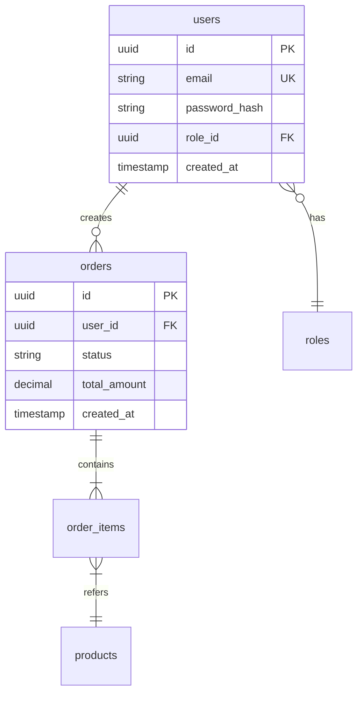
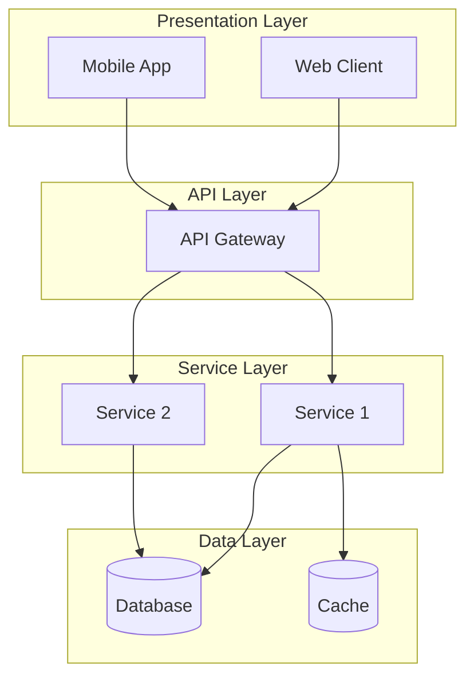
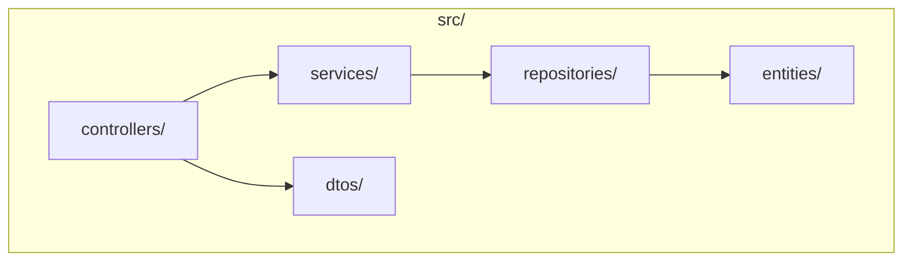
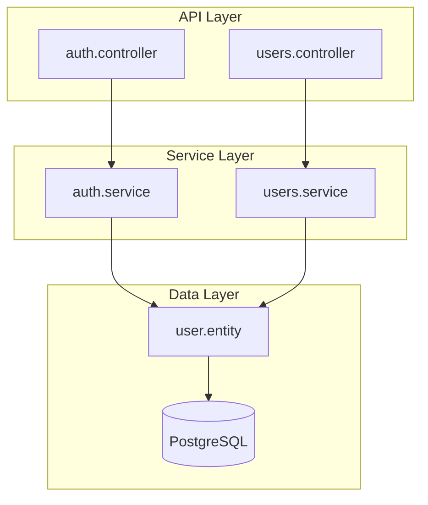

# HƯỚNG DẪN TOÀN DIỆN: TẠO LẠI TÀI LIỆU THIẾT KẾ CƠ SỞ (BASIC DESIGN) TỪ CODEBASE BẰNG AI

---

## 📋 MỤC LỤC

1. [Tổng quan về Reverse Engineering Basic Design](#1-tổng-quan)
2. [Đầu vào cần thiết](#2-đầu-vào)
3. [Quy trình phân tích codebase](#3-quy-trình-phân-tích)
4. [Cấu trúc thư mục tài liệu đầu ra](#4-cấu-trúc-thư-mục)
5. [Hướng dẫn chi tiết từng phần](#5-hướng-dẫn-chi-tiết)
6. [Template và mẫu](#6-template)
7. [Prompt System cho AI](#7-prompt-system)
8. [Checklist và Quality Assurance](#8-checklist)
9. [Ví dụ minh họa](#9-ví-dụ)

---

## 1. TỔNG QUAN VỀ REVERSE ENGINEERING BASIC DESIGN

### 1.1 Định nghĩa

```
┌─────────────────────────────────────────────────────────────────┐
│            REVERSE ENGINEERING BASIC DESIGN                     │
├─────────────────────────────────────────────────────────────────┤
│                                                                 │
│   Existing Codebase      Analyze & Extract      Basic Design    │
│   (Code có sẵn)     →    (Phân tích)       →   (Tài liệu BD)    │
│                                                                 │
│   ┌─────────────┐      ┌─────────────────┐    ┌──────────────┐  │
│   │ Source Code │  →   │ Understand      │ →  │ Document     │  │
│   │ + Structure │      │ Architecture    │    │ the Design   │  │
│   │ + Database  │      │ + Components    │    │              │  │
│   │ + APIs      │      │ + Data Model    │    │              │  │
│   └─────────────┘      └─────────────────┘    └──────────────┘  │
│                                                                 │
│   Ngược lại với Forward Engineering:                            │
│   Requirements → Design → Code                                  │
│                                                                 │
│   Reverse Engineering:                                          │
│   Code → Extract Design → Document                              │
│                                                                 │
└─────────────────────────────────────────────────────────────────┘
```

### 1.2 Mục đích của Reverse Engineering Basic Design

| Mục đích                     | Mô tả                                                  |
| ---------------------------- | ------------------------------------------------------ |
| **Tài liệu hóa legacy code** | Tạo tài liệu cho hệ thống cũ không có documentation    |
| **Hiểu hệ thống hiện tại**   | Giúp team mới hiểu kiến trúc và thiết kế của hệ thống  |
| **Chuẩn bị cho refactoring** | Tài liệu hóa trước khi tiến hành cải tiến/tái cấu trúc |
| **Knowledge transfer**       | Chuyển giao kiến thức giữa các team                    |
| **Compliance/Audit**         | Đáp ứng yêu cầu về tài liệu kỹ thuật cho audit         |
| **Maintenance planning**     | Hỗ trợ lập kế hoạch bảo trì và nâng cấp                |

### 1.3 So sánh với Forward Engineering

| Khía cạnh            | Forward Engineering            | Reverse Engineering              |
| -------------------- | ------------------------------ | -------------------------------- |
| **Điểm bắt đầu**     | Requirements/Specifications    | Existing Codebase                |
| **Mục tiêu**         | Tạo code từ thiết kế           | Tạo thiết kế từ code             |
| **Thách thức chính** | Đảm bảo thiết kế đúng yêu cầu  | Hiểu đúng ý đồ thiết kế từ code  |
| **Nguồn thông tin**  | Tài liệu yêu cầu, stakeholders | Code, database, config, comments |
| **Xác minh**         | Code phải match với design     | Design phải reflect đúng code    |

---

## 2. ĐẦU VÀO CẦN THIẾT

### 2.1 Tổng quan các nguồn đầu vào

```
┌─────────────────────────────────────────────────────────────────┐
│                    NGUỒN ĐẦU VÀO CHO REVERSE ENGINEERING        │
├─────────────────────────────────────────────────────────────────┤
│                                                                 │
│   ┌───────────────────┐    ┌───────────────────┐                │
│   │ 📄 TÀI LIỆU       │    │ 📁 CẤU TRÚC DỰ ÁN │                │
│   │ SUMMARY           │    │                   │                │
│   ├───────────────────┤    ├───────────────────┤                │
│   │ • README.md       │    │ • Folder tree     │                │
│   │ • Project docs    │    │ • Module layout   │                │
│   │ • API docs        │    │ • Config files    │                │
│   │ • Decision logs   │    │ • Build scripts   │                │
│   └───────────────────┘    └───────────────────┘                │
│                                                                 │
│   ┌───────────────────┐    ┌───────────────────┐                │
│   │ 💾 CODEBASE       │    │ 🗄️ DATABASE       │                │
│   │                   │    │                   │                │
│   ├───────────────────┤    ├───────────────────┤                │
│   │ • Source code     │    │ • Schema files    │                │
│   │ • Controllers     │    │ • Migration files │                │
│   │ • Services        │    │ • Entity models   │                │
│   │ • Models/Entities │    │ • ERD (nếu có)    │                │
│   │ • APIs/Routes     │    │                   │                │
│   │ • UI Components   │    │                   │                │
│   └───────────────────┘    └───────────────────┘                │
│                                                                 │
└─────────────────────────────────────────────────────────────────┘
```

### 2.2 Chi tiết từng nguồn đầu vào

#### 2.2.1 Tài liệu Summary (Nếu có)

| Loại tài liệu     | Mô tả                                      | Ưu tiên    |
| ----------------- | ------------------------------------------ | ---------- |
| README.md         | Tổng quan dự án, cách build, cấu hình      | Cao        |
| Project Charter   | Mục tiêu, phạm vi, stakeholders            | Cao        |
| API Documentation | Swagger/OpenAPI specs, Postman collections | Cao        |
| Decision Log      | Các quyết định thiết kế đã được ghi nhận   | Trung bình |
| Architecture Docs | Tài liệu kiến trúc có sẵn (nếu có)         | Cao        |
| User Guide        | Hướng dẫn sử dụng - giúp hiểu chức năng    | Trung bình |

#### 2.2.2 Cấu trúc thư mục và file dự án

```
📁 project-root/
├── 📄 package.json / pom.xml / build.gradle    ← Dependencies, versions
├── 📄 docker-compose.yml / Dockerfile          ← Infrastructure
├── 📄 .env.example                             ← Environment config
├── 📁 src/
│   ├── 📁 controllers/ / routes/               ← API endpoints
│   ├── 📁 services/ / usecases/                ← Business logic
│   ├── 📁 models/ / entities/                  ← Data models
│   ├── 📁 repositories/ / dao/                 ← Data access
│   ├── 📁 middlewares/                         ← Cross-cutting concerns
│   ├── 📁 utils/ / helpers/                    ← Utility functions
│   └── 📁 config/                              ← Configuration
├── 📁 database/
│   ├── 📁 migrations/                          ← Schema changes
│   ├── 📁 seeds/                               ← Initial data
│   └── 📁 schema/                              ← Schema definitions
├── 📁 tests/                                   ← Test files
└── 📁 docs/                                    ← Existing documentation
```

#### 2.2.3 Codebase - Các thành phần quan trọng cần phân tích

| Thành phần          | File patterns                             | Trích xuất được            |
| ------------------- | ----------------------------------------- | -------------------------- |
| **API/Routes**      | `*Controller.*`, `routes.*`, `*.router.*` | API endpoints, methods     |
| **Services**        | `*Service.*`, `*UseCase.*`                | Business logic             |
| **Models/Entities** | `*Model.*`, `*Entity.*`, `*.model.*`      | Data structure, ERD        |
| **DTOs**            | `*Dto.*`, `*Request.*`, `*Response.*`     | API contracts              |
| **Configs**         | `config.*`, `*.config.*`, `.env*`         | Technology stack, settings |
| **Database**        | `migrations/*`, `schema.*`                | Table structures           |
| **Tests**           | `*.spec.*`, `*.test.*`                    | Use cases, behaviors       |
| **UI Components**   | `*.component.*`, `*.tsx`, `*.vue`         | Screen designs             |

### 2.3 Template thu thập thông tin đầu vào

```markdown
# THÔNG TIN ĐẦU VÀO CHO REVERSE ENGINEERING

## 1. Thông tin dự án cơ bản

| Thông tin             | Giá trị                               |
| --------------------- | ------------------------------------- |
| Tên dự án             | [Tên dự án]                           |
| Đường dẫn source code | [Path to codebase]                    |
| Ngôn ngữ chính        | [Java/TypeScript/Python/Go/C#...]     |
| Framework             | [Spring/NestJS/Django/Gin/ASP.NET...] |
| Database              | [PostgreSQL/MySQL/MongoDB/...]        |

## 2. Tài liệu có sẵn

- [ ] README.md
- [ ] API Documentation (Swagger/OpenAPI)
- [ ] Architecture document
- [ ] Database schema/ERD
- [ ] User guide
- [ ] Deployment guide
- [ ] Khác: ******\_\_\_\_******

## 3. Phạm vi reverse engineering

- [ ] Full system (toàn bộ hệ thống)
- [ ] Specific modules: [Liệt kê các module]
- [ ] Specific areas:
  - [ ] System Architecture
  - [ ] Functional Design
  - [ ] Screen/UI Design
  - [ ] Data Design
  - [ ] API Design
  - [ ] Non-functional (Security, Performance)

## 4. Ngôn ngữ đầu ra mong muốn

- [ ] Tiếng Việt
- [ ] Tiếng Anh
- [ ] Tiếng Nhật
- [ ] Khác: ******\_\_\_\_******

## 5. Yêu cầu đặc biệt

[Ghi chú thêm nếu có]
```

---

## 3. QUY TRÌNH PHÂN TÍCH CODEBASE

### 3.1 Workflow tổng quan

```
┌──────────────────────────────────────────────────────────────────┐
│              QUY TRÌNH REVERSE ENGINEERING CODEBASE              │
└──────────────────────────────────────────────────────────────────┘
                              │
                              ▼
┌──────────────────────────────────────────────────────────────────┐
│ BƯỚC 1: THU THẬP & CHUẨN BỊ                                      │
├──────────────────────────────────────────────────────────────────┤
│ • Đọc tất cả tài liệu summary có sẵn                             │
│ • Phân tích cấu trúc thư mục project                             │
│ • Xác định technology stack từ config files                      │
│ • Liệt kê các module/component chính                             │
└──────────────────────────────────────────────────────────────────┘
                              │
                              ▼
┌──────────────────────────────────────────────────────────────────┐
│ BƯỚC 2: PHÂN TÍCH KIẾN TRÚC                                      │
├──────────────────────────────────────────────────────────────────┤
│ • Xác định architecture pattern (MVC, Clean, Hexagonal...)       │
│ • Vẽ component diagram từ folder structure                       │
│ • Phân tích dependencies và integrations                         │
│ • Xác định layers (Presentation, Business, Data)                 │
└──────────────────────────────────────────────────────────────────┘
                              │
                              ▼
┌──────────────────────────────────────────────────────────────────┐
│ BƯỚC 3: PHÂN TÍCH DỮ LIỆU                                        │
├──────────────────────────────────────────────────────────────────┤
│ • Extract entity/model definitions                               │
│ • Phân tích migrations để xây dựng ERD                           │
│ • Xác định relationships giữa các entities                       │
│ • Document table structures và indices                           │
└──────────────────────────────────────────────────────────────────┘
                              │
                              ▼
┌──────────────────────────────────────────────────────────────────┐
│ BƯỚC 4: PHÂN TÍCH CHỨC NĂNG & API                                │
├──────────────────────────────────────────────────────────────────┤
│ • Extract API endpoints từ controllers/routes                    │
│ • Phân tích request/response DTOs                                │
│ • Trace business logic từ services                               │
│ • Xác định use cases từ API và business flow                     │
└──────────────────────────────────────────────────────────────────┘
                              │
                              ▼
┌──────────────────────────────────────────────────────────────────┐
│ BƯỚC 5: PHÂN TÍCH UI/SCREEN (nếu có Frontend)                    │
├──────────────────────────────────────────────────────────────────┤
│ • Liệt kê các pages/screens từ routing config                    │
│ • Phân tích component hierarchy                                  │
│ • Extract form fields và validation rules                        │
│ • Document screen transitions                                    │
└──────────────────────────────────────────────────────────────────┘
                              │
                              ▼
┌──────────────────────────────────────────────────────────────────┐
│ BƯỚC 6: TỔNG HỢP & TẠO TÀI LIỆU                                  │
├──────────────────────────────────────────────────────────────────┤
│ • Compile tất cả findings vào các sections                       │
│ • Cross-reference và validate                                    │
│ • Format theo template chuẩn Basic Design                        │
│ • Review và hoàn thiện                                           │
└──────────────────────────────────────────────────────────────────┘
```

### 3.2 Chi tiết kỹ thuật phân tích

#### 3.2.1 Phân tích Technology Stack

```
TỪ FILE                    TRÍCH XUẤT ĐƯỢC
━━━━━━━━━━━━━━━━━━━━━━━━━━━━━━━━━━━━━━━━━━━━━━━━━━━━━━━━━━━━━━━
package.json            → Node.js dependencies, frameworks
pom.xml                 → Java/Spring dependencies
build.gradle            → Java/Gradle dependencies
requirements.txt        → Python dependencies
go.mod                  → Go modules
*.csproj                → .NET dependencies
docker-compose.yml      → Services, databases, caching
Dockerfile              → Runtime environment
.env.example            → Environment variables, configs
nginx.conf              → Web server, reverse proxy
```

#### 3.2.2 Mapping từ Code sang Design Elements

```
┌─────────────────────────┬──────────────────────────┬─────────────────────────┐
│  CODE ELEMENT           │     DESIGN ELEMENT       │   BASIC DESIGN SECTION  │
├─────────────────────────┼──────────────────────────┼─────────────────────────┤
│ Folder structure        │ System Architecture      │ 02-system-architecture  │
│ Config files            │ Technology Stack         │ 02-system-architecture  │
│ Entity/Model classes    │ ERD, Table Definitions   │ 05-data-design          │
│ Controller/Routes       │ API List, Endpoints      │ 06-api-design           │
│ Service classes         │ Business Logic           │ 03-functional-design    │
│ DTOs                    │ Request/Response Format  │ 06-api-design           │
│ Middleware              │ Cross-cutting Concerns   │ 08-non-functional       │
│ UI Components           │ Screen Design            │ 04-screen-design        │
│ Route config (frontend) │ Screen Transition        │ 04-screen-design        │
│ Validation decorators   │ Validation Rules         │ 04-screen-design        │
│ Error handlers          │ Error Handling           │ 09-error-handling       │
│ Test files              │ Use Cases, Behaviors     │ 03-functional-design    │
│ Security configs        │ Security Design          │ 08-non-functional       │
└─────────────────────────┴──────────────────────────┴─────────────────────────┘
```

#### 3.2.3 Phân tích Entity/Model để tạo ERD

**Input (Entity Class):**

```typescript
// TypeScript/NestJS example
@Entity()
export class User {
  @PrimaryGeneratedColumn("uuid")
  id: string;

  @Column({ unique: true })
  email: string;

  @Column()
  passwordHash: string;

  @ManyToOne(() => Role, (role) => role.users)
  role: Role;

  @OneToMany(() => Order, (order) => order.user)
  orders: Order[];

  @CreateDateColumn()
  createdAt: Date;
}
```

**Output (Table Definition):**

| No  | Column Name   | Logical Name  | Data Type    | PK  | FK  | NN  | Description    |
| --- | ------------- | ------------- | ------------ | --- | --- | --- | -------------- |
| 1   | id            | User ID       | UUID         | ○   |     | ○   | Primary key    |
| 2   | email         | Email         | VARCHAR(255) |     |     | ○   | Unique         |
| 3   | password_hash | Password Hash | VARCHAR(255) |     |     | ○   | Encrypted      |
| 4   | role_id       | Role ID       | UUID         |     | ○   | ○   | FK to roles    |
| 5   | created_at    | Created At    | TIMESTAMP    |     |     | ○   | Auto-generated |

#### 3.2.4 Phân tích Controller để tạo API Specification

**Input (Controller):**

```typescript
// NestJS example
@Controller("users")
export class UserController {
  @Post()
  @UseGuards(AuthGuard, RoleGuard("admin"))
  async create(@Body() dto: CreateUserDto): Promise<UserResponseDto> {
    return this.userService.create(dto);
  }

  @Get()
  @UseGuards(AuthGuard)
  async findAll(
    @Query("page") page: number = 1,
    @Query("size") size: number = 10,
    @Query("search") search?: string
  ): Promise<PaginatedResponse<UserResponseDto>> {
    return this.userService.findAll({ page, size, search });
  }
}
```

**Output (API List):**

| ID     | Endpoint   | Method | Description     | Auth Required | Role  |
| ------ | ---------- | ------ | --------------- | ------------- | ----- |
| API001 | /api/users | POST   | Create new user | Yes           | admin |
| API002 | /api/users | GET    | Get user list   | Yes           | any   |

---

## 4. CẤU TRÚC THƯ MỤC TÀI LIỆU ĐẦU RA

> ⚠️ **QUAN TRỌNG**: Output của Reverse Engineering tuân theo cùng format với Basic Design Document tiêu chuẩn để đảm bảo tính nhất quán.

### 4.1 Cấu trúc thư mục chuẩn

Tên thư mục được đặt theo ngôn ngữ của tài liệu:

- Tiếng Việt: `Tài liệu Thiết kế Cơ sở`
- Tiếng Anh: `Basic Design Document`
- Tiếng Nhật: `基本設計書`

```
📁 [Tên thư mục chứa tài liệu]/
├── 📁 Basic Design Document/           # Hoặc tên theo ngôn ngữ phù hợp
│   ├── 📄 _index.md                     # File index - BẮT BUỘC
│   ├── 📄 01-system-overview.md         # Tổng quan hệ thống
│   ├── 📄 02-system-architecture.md     # Kiến trúc hệ thống
│   ├── 📄 03-functional-design.md       # Thiết kế chức năng
│   ├── 📄 04-screen-design.md           # Thiết kế giao diện
│   ├── 📄 05-data-design.md             # Thiết kế dữ liệu
│   ├── 📄 06-api-design.md              # Thiết kế API
│   ├── 📄 07-batch-design.md            # Thiết kế Batch (nếu có)
│   ├── 📄 08-non-functional.md          # Yêu cầu phi chức năng
│   ├── 📄 09-error-handling.md          # Xử lý lỗi
│   └── 📄 10-appendix.md                # Phụ lục
```

### 4.2 File Index (\_index.md) - Template cho Reverse Engineering

```markdown
# [TÊN DỰ ÁN] - Tài liệu Thiết kế Cơ sở (Reverse Engineered)

## Thông tin tài liệu

| Thông tin               | Giá trị                          |
| ----------------------- | -------------------------------- |
| Tên dự án               | [Project Name]                   |
| Nguồn gốc               | Reverse Engineered from Codebase |
| Phiên bản code analyzed | [Git commit hash / version]      |
| Ngày tạo                | [DD/MM/YYYY]                     |
| Trạng thái              | Draft / Review / Approved        |

## Tổng quan dự án

[Mô tả ngắn gọn về dự án được trích xuất từ README hoặc phân tích code - 3-5 câu]

## Nguồn dữ liệu phân tích

| Nguồn           | Đường dẫn/Mô tả             |
| --------------- | --------------------------- |
| Source Code     | [Path to codebase]          |
| Tài liệu có sẵn | [List existing docs]        |
| Database Schema | [Path to schema/migrations] |
| API Docs        | [Path to Swagger/OpenAPI]   |

## Cấu trúc tài liệu

| STT | File                                                     | Nội dung chính        | Mô tả                                                 |
| --- | -------------------------------------------------------- | --------------------- | ----------------------------------------------------- |
| 1   | [01-system-overview.md](./01-system-overview.md)         | Tổng quan hệ thống    | Mục đích, phạm vi, đối tượng sử dụng, thuật ngữ       |
| 2   | [02-system-architecture.md](./02-system-architecture.md) | Kiến trúc hệ thống    | Sơ đồ kiến trúc, component diagram, technology stack  |
| 3   | [03-functional-design.md](./03-functional-design.md)     | Thiết kế chức năng    | Danh sách chức năng, use case, business flow          |
| 4   | [04-screen-design.md](./04-screen-design.md)             | Thiết kế giao diện    | Screen transition, screen list, screen specifications |
| 5   | [05-data-design.md](./05-data-design.md)                 | Thiết kế dữ liệu      | ERD, table definitions, data dictionary               |
| 6   | [06-api-design.md](./06-api-design.md)                   | Thiết kế API          | API list, API specifications, external interfaces     |
| 7   | [07-batch-design.md](./07-batch-design.md)               | Thiết kế Batch        | Batch job list, schedule, processing flow             |
| 8   | [08-non-functional.md](./08-non-functional.md)           | Yêu cầu phi chức năng | Performance, security, availability                   |
| 9   | [09-error-handling.md](./09-error-handling.md)           | Xử lý lỗi             | Error code system, error handling strategy            |
| 10  | [10-appendix.md](./10-appendix.md)                       | Phụ lục               | Traceability matrix, permission matrix, open issues   |

## Thông tin chính cho AI Context

### Actors/Users (Extracted from Auth/Role system)

- [Actor 1]: [Mô tả vai trò và quyền hạn chính]
- [Actor 2]: [Mô tả vai trò và quyền hạn chính]

### Modules/Services chính (Extracted from folder structure)

- [Module 1]: [Chức năng chính]
- [Module 2]: [Chức năng chính]

### Technology Stack (Extracted from config files)

- Frontend: [Technologies + Versions]
- Backend: [Technologies + Versions]
- Database: [Technologies + Versions]
- Infrastructure: [Technologies]

### Lưu ý về Reverse Engineering

- ⚠️ Tài liệu này được tạo từ phân tích code, có thể thiếu một số business context
- ⚠️ Một số design decisions có thể cần xác nhận với đội phát triển gốc
- ⚠️ [Các assumptions đã đưa ra trong quá trình phân tích]

---

_File này được tạo tự động từ quá trình Reverse Engineering._
```

---

## 5. HƯỚNG DẪN CHI TIẾT TỪNG PHẦN

### 5.1 Trích xuất System Overview

**Nguồn dữ liệu:**

- README.md
- Package description (package.json, pom.xml)
- Project documentation
- Comments trong code

**Output cần tạo:**

```markdown
## 1. Tổng quan hệ thống

### 1.1 Mục đích hệ thống

[Trích xuất từ README.md hoặc suy luận từ code]

### 1.2 Phạm vi hệ thống

**Trong phạm vi (Inferred from codebase):**

- [Feature 1 - có trong code]
- [Feature 2 - có trong code]

**Ngoài phạm vi (Not found in codebase):**

- [Feature có thể cần nhưng chưa implement]

### 1.3 Đối tượng sử dụng

| Actor    | Mô tả         | Quyền hạn chính | Extracted from   |
| -------- | ------------- | --------------- | ---------------- |
| [Role 1] | [Description] | [Permissions]   | Role entity/enum |
| [Role 2] | [Description] | [Permissions]   | Auth guards      |

### 1.4 Thuật ngữ

| Thuật ngữ | Định nghĩa   | Source        |
| --------- | ------------ | ------------- |
| [Term 1]  | [Definition] | Entity name   |
| [Term 2]  | [Definition] | Domain folder |
```

### 5.2 Trích xuất System Architecture

**Nguồn dữ liệu:**

- Folder structure
- Config files (docker-compose.yml, deployment configs)
- Package dependencies
- Import statements

**Cách phân tích Architecture Pattern:**

```
FOLDER STRUCTURE                     → ARCHITECTURE PATTERN
━━━━━━━━━━━━━━━━━━━━━━━━━━━━━━━━━━━━━━━━━━━━━━━━━━━━━━━━━━━━━━━━━━━
src/
├── controllers/
├── services/
├── repositories/                    → Layered Architecture (MVC)
└── models/

src/
├── application/ (use-cases)
├── domain/ (entities)
├── infrastructure/ (repos, APIs)    → Clean Architecture
└── presentation/ (controllers)

src/
├── modules/
│   ├── user/
│   │   ├── controller
│   │   ├── service
│   │   └── repository                → Modular Monolith
│   └── order/
│       ├── ...

services/
├── user-service/
├── order-service/
└── payment-service/                  → Microservices
```

### 5.3 Trích xuất Data Design

**Nguồn dữ liệu:**

- Entity/Model classes
- Migration files
- TypeORM/Prisma/Sequelize schemas
- Database configuration

**Quy trình:**

```
1. COLLECT ENTITIES
   └── Scan files: *Entity.*, *Model.*, *.entity.*, *.model.*

2. EXTRACT COLUMNS
   └── Parse decorators: @Column, @PrimaryKey, @ForeignKey, etc.

3. IDENTIFY RELATIONSHIPS
   └── Parse: @OneToMany, @ManyToOne, @ManyToMany, @BelongsTo, etc.

4. BUILD ERD
   └── Create Mermaid diagram

5. DOCUMENT TABLES
   └── Generate table specifications
```

**Mermaid ERD Template từ Code:**



### 5.4 Trích xuất API Design

**Nguồn dữ liệu:**

- Controller/Route files
- DTO classes
- OpenAPI/Swagger annotations
- Middleware configurations

**Output Format:**

````markdown
## API List

| ID      | Endpoint          | Method | Description     | Auth | Role  | Source File          |
| ------- | ----------------- | ------ | --------------- | ---- | ----- | -------------------- |
| API-001 | /api/v1/users     | POST   | Create user     | ✓    | admin | UserController.ts:15 |
| API-002 | /api/v1/users     | GET    | List users      | ✓    | any   | UserController.ts:28 |
| API-003 | /api/v1/users/:id | GET    | Get user detail | ✓    | any   | UserController.ts:42 |

## API Specification: API-001 - Create User

### Endpoint Information

| Item          | Value                |
| ------------- | -------------------- |
| URL           | /api/v1/users        |
| Method        | POST                 |
| Source        | UserController.ts:15 |
| Auth Required | Yes (Bearer Token)   |
| Required Role | admin                |

### Request Body (from CreateUserDto)

```json
{
  "email": "string (required, email format)",
  "password": "string (required, min 8 chars)",
  "firstName": "string (required)",
  "lastName": "string (required)",
  "roleId": "uuid (required)"
}
```
````

### Response (from UserResponseDto)

```json
{
  "success": true,
  "data": {
    "id": "uuid",
    "email": "string",
    "firstName": "string",
    "lastName": "string",
    "role": {
      "id": "uuid",
      "name": "string"
    },
    "createdAt": "timestamp"
  }
}
```

````

### 5.5 Trích xuất Screen Design (Frontend)

**Nguồn dữ liệu:**
- Router configuration
- Page/View components
- Form components
- State management (Redux, Vuex, etc.)

**Phân tích Route để tạo Screen List:**

```typescript
// Input: React Router / Vue Router / Next.js pages
const routes = [
  { path: '/login', component: LoginPage },
  { path: '/dashboard', component: DashboardPage },
  { path: '/users', component: UserListPage },
  { path: '/users/:id', component: UserDetailPage },
  { path: '/users/create', component: UserFormPage },
];
````

**Output:**

| Screen ID | Screen Name | URL Pattern   | Component      | Access Level  |
| --------- | ----------- | ------------- | -------------- | ------------- |
| SCR-001   | Login       | /login        | LoginPage      | Guest         |
| SCR-002   | Dashboard   | /dashboard    | DashboardPage  | Authenticated |
| SCR-003   | User List   | /users        | UserListPage   | Admin         |
| SCR-004   | User Detail | /users/:id    | UserDetailPage | Admin         |
| SCR-005   | User Form   | /users/create | UserFormPage   | Admin         |

### 5.6 Trích xuất Error Handling

**Nguồn dữ liệu:**

- Exception/Error classes
- Error handling middleware
- Error response DTOs
- HTTP status codes used

**Output Format:**

````markdown
## Error Code System (Extracted from codebase)

### Error Code Format

[Extracted from error class naming convention]

### Error Code List

| Code           | HTTP | Message              | Source            |
| -------------- | ---- | -------------------- | ----------------- |
| AUTH_001       | 401  | Invalid credentials  | AuthException.ts  |
| AUTH_002       | 401  | Token expired        | JwtGuard.ts       |
| USER_001       | 404  | User not found       | UserService.ts    |
| USER_002       | 409  | Email already exists | UserService.ts    |
| VALIDATION_001 | 400  | Validation failed    | ValidationPipe.ts |

### Error Response Format (Extracted from ErrorResponseDto)

```json
{
  "success": false,
  "error": {
    "code": "string",
    "message": "string",
    "details": "object (optional)"
  },
  "timestamp": "ISO timestamp",
  "path": "string"
}
```
````

````

---

## 6. TEMPLATE VÀ MẪU

### 6.1 Template File 01-system-overview.md

```markdown
# Tổng quan hệ thống

## 1. Thông tin tài liệu

| Mục | Nội dung |
|-----|----------|
| Document Status | Reverse Engineered |
| Source Codebase | [Path/Git URL] |
| Analysis Date | [Date] |
| Code Version | [Git commit/tag] |

## 2. Mục đích hệ thống

[Extracted from README.md or inferred from code analysis]

### 2.1 Mô tả tổng quan

[Description]

### 2.2 Bối cảnh sử dụng

[Inferred from code structure and features]

## 3. Phạm vi hệ thống

### 3.1 Trong phạm vi

| STT | Chức năng | Evidence in Code |
|-----|-----------|------------------|
| 1 | [Feature 1] | [Controller/Service name] |
| 2 | [Feature 2] | [Controller/Service name] |

### 3.2 Ngoài phạm vi

[Features not found in codebase]

## 4. Đối tượng sử dụng (Actors)

| Actor | Description | Permissions | Source |
|-------|-------------|-------------|--------|
| [Role 1] | [Desc] | [Perms] | [Role enum/entity] |

## 5. Thuật ngữ & Định nghĩa

| Thuật ngữ | Định nghĩa | Nguồn |
|-----------|------------|-------|
| [Term] | [Definition] | [Entity/Domain] |

## 6. Giả định trong quá trình phân tích

| STT | Giả định | Lý do |
|-----|----------|-------|
| 1 | [Assumption] | [Reason] |

---
_Generated by Reverse Engineering process_
````

### 6.2 Template File 02-system-architecture.md

````markdown
# Kiến trúc hệ thống

## 1. Sơ đồ kiến trúc tổng quan

[Mermaid diagram vẽ từ phân tích code structure]


````

## 2. Architecture Pattern

| Pattern        | Evidence                              |
| -------------- | ------------------------------------- |
| [Pattern name] | [Folder structure, code organization] |

## 3. Technology Stack

### 3.1 Extracted from package.json / pom.xml / etc.

| Layer             | Technology | Version | Purpose   |
| ----------------- | ---------- | ------- | --------- |
| Backend Framework | [Name]     | [x.x.x] | [Purpose] |
| Database          | [Name]     | [x.x.x] | [Purpose] |
| ORM               | [Name]     | [x.x.x] | [Purpose] |
| Cache             | [Name]     | [x.x.x] | [Purpose] |
| Message Queue     | [Name]     | [x.x.x] | [Purpose] |

### 3.2 Infrastructure (from docker-compose.yml, Dockerfile)

| Service   | Image/Config | Port   | Purpose   |
| --------- | ------------ | ------ | --------- |
| [Service] | [Image]      | [Port] | [Purpose] |

## 4. Component Diagram



## 5. Module Dependencies

| Module     | Dependencies | Dependents |
| ---------- | ------------ | ---------- |
| [Module 1] | [List]       | [List]     |

---

_Generated by Reverse Engineering process_

````

### 6.3 Template File 05-data-design.md

```markdown
# Thiết kế dữ liệu

## 1. Tổng quan

| Mục | Giá trị |
|-----|---------|
| Database Type | [PostgreSQL/MySQL/MongoDB/...] |
| ORM/ODM | [TypeORM/Prisma/Mongoose/...] |
| Entity Count | [Number] |
| Source Files | [Path to entities/] |

## 2. Entity Relationship Diagram

```mermaid
erDiagram
    %% Auto-generated from entity analysis

    ENTITY1 ||--o{ ENTITY2 : relationship
    ENTITY2 }o--|| ENTITY3 : relationship

    ENTITY1 {
        type column_name PK
        type column_name FK
        type column_name
    }
````

## 3. Danh sách bảng

| No  | Table Name (Physical) | Table Name (Logical) | Description | Source File |
| --- | --------------------- | -------------------- | ----------- | ----------- |
| 1   | [table_name]          | [Logical Name]       | [Desc]      | [entity.ts] |

## 4. Chi tiết bảng

### 4.1 Table: [table_name]

**Source:** `src/entities/[Entity].ts`

| No  | Column Name | Logical Name | Data Type | PK  | FK  | NN  | Default | Description |
| --- | ----------- | ------------ | --------- | --- | --- | --- | ------- | ----------- |
| 1   | id          | ID           | UUID      | ○   |     | ○   | auto    | Primary key |
| 2   | ...         | ...          | ...       |     |     |     |         |             |

**Indexes (from entity decorators or migration):**

| Index Name | Columns | Unique | Source             |
| ---------- | ------- | ------ | ------------------ |
| [name]     | [cols]  | ○/-    | [@Index decorator] |

**Relationships:**

| Relationship | Target Entity | Type      | Description |
| ------------ | ------------- | --------- | ----------- |
| [column]     | [Entity]      | ManyToOne | [Desc]      |

---

_Generated by Reverse Engineering process_

````

---

## 7. PROMPT SYSTEM CHO AI

### 7.1 System Prompt

```markdown
# SYSTEM PROMPT: REVERSE ENGINEERING BASIC DESIGN DOCUMENT GENERATOR

## ROLE
Bạn là Senior Solution Architect chuyên về Reverse Engineering. Nhiệm vụ của bạn là phân tích codebase có sẵn và tạo ra tài liệu Basic Design chuyên nghiệp.

## EXPERTISE
- Code Analysis và Pattern Recognition
- Software Architecture (nhận dạng patterns từ code)
- Database Schema Analysis
- API/Interface Extraction
- Documentation generation

## INPUT PROCESSING RULES

### Rule 1: Source Analysis Priority
1. Đọc và phân tích tài liệu summary có sẵn (README, docs)
2. Phân tích cấu trúc thư mục để hiểu architecture
3. Phân tích config files để xác định technology stack
4. Phân tích entities/models để xây dựng data design
5. Phân tích controllers/routes để extract API design
6. Phân tích UI components để document screen design

### Rule 2: Extraction Guidelines
- Mọi thông tin PHẢI có source reference (file path, line number)
- Không suy đoán không có căn cứ - ghi chú là "Inferred" nếu suy luận
- Ghi nhận các assumptions đã đưa ra
- Cross-reference giữa các phần (Entity ↔ API ↔ Screen)

### Rule 3: Output Format
- Sử dụng Markdown format chuẩn
- Bao gồm diagrams (Mermaid preferred)
- Tables với đầy đủ columns
- Code snippets khi cần minh họa
- Source references cho mọi thông tin

### Rule 4: Quality Standards
- Accurate: Phản ánh đúng code hiện tại
- Complete: Không bỏ sót components chính
- Traceable: Có thể trace về code gốc
- Readable: Dễ hiểu cho người mới

## OUTPUT SECTIONS
Tạo đầy đủ các sections theo template Basic Design:
1. System Overview
2. System Architecture
3. Functional Design
4. Screen Design
5. Data Design
6. API Design
7. Batch Design (if applicable)
8. Non-functional (Security, Performance)
9. Error Handling
10. Appendix

## SPECIAL NOTES FOR REVERSE ENGINEERING
- Luôn ghi chú phiên bản code đang phân tích
- Đánh dấu các phần cần xác nhận với team gốc
- Ghi nhận các inconsistencies phát hiện trong code
- Đề xuất improvements nếu phát hiện issues
````

### 7.2 User Prompt Template

```markdown
# REQUEST: TẠO TÀI LIỆU BASIC DESIGN TỪ CODEBASE

## THÔNG TIN DỰ ÁN

### Tên dự án: [Project Name]

### Đường dẫn codebase: [Path]

### Tài liệu có sẵn:

- README: [Path or content]
- API Docs: [Path - Swagger/OpenAPI]
- Other docs: [List]

### Cấu trúc thư mục:
```

[Paste folder tree]

```

### Technology Stack (nếu đã biết):
- Backend: [Framework/Version]
- Frontend: [Framework/Version]
- Database: [Type/Version]

## YÊU CẦU ĐẦU RA

### Ngôn ngữ: [Tiếng Việt / English / 日本語]

### Sections cần tạo:
- [ ] Tất cả sections
- [ ] Chọn cụ thể: [1,2,3...]

### Mức độ chi tiết:
- [ ] Overview only
- [ ] Full detail

### Yêu cầu đặc biệt:
[Ghi chú thêm]

---

Hãy phân tích codebase và tạo tài liệu Basic Design hoàn chỉnh.
```

### 7.3 Prompt cho từng phần

#### Prompt phân tích Architecture:

```markdown
# PROMPT: ANALYZE & DOCUMENT SYSTEM ARCHITECTURE

## Input

- Folder structure: [Tree output]
- Package.json / pom.xml / build.gradle content
- Docker-compose.yml content (if exists)
- Main entry point file

## Tasks

1. Identify architecture pattern (MVC, Clean, Hexagonal, etc.)
2. List all layers and their responsibilities
3. Identify external dependencies and integrations
4. Create architecture diagram (Mermaid)
5. Document technology stack with versions

## Output Format

Follow template in 02-system-architecture.md
Include source references for all claims
```

#### Prompt phân tích Data Design:

```markdown
# PROMPT: EXTRACT DATA DESIGN FROM ENTITIES

## Input

- Entity/Model files: [List of files]
- Migration files: [List if available]
- Database config

## Tasks

1. List all entities with their source files
2. Extract all columns with types, constraints
3. Identify relationships (1:1, 1:N, N:N)
4. Create ERD diagram (Mermaid)
5. Document indexes and constraints

## Output Format

Follow template in 05-data-design.md
Include source file and line numbers
```

#### Prompt phân tích API:

```markdown
# PROMPT: EXTRACT API DESIGN FROM CONTROLLERS

## Input

- Controller/Route files: [List]
- DTO files: [List]
- Middleware/Guard files: [List]

## Tasks

1. List all API endpoints with methods
2. Extract request/response DTOs
3. Identify authentication requirements
4. Document business logic flow
5. Extract error responses

## Output Format

Follow template in 06-api-design.md
Include source file references
```

---

## 8. CHECKLIST VÀ QUALITY ASSURANCE

### 8.1 Pre-Analysis Checklist

```markdown
# CHECKLIST TRƯỚC KHI PHÂN TÍCH

## Thông tin dự án

- [ ] Đã có access vào codebase
- [ ] Đã xác định được version/commit đang phân tích
- [ ] Đã thu thập các tài liệu có sẵn

## Chuẩn bị môi trường

- [ ] Có thể navigate trong codebase
- [ ] Đã xác định được main entry points
- [ ] Đã hiểu basic folder structure

## Xác nhận scope

- [ ] Đã xác định modules cần phân tích
- [ ] Đã xác định ngôn ngữ output
- [ ] Đã xác định mức độ chi tiết cần thiết
```

### 8.2 Post-Generation Checklist

```markdown
# CHECKLIST SAU KHI TẠO TÀI LIỆU

## Hoàn thiện nội dung

- [ ] \_index.md có đầy đủ thông tin tổng quan
- [ ] Tất cả sections đã được tạo
- [ ] Mỗi section có source references

## Kiểm tra tính chính xác

- [ ] ERD phản ánh đúng entities trong code
- [ ] API list đầy đủ các endpoints
- [ ] Screen list match với route configuration
- [ ] Technology stack đúng với package files

## Kiểm tra tính nhất quán

- [ ] Naming conventions thống nhất
- [ ] Cross-references giữa sections chính xác
- [ ] ID format thống nhất (SCR-xxx, API-xxx, TBL-xxx)

## Ghi chú & Cảnh báo

- [ ] Đã ghi chú các assumptions
- [ ] Đã đánh dấu phần cần xác nhận
- [ ] Đã ghi nhận inconsistencies (nếu có)

## Format & Presentation

- [ ] Markdown syntax đúng
- [ ] Mermaid diagrams render được
- [ ] Tables format đúng
- [ ] Links hoạt động
```

### 8.3 Verification Matrix

```markdown
| Design Element  | Verification Method     | Source Check |
| --------------- | ----------------------- | ------------ |
| System Overview | README.md match         | ○            |
| Architecture    | Folder structure match  | ○            |
| Data Design     | Entity files match      | ○            |
| API Design      | Controller files match  | ○            |
| Screen Design   | Router/Pages match      | ○            |
| Error Handling  | Exception classes match | ○            |
| Tech Stack      | Package files match     | ○            |
```

---

## 9. VÍ DỤ MINH HỌA

### 9.1 Sample Input

#### Cấu trúc thư mục:

```
my-api/
├── package.json
├── docker-compose.yml
├── README.md
├── src/
│   ├── main.ts
│   ├── app.module.ts
│   ├── modules/
│   │   ├── auth/
│   │   │   ├── auth.controller.ts
│   │   │   ├── auth.service.ts
│   │   │   ├── dto/
│   │   │   │   ├── login.dto.ts
│   │   │   │   └── register.dto.ts
│   │   │   └── guards/
│   │   │       └── jwt.guard.ts
│   │   └── users/
│   │       ├── users.controller.ts
│   │       ├── users.service.ts
│   │       ├── dto/
│   │       │   ├── create-user.dto.ts
│   │       │   └── update-user.dto.ts
│   │       └── entities/
│   │           └── user.entity.ts
│   ├── shared/
│   │   ├── entities/
│   │   │   └── base.entity.ts
│   │   └── exceptions/
│   │       └── http-exception.filter.ts
│   └── database/
│       └── migrations/
│           ├── 001-create-users.ts
│           └── 002-add-roles.ts
└── test/
```

#### Package.json (excerpt):

```json
{
  "name": "my-api",
  "dependencies": {
    "@nestjs/common": "^10.0.0",
    "@nestjs/core": "^10.0.0",
    "@nestjs/typeorm": "^10.0.0",
    "typeorm": "^0.3.17",
    "pg": "^8.11.0",
    "passport-jwt": "^4.0.1"
  }
}
```

### 9.2 Sample Output (Excerpt)

#### 02-system-architecture.md (excerpt):

````markdown
# Kiến trúc hệ thống

## 1. Architecture Pattern

| Pattern          | Evidence                                                 |
| ---------------- | -------------------------------------------------------- |
| Modular Monolith | `src/modules/` structure with separate domains           |
| MVC-like         | Controller → Service → Repository pattern in each module |

## 2. Technology Stack

| Layer             | Technology   | Version | Source                         |
| ----------------- | ------------ | ------- | ------------------------------ |
| Backend Framework | NestJS       | 10.0.0  | package.json                   |
| ORM               | TypeORM      | 0.3.17  | package.json                   |
| Database          | PostgreSQL   | -       | docker-compose.yml, pg package |
| Authentication    | Passport JWT | 4.0.1   | package.json, jwt.guard.ts     |

## 3. Component Diagram


````

## 4. Module Dependencies

| Module | Path               | Dependencies |
| ------ | ------------------ | ------------ |
| Auth   | src/modules/auth/  | users        |
| Users  | src/modules/users/ | shared       |
| Shared | src/shared/        | -            |

---

_Extracted from: src/ folder structure_
_Analyzed: 2024-01-15_

````

#### 06-api-design.md (excerpt):

```markdown
# Thiết kế API

## 1. API List

| ID | Endpoint | Method | Description | Auth | Source |
|----|----------|--------|-------------|------|--------|
| API-AUTH-001 | /auth/login | POST | User login | No | auth.controller.ts:15 |
| API-AUTH-002 | /auth/register | POST | User registration | No | auth.controller.ts:28 |
| API-USER-001 | /users | GET | Get all users | Yes (JWT) | users.controller.ts:12 |
| API-USER-002 | /users/:id | GET | Get user by ID | Yes (JWT) | users.controller.ts:22 |
| API-USER-003 | /users | POST | Create user | Yes (JWT, Admin) | users.controller.ts:32 |

## 2. API Specification: API-AUTH-001

### Endpoint Information

| Item | Value | Source |
|------|-------|--------|
| URL | /auth/login | auth.controller.ts:15 |
| Method | POST | @Post() decorator |
| Auth Required | No | No guard decorator |

### Request Body (from LoginDto)

```typescript
// Source: src/modules/auth/dto/login.dto.ts
export class LoginDto {
  @IsEmail()
  email: string;

  @IsString()
  @MinLength(8)
  password: string;
}
````

| Field    | Type   | Required | Validation   | Source        |
| -------- | ------ | -------- | ------------ | ------------- |
| email    | string | Yes      | Email format | @IsEmail()    |
| password | string | Yes      | Min 8 chars  | @MinLength(8) |

---

_Extracted from: src/modules/auth/_

```

---

## 10. KẾT LUẬN

### Tóm tắt quy trình

```

┌─────────────────────────────────────────────────────────────────┐
│ REVERSE ENGINEERING WORKFLOW TỔNG QUAN │
├─────────────────────────────────────────────────────────────────┤
│ │
│ 1. COLLECT INPUTS │
│ ├── Tài liệu summary (README, docs) │
│ ├── Cấu trúc thư mục project │
│ └── Codebase (entities, controllers, services) │
│ │ │
│ ▼ │
│ 2. ANALYZE CODEBASE │
│ ├── Identify architecture pattern │
│ ├── Extract technology stack │
│ ├── Analyze entities → ERD │
│ ├── Analyze controllers → API specs │
│ └── Analyze UI → Screen design │
│ │ │
│ ▼ │
│ 3. GENERATE DOCUMENTATION │
│ ├── System Overview │
│ ├── System Architecture │
│ ├── Functional Design │
│ ├── Screen Design │
│ ├── Data Design │
│ ├── API Design │
│ ├── Non-functional │
│ └── Error Handling │
│ │ │
│ ▼ │
│ 4. VALIDATE & REFINE │
│ ├── Cross-reference all sections │
│ ├── Verify against source code │
│ └── Document assumptions │
│ │ │
│ ▼ │
│ 5. OUTPUT │
│ └── Basic Design Document (Complete) │
│ │
└─────────────────────────────────────────────────────────────────┘

```

### Điểm khác biệt quan trọng so với Forward Engineering

| Aspect | Forward Engineering | Reverse Engineering |
|--------|---------------------|---------------------|
| Input | Requirements doc | Codebase + optional docs |
| Source of truth | Design document | Source code |
| Verification | Code matches design | Design matches code |
| Assumptions | Documented upfront | Discovered during analysis |
| Missing info | Ask stakeholders | Infer from code + mark |

### Best Practices

1. **Luôn ghi source reference** - Mọi thông tin phải có thể trace về code gốc
2. **Document assumptions** - Ghi rõ các giả định khi thông tin không rõ ràng
3. **Cross-validate** - Đảm bảo các phần liên kết với nhau (Entity ↔ API ↔ Screen)
4. **Version tracking** - Ghi rõ version/commit code đang phân tích
5. **Flag uncertainties** - Đánh dấu các phần cần xác nhận với team gốc
```
