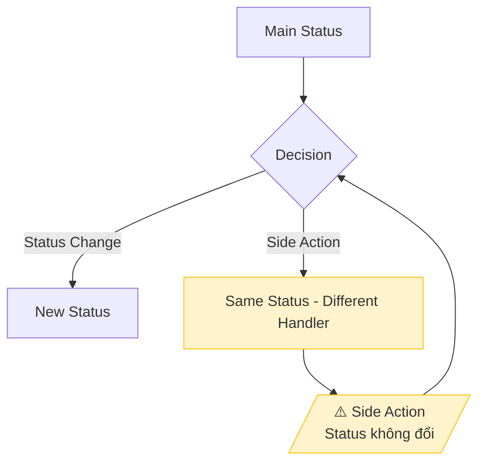

# BD Side Actions Guide

> Hướng dẫn phân loại và ghi chép Side Actions cho team phát triển

## 1. Phân loại các loại Action trong hệ thống

| Loại Action           | Mô tả                                    | Ảnh hưởng                    | Ví dụ                           |
| --------------------- | ---------------------------------------- | ---------------------------- | ------------------------------- |
| **Status Transition** | Thay đổi status chính của entity         | Entity status thay đổi       | Submit, Approve, Reject         |
| **Side Action**       | Hành động phụ trợ, KHÔNG thay đổi status | Metadata/Assignment thay đổi | Escalation, Delegation, Comment |
| **Background Action** | Hành động tự động của hệ thống           | Tùy thuộc logic              | Reminder, Auto-lock             |

## 2. Yêu cầu ghi chép cho mỗi loại Action

### A. Status Transition (Bắt buộc trong Lifecycle Flow)

Flowchart PHẢI thể hiện:

- [ ] Tất cả possible status
- [ ] Tất cả transitions giữa các status
- [ ] Trigger/Actor cho mỗi transition
- [ ] Điều kiện (nếu có)

### B. Side Actions (Bắt buộc ghi rõ)

Với MỖI side action, PHẢI có section riêng giải thích:

```markdown
### [Tên Action] について

> ⚠️ **重要**: [Tên Action]はステータス遷移ではなく、**[mô tả thay đổi]**です。

#### 使用ケース (Khi nào dùng)

| ケース   | 説明    | 例             |
| -------- | ------- | -------------- |
| [Case 1] | [Mô tả] | [Ví dụ cụ thể] |

#### フロー (Luồng xử lý)

[Sequence diagram]

#### ポイント (Điểm quan trọng cho dev)

1. **Không thay đổi status**: [giải thích]
2. **Thay đổi gì**: [field nào, table nào]
3. **Lịch sử**: [có log không, ở đâu]
```

## 3. Template cho Side Actions thường gặp

### Escalation (Leo thang)

```markdown
### エスカレーションについて

> ⚠️ **重要**: エスカレーションはステータス遷移ではなく、**承認担当者の変更**です。

#### 使用ケース

| ケース       | 説明                                        | 例                 |
| ------------ | ------------------------------------------- | ------------------ |
| 予算超過     | 提案の投資コストが Manager 権限を超える場合 | 投資額 > 100 万円  |
| 複数部門影響 | 提案が複数部門に影響する場合                | 全社 IT 基盤の変更 |
| 戦略的判断   | 経営判断が必要な場合                        | 新規事業への投資   |

#### ポイント

1. **ステータスは変わらない**: Submitted または Under Review のまま
2. **担当者のみ変更**: `assigned_manager` フィールドが更新される
3. **履歴は保持**: `approval_history` テーブルに ESCALATED アクションとして記録
```

### Delegation (Ủy quyền)

```markdown
### 権限委任について

> ⚠️ **重要**: 権限委任はステータス遷移ではなく、**一時的な権限の移譲**です。

#### ポイント

1. **ステータスは変わらない**: 提案のステータスに影響なし
2. **delegations テーブル**: 新規レコード作成
3. **期間限定**: start_date, end_date で有効期間を設定
4. **自動チェック**: システムは権限確認時に委任をチェック
```

### Comment (Bình luận)

```markdown
### コメントについて

> ⚠️ **重要**: コメントはステータス遷移ではなく、**履歴記録**です。

#### ポイント

1. **ステータスは変わらない**: 提案のステータスに影響なし
2. **comments テーブル**: 新規レコード追加
3. **編集・削除不可**: 履歴として永久保存
4. **通知**: 関連ユーザーに通知送信
```

## 4. Quy ước Flowchart

### Màu sắc

| Màu        | Mã hex    | Ý nghĩa       |
| ---------- | --------- | ------------- |
| 🟡 Vàng    | `#fff3cd` | Side Actions  |
| 🟢 Xanh lá | `#d4edda` | Happy path    |
| 🔴 Đỏ      | `#f8d7da` | Error/Reject  |
| ⚪ Trắng   | default   | Normal status |

### Ví dụ Mermaid



## 5. Checklist Side Actions

| #   | Kiểm tra                                          | Trạng thái |
| --- | ------------------------------------------------- | ---------- |
| 1   | Đã liệt kê TẤT CẢ side actions trong hệ thống?    | ☐          |
| 2   | Mỗi side action có section giải thích riêng?      | ☐          |
| 3   | Có sequence diagram cho mỗi side action?          | ☐          |
| 4   | Ghi rõ "không thay đổi status" ở đầu mỗi section? | ☐          |
| 5   | Ghi rõ "thay đổi field/table nào" cho dev?        | ☐          |
| 6   | Lifecycle Flow có note/highlight side actions?    | ☐          |
