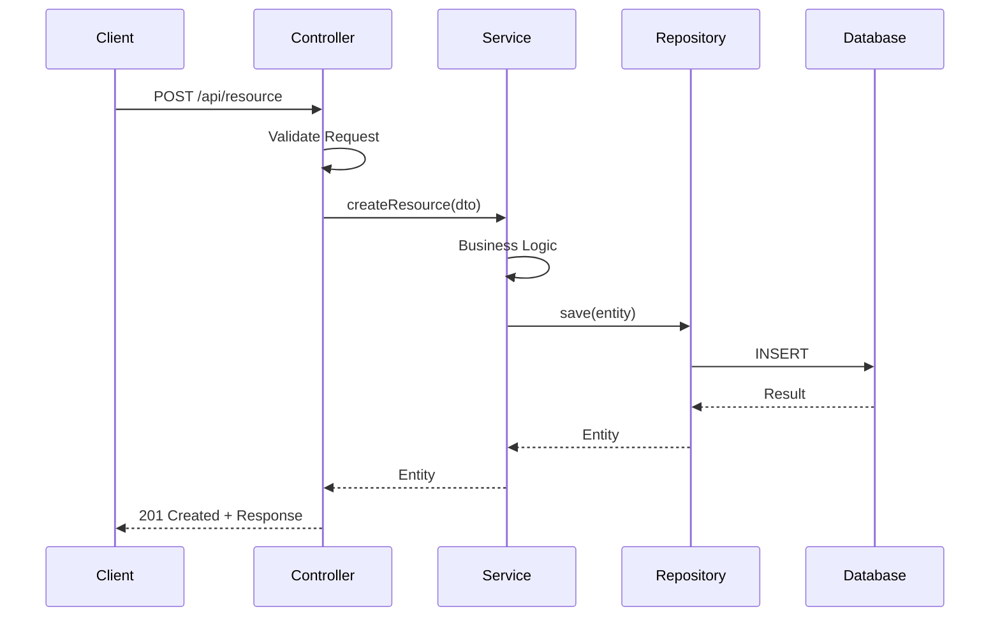
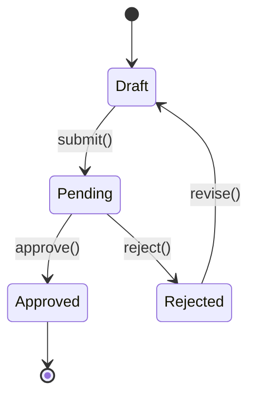
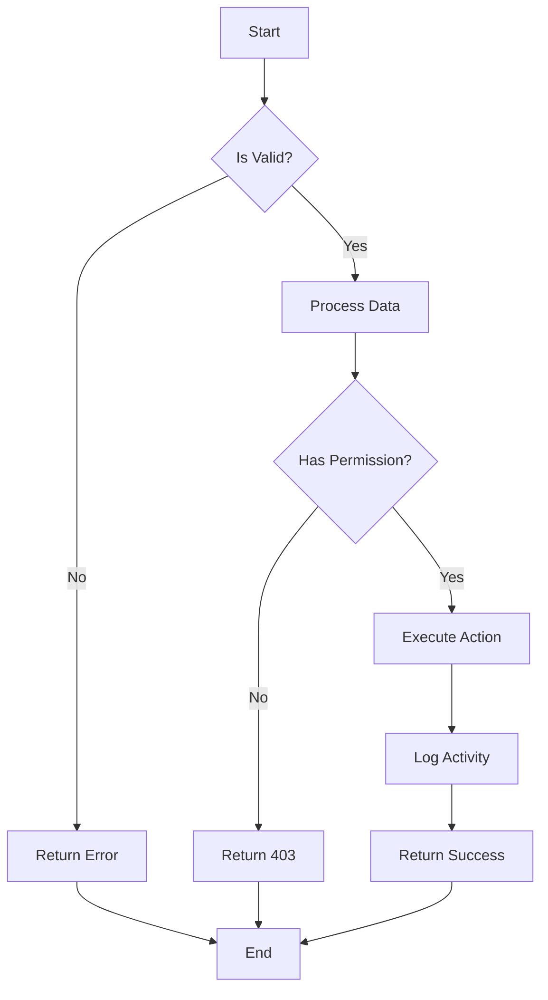
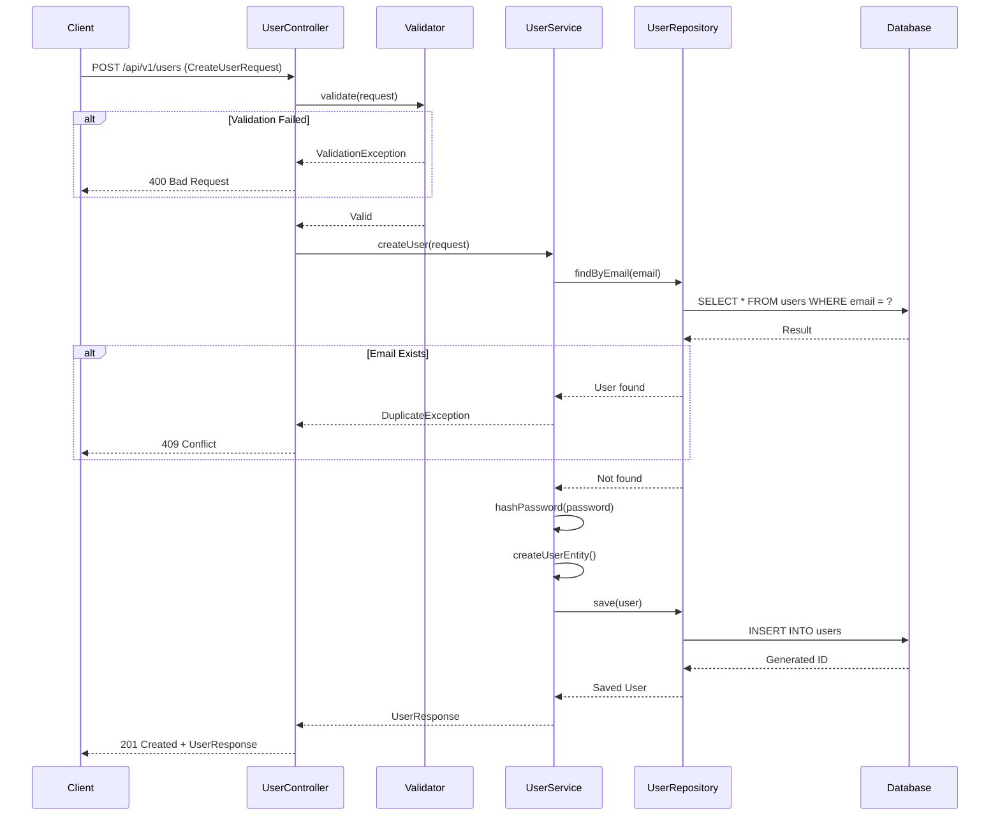
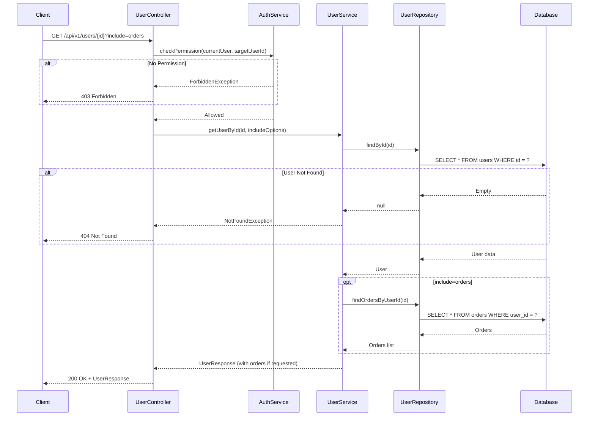
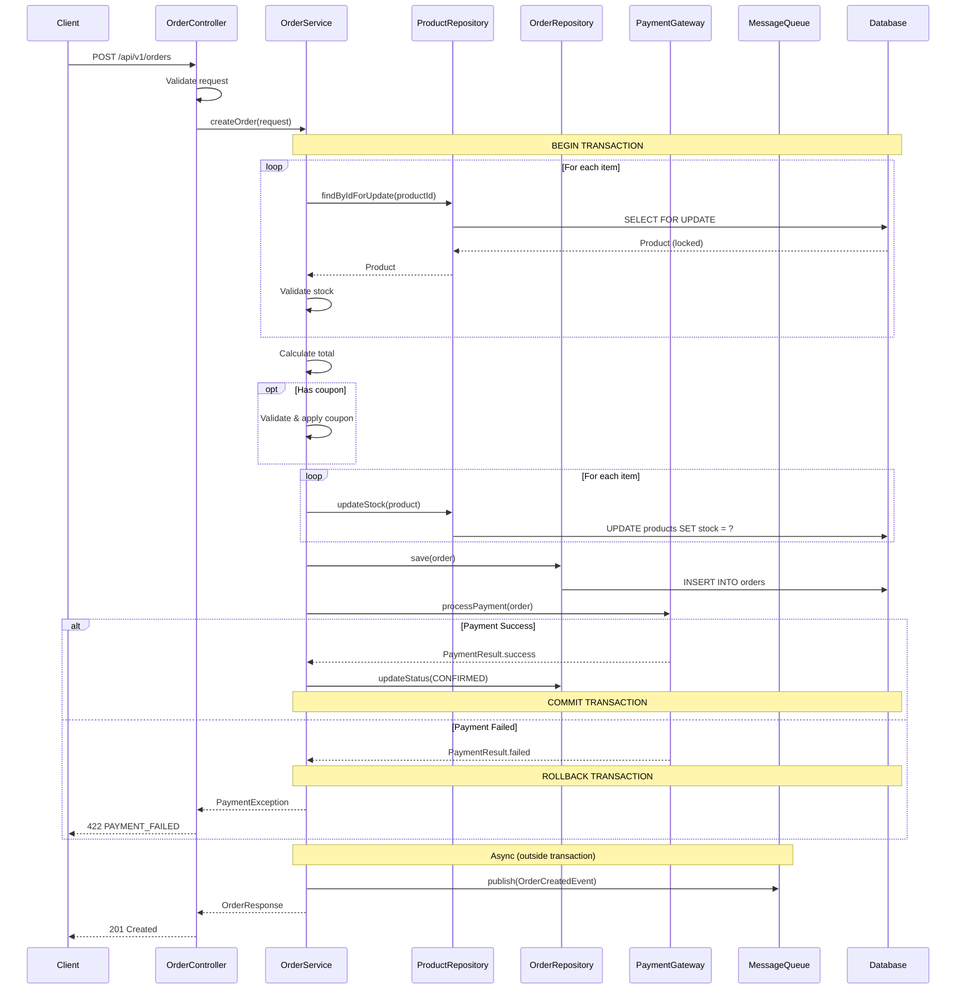
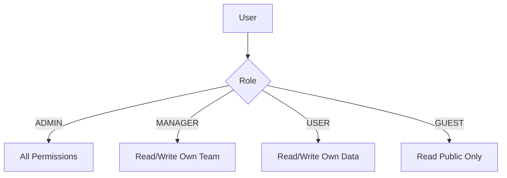
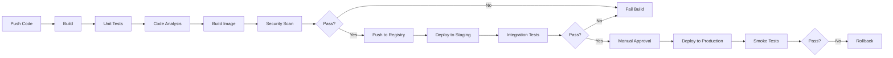

# HƯỚNG DẪN TOÀN DIỆN: AI TẠO TÀI LIỆU THIẾT KẾ CHI TIẾT (DETAILED DESIGN DOCUMENT)

## 📋 MỤC LỤC

1. [Tổng quan](#1-tổng-quan)
   - 1.1 [Mục đích](#11-mục-đích)
   - 1.2 [Input cần thiết](#12-input-cần-thiết)
   - 1.3 [Cấu trúc thư mục tài liệu](#13-cấu-trúc-thư-mục-tài-liệu)
2. [System Prompt cho AI](#2-system-prompt-cho-ai)
3. [Cấu trúc tài liệu Detailed Design](#3-cấu-trúc-tài-liệu-detailed-design)
4. [Quy trình xử lý từng phần](#4-quy-trình-xử-lý-từng-phần)
5. [Template chi tiết](#5-template-chi-tiết)
6. [Checklist đánh giá chất lượng](#6-checklist-đánh-giá-chất-lượng)

---

## 1. TỔNG QUAN

### 1.1. Mục đích

Hướng dẫn này giúp AI tạo tài liệu Detailed Design (DD) chuyên nghiệp, đầy đủ và có thể sử dụng trực tiếp cho việc coding.

### 1.2. Input cần thiết

```
┌─────────────────────────────────────────────────────────────┐
│                      INPUT DOCUMENTS                         │
├─────────────────────────────────────────────────────────────┤
│  1. Requirements Document (SRS/BRD/PRD)                     │
│     - Functional Requirements                                │
│     - Non-Functional Requirements                            │
│     - Use Cases / User Stories                               │
│                                                              │
│  2. Basic Design Document (HLD)                              │
│     - System Architecture                                    │
│     - Technology Stack                                       │
│     - High-level Components                                  │
│     - Integration Points                                     │
└─────────────────────────────────────────────────────────────┘
                              │
                              ▼
┌─────────────────────────────────────────────────────────────┐
│                  OUTPUT: DETAILED DESIGN                     │
│     (Tài liệu đủ chi tiết để developer có thể code)         │
└─────────────────────────────────────────────────────────────┘
```

### 1.3. Cấu trúc thư mục tài liệu

> ⚠️ **QUAN TRỌNG**: Tài liệu Detailed Design KHÔNG nên viết tất cả vào một file duy nhất. Thay vào đó, hãy tổ chức thành thư mục với nhiều file riêng biệt để:
>
> - Giảm kích thước mỗi file, tránh quá tải
> - Dễ dàng quản lý và cập nhật từng phần
> - Cung cấp ngữ cảnh rõ ràng cho AI trong các giai đoạn tiếp theo (Coding, Testing...)

#### 1.3.1 Cấu trúc thư mục chuẩn

Tên thư mục được đặt theo ngôn ngữ của tài liệu:

- Tiếng Việt: `Tài liệu Thiết kế Chi tiết`
- Tiếng Anh: `Detailed Design Document`
- Tiếng Nhật: `詳細設計書`

```
📁 [Tên thư mục chứa tài liệu]/
├── 📁 Detailed Design Document/           # Hoặc tên theo ngôn ngữ phù hợp
│   ├── 📄 _index.md                        # File index - BẮT BUỘC
│   ├── 📄 01-introduction.md               # Giới thiệu và tổng quan
│   ├── 📄 02-references-terminology.md     # Tài liệu tham chiếu, thuật ngữ
│   ├── 📄 03-system-overview.md            # Tổng quan hệ thống
│   ├── 📄 04-design-considerations.md      # Các cân nhắc thiết kế
│   ├── 📄 05-module-design.md              # Thiết kế module (hoặc tách nhỏ hơn)
│   ├── 📄 06-database-design.md            # Thiết kế database chi tiết
│   ├── 📄 07-api-design.md                 # Thiết kế API chi tiết
│   ├── 📄 08-ui-ux-specifications.md       # Đặc tả UI/UX chi tiết
│   ├── 📄 09-security-design.md            # Thiết kế bảo mật
│   ├── 📄 10-error-handling.md             # Xử lý lỗi chi tiết
│   ├── 📄 11-logging-monitoring.md         # Logging và Monitoring
│   ├── 📄 12-deployment-design.md          # Thiết kế triển khai
│   └── 📄 13-appendices.md                 # Phụ lục
```

#### 1.3.2 File Index (\_index.md) - BẮT BUỘC

File `_index.md` là file quan trọng nhất, giúp AI hiểu ngữ cảnh tổng thể của dự án khi thực hiện các công việc ở giai đoạn tiếp theo (Coding, Testing...).

##### Template cho \_index.md:

```markdown
# [TÊN DỰ ÁN] - Tài liệu Thiết kế Chi tiết

## Thông tin tài liệu

| Thông tin  | Giá trị                   |
| ---------- | ------------------------- |
| Tên dự án  | [Project Name]            |
| Mã dự án   | [Project Code]            |
| Phiên bản  | 1.0                       |
| Ngày tạo   | [DD/MM/YYYY]              |
| Trạng thái | Draft / Review / Approved |

## Tổng quan dự án

[Mô tả ngắn gọn về dự án, mục đích và phạm vi - 3-5 câu]

## Cấu trúc tài liệu

| STT | File                                                           | Nội dung chính        | Mô tả                                           |
| --- | -------------------------------------------------------------- | --------------------- | ----------------------------------------------- |
| 1   | [01-introduction.md](./01-introduction.md)                     | Giới thiệu            | Mục đích, phạm vi, đối tượng sử dụng            |
| 2   | [02-references-terminology.md](./02-references-terminology.md) | Tham chiếu, thuật ngữ | Tài liệu liên quan, định nghĩa thuật ngữ        |
| 3   | [03-system-overview.md](./03-system-overview.md)               | Tổng quan hệ thống    | Technology stack, architecture pattern          |
| 4   | [04-design-considerations.md](./04-design-considerations.md)   | Cân nhắc thiết kế     | Assumptions, constraints, design decisions      |
| 5   | [05-module-design.md](./05-module-design.md)                   | Thiết kế module       | Class diagrams, sequence diagrams, algorithms   |
| 6   | [06-database-design.md](./06-database-design.md)               | Thiết kế database     | ERD, table specs, indexes, data dictionary      |
| 7   | [07-api-design.md](./07-api-design.md)                         | Thiết kế API          | OpenAPI specs, request/response, error codes    |
| 8   | [08-ui-ux-specifications.md](./08-ui-ux-specifications.md)     | Đặc tả UI/UX          | Screen flows, component specs, validation rules |
| 9   | [09-security-design.md](./09-security-design.md)               | Thiết kế bảo mật      | Authentication, authorization, encryption       |
| 10  | [10-error-handling.md](./10-error-handling.md)                 | Xử lý lỗi             | Error codes, exception handling, recovery       |
| 11  | [11-logging-monitoring.md](./11-logging-monitoring.md)         | Logging & Monitoring  | Log formats, metrics, alerts                    |
| 12  | [12-deployment-design.md](./12-deployment-design.md)           | Thiết kế triển khai   | Infrastructure, CI/CD, environment configs      |
| 13  | [13-appendices.md](./13-appendices.md)                         | Phụ lục               | Traceability matrix, full API spec, DB scripts  |

## Thông tin chính cho AI Context

### Technology Stack (Tóm tắt)

- Frontend: [Technologies]
- Backend: [Technologies]
- Database: [Technologies]
- Infrastructure: [Technologies]

### Modules/Services chính

- [Module 1]: [Chức năng chính và classes quan trọng]
- [Module 2]: [Chức năng chính và classes quan trọng]
- ...

### Design Patterns được sử dụng

- [Pattern 1]: [Mục đích sử dụng]
- [Pattern 2]: [Mục đích sử dụng]
- ...

### Database Summary

- Số lượng tables: [N]
- Tables chính: [List main tables]
- Relationships quan trọng: [Brief description]

### API Summary

- Số lượng endpoints: [N]
- Authentication: [Method]
- API Groups: [List main groups]

### Ràng buộc và giả định quan trọng

- [Constraint 1]
- [Constraint 2]
- ...

## Tham chiếu đến tài liệu liên quan

| Loại tài liệu     | Đường dẫn                  |
| ----------------- | -------------------------- |
| Yêu cầu hệ thống  | [Link to requirements doc] |
| Basic Design      | [Link to BD doc]           |
| API Documentation | [Link - nếu có]            |
| Database Scripts  | [Link - nếu có]            |

---

_File này được cập nhật tự động khi có thay đổi trong các file con._
```

#### 1.3.3 Quy tắc phân chia nội dung

| Nguyên tắc            | Mô tả                                                                                      |
| --------------------- | ------------------------------------------------------------------------------------------ |
| **Kích thước file**   | Mỗi file không nên vượt quá 500-800 dòng. Nếu lớn hơn, cân nhắc tách thành nhiều file con. |
| **Một chủ đề/file**   | Mỗi file tập trung vào một chủ đề chính (module, database, API...)                         |
| **Cross-reference**   | Sử dụng link relative để tham chiếu giữa các file khi cần                                  |
| **Consistent naming** | Đặt tên file theo format: `[số thứ tự]-[tên-kebab-case].md`                                |
| **Index đầy đủ**      | File index phải có đủ thông tin để AI hiểu context mà không cần đọc tất cả các file        |

#### 1.3.4 Ví dụ tên thư mục theo ngôn ngữ

| Ngôn ngữ    | Tên thư mục                  |
| ----------- | ---------------------------- |
| Tiếng Việt  | `Tài liệu Thiết kế Chi tiết` |
| Tiếng Anh   | `Detailed Design Document`   |
| Tiếng Nhật  | `詳細設計書`                 |
| Tiếng Hàn   | `상세설계서`                 |
| Tiếng Trung | `详细设计文档`               |

#### 1.3.5 Tách file theo quy mô dự án

##### Dự án nhỏ (< 10 modules, < 30 tables)

```
📁 Detailed Design Document/
├── 📄 _index.md
├── 📄 01-overview-considerations.md    # Gộp intro + overview + considerations
├── 📄 02-module-design.md              # Tất cả modules
├── 📄 03-data-api-design.md            # Gộp database + API design
├── 📄 04-security-error-handling.md    # Gộp security + error handling
└── 📄 05-deployment-appendix.md        # Gộp deployment + appendix
```

##### Dự án trung bình (10-30 modules, 30-80 tables)

Sử dụng cấu trúc chuẩn ở mục 1.3.1

##### Dự án lớn (> 30 modules, > 80 tables)

```
📁 Detailed Design Document/
├── 📄 _index.md
├── 📁 01-introduction/
│   ├── 📄 _index.md
│   ├── 📄 purpose-scope.md
│   └── 📄 terminology.md
├── 📁 02-module-design/
│   ├── 📄 _index.md                    # Tổng quan tất cả modules
│   ├── 📁 auth-module/
│   │   ├── 📄 _index.md
│   │   ├── 📄 class-design.md
│   │   ├── 📄 sequence-diagrams.md
│   │   └── 📄 algorithms.md
│   ├── 📁 user-module/
│   │   ├── 📄 _index.md
│   │   └── 📄 ...
│   └── 📁 .../
├── 📁 03-database-design/
│   ├── 📄 _index.md
│   ├── 📄 erd.md
│   ├── 📁 tables/
│   │   ├── 📄 master-tables.md
│   │   ├── 📄 transaction-tables.md
│   │   └── 📄 ...
│   └── 📄 indexes-views.md
├── 📁 04-api-design/
│   ├── 📄 _index.md
│   ├── 📄 auth-apis.md
│   ├── 📄 user-apis.md
│   └── 📄 .../
└── 📁 .../
```

---

## 2. SYSTEM PROMPT CHO AI

### 2.1. Master System Prompt

```markdown
# SYSTEM PROMPT: DETAILED DESIGN DOCUMENT GENERATOR

## VAI TRÒ

Bạn là một Software Architect chuyên nghiệp với 15+ năm kinh nghiệm trong thiết kế phần mềm. Nhiệm vụ của bạn là tạo tài liệu Detailed Design Document (DDD) dựa trên:

- Tài liệu yêu cầu (Requirements Document)
- Tài liệu thiết kế cơ sở (Basic Design/HLD)

## NGUYÊN TẮC CỐT LÕI

### 1. Tính đầy đủ (Completeness)

- Mọi requirement phải được map đến design
- Mọi component trong HLD phải được chi tiết hóa
- Không bỏ sót bất kỳ use case nào

### 2. Tính nhất quán (Consistency)

- Naming convention thống nhất
- Thuật ngữ đồng nhất xuyên suốt tài liệu
- Format và style đồng bộ

### 3. Tính khả thi (Feasibility)

- Design phải implement được
- Phù hợp với technology stack đã chọn
- Đáp ứng các ràng buộc kỹ thuật

### 4. Tính truy xuất (Traceability)

- Mỗi design element phải trace được về requirement
- Sử dụng Requirement ID để tham chiếu

### 5. Ưu tiên ngôn ngữ tự nhiên (Natural Language First) ⭐ QUAN TRỌNG

- **LUÔN ưu tiên trình bày logic bằng ngôn ngữ tự nhiên** trước khi sử dụng code
- Chỉ sử dụng code/pseudocode khi:
  - Logic quá phức tạp để diễn đạt bằng văn bản
  - Cần thể hiện cú pháp cụ thể của ngôn ngữ lập trình
  - Cần minh họa cấu trúc dữ liệu chi tiết
  - Developer cần copy trực tiếp để implement
- **Khi BẮT BUỘC phải dùng code:**
  - Mỗi đoạn code PHẢI có phần giải thích bằng ngôn ngữ tự nhiên đi kèm
  - Comment trong code phải đầy đủ, giải thích MỤC ĐÍCH và LOGIC
  - Trước mỗi code block, cần có đoạn mô tả tổng quan bằng văn bản
  - Sau code block, cần có phần giải thích chi tiết các bước (nếu cần)

## QUY TRÌNH XỬ LÝ

### Bước 1: Phân tích Input

1.1. Đọc và trích xuất từ Requirements Document: - Danh sách Functional Requirements (FR-xxx) - Danh sách Non-Functional Requirements (NFR-xxx) - Use Cases / User Stories - Business Rules - Data Requirements - External Interfaces

1.2. Đọc và trích xuất từ Basic Design: - Kiến trúc hệ thống (Layers, Tiers) - Technology Stack - Các module/component chính - Luồng dữ liệu tổng quan - Integration points - Security architecture tổng quan

### Bước 2: Mapping & Analysis

2.1. Tạo Requirement-to-Design Traceability Matrix
2.2. Xác định các module cần thiết kế chi tiết
2.3. Xác định các interface giữa modules
2.4. Xác định data model chi tiết

### Bước 3: Thiết kế chi tiết từng module

Với mỗi module:

- Class Diagram với đầy đủ attributes và methods
- Sequence Diagram cho các use cases liên quan
- State Diagram (nếu có state management)
- Activity Diagram (cho business logic phức tạp)
- Pseudocode/Algorithm cho logic quan trọng

### Bước 4: Thiết kế Database

- ERD với đầy đủ columns, types, constraints
- Data Dictionary
- Index Strategy
- Query Optimization Notes

### Bước 5: Thiết kế API

- API Specifications (OpenAPI format)
- Request/Response schemas
- Error codes và handling
- Authentication/Authorization

### Bước 6: Cross-cutting Concerns

- Logging strategy
- Error handling strategy
- Security implementation details
- Performance considerations

## OUTPUT FORMAT

Sử dụng Markdown với cấu trúc rõ ràng:

- Heading levels: # ## ### ####
- Tables cho data structures
- Code blocks cho pseudocode, JSON, SQL (KÈM THEO giải thích bằng ngôn ngữ tự nhiên)
- Mermaid/PlantUML syntax cho diagrams
- Numbered lists cho steps/procedures
- Bullet points cho enumerations

### ⭐ QUY TẮC TRÌNH BÀY LOGIC (QUAN TRỌNG)

#### Thứ tự ưu tiên khi trình bày logic:

1. **Ngôn ngữ tự nhiên** - Mô tả bằng văn bản rõ ràng, dễ hiểu
2. **Flowchart/Diagram** - Khi cần trực quan hóa luồng xử lý
3. **Bảng quyết định** - Khi có nhiều điều kiện và kết quả
4. **Pseudocode** - Khi logic phức tạp cần cấu trúc rõ ràng
5. **Code thực tế** - Chỉ khi cần thiết cho implementation

#### Cấu trúc trình bày logic chuẩn:
```

1. [MÔ TẢ TỔNG QUAN] - Giải thích mục đích và ý nghĩa bằng ngôn ngữ tự nhiên
2. [ĐIỀU KIỆN ĐẦU VÀO] - Liệt kê các điều kiện tiên quyết
3. [CÁC BƯỚC XỬ LÝ] - Mô tả từng bước bằng ngôn ngữ tự nhiên
4. [KẾT QUẢ ĐẦU RA] - Mô tả kết quả mong đợi
5. [CODE/PSEUDOCODE] - Chỉ khi cần thiết, kèm comment đầy đủ
6. [GIẢI THÍCH BỔ SUNG] - Làm rõ các điểm quan trọng trong code

````

#### Ví dụ cách trình bày đúng:

**❌ SAI - Chỉ có code:**
```java
if (user.getAge() >= 18 && user.hasValidId()) {
    return approve(user);
} else {
    return reject(user);
}
````

**✅ ĐÚNG - Ngôn ngữ tự nhiên + Code có comment:**

**Mô tả logic xác thực người dùng:**

Hệ thống cần kiểm tra hai điều kiện để phê duyệt người dùng:

- Điều kiện 1: Người dùng phải từ 18 tuổi trở lên
- Điều kiện 2: Người dùng phải có giấy tờ tùy thân hợp lệ

Nếu cả hai điều kiện đều thỏa mãn, hệ thống sẽ phê duyệt. Ngược lại, hệ thống sẽ từ chối.

```java
// Kiểm tra điều kiện phê duyệt người dùng
// - Tuổi >= 18: Đảm bảo người dùng đủ tuổi theo quy định pháp luật
// - Có ID hợp lệ: Đảm bảo có thể xác minh danh tính
if (user.getAge() >= 18 && user.hasValidId()) {
    // Phê duyệt khi thỏa mãn cả hai điều kiện
    return approve(user);
} else {
    // Từ chối khi không thỏa mãn ít nhất một điều kiện
    return reject(user);
}
```

## CHẤT LƯỢNG YÊU CẦU

✓ Developer có thể code trực tiếp từ tài liệu
✓ Không cần giả định thêm
✓ Tất cả edge cases được xử lý
✓ Error handling rõ ràng
✓ Security được tích hợp
✓ Performance được cân nhắc
✓ **Logic được giải thích bằng ngôn ngữ tự nhiên trước khi có code**
✓ **Mọi đoạn code đều có comment và giải thích đi kèm**

````

---

## 3. CẤU TRÚC TÀI LIỆU DETAILED DESIGN

### 3.1. Template Cấu Trúc Đầy Đủ

```markdown
# DETAILED DESIGN DOCUMENT
## [Tên Dự Án/Hệ Thống]

### Document Information
| Item | Value |
|------|-------|
| Version | 1.0 |
| Status | Draft/Review/Approved |
| Created Date | YYYY-MM-DD |
| Last Updated | YYYY-MM-DD |
| Author | [Name] |
| Reviewer | [Name] |
| Approver | [Name] |

### Revision History
| Version | Date | Author | Description |
|---------|------|--------|-------------|
| 1.0 | YYYY-MM-DD | | Initial version |

---

## TABLE OF CONTENTS
1. Introduction
2. References
3. Terminology & Abbreviations
4. System Overview
5. Design Considerations
6. Module Design
7. Database Design
8. API Design
9. UI/UX Design Specifications
10. Security Design
11. Error Handling Design
12. Logging & Monitoring Design
13. Deployment Design
14. Appendices

---

## 1. INTRODUCTION

### 1.1 Purpose
[Mục đích của tài liệu]

### 1.2 Scope
[Phạm vi của thiết kế]

### 1.3 Intended Audience
[Đối tượng sử dụng: Developers, QA, DevOps, etc.]

### 1.4 Document Conventions
[Quy ước trong tài liệu]

---

## 2. REFERENCES

### 2.1 Related Documents
| Document | Version | Description |
|----------|---------|-------------|
| SRS | 1.0 | Software Requirements Specification |
| HLD | 1.0 | High-Level Design Document |

### 2.2 Standards & Guidelines
[Các chuẩn áp dụng]

---

## 3. TERMINOLOGY & ABBREVIATIONS

| Term/Abbreviation | Definition |
|-------------------|------------|
| API | Application Programming Interface |
| ... | ... |

---

## 4. SYSTEM OVERVIEW

### 4.1 System Context (from HLD)
[Tóm tắt context từ HLD]

### 4.2 Technology Stack
| Layer | Technology | Version | Purpose |
|-------|------------|---------|---------|
| Frontend | React | 18.x | UI Framework |
| Backend | Node.js | 20.x | API Server |
| Database | PostgreSQL | 15.x | Primary DB |
| Cache | Redis | 7.x | Caching |

### 4.3 Architecture Pattern
[Chi tiết pattern sử dụng: Clean Architecture, Hexagonal, etc.]

---

## 5. DESIGN CONSIDERATIONS

### 5.1 Assumptions
[Các giả định]

### 5.2 Constraints
[Các ràng buộc]

### 5.3 Design Decisions
| Decision | Rationale | Alternatives Considered |
|----------|-----------|------------------------|
| | | |

---

## 6. MODULE DESIGN

[Chi tiết từng module - xem section 4.1]

---

## 7. DATABASE DESIGN

[Chi tiết database - xem section 4.2]

---

## 8. API DESIGN

[Chi tiết API - xem section 4.3]

---

## 9. UI/UX DESIGN SPECIFICATIONS

[Chi tiết UI/UX - xem section 4.4]

---

## 10. SECURITY DESIGN

[Chi tiết Security - xem section 4.5]

---

## 11. ERROR HANDLING DESIGN

[Chi tiết Error Handling - xem section 4.6]

---

## 12. LOGGING & MONITORING DESIGN

[Chi tiết Logging & Monitoring - xem section 4.7]

---

## 13. DEPLOYMENT DESIGN

[Chi tiết Deployment - xem section 4.8]

---

## 14. APPENDICES

### Appendix A: Requirement Traceability Matrix
### Appendix B: Glossary
### Appendix C: Full API Specification (OpenAPI)
### Appendix D: Database Scripts
````

---

## 4. QUY TRÌNH XỬ LÝ TỪNG PHẦN

### ⭐ NGUYÊN TẮC CHUNG: ƯU TIÊN NGÔN NGỮ TỰ NHIÊN

Trước khi đi vào chi tiết từng phần, hãy luôn nhớ nguyên tắc quan trọng nhất:

> **"Giải thích trước, code sau"** - Mọi logic phải được mô tả bằng ngôn ngữ tự nhiên trước khi (nếu cần) trình bày bằng code.

#### Cấu trúc trình bày chuẩn cho MỌI phần có logic:

```
┌─────────────────────────────────────────────────────────────┐
│  1. MÔ TẢ TỔNG QUAN (Ngôn ngữ tự nhiên)                    │
│     - Mục đích của logic này là gì?                         │
│     - Tại sao cần logic này?                                │
│     - Kết quả mong đợi là gì?                               │
├─────────────────────────────────────────────────────────────┤
│  2. ĐIỀU KIỆN & RÀNG BUỘC (Bảng hoặc danh sách)            │
│     - Input cần có gì?                                      │
│     - Điều kiện tiên quyết?                                 │
│     - Các trường hợp lỗi có thể xảy ra?                     │
├─────────────────────────────────────────────────────────────┤
│  3. CÁC BƯỚC XỬ LÝ (Ngôn ngữ tự nhiên, đánh số)            │
│     - Bước 1: Làm gì? Tại sao?                              │
│     - Bước 2: Làm gì? Tại sao?                              │
│     - ...                                                   │
├─────────────────────────────────────────────────────────────┤
│  4. CODE/PSEUDOCODE (Chỉ khi cần thiết)                    │
│     - Kèm comment giải thích từng phần                      │
│     - Đánh dấu các điểm quan trọng                          │
├─────────────────────────────────────────────────────────────┤
│  5. GHI CHÚ BỔ SUNG (Nếu có)                               │
│     - Edge cases cần lưu ý                                  │
│     - Performance considerations                            │
│     - Security notes                                        │
└─────────────────────────────────────────────────────────────┘
```

#### Khi nào BẮT BUỘC phải dùng code:

| Trường hợp           | Lý do                         | Yêu cầu                    |
| -------------------- | ----------------------------- | -------------------------- |
| API Request/Response | Cần format chính xác          | Kèm mô tả từng field       |
| Database Schema      | Cần cú pháp SQL chuẩn         | Kèm giải thích từng column |
| Config files         | Cần format chuẩn (YAML, JSON) | Kèm comment giải thích     |
| Algorithm phức tạp   | Khó diễn đạt bằng văn bản     | Kèm mô tả từng bước        |
| Code mẫu để copy     | Developer cần implement       | Kèm comment đầy đủ         |

#### Khi KHÔNG cần dùng code:

| Trường hợp              | Cách trình bày thay thế          |
| ----------------------- | -------------------------------- |
| Business logic đơn giản | Mô tả bằng văn bản + flowchart   |
| Quy trình xử lý         | Danh sách các bước đánh số       |
| Điều kiện rẽ nhánh      | Bảng quyết định (decision table) |
| Validation rules        | Bảng liệt kê điều kiện           |
| Error handling          | Bảng mã lỗi và cách xử lý        |

---

### 4.1. MODULE DESIGN

```markdown
## PROMPT CHO TỪNG MODULE

### Input cần cung cấp cho AI:
```

Module Name: [Tên module]
Related Requirements: [FR-001, FR-002, NFR-001]
Related Use Cases: [UC-001, UC-002]
HLD Reference: [Section trong HLD mô tả module này]

````

### Template output:

## Module: [Module Name]

### 6.x.1 Module Overview
| Attribute | Value |
|-----------|-------|
| Module ID | MOD-xxx |
| Module Name | |
| Description | |
| Related Requirements | FR-xxx, NFR-xxx |
| Dependencies | [Other modules] |

### 6.x.2 Class Design

#### Class Diagram
```mermaid
classDiagram
    class ClassName {
        -privateAttribute: Type
        +publicAttribute: Type
        #protectedAttribute: Type
        +publicMethod(param: Type): ReturnType
        -privateMethod(): void
    }

    ClassA --|> ClassB : inherits
    ClassA --* ClassC : composition
    ClassA --o ClassD : aggregation
    ClassA --> ClassE : uses
````

#### Class Specifications

##### Class: [ClassName]

| Attribute   | Description                          |
| ----------- | ------------------------------------ |
| Package     | com.example.module                   |
| Stereotype  | Entity/Service/Repository/Controller |
| Description |                                      |

###### Attributes

| Name | Type   | Access  | Default | Description        | Validation    |
| ---- | ------ | ------- | ------- | ------------------ | ------------- |
| id   | Long   | private | -       | Primary identifier | Not null      |
| name | String | private | ""      | User name          | Max 100 chars |

###### Methods

| Name   | Parameters     | Return Type | Description        | Exceptions          |
| ------ | -------------- | ----------- | ------------------ | ------------------- |
| create | dto: CreateDTO | Entity      | Creates new entity | ValidationException |

###### Method Detail: create()

**Mô tả chức năng (Ngôn ngữ tự nhiên):**

Phương thức này có nhiệm vụ tạo mới một entity trong hệ thống. Quy trình xử lý như sau:

1. **Kiểm tra dữ liệu đầu vào:** Hệ thống xác nhận DTO không rỗng và chứa đầy đủ thông tin bắt buộc (tên không được để trống).

2. **Kiểm tra trùng lặp:** Trước khi tạo mới, hệ thống kiểm tra xem entity với thông tin tương tự đã tồn tại chưa để tránh dữ liệu trùng.

3. **Chuyển đổi dữ liệu:** Dữ liệu từ DTO được chuyển đổi sang Entity phù hợp với cấu trúc lưu trữ.

4. **Lưu vào database:** Entity được lưu vào repository và hệ thống tự động sinh ID.

5. **Trả về kết quả:** Entity đã lưu (bao gồm ID mới) được trả về cho caller.

**Điều kiện và ngoại lệ:**

| Điều kiện           | Loại          | Mô tả                       |
| ------------------- | ------------- | --------------------------- |
| dto không null      | Tiên quyết    | DTO phải được cung cấp      |
| dto.name không rỗng | Tiên quyết    | Tên entity là bắt buộc      |
| Entity được lưu     | Hậu điều kiện | Dữ liệu được persist vào DB |
| ID được sinh        | Hậu điều kiện | Entity có ID duy nhất       |
| ValidationException | Ngoại lệ      | Khi validation thất bại     |
| DuplicateException  | Ngoại lệ      | Khi entity đã tồn tại       |

**Pseudocode (kèm giải thích):**

```
Purpose: Creates a new entity in the system
Pre-conditions:
  - dto is not null
  - dto.name is not empty
Post-conditions:
  - Entity is persisted in database
  - ID is generated
Algorithm:
  1. Validate input DTO          // Đảm bảo dữ liệu hợp lệ trước khi xử lý
  2. Check for duplicates        // Tránh tạo dữ liệu trùng lặp
  3. Map DTO to Entity           // Chuyển đổi format dữ liệu
  4. Save to repository          // Persist vào database
  5. Return saved entity         // Trả về entity với ID mới
Exceptions:
  - ValidationException: if validation fails    // Dữ liệu không hợp lệ
  - DuplicateException: if entity already exists // Entity đã tồn tại
```

### 6.x.3 Sequence Diagrams

#### Use Case: [UC-001] - [Use Case Name]



#### Sequence Diagram Specifications

| Step | Actor      | Action             | Description         | Data      |
| ---- | ---------- | ------------------ | ------------------- | --------- |
| 1    | Client     | POST /api/resource | Gửi request tạo mới | CreateDTO |
| 2    | Controller | validate()         | Validate input      | -         |
| ...  | ...        | ...                | ...                 | ...       |

### 6.x.4 State Diagram (if applicable)



#### State Specifications

| State   | Description       | Entry Actions    | Exit Actions |
| ------- | ----------------- | ---------------- | ------------ |
| Draft   | Initial state     | Set createdDate  | -            |
| Pending | Awaiting approval | Notify approvers | -            |

#### Transition Specifications

| From  | To      | Trigger  | Guard     | Actions            |
| ----- | ------- | -------- | --------- | ------------------ |
| Draft | Pending | submit() | isValid() | sendNotification() |

### 6.x.5 Activity Diagram (for complex logic)



### 6.x.6 Pseudocode/Algorithm

> ⚠️ **LƯU Ý:** Phần này chỉ sử dụng khi logic quá phức tạp để diễn đạt bằng văn bản thuần túy. LUÔN kèm theo giải thích bằng ngôn ngữ tự nhiên.

#### Mô tả logic xử lý đơn hàng (Ngôn ngữ tự nhiên):

**Mục đích:** Xử lý và tạo đơn hàng mới trong hệ thống.

**Luồng xử lý chính:**

1. **Giai đoạn 1 - Kiểm tra tính hợp lệ của đơn hàng:**

   - Đơn hàng không được null
   - Đơn hàng phải có ít nhất một sản phẩm

2. **Giai đoạn 2 - Xử lý từng sản phẩm trong đơn hàng:**

   - Với mỗi sản phẩm, kiểm tra số lượng phải lớn hơn 0
   - Tìm thông tin sản phẩm trong database
   - Kiểm tra tồn kho có đủ để đáp ứng không
   - Tính tiền cho từng sản phẩm (giá × số lượng)
   - Cộng dồn vào tổng tiền đơn hàng
   - Trừ số lượng tồn kho tương ứng

3. **Giai đoạn 3 - Áp dụng khuyến mãi (nếu có):**

   - Nếu có mã giảm giá, tính số tiền được giảm
   - Trừ số tiền giảm khỏi tổng đơn hàng

4. **Giai đoạn 4 - Hoàn tất đơn hàng:**
   - Cập nhật tổng tiền, trạng thái và thời gian tạo
   - Lưu đơn hàng vào database
   - Phát sự kiện để các hệ thống khác xử lý (gửi email, thông báo...)

**Các trường hợp lỗi có thể xảy ra:**

| Lỗi                        | Điều kiện               | Xử lý         |
| -------------------------- | ----------------------- | ------------- |
| ValidationException        | Đơn hàng null hoặc rỗng | Từ chối xử lý |
| ValidationException        | Số lượng sản phẩm ≤ 0   | Từ chối xử lý |
| NotFoundException          | Sản phẩm không tồn tại  | Thông báo lỗi |
| InsufficientStockException | Tồn kho không đủ        | Thông báo lỗi |

**Pseudocode chi tiết (kèm comment giải thích):**

```pseudocode
FUNCTION processOrder(order: Order): OrderResult
    // ========== GIAI ĐOẠN 1: KIỂM TRA TÍNH HỢP LỆ ==========
    // Đảm bảo đơn hàng được cung cấp và có nội dung
    IF order IS NULL THEN
        THROW ValidationException("Order cannot be null")
    END IF

    IF order.items IS EMPTY THEN
        THROW ValidationException("Order must have at least one item")
    END IF

    // ========== GIAI ĐOẠN 2: XỬ LÝ TỪNG SẢN PHẨM ==========
    // Duyệt qua từng sản phẩm để tính tiền và kiểm tra tồn kho
    totalAmount := 0
    FOR EACH item IN order.items DO
        // Kiểm tra số lượng hợp lệ
        IF item.quantity <= 0 THEN
            THROW ValidationException("Invalid quantity")
        END IF

        // Lấy thông tin sản phẩm từ database
        product := productRepository.findById(item.productId)
        IF product IS NULL THEN
            THROW NotFoundException("Product not found: " + item.productId)
        END IF

        // Kiểm tra tồn kho có đủ không
        IF product.stock < item.quantity THEN
            THROW InsufficientStockException(product.id, item.quantity)
        END IF

        // Tính tiền cho sản phẩm này và cộng vào tổng
        itemTotal := product.price * item.quantity
        totalAmount := totalAmount + itemTotal

        // Trừ tồn kho (đặt trước hàng cho đơn này)
        product.stock := product.stock - item.quantity
        productRepository.save(product)
    END FOR

    // ========== GIAI ĐOẠN 3: ÁP DỤNG KHUYẾN MÃI ==========
    // Nếu có mã giảm giá, tính và trừ số tiền được giảm
    IF order.couponCode IS NOT NULL THEN
        discount := couponService.calculateDiscount(order.couponCode, totalAmount)
        totalAmount := totalAmount - discount
    END IF

    // ========== GIAI ĐOẠN 4: HOÀN TẤT ĐƠN HÀNG ==========
    // Cập nhật thông tin đơn hàng
    order.totalAmount := totalAmount
    order.status := OrderStatus.PENDING  // Đơn hàng mới ở trạng thái chờ xử lý
    order.createdAt := NOW()

    // Lưu vào database
    savedOrder := orderRepository.save(order)

    // Phát sự kiện để các hệ thống khác biết (email, notification, analytics...)
    eventPublisher.publish(OrderCreatedEvent(savedOrder))

    RETURN OrderResult.success(savedOrder)
END FUNCTION
```

**Tóm tắt luồng xử lý:**

```
Đơn hàng → Validate → Xử lý từng item → Áp dụng giảm giá → Lưu DB → Phát event → Trả kết quả
```

### 6.x.7 Interface Definitions

#### Internal Interfaces

| Interface     | Method                  | Description       |
| ------------- | ----------------------- | ----------------- |
| IOrderService | createOrder(dto): Order | Creates new order |
| IOrderService | getOrder(id): Order     | Gets order by ID  |

#### External Interfaces

| System          | Interface Type | Protocol | Description      |
| --------------- | -------------- | -------- | ---------------- |
| Payment Gateway | REST API       | HTTPS    | Process payments |

````

---

### 4.2. DATABASE DESIGN

```markdown
## PROMPT CHO DATABASE DESIGN

### Input cần cung cấp cho AI:
````

Related Requirements: [Data requirements từ SRS]
HLD Database Section: [Thông tin từ HLD]
Entities identified: [List entities từ analysis]

````

### Template output:

## 7. DATABASE DESIGN

### 7.1 Entity Relationship Diagram

```mermaid
erDiagram
    USER ||--o{ ORDER : places
    ORDER ||--|{ ORDER_ITEM : contains
    PRODUCT ||--o{ ORDER_ITEM : "ordered in"
    USER {
        bigint id PK
        varchar(100) email UK
        varchar(255) password_hash
        varchar(50) first_name
        varchar(50) last_name
        timestamp created_at
        timestamp updated_at
    }
    ORDER {
        bigint id PK
        bigint user_id FK
        varchar(20) status
        decimal total_amount
        timestamp created_at
    }
    ORDER_ITEM {
        bigint id PK
        bigint order_id FK
        bigint product_id FK
        int quantity
        decimal unit_price
    }
    PRODUCT {
        bigint id PK
        varchar(200) name
        text description
        decimal price
        int stock
    }
````

### 7.2 Table Specifications

#### Table: users

| Column        | Data Type    | Constraints        | Default           | Description    |
| ------------- | ------------ | ------------------ | ----------------- | -------------- |
| id            | BIGINT       | PK, AUTO_INCREMENT | -                 | Primary key    |
| email         | VARCHAR(100) | NOT NULL, UNIQUE   | -                 | User email     |
| password_hash | VARCHAR(255) | NOT NULL           | -                 | Bcrypt hash    |
| first_name    | VARCHAR(50)  | NOT NULL           | -                 | First name     |
| last_name     | VARCHAR(50)  | NOT NULL           | -                 | Last name      |
| status        | VARCHAR(20)  | NOT NULL           | 'ACTIVE'          | Account status |
| created_at    | TIMESTAMP    | NOT NULL           | CURRENT_TIMESTAMP | Creation time  |
| updated_at    | TIMESTAMP    | NOT NULL           | CURRENT_TIMESTAMP | Last update    |

##### Indexes

| Index Name       | Columns | Type   | Purpose          |
| ---------------- | ------- | ------ | ---------------- |
| idx_users_email  | email   | UNIQUE | Email lookup     |
| idx_users_status | status  | BTREE  | Filter by status |

##### Constraints

| Constraint Name  | Type        | Definition                                    | Description    |
| ---------------- | ----------- | --------------------------------------------- | -------------- |
| pk_users         | PRIMARY KEY | id                                            | Primary key    |
| uk_users_email   | UNIQUE      | email                                         | Unique email   |
| chk_users_status | CHECK       | status IN ('ACTIVE', 'INACTIVE', 'SUSPENDED') | Valid statuses |

### 7.3 Data Dictionary

#### Entity: User

| Attribute     | Description          | Business Rules                     |
| ------------- | -------------------- | ---------------------------------- |
| email         | User's email address | Must be valid email format, unique |
| password_hash | Encrypted password   | Min 8 chars before hashing         |
| status        | Account status       | New accounts default to ACTIVE     |

### 7.4 Stored Procedures / Functions

> ⚠️ **LƯU Ý:** Mỗi stored procedure PHẢI có phần mô tả bằng ngôn ngữ tự nhiên trước code SQL.

#### Procedure: sp_get_user_orders

**Mô tả chức năng:**

Procedure này lấy danh sách đơn hàng của một người dùng cụ thể với các tính năng:

- Lọc theo trạng thái đơn hàng (tùy chọn)
- Phân trang để xử lý danh sách lớn
- Đếm số lượng sản phẩm trong mỗi đơn hàng

**Tham số đầu vào:**

| Tham số     | Kiểu        | Bắt buộc | Mô tả                                   |
| ----------- | ----------- | -------- | --------------------------------------- |
| p_user_id   | BIGINT      | Có       | ID của người dùng cần lấy đơn hàng      |
| p_status    | VARCHAR(20) | Không    | Lọc theo trạng thái (NULL = lấy tất cả) |
| p_page      | INT         | Có       | Số trang hiện tại (bắt đầu từ 1)        |
| p_page_size | INT         | Có       | Số đơn hàng mỗi trang                   |

**Kết quả trả về:**

| Cột          | Mô tả                       |
| ------------ | --------------------------- |
| id           | ID đơn hàng                 |
| status       | Trạng thái đơn hàng         |
| total_amount | Tổng tiền đơn hàng          |
| created_at   | Thời gian tạo đơn           |
| item_count   | Số lượng sản phẩm trong đơn |

**Logic xử lý:**

1. Tính vị trí bắt đầu (offset) dựa trên số trang và kích thước trang
2. Truy vấn bảng orders, join với order_items để đếm số sản phẩm
3. Lọc theo user_id và status (nếu có)
4. Sắp xếp theo thời gian tạo mới nhất trước
5. Áp dụng phân trang với LIMIT và OFFSET

**Code SQL (kèm comment):**

```sql
CREATE PROCEDURE sp_get_user_orders(
    IN p_user_id BIGINT,      -- ID người dùng cần lấy đơn hàng
    IN p_status VARCHAR(20),   -- Trạng thái lọc (NULL = tất cả)
    IN p_page INT,             -- Số trang (bắt đầu từ 1)
    IN p_page_size INT         -- Số bản ghi mỗi trang
)
BEGIN
    -- Tính vị trí bắt đầu cho phân trang
    -- Ví dụ: trang 2, size 10 → offset = (2-1)*10 = 10
    DECLARE v_offset INT;
    SET v_offset = (p_page - 1) * p_page_size;

    -- Truy vấn danh sách đơn hàng
    SELECT
        o.id,
        o.status,
        o.total_amount,
        o.created_at,
        COUNT(oi.id) as item_count  -- Đếm số sản phẩm trong đơn
    FROM orders o
    -- LEFT JOIN để vẫn hiển thị đơn hàng không có item (edge case)
    LEFT JOIN order_items oi ON o.id = oi.order_id
    WHERE o.user_id = p_user_id
      -- Lọc status nếu được chỉ định, bỏ qua nếu NULL
      AND (p_status IS NULL OR o.status = p_status)
    GROUP BY o.id
    -- Đơn hàng mới nhất hiển thị trước
    ORDER BY o.created_at DESC
    -- Áp dụng phân trang
    LIMIT p_page_size OFFSET v_offset;
END;
```

### 7.5 Database Migration Scripts

#### Migration: V001\_\_create_users_table.sql

```sql
CREATE TABLE users (
    id BIGINT AUTO_INCREMENT PRIMARY KEY,
    email VARCHAR(100) NOT NULL,
    password_hash VARCHAR(255) NOT NULL,
    first_name VARCHAR(50) NOT NULL,
    last_name VARCHAR(50) NOT NULL,
    status VARCHAR(20) NOT NULL DEFAULT 'ACTIVE',
    created_at TIMESTAMP NOT NULL DEFAULT CURRENT_TIMESTAMP,
    updated_at TIMESTAMP NOT NULL DEFAULT CURRENT_TIMESTAMP ON UPDATE CURRENT_TIMESTAMP,

    CONSTRAINT uk_users_email UNIQUE (email),
    CONSTRAINT chk_users_status CHECK (status IN ('ACTIVE', 'INACTIVE', 'SUSPENDED'))
);

CREATE INDEX idx_users_status ON users(status);
```

### 7.6 Data Archival & Retention

| Table      | Retention Period | Archive Strategy      | Archive Location |
| ---------- | ---------------- | --------------------- | ---------------- |
| orders     | 7 years          | Move to archive table | orders_archive   |
| audit_logs | 1 year           | Delete                | N/A              |

### 7.7 Performance Considerations

#### Query Optimization

| Query Pattern      | Frequency | Index Used         | Optimization  |
| ------------------ | --------- | ------------------ | ------------- |
| Get user by email  | Very High | idx_users_email    | Covered index |
| Get orders by user | High      | idx_orders_user_id | Pagination    |

#### Partitioning Strategy

| Table  | Partition Type | Partition Key        | Retention        |
| ------ | -------------- | -------------------- | ---------------- |
| orders | RANGE          | created_at (monthly) | 12 months active |

````

---

### 4.3. API DESIGN

```markdown
## PROMPT CHO API DESIGN

### Input cần cung cấp cho AI:
````

Related Requirements: [API requirements từ SRS]
Related Use Cases: [Use cases cần API]
Authentication Method: [JWT/OAuth2/API Key]
API Style: [REST/GraphQL/gRPC]

```

### ⭐ YÊU CẦU BẮT BUỘC: BUSINESS LOGIC CHO MỖI API

> **QUAN TRỌNG:** Mỗi API endpoint PHẢI có phần **Business Logic** chi tiết để developer có thể implement trực tiếp mà không cần hỏi thêm.

#### Cấu trúc Business Logic cho mỗi API:

```

┌─────────────────────────────────────────────────────────────┐
│ 1. MÔ TẢ TỔNG QUAN │
│ - API này làm gì? │
│ - Mục đích business của API? │
│ - Kết quả mong đợi? │
├─────────────────────────────────────────────────────────────┤
│ 2. LUỒNG XỬ LÝ CHI TIẾT (Đánh số từng bước) │
│ - Bước 1: Validation - Kiểm tra gì? Lỗi trả về gì? │
│ - Bước 2: Authorization - Ai được phép? Kiểm tra thế nào?│
│ - Bước 3: Business Rules - Quy tắc nghiệp vụ nào áp dụng?│
│ - Bước 4: Data Processing - Xử lý dữ liệu như thế nào? │
│ - Bước 5: Persistence - Lưu trữ ở đâu? Cách nào? │
│ - Bước 6: Response - Trả về gì? Format nào? │
├─────────────────────────────────────────────────────────────┤
│ 3. BẢNG QUYẾT ĐỊNH XỬ LÝ LỖI │
│ - Điều kiện → Kết quả → HTTP Status → Error Code │
├─────────────────────────────────────────────────────────────┤
│ 4. SEQUENCE DIAGRAM │
│ - Thể hiện tương tác giữa các components │
│ - Bao gồm cả happy path và error paths │
├─────────────────────────────────────────────────────────────┤
│ 5. PSEUDOCODE (Kèm comment giải thích) │
│ - Logic xử lý chi tiết │
│ - Đánh dấu các điểm quan trọng │
│ - Giải thích tại sao làm như vậy │
├─────────────────────────────────────────────────────────────┤
│ 6. GHI CHÚ BỔ SUNG (Nếu có) │
│ - Edge cases cần xử lý │
│ - Performance considerations │
│ - Security notes │
│ - Transaction boundaries │
└─────────────────────────────────────────────────────────────┘

````

#### Checklist Business Logic cho mỗi API:

| # | Mục kiểm tra | Bắt buộc |
|---|--------------|----------|
| 1 | Có mô tả tổng quan mục đích API | ✓ |
| 2 | Có liệt kê đầy đủ các bước xử lý | ✓ |
| 3 | Mỗi bước có giải thích TẠI SAO | ✓ |
| 4 | Có bảng quyết định xử lý lỗi | ✓ |
| 5 | Có Sequence Diagram | ✓ |
| 6 | Có Pseudocode với comment | ✓ |
| 7 | Có xử lý validation đầu vào | ✓ |
| 8 | Có kiểm tra authorization | ✓ |
| 9 | Có xử lý các edge cases | ✓ |
| 10 | Có ghi chú về transaction (nếu cần) | Tùy chọn |
| 11 | Có ghi chú về caching (nếu cần) | Tùy chọn |
| 12 | Có ghi chú về async processing (nếu cần) | Tùy chọn |

#### Ví dụ các loại Business Logic thường gặp:

| Loại API | Business Logic cần mô tả |
|----------|-------------------------|
| CREATE | Validation → Check duplicate → Transform → Save → Return |
| READ | Auth check → Query → Transform → Return |
| UPDATE | Auth check → Find existing → Validate changes → Apply → Save → Return |
| DELETE | Auth check → Find existing → Check dependencies → Soft/Hard delete → Return |
| SEARCH | Parse filters → Build query → Execute → Paginate → Transform → Return |
| BATCH | Validate all → Process each → Collect results → Return summary |
| ASYNC | Validate → Queue job → Return job ID → (Background: Process → Notify) |

### Template output:

## 8. API DESIGN

### 8.1 API Overview

| Attribute | Value |
|-----------|-------|
| Base URL | https://api.example.com/v1 |
| Protocol | HTTPS |
| Format | JSON |
| Authentication | Bearer Token (JWT) |
| Rate Limiting | 1000 requests/minute |

### 8.2 Authentication & Authorization

#### Authentication Flow
```mermaid
sequenceDiagram
    participant C as Client
    participant A as Auth Server
    participant R as Resource Server

    C->>A: POST /auth/login (credentials)
    A->>A: Validate credentials
    A-->>C: 200 OK + JWT Token
    C->>R: GET /api/resource + Bearer Token
    R->>R: Validate JWT
    R-->>C: 200 OK + Resource
````

#### Authorization Matrix

| Role  | GET /users | POST /users | PUT /users/{id} | DELETE /users/{id} |
| ----- | ---------- | ----------- | --------------- | ------------------ |
| Admin | ✓          | ✓           | ✓               | ✓                  |
| User  | Own only   | ✗           | Own only        | ✗                  |
| Guest | ✗          | ✗           | ✗               | ✗                  |

### 8.3 API Endpoints

#### 8.3.1 User Management APIs

##### POST /api/v1/users

Create a new user

**Request**

```json
{
  "email": "user@example.com",
  "password": "SecurePass123!",
  "firstName": "John",
  "lastName": "Doe"
}
```

**Request Schema**
| Field | Type | Required | Validation | Description |
|-------|------|----------|------------|-------------|
| email | string | Yes | Email format, max 100 | User email |
| password | string | Yes | Min 8, 1 upper, 1 number, 1 special | Password |
| firstName | string | Yes | Max 50, letters only | First name |
| lastName | string | Yes | Max 50, letters only | Last name |

**Business Logic** ⭐

> **Mô tả tổng quan:** API này tạo mới một tài khoản người dùng trong hệ thống. Quy trình xử lý đảm bảo dữ liệu hợp lệ, không trùng lặp và được lưu trữ an toàn.

**Luồng xử lý chi tiết:**

1. **Bước 1 - Validation dữ liệu đầu vào:**

   - Kiểm tra tất cả các trường bắt buộc có được cung cấp không
   - Validate email theo định dạng RFC 5322
   - Validate password theo quy tắc độ mạnh (min 8 ký tự, có chữ hoa, số, ký tự đặc biệt)
   - Validate firstName và lastName chỉ chứa chữ cái, không quá 50 ký tự
   - **Nếu validation thất bại:** Trả về HTTP 400 với chi tiết lỗi từng field

2. **Bước 2 - Kiểm tra email trùng lặp:**

   - Truy vấn database kiểm tra email đã tồn tại chưa
   - **Nếu email đã tồn tại:** Trả về HTTP 409 với mã lỗi EMAIL_EXISTS

3. **Bước 3 - Xử lý mật khẩu:**

   - Hash password sử dụng Bcrypt với cost factor = 12
   - KHÔNG lưu password dạng plain text

4. **Bước 4 - Tạo entity User:**

   - Tạo đối tượng User với các thông tin từ request
   - Gán status mặc định = "ACTIVE"
   - Gán createdAt = thời gian hiện tại (UTC)

5. **Bước 5 - Lưu vào database:**

   - Persist User entity vào database
   - Database tự động sinh ID

6. **Bước 6 - Trả về response:**
   - Map User entity sang UserResponse DTO
   - KHÔNG trả về password hoặc password_hash
   - Trả về HTTP 201 Created

**Bảng quyết định xử lý lỗi:**

| Điều kiện                 | Kết quả  | HTTP Status | Error Code       |
| ------------------------- | -------- | ----------- | ---------------- |
| Email format không hợp lệ | Từ chối  | 400         | VALIDATION_ERROR |
| Password không đủ mạnh    | Từ chối  | 400         | VALIDATION_ERROR |
| Email đã tồn tại          | Từ chối  | 409         | EMAIL_EXISTS     |
| Database connection lỗi   | Từ chối  | 500         | INTERNAL_ERROR   |
| Tất cả hợp lệ             | Tạo user | 201         | -                |

**Sequence Diagram:**



**Pseudocode (kèm giải thích):**

```pseudocode
FUNCTION createUser(request: CreateUserRequest): UserResponse
    // Bước 1: Validate input
    validationResult := validator.validate(request)
    IF validationResult.hasErrors() THEN
        THROW ValidationException(validationResult.errors)
    END IF

    // Bước 2: Kiểm tra email trùng lặp
    existingUser := userRepository.findByEmail(request.email)
    IF existingUser IS NOT NULL THEN
        THROW DuplicateException("EMAIL_EXISTS", "Email already registered")
    END IF

    // Bước 3: Hash password - QUAN TRỌNG: không lưu plain text
    hashedPassword := bcrypt.hash(request.password, COST_FACTOR_12)

    // Bước 4: Tạo User entity
    user := new User()
    user.email := request.email.toLowerCase().trim()
    user.passwordHash := hashedPassword
    user.firstName := request.firstName.trim()
    user.lastName := request.lastName.trim()
    user.status := "ACTIVE"
    user.createdAt := NOW_UTC()

    // Bước 5: Lưu vào database
    savedUser := userRepository.save(user)

    // Bước 6: Map sang response DTO (không bao gồm password)
    RETURN UserResponse.fromEntity(savedUser)
END FUNCTION
```

**Response 201 Created**

```json
{
  "id": 12345,
  "email": "user@example.com",
  "firstName": "John",
  "lastName": "Doe",
  "status": "ACTIVE",
  "createdAt": "2024-01-15T10:30:00Z"
}
```

**Response Schema**
| Field | Type | Description |
|-------|------|-------------|
| id | integer | User ID |
| email | string | User email |
| firstName | string | First name |
| lastName | string | Last name |
| status | string | Account status |
| createdAt | string (ISO 8601) | Creation timestamp |

**Error Responses**
| Status Code | Error Code | Description |
|-------------|------------|-------------|
| 400 | VALIDATION_ERROR | Invalid input |
| 409 | EMAIL_EXISTS | Email already registered |
| 500 | INTERNAL_ERROR | Server error |

**Error Response Format**

```json
{
  "error": {
    "code": "VALIDATION_ERROR",
    "message": "Validation failed",
    "details": [
      {
        "field": "email",
        "message": "Invalid email format"
      }
    ]
  },
  "requestId": "abc-123-def"
}
```

##### GET /api/v1/users/{id}

Get user by ID

**Path Parameters**
| Parameter | Type | Required | Description |
|-----------|------|----------|-------------|
| id | integer | Yes | User ID |

**Query Parameters**
| Parameter | Type | Required | Default | Description |
|-----------|------|----------|---------|-------------|
| include | string | No | - | Comma-separated: orders,profile |

**Business Logic** ⭐

> **Mô tả tổng quan:** API này lấy thông tin chi tiết của một người dùng theo ID. Hỗ trợ eager loading các quan hệ liên quan thông qua query parameter `include`.

**Luồng xử lý chi tiết:**

1. **Bước 1 - Validation path parameter:**

   - Kiểm tra `id` là số nguyên dương hợp lệ
   - **Nếu không hợp lệ:** Trả về HTTP 400

2. **Bước 2 - Kiểm tra quyền truy cập:**

   - Lấy thông tin user hiện tại từ JWT token
   - Kiểm tra quyền theo Authorization Matrix:
     - ADMIN: Có thể xem tất cả users
     - USER: Chỉ có thể xem thông tin của chính mình
   - **Nếu không có quyền:** Trả về HTTP 403

3. **Bước 3 - Truy vấn database:**

   - Tìm user theo ID
   - **Nếu không tìm thấy:** Trả về HTTP 404

4. **Bước 4 - Xử lý include parameter (nếu có):**

   - Parse danh sách include từ query string
   - Với mỗi giá trị include hợp lệ:
     - `orders`: Eager load danh sách đơn hàng của user
     - `profile`: Eager load thông tin profile mở rộng
   - Bỏ qua các giá trị include không hợp lệ (không báo lỗi)

5. **Bước 5 - Trả về response:**
   - Map User entity sang UserResponse DTO
   - Bao gồm các quan hệ đã được load (nếu có)

**Bảng quyết định xử lý:**

| Điều kiện               | Kết quả     | HTTP Status |
| ----------------------- | ----------- | ----------- |
| ID không phải số        | Từ chối     | 400         |
| User không có quyền xem | Từ chối     | 403         |
| User không tồn tại      | Từ chối     | 404         |
| Tất cả hợp lệ           | Trả về user | 200         |

**Sequence Diagram:**



**Pseudocode (kèm giải thích):**

```pseudocode
FUNCTION getUserById(id: Long, include: String, currentUser: User): UserResponse
    // Bước 1: Validate ID
    IF id <= 0 THEN
        THROW ValidationException("Invalid user ID")
    END IF

    // Bước 2: Kiểm tra quyền truy cập
    IF currentUser.role != "ADMIN" AND currentUser.id != id THEN
        THROW ForbiddenException("You can only view your own profile")
    END IF

    // Bước 3: Truy vấn user
    user := userRepository.findById(id)
    IF user IS NULL THEN
        THROW NotFoundException("User not found with ID: " + id)
    END IF

    // Bước 4: Xử lý include parameter
    response := UserResponse.fromEntity(user)

    IF include IS NOT NULL THEN
        includeList := include.split(",")

        IF includeList.contains("orders") THEN
            orders := orderRepository.findByUserId(id)
            response.orders := orders.map(OrderResponse.fromEntity)
        END IF

        IF includeList.contains("profile") THEN
            profile := profileRepository.findByUserId(id)
            response.profile := ProfileResponse.fromEntity(profile)
        END IF
    END IF

    // Bước 5: Trả về response
    RETURN response
END FUNCTION
```

**Response 200 OK**

```json
{
  "id": 12345,
  "email": "user@example.com",
  "firstName": "John",
  "lastName": "Doe",
  "status": "ACTIVE",
  "createdAt": "2024-01-15T10:30:00Z",
  "orders": [...]  // if include=orders
}
```

### 8.4 Common Response Codes

| Status Code | Description           | When to Use             |
| ----------- | --------------------- | ----------------------- |
| 200         | OK                    | Successful GET, PUT     |
| 201         | Created               | Successful POST         |
| 204         | No Content            | Successful DELETE       |
| 400         | Bad Request           | Validation error        |
| 401         | Unauthorized          | Missing/invalid auth    |
| 403         | Forbidden             | No permission           |
| 404         | Not Found             | Resource not found      |
| 409         | Conflict              | Duplicate resource      |
| 422         | Unprocessable Entity  | Business rule violation |
| 429         | Too Many Requests     | Rate limit exceeded     |
| 500         | Internal Server Error | Server error            |

### 8.5 Pagination

**Request**

```
GET /api/v1/users?page=1&size=20&sort=createdAt,desc
```

**Response**

```json
{
  "data": [...],
  "pagination": {
    "page": 1,
    "size": 20,
    "totalItems": 100,
    "totalPages": 5,
    "hasNext": true,
    "hasPrevious": false
  }
}
```

### 8.6 Filtering & Searching

**Request**

```
GET /api/v1/users?filter[status]=ACTIVE&filter[createdAt][gte]=2024-01-01&search=john
```

### 8.7 API Versioning Strategy

| Version | Status  | Sunset Date | Notes              |
| ------- | ------- | ----------- | ------------------ |
| v1      | Current | -           | Active development |
| v2      | Beta    | -           | New features       |

### 8.8 OpenAPI Specification

```yaml
openapi: 3.0.3
info:
  title: User Management API
  version: 1.0.0
  description: API for user management

servers:
  - url: https://api.example.com/v1

paths:
  /users:
    post:
      summary: Create a new user
      operationId: createUser
      tags:
        - Users
      requestBody:
        required: true
        content:
          application/json:
            schema:
              $ref: "#/components/schemas/CreateUserRequest"
      responses:
        "201":
          description: User created successfully
          content:
            application/json:
              schema:
                $ref: "#/components/schemas/UserResponse"
        "400":
          $ref: "#/components/responses/BadRequest"
        "409":
          $ref: "#/components/responses/Conflict"

components:
  schemas:
    CreateUserRequest:
      type: object
      required:
        - email
        - password
        - firstName
        - lastName
      properties:
        email:
          type: string
          format: email
          maxLength: 100
        password:
          type: string
          minLength: 8
        firstName:
          type: string
          maxLength: 50
        lastName:
          type: string
          maxLength: 50

    UserResponse:
      type: object
      properties:
        id:
          type: integer
          format: int64
        email:
          type: string
        firstName:
          type: string
        lastName:
          type: string
        status:
          type: string
          enum: [ACTIVE, INACTIVE, SUSPENDED]
        createdAt:
          type: string
          format: date-time

  securitySchemes:
    bearerAuth:
      type: http
      scheme: bearer
      bearerFormat: JWT

security:
  - bearerAuth: []
```

### 8.9 API Business Logic Templates

> ⭐ **Phần này cung cấp các template chuẩn cho Business Logic của các loại API phức tạp. Developer PHẢI tuân theo cấu trúc này khi thiết kế API.**

#### Template cho API có Transaction phức tạp

##### Ví dụ: POST /api/v1/orders - Tạo đơn hàng

**Business Logic** ⭐

> **Mô tả tổng quan:** API tạo đơn hàng mới với nhiều sản phẩm, áp dụng khuyến mãi và xử lý thanh toán. Đây là API phức tạp cần transaction để đảm bảo tính nhất quán dữ liệu.

**Luồng xử lý chi tiết:**

1. **Bước 1 - Validation dữ liệu đầu vào:**

   - Kiểm tra danh sách items không rỗng
   - Mỗi item phải có productId và quantity > 0
   - Nếu có couponCode, kiểm tra format hợp lệ
   - **Lỗi:** HTTP 400 VALIDATION_ERROR

2. **Bước 2 - Kiểm tra authentication & authorization:**

   - User phải đăng nhập (có JWT token hợp lệ)
   - User phải có status = ACTIVE
   - **Lỗi:** HTTP 401 hoặc 403

3. **Bước 3 - BEGIN TRANSACTION:**

   - Bắt đầu database transaction
   - Tất cả các bước sau phải trong cùng transaction

4. **Bước 4 - Kiểm tra và lock sản phẩm:**

   - Với mỗi item trong order:
     - Tìm product theo ID (SELECT FOR UPDATE để lock row)
     - Kiểm tra product tồn tại và status = ACTIVE
     - Kiểm tra stock >= quantity yêu cầu
   - **Lỗi:** HTTP 404 PRODUCT_NOT_FOUND hoặc HTTP 422 INSUFFICIENT_STOCK

5. **Bước 5 - Tính toán giá:**

   - Tính subtotal = Σ(product.price × item.quantity)
   - Nếu có couponCode:
     - Validate coupon còn hiệu lực
     - Validate coupon áp dụng được cho user này
     - Tính discount amount
   - Tính total = subtotal - discount
   - **Lỗi:** HTTP 422 INVALID_COUPON

6. **Bước 6 - Trừ tồn kho:**

   - Với mỗi item: product.stock -= item.quantity
   - Update product trong database

7. **Bước 7 - Tạo Order và OrderItems:**

   - Tạo Order entity với status = PENDING
   - Tạo OrderItem entities cho mỗi sản phẩm
   - Lưu vào database

8. **Bước 8 - Xử lý thanh toán (nếu có):**

   - Gọi Payment Gateway API
   - Nếu thành công: Order.status = CONFIRMED
   - Nếu thất bại: ROLLBACK transaction
   - **Lỗi:** HTTP 422 PAYMENT_FAILED

9. **Bước 9 - COMMIT TRANSACTION:**

   - Commit tất cả thay đổi

10. **Bước 10 - Post-processing (ngoài transaction):**

    - Gửi email xác nhận đơn hàng (async)
    - Publish event OrderCreated cho các service khác
    - Cập nhật analytics

11. **Bước 11 - Trả về response:**
    - Map Order sang OrderResponse
    - HTTP 201 Created

**Bảng quyết định xử lý lỗi:**

| Điều kiện             | Kết quả   | HTTP Status | Error Code         | Rollback? |
| --------------------- | --------- | ----------- | ------------------ | --------- |
| Items rỗng            | Từ chối   | 400         | VALIDATION_ERROR   | Không     |
| User chưa đăng nhập   | Từ chối   | 401         | UNAUTHORIZED       | Không     |
| Product không tồn tại | Từ chối   | 404         | PRODUCT_NOT_FOUND  | Có        |
| Tồn kho không đủ      | Từ chối   | 422         | INSUFFICIENT_STOCK | Có        |
| Coupon không hợp lệ   | Từ chối   | 422         | INVALID_COUPON     | Có        |
| Thanh toán thất bại   | Từ chối   | 422         | PAYMENT_FAILED     | Có        |
| Database lỗi          | Từ chối   | 500         | INTERNAL_ERROR     | Có        |
| Tất cả OK             | Tạo order | 201         | -                  | Không     |

**Transaction Boundaries:**

```
┌─────────────────────────────────────────────────────────────┐
│                    TRANSACTION SCOPE                         │
├─────────────────────────────────────────────────────────────┤
│  ┌─────────────────────────────────────────────────────┐   │
│  │ 1. Lock products (SELECT FOR UPDATE)                │   │
│  │ 2. Validate stock                                   │   │
│  │ 3. Calculate prices                                 │   │
│  │ 4. Deduct stock                                     │   │
│  │ 5. Create Order + OrderItems                        │   │
│  │ 6. Process payment                                  │   │
│  └─────────────────────────────────────────────────────┘   │
│                                                             │
│  ⚠️ Nếu bất kỳ bước nào thất bại → ROLLBACK toàn bộ        │
└─────────────────────────────────────────────────────────────┘
                              │
                              ▼
┌─────────────────────────────────────────────────────────────┐
│              NGOÀI TRANSACTION (Async)                       │
├─────────────────────────────────────────────────────────────┤
│  • Gửi email xác nhận                                       │
│  • Publish event                                            │
│  • Update analytics                                         │
│  ⚠️ Nếu thất bại → Log error, retry later (không rollback) │
└─────────────────────────────────────────────────────────────┘
```

**Sequence Diagram:**



**Pseudocode (kèm giải thích):**

```pseudocode
@Transactional  // Đánh dấu method này chạy trong transaction
FUNCTION createOrder(request: CreateOrderRequest, currentUser: User): OrderResponse
    // ========== VALIDATION ==========
    IF request.items IS EMPTY THEN
        THROW ValidationException("Order must have at least one item")
    END IF

    FOR EACH item IN request.items DO
        IF item.quantity <= 0 THEN
            THROW ValidationException("Quantity must be positive")
        END IF
    END FOR

    // ========== TRONG TRANSACTION ==========
    totalAmount := 0
    orderItems := []

    // Lock và validate từng sản phẩm
    FOR EACH item IN request.items DO
        // SELECT FOR UPDATE để lock row, tránh race condition
        product := productRepository.findByIdForUpdate(item.productId)

        IF product IS NULL THEN
            THROW NotFoundException("Product not found: " + item.productId)
        END IF

        IF product.stock < item.quantity THEN
            THROW BusinessException("INSUFFICIENT_STOCK",
                "Not enough stock for product: " + product.name)
        END IF

        // Tính tiền
        itemTotal := product.price * item.quantity
        totalAmount := totalAmount + itemTotal

        // Trừ tồn kho
        product.stock := product.stock - item.quantity
        productRepository.save(product)

        // Tạo order item
        orderItem := new OrderItem(product, item.quantity, product.price)
        orderItems.add(orderItem)
    END FOR

    // Áp dụng coupon nếu có
    discount := 0
    IF request.couponCode IS NOT NULL THEN
        coupon := couponService.validateAndGet(request.couponCode, currentUser)
        IF coupon IS NULL OR coupon.isExpired() THEN
            THROW BusinessException("INVALID_COUPON", "Coupon is invalid or expired")
        END IF
        discount := coupon.calculateDiscount(totalAmount)
    END IF

    finalAmount := totalAmount - discount

    // Tạo order
    order := new Order()
    order.user := currentUser
    order.items := orderItems
    order.subtotal := totalAmount
    order.discount := discount
    order.total := finalAmount
    order.status := OrderStatus.PENDING
    order.createdAt := NOW_UTC()

    savedOrder := orderRepository.save(order)

    // Xử lý thanh toán
    paymentResult := paymentGateway.process(savedOrder)
    IF paymentResult.isSuccess() THEN
        savedOrder.status := OrderStatus.CONFIRMED
        savedOrder.paymentId := paymentResult.transactionId
        orderRepository.save(savedOrder)
    ELSE
        // Transaction sẽ tự động rollback khi throw exception
        THROW BusinessException("PAYMENT_FAILED", paymentResult.errorMessage)
    END IF

    // ========== NGOÀI TRANSACTION (Async) ==========
    // Các tác vụ này chạy async, không ảnh hưởng đến response
    eventPublisher.publishAsync(new OrderCreatedEvent(savedOrder))
    emailService.sendOrderConfirmationAsync(savedOrder)

    RETURN OrderResponse.fromEntity(savedOrder)
END FUNCTION
```

**Edge Cases cần xử lý:**

| Edge Case                          | Cách xử lý                                    |
| ---------------------------------- | --------------------------------------------- |
| 2 users đặt cùng sản phẩm cùng lúc | SELECT FOR UPDATE lock row, user sau phải đợi |
| Stock = 0 sau khi lock             | Trả về INSUFFICIENT_STOCK                     |
| Payment timeout                    | Retry 2 lần, sau đó rollback                  |
| Email service down                 | Log error, queue để retry sau                 |
| Coupon đã hết lượt sử dụng         | Validate trước khi áp dụng                    |

**Performance Notes:**

- Sử dụng batch insert cho OrderItems nếu có nhiều items
- Cache product prices để giảm DB queries
- Async processing cho email và events

---

#### Template cho API Search/Filter phức tạp

##### Ví dụ: GET /api/v1/products/search

**Business Logic** ⭐

> **Mô tả tổng quan:** API tìm kiếm sản phẩm với nhiều tiêu chí lọc, hỗ trợ full-text search, sorting và pagination.

**Luồng xử lý chi tiết:**

1. **Bước 1 - Parse và validate query parameters:**

   - Parse các filter parameters (category, priceMin, priceMax, brand, etc.)
   - Validate giá trị (priceMin <= priceMax, page >= 1, size <= 100)
   - Set default values cho các params không có

2. **Bước 2 - Build search query:**

   - Nếu có `q` (search term): Sử dụng full-text search trên name, description
   - Nếu có filters: Thêm WHERE conditions
   - Nếu có sort: Thêm ORDER BY clause

3. **Bước 3 - Execute count query:**

   - Đếm tổng số kết quả (cho pagination info)
   - Sử dụng cache nếu query giống nhau trong 5 phút

4. **Bước 4 - Execute search query:**

   - Apply LIMIT và OFFSET cho pagination
   - Eager load các relations cần thiết (category, brand)

5. **Bước 5 - Transform và return:**
   - Map entities sang DTOs
   - Build pagination metadata
   - Return response

**Query Building Logic:**

```
Base Query: SELECT * FROM products WHERE status = 'ACTIVE'

+ IF q IS NOT NULL:
    AND (name ILIKE '%{q}%' OR description ILIKE '%{q}%')
    -- Hoặc sử dụng full-text search: AND search_vector @@ to_tsquery('{q}')

+ IF category IS NOT NULL:
    AND category_id = {category}

+ IF priceMin IS NOT NULL:
    AND price >= {priceMin}

+ IF priceMax IS NOT NULL:
    AND price <= {priceMax}

+ IF brand IS NOT NULL:
    AND brand_id IN ({brand})  -- brand có thể là array

+ IF inStock = true:
    AND stock > 0

+ ORDER BY:
    - relevance (nếu có search term)
    - price_asc / price_desc
    - newest (created_at DESC)
    - bestseller (sold_count DESC)

+ LIMIT {size} OFFSET {(page-1) * size}
```

**Pseudocode:**

```pseudocode
FUNCTION searchProducts(params: SearchParams): PagedResponse<ProductResponse>
    // Bước 1: Validate và set defaults
    page := params.page ?? 1
    size := MIN(params.size ?? 20, 100)  // Max 100 items per page

    IF params.priceMin > params.priceMax THEN
        THROW ValidationException("priceMin cannot be greater than priceMax")
    END IF

    // Bước 2: Build query
    queryBuilder := new QueryBuilder()
    queryBuilder.select("p.*")
                .from("products p")
                .where("p.status = 'ACTIVE'")

    // Full-text search
    IF params.q IS NOT NULL AND params.q.length >= 2 THEN
        searchTerm := sanitizeSearchTerm(params.q)
        queryBuilder.andWhere("p.search_vector @@ plainto_tsquery(?)", searchTerm)
        queryBuilder.addSelect("ts_rank(p.search_vector, plainto_tsquery(?)) as relevance", searchTerm)
    END IF

    // Filters
    IF params.category IS NOT NULL THEN
        queryBuilder.andWhere("p.category_id = ?", params.category)
    END IF

    IF params.priceMin IS NOT NULL THEN
        queryBuilder.andWhere("p.price >= ?", params.priceMin)
    END IF

    IF params.priceMax IS NOT NULL THEN
        queryBuilder.andWhere("p.price <= ?", params.priceMax)
    END IF

    IF params.brands IS NOT NULL AND params.brands.length > 0 THEN
        queryBuilder.andWhere("p.brand_id IN (?)", params.brands)
    END IF

    IF params.inStock = true THEN
        queryBuilder.andWhere("p.stock > 0")
    END IF

    // Sorting
    SWITCH params.sort
        CASE "price_asc":
            queryBuilder.orderBy("p.price ASC")
        CASE "price_desc":
            queryBuilder.orderBy("p.price DESC")
        CASE "newest":
            queryBuilder.orderBy("p.created_at DESC")
        CASE "bestseller":
            queryBuilder.orderBy("p.sold_count DESC")
        DEFAULT:
            IF params.q IS NOT NULL THEN
                queryBuilder.orderBy("relevance DESC")  // Relevance first for search
            ELSE
                queryBuilder.orderBy("p.created_at DESC")
            END IF
    END SWITCH

    // Bước 3: Count total (with caching)
    cacheKey := "product_search_count:" + hash(queryBuilder.getWhereClause())
    totalItems := cache.get(cacheKey)
    IF totalItems IS NULL THEN
        totalItems := queryBuilder.count()
        cache.set(cacheKey, totalItems, TTL_5_MINUTES)
    END IF

    // Bước 4: Execute with pagination
    offset := (page - 1) * size
    products := queryBuilder.limit(size).offset(offset).execute()

    // Bước 5: Build response
    totalPages := CEIL(totalItems / size)

    RETURN PagedResponse {
        data: products.map(ProductResponse.fromEntity),
        pagination: {
            page: page,
            size: size,
            totalItems: totalItems,
            totalPages: totalPages,
            hasNext: page < totalPages,
            hasPrevious: page > 1
        }
    }
END FUNCTION
```

---

### 4.4. UI/UX DESIGN SPECIFICATIONS

```markdown
## 9. UI/UX DESIGN SPECIFICATIONS

### 9.1 Screen List

| Screen ID | Screen Name | Related UC | Description       |
| --------- | ----------- | ---------- | ----------------- |
| SCR-001   | Login       | UC-001     | User login screen |
| SCR-002   | Dashboard   | UC-002     | Main dashboard    |

### 9.2 Screen Specifications

#### SCR-001: Login Screen

**Layout**
```

┌────────────────────────────────────────────────────┐
│ LOGO │
├────────────────────────────────────────────────────┤
│ │
│ ┌────────────────────────────────────┐ │
│ │ Email │ │
│ └────────────────────────────────────┘ │
│ │
│ ┌────────────────────────────────────┐ │
│ │ Password 👁 │ │
│ └────────────────────────────────────┘ │
│ │
│ ☐ Remember me Forgot password? │
│ │
│ ┌────────────────────────────────────┐ │
│ │ LOGIN │ │
│ └────────────────────────────────────┘ │
│ │
│ ─────────── OR ─────────── │
│ │
│ ┌────────────────────────────────────┐ │
│ │ 🔵 Continue with Google │ │
│ └────────────────────────────────────┘ │
│ │
│ Don't have an account? Sign up │
│ │
└────────────────────────────────────────────────────┘

```

**Component Specifications**
| Component | Type | Properties | Validation | Events |
|-----------|------|------------|------------|--------|
| Email Input | TextField | placeholder="Enter email" | Required, email format | onChange, onBlur |
| Password Input | TextField | type="password", toggle visibility | Required, min 8 chars | onChange |
| Remember Me | Checkbox | default=false | - | onChange |
| Login Button | Button | variant="primary", fullWidth | - | onClick → submitForm() |

**Screen States**
| State | Description | Visual |
|-------|-------------|--------|
| Initial | Empty form | All fields empty |
| Loading | Submitting | Button disabled, spinner |
| Error | Login failed | Error message below form |
| Success | Login success | Redirect to dashboard |

**Validation Messages**
| Field | Condition | Message |
|-------|-----------|---------|
| Email | Empty | "Email is required" |
| Email | Invalid format | "Please enter a valid email" |
| Password | Empty | "Password is required" |
| Form | Invalid credentials | "Invalid email or password" |
```

---

### 4.5. SECURITY DESIGN

````markdown
## 10. SECURITY DESIGN

### 10.1 Security Requirements Mapping

| NFR ID      | Requirement         | Implementation        |
| ----------- | ------------------- | --------------------- |
| NFR-SEC-001 | Password encryption | Bcrypt (cost 12)      |
| NFR-SEC-002 | Session security    | JWT with 15min expiry |

### 10.2 Authentication Design

#### Password Security

| Aspect      | Specification                    |
| ----------- | -------------------------------- |
| Algorithm   | Bcrypt                           |
| Cost Factor | 12                               |
| Salt        | Auto-generated                   |
| Min Length  | 8 characters                     |
| Complexity  | 1 uppercase, 1 number, 1 special |

#### JWT Token Structure

```json
{
  "header": {
    "alg": "RS256",
    "typ": "JWT"
  },
  "payload": {
    "sub": "user_id",
    "email": "user@example.com",
    "roles": ["USER"],
    "iat": 1234567890,
    "exp": 1234567890,
    "jti": "unique_token_id"
  }
}
```
````

#### Token Management

| Token Type    | Expiry | Storage         | Refresh Strategy |
| ------------- | ------ | --------------- | ---------------- |
| Access Token  | 15 min | Memory          | Silent refresh   |
| Refresh Token | 7 days | HttpOnly Cookie | Rotate on use    |

### 10.3 Authorization Design

#### Role-Based Access Control (RBAC)



#### Permission Matrix

| Resource        | ADMIN | MANAGER | USER | GUEST |
| --------------- | ----- | ------- | ---- | ----- |
| users.read.all  | ✓     | ✓       | ✗    | ✗     |
| users.read.own  | ✓     | ✓       | ✓    | ✗     |
| users.write     | ✓     | ✗       | ✗    | ✗     |
| orders.read.all | ✓     | ✓       | ✗    | ✗     |
| orders.read.own | ✓     | ✓       | ✓    | ✗     |

### 10.4 Input Validation

#### Validation Rules

| Input Type | Validation          | Sanitization       |
| ---------- | ------------------- | ------------------ |
| String     | Length, pattern     | HTML encode, trim  |
| Number     | Range, format       | Type casting       |
| Email      | RFC 5322 format     | Lowercase, trim    |
| URL        | Valid URL format    | Protocol whitelist |
| File       | Type, size, content | Virus scan         |

#### SQL Injection Prevention

**Mô tả vấn đề SQL Injection:**

SQL Injection xảy ra khi dữ liệu người dùng được ghép trực tiếp vào câu SQL mà không được xử lý. Kẻ tấn công có thể chèn mã SQL độc hại để:

- Đọc dữ liệu trái phép
- Xóa hoặc sửa dữ liệu
- Bypass authentication
- Thực thi lệnh hệ thống

**Nguyên tắc phòng chống:**

1. KHÔNG BAO GIỜ ghép string trực tiếp vào SQL
2. LUÔN sử dụng Parameterized Query (Prepared Statement)
3. Validate và sanitize input trước khi sử dụng
4. Áp dụng principle of least privilege cho database user

**Ví dụ minh họa:**

```java
// ❌ SAI - Dễ bị tấn công SQL Injection
// Nếu email = "'; DROP TABLE users; --" → Xóa toàn bộ bảng users!
String query = "SELECT * FROM users WHERE email = '" + email + "'";

// ✅ ĐÚNG - Sử dụng Parameterized Query
// Dấu ? là placeholder, giá trị được truyền riêng và được escape tự động
String query = "SELECT * FROM users WHERE email = ?";
PreparedStatement stmt = conn.prepareStatement(query);
stmt.setString(1, email);  // Database tự động escape ký tự đặc biệt
```

**Tại sao Parameterized Query an toàn:**

- Giá trị được truyền riêng biệt với câu SQL
- Database engine tự động escape các ký tự đặc biệt
- Cấu trúc SQL được compile trước, không thể thay đổi bởi input

### 10.5 Security Headers

| Header                    | Value                               | Purpose               |
| ------------------------- | ----------------------------------- | --------------------- |
| Strict-Transport-Security | max-age=31536000; includeSubDomains | Force HTTPS           |
| X-Content-Type-Options    | nosniff                             | Prevent MIME sniffing |
| X-Frame-Options           | DENY                                | Prevent clickjacking  |
| Content-Security-Policy   | default-src 'self'                  | XSS protection        |
| X-XSS-Protection          | 1; mode=block                       | XSS filter            |

### 10.6 Data Protection

#### Encryption at Rest

| Data Type    | Encryption    | Key Management |
| ------------ | ------------- | -------------- |
| Database     | AES-256 (TDE) | AWS KMS        |
| File Storage | AES-256       | AWS KMS        |
| Backups      | AES-256       | Separate key   |

#### Encryption in Transit

| Connection        | Protocol | Certificate   |
| ----------------- | -------- | ------------- |
| Client ↔ Server   | TLS 1.3  | Let's Encrypt |
| Server ↔ Database | TLS 1.2+ | Self-signed   |
| Server ↔ Cache    | TLS 1.2+ | Self-signed   |

### 10.7 Audit Logging

| Event             | Data Logged                             | Retention |
| ----------------- | --------------------------------------- | --------- |
| Login Success     | user_id, ip, timestamp, user_agent      | 1 year    |
| Login Failure     | email (masked), ip, timestamp           | 90 days   |
| Data Access       | user_id, resource, action, timestamp    | 1 year    |
| Data Modification | user_id, resource, old_value, new_value | 7 years   |

````

---

### 4.6. ERROR HANDLING DESIGN

```markdown
## 11. ERROR HANDLING DESIGN

### 11.1 Error Code System

#### Error Code Format
````

[CATEGORY]-[MODULE]-[SEQUENCE]
Example: VAL-USR-001 = Validation Error in User module, #001

````

#### Error Categories
| Category | Code Prefix | HTTP Status | Description |
|----------|-------------|-------------|-------------|
| Validation | VAL | 400 | Input validation errors |
| Authentication | AUTH | 401 | Auth failures |
| Authorization | AUTHZ | 403 | Permission denied |
| Not Found | NF | 404 | Resource not found |
| Conflict | CONF | 409 | Resource conflicts |
| Business | BIZ | 422 | Business rule violations |
| System | SYS | 500 | System errors |

### 11.2 Error Catalog

| Error Code | Message | Cause | Resolution |
|------------|---------|-------|------------|
| VAL-USR-001 | Invalid email format | Email doesn't match pattern | Provide valid email |
| VAL-USR-002 | Password too weak | Doesn't meet requirements | Use stronger password |
| AUTH-001 | Invalid credentials | Wrong email/password | Check credentials |
| AUTH-002 | Token expired | JWT expired | Refresh token |
| NF-USR-001 | User not found | User ID doesn't exist | Check user ID |
| BIZ-ORD-001 | Insufficient stock | Not enough inventory | Reduce quantity |

### 11.3 Error Response Format

```json
{
  "error": {
    "code": "VAL-USR-001",
    "message": "Validation failed",
    "details": [
      {
        "field": "email",
        "code": "INVALID_FORMAT",
        "message": "Invalid email format",
        "rejectedValue": "invalid-email"
      }
    ],
    "timestamp": "2024-01-15T10:30:00Z",
    "path": "/api/v1/users",
    "requestId": "req-abc-123"
  }
}
````

### 11.4 Exception Handling Strategy

#### Exception Hierarchy

```
BaseException
├── BusinessException
│   ├── ValidationException
│   ├── ResourceNotFoundException
│   ├── DuplicateResourceException
│   └── BusinessRuleViolationException
├── SecurityException
│   ├── AuthenticationException
│   └── AuthorizationException
└── SystemException
    ├── DatabaseException
    ├── ExternalServiceException
    └── ConfigurationException
```

#### Exception Handler

**Mô tả cơ chế xử lý exception:**

Hệ thống sử dụng một Global Exception Handler để xử lý tập trung tất cả các exception. Cơ chế này đảm bảo:

- Mọi lỗi đều được xử lý nhất quán
- Response lỗi có format chuẩn
- Lỗi không mong đợi được log để debug
- Thông tin nhạy cảm không bị lộ ra ngoài

**Các loại exception được xử lý:**

| Exception           | HTTP Status        | Xử lý                         |
| ------------------- | ------------------ | ----------------------------- |
| ValidationException | 400 Bad Request    | Trả về chi tiết các field lỗi |
| Exception (khác)    | 500 Internal Error | Log lỗi, trả về message chung |

**Logic xử lý chi tiết:**

1. **ValidationException:** Khi dữ liệu đầu vào không hợp lệ

   - Lấy mã lỗi và danh sách violations từ exception
   - Tạo response với HTTP 400
   - Trả về chi tiết để client biết field nào sai

2. **Exception chung:** Khi có lỗi không mong đợi
   - Ghi log đầy đủ stack trace để debug
   - Trả về message chung, không lộ thông tin hệ thống
   - HTTP 500 để client biết là lỗi server

**Code implementation (kèm comment):**

```java
@ControllerAdvice  // Đánh dấu class này xử lý exception cho toàn bộ controller
public class GlobalExceptionHandler {

    /**
     * Xử lý lỗi validation dữ liệu đầu vào
     * Trả về HTTP 400 với chi tiết các field không hợp lệ
     */
    @ExceptionHandler(ValidationException.class)
    public ResponseEntity<ErrorResponse> handleValidation(ValidationException ex) {
        // Tạo response chứa thông tin lỗi chi tiết
        ErrorResponse error = ErrorResponse.builder()
            .code(ex.getCode())           // Mã lỗi cụ thể (VD: VAL-USR-001)
            .message("Validation failed") // Message tổng quan
            .details(ex.getViolations())  // Chi tiết từng field lỗi
            .build();
        // Trả về HTTP 400 Bad Request
        return ResponseEntity.badRequest().body(error);
    }

    /**
     * Xử lý tất cả exception không được handle riêng
     * Đây là "safety net" cuối cùng để không có exception nào bị bỏ sót
     */
    @ExceptionHandler(Exception.class)
    public ResponseEntity<ErrorResponse> handleUnexpected(Exception ex) {
        // Log đầy đủ để debug - QUAN TRỌNG cho việc troubleshoot
        log.error("Unexpected error", ex);

        // Tạo response chung, KHÔNG lộ thông tin hệ thống ra ngoài
        ErrorResponse error = ErrorResponse.builder()
            .code("SYS-001")                           // Mã lỗi hệ thống chung
            .message("An unexpected error occurred")   // Message an toàn
            .build();
        // Trả về HTTP 500 Internal Server Error
        return ResponseEntity.status(500).body(error);
    }
}
```

### 11.5 Retry Strategy

| Error Type         | Retry | Max Attempts | Backoff                     |
| ------------------ | ----- | ------------ | --------------------------- |
| Network Timeout    | Yes   | 3            | Exponential (1s, 2s, 4s)    |
| 429 Rate Limit     | Yes   | 3            | Based on Retry-After header |
| 500 Server Error   | Yes   | 2            | Exponential (2s, 4s)        |
| 4xx Client Error   | No    | -            | -                           |
| Connection Refused | Yes   | 3            | Exponential (5s, 10s, 20s)  |

### 11.6 Circuit Breaker Pattern

**Mô tả cơ chế Circuit Breaker:**

Circuit Breaker là một pattern bảo vệ hệ thống khỏi cascade failure khi service phụ thuộc gặp sự cố. Hoạt động giống như cầu dao điện:

**Các trạng thái của Circuit Breaker:**

| Trạng thái | Mô tả        | Hành vi                                     |
| ---------- | ------------ | ------------------------------------------- |
| CLOSED     | Bình thường  | Cho phép tất cả request đi qua              |
| OPEN       | Service lỗi  | Chặn request, trả về fallback ngay          |
| HALF-OPEN  | Đang thử lại | Cho một số request thử, nếu OK thì đóng lại |

**Cấu hình trong ví dụ:**

- `failureRateThreshold = 50`: Mở circuit khi 50% request thất bại
- `waitDurationInOpenState = 30000`: Đợi 30 giây trước khi thử lại
- `slidingWindowSize = 10`: Tính tỷ lệ lỗi trên 10 request gần nhất

**Luồng xử lý:**

1. Request đến → Circuit kiểm tra trạng thái
2. Nếu CLOSED → Gọi service thật
3. Nếu OPEN → Gọi fallback ngay (không gọi service)
4. Nếu service lỗi quá ngưỡng → Chuyển sang OPEN
5. Sau thời gian chờ → Chuyển sang HALF-OPEN để thử lại

**Code implementation (kèm giải thích):**

```java
/**
 * Xử lý thanh toán với Circuit Breaker bảo vệ
 * Khi payment service gặp sự cố, hệ thống sẽ tự động chuyển sang fallback
 */
@CircuitBreaker(
    name = "paymentService",           // Tên định danh cho circuit này
    failureRateThreshold = 50,         // Mở circuit khi 50% request lỗi
    waitDurationInOpenState = 30000,   // Đợi 30s trước khi thử lại
    slidingWindowSize = 10,            // Tính trên 10 request gần nhất
    fallbackMethod = "paymentFallback" // Method gọi khi circuit mở
)
public PaymentResult processPayment(PaymentRequest request) {
    // Gọi payment service bên ngoài
    // Nếu service lỗi, Circuit Breaker sẽ tự động xử lý
    return paymentClient.process(request);
}

/**
 * Fallback method - được gọi khi:
 * 1. Circuit đang OPEN (service đang lỗi)
 * 2. Hoặc khi gọi service thất bại
 *
 * Chiến lược: Đưa request vào queue để xử lý sau
 */
public PaymentResult paymentFallback(PaymentRequest request, Exception ex) {
    // Log cảnh báo để monitoring biết service đang có vấn đề
    log.warn("Payment service unavailable, queuing for retry");

    // Đưa vào queue để worker xử lý sau khi service khôi phục
    paymentQueue.enqueue(request);

    // Trả về trạng thái "đã xếp hàng" để client biết
    return PaymentResult.queued();
}
```

**Lưu ý quan trọng:**

- Fallback phải có cùng signature với method chính (thêm Exception parameter)
- Nên log khi fallback được gọi để monitoring
- Cân nhắc kỹ chiến lược fallback phù hợp với business

````

---

### 4.7. LOGGING & MONITORING DESIGN

```markdown
## 12. LOGGING & MONITORING DESIGN

### 12.1 Logging Strategy

#### Log Levels
| Level | Usage | Examples |
|-------|-------|----------|
| ERROR | System errors, exceptions | DB connection failure |
| WARN | Potential issues | High memory usage |
| INFO | Business events | User login, order created |
| DEBUG | Development info | Method entry/exit |
| TRACE | Detailed debugging | Variable values |

#### Log Format
````

{
"timestamp": "2024-01-15T10:30:00.123Z",
"level": "INFO",
"logger": "com.example.UserService",
"thread": "http-nio-8080-exec-1",
"message": "User login successful",
"context": {
"requestId": "req-abc-123",
"userId": "12345",
"action": "LOGIN",
"duration": 150
}
}

```

#### What to Log
| Event Type | Log Level | Data |
|------------|-----------|------|
| Request Start | INFO | method, path, user, requestId |
| Request End | INFO | status, duration, requestId |
| Business Event | INFO | event type, entity, user |
| Validation Error | WARN | field, value (masked), reason |
| Authentication Failure | WARN | email (masked), IP, reason |
| Exception | ERROR | stack trace, context |
| External API Call | DEBUG | service, method, duration |

#### Sensitive Data Masking
| Data Type | Original | Masked |
|-----------|----------|--------|
| Email | john@example.com | j***@e***.com |
| Password | password123 | ******** |
| Credit Card | 4111111111111111 | ****1111 |
| Phone | +84912345678 | +84***5678 |

### 12.2 Monitoring Design

#### Health Check Endpoints
```

GET /health → Overall health
GET /health/live → Liveness probe
GET /health/ready → Readiness probe

````

**Health Response**
```json
{
  "status": "UP",
  "components": {
    "database": { "status": "UP", "responseTime": 5 },
    "redis": { "status": "UP", "responseTime": 2 },
    "externalApi": { "status": "UP", "responseTime": 100 }
  }
}
````

#### Metrics to Collect

| Category | Metric                 | Type      | Alert Threshold |
| -------- | ---------------------- | --------- | --------------- |
| HTTP     | request_count          | Counter   | -               |
| HTTP     | request_duration_ms    | Histogram | p99 > 500ms     |
| HTTP     | error_rate             | Gauge     | > 1%            |
| JVM      | heap_used_bytes        | Gauge     | > 80%           |
| JVM      | gc_duration_ms         | Histogram | > 500ms         |
| DB       | connection_pool_active | Gauge     | > 80%           |
| DB       | query_duration_ms      | Histogram | p99 > 100ms     |
| Business | orders_created         | Counter   | -               |
| Business | payment_failures       | Counter   | > 5/min         |

#### Alerting Rules

| Alert              | Condition                | Severity | Action       |
| ------------------ | ------------------------ | -------- | ------------ |
| High Error Rate    | error_rate > 5% for 5min | Critical | Page on-call |
| High Latency       | p99 > 2s for 5min        | Warning  | Notify Slack |
| DB Connection Pool | active > 90%             | Warning  | Notify Slack |
| Service Down       | health != UP for 1min    | Critical | Page on-call |

### 12.3 Distributed Tracing

#### Trace Context

```
traceparent: 00-0af7651916cd43dd8448eb211c80319c-b7ad6b7169203331-01
```

#### Span Structure

```json
{
  "traceId": "abc123",
  "spanId": "def456",
  "parentSpanId": "ghi789",
  "operationName": "POST /api/orders",
  "startTime": "2024-01-15T10:30:00Z",
  "duration": 150,
  "tags": {
    "http.method": "POST",
    "http.status_code": 201,
    "user.id": "12345"
  },
  "logs": [
    { "timestamp": "...", "message": "Validating order" },
    { "timestamp": "...", "message": "Saving to database" }
  ]
}
```

````

---

### 4.8. DEPLOYMENT DESIGN

```markdown
## 13. DEPLOYMENT DESIGN

### 13.1 Deployment Architecture

````

┌─────────────────────────────────────────────────────────────┐
│ INTERNET │
└─────────────────────────┬───────────────────────────────────┘
│
┌─────────▼─────────┐
│ Load Balancer │
│ (AWS ALB) │
└─────────┬─────────┘
│
┌─────────────────┼─────────────────┐
│ │ │
┌───────▼───────┐ ┌───────▼───────┐ ┌───────▼───────┐
│ App Server │ │ App Server │ │ App Server │
│ (Pod 1) │ │ (Pod 2) │ │ (Pod 3) │
└───────┬───────┘ └───────┬───────┘ └───────┬───────┘
│ │ │
└─────────────────┼─────────────────┘
│
┌─────────────────┼─────────────────┐
│ │ │
┌───────▼───────┐ ┌───────▼───────┐ ┌───────▼───────┐
│ Database │ │ Cache │ │ Message │
│ (RDS) │ │ (Redis) │ │ Queue (SQS) │
└───────────────┘ └───────────────┘ └───────────────┘

````

### 13.2 Environment Configuration

| Environment | Purpose | Infrastructure | Data |
|-------------|---------|----------------|------|
| Development | Dev testing | Minimal | Synthetic |
| Staging | Pre-prod testing | Production-like | Anonymized |
| Production | Live system | Full scale | Real |

### 13.3 Container Specification

#### Dockerfile
```dockerfile
FROM eclipse-temurin:17-jre-alpine

WORKDIR /app

# Security: non-root user
RUN addgroup -S app && adduser -S app -G app
USER app

COPY --chown=app:app target/app.jar app.jar

EXPOSE 8080

HEALTHCHECK --interval=30s --timeout=3s \
  CMD wget -q --spider http://localhost:8080/health || exit 1

ENTRYPOINT ["java", "-jar", "app.jar"]
````

### 13.4 Kubernetes Manifests

#### Deployment

```yaml
apiVersion: apps/v1
kind: Deployment
metadata:
  name: user-service
spec:
  replicas: 3
  selector:
    matchLabels:
      app: user-service
  template:
    metadata:
      labels:
        app: user-service
    spec:
      containers:
        - name: user-service
          image: registry.example.com/user-service:1.0.0
          ports:
            - containerPort: 8080
          resources:
            requests:
              memory: "256Mi"
              cpu: "250m"
            limits:
              memory: "512Mi"
              cpu: "500m"
          livenessProbe:
            httpGet:
              path: /health/live
              port: 8080
            initialDelaySeconds: 30
            periodSeconds: 10
          readinessProbe:
            httpGet:
              path: /health/ready
              port: 8080
            initialDelaySeconds: 5
            periodSeconds: 5
          env:
            - name: DB_HOST
              valueFrom:
                secretKeyRef:
                  name: db-credentials
                  key: host
```

### 13.5 CI/CD Pipeline



### 13.6 Rollback Strategy

| Trigger              | Action             | RTO      |
| -------------------- | ------------------ | -------- |
| Health check failure | Automatic rollback | < 2 min  |
| Error rate > 5%      | Automatic rollback | < 5 min  |
| Manual trigger       | Manual rollback    | < 10 min |

````

---

## 5. TEMPLATE CHI TIẾT

### 5.1. Prompt Template để người dùng nhập

```markdown
## PROMPT TEMPLATE CHO NGƯỜI DÙNG

Hãy copy và điền thông tin vào template sau để AI tạo Detailed Design:

---

# THÔNG TIN DỰ ÁN

## 1. Thông tin cơ bản
- **Tên dự án:** [Tên dự án]
- **Phiên bản:** [1.0]
- **Ngày tạo:** [YYYY-MM-DD]

## 2. Tài liệu yêu cầu (Requirements)

### 2.1. Functional Requirements
````

[Paste nội dung Functional Requirements tại đây]
Ví dụ:
FR-001: Hệ thống phải cho phép người dùng đăng ký tài khoản
FR-002: Hệ thống phải cho phép người dùng đăng nhập
...

```

### 2.2. Non-Functional Requirements
```

[Paste nội dung Non-Functional Requirements tại đây]
Ví dụ:
NFR-001: Thời gian phản hồi API < 200ms
NFR-002: Hệ thống phải hỗ trợ 10,000 concurrent users
...

```

### 2.3. Use Cases
```

[Paste Use Cases tại đây]
Ví dụ:
UC-001: Đăng ký tài khoản

- Actor: Guest
- Precondition: Chưa có tài khoản
- Main Flow: ...
  ...

```

## 3. Tài liệu thiết kế cơ sở (Basic Design/HLD)

### 3.1. Kiến trúc hệ thống
```

[Paste mô tả kiến trúc tại đây]
Ví dụ:

- Kiến trúc: Microservices
- Layers: Presentation, Business, Data Access
  ...

```

### 3.2. Technology Stack
```

[Paste technology stack tại đây]
Ví dụ:

- Frontend: React 18
- Backend: Spring Boot 3
- Database: PostgreSQL 15
  ...

```

### 3.3. Các module/component chính
```

[Paste danh sách modules tại đây]
Ví dụ:

- User Service
- Order Service
- Payment Service
  ...

```

### 3.4. Diagrams (nếu có)
```

[Paste các diagram hoặc mô tả diagram tại đây]

```

## 4. Yêu cầu bổ sung

### 4.1. Phạm vi Detailed Design cần tạo
- [ ] Toàn bộ hệ thống
- [ ] Chỉ module cụ thể: [Tên module]

### 4.2. Mức độ chi tiết mong muốn
- [ ] Cơ bản (Class diagram + API)
- [ ] Trung bình (+ Sequence diagram + Database)
- [ ] Chi tiết (+ Pseudocode + Security + Error handling)
- [ ] Đầy đủ (Tất cả các phần)

### 4.3. Format output mong muốn
- [ ] Markdown
- [ ] PDF-ready Markdown
- [ ] Có diagram (Mermaid/PlantUML)

---

**Lưu ý:** Càng cung cấp nhiều thông tin chi tiết, AI sẽ tạo ra Detailed Design càng chính xác và hữu ích.
```

---

## 6. CHECKLIST ĐÁNH GIÁ CHẤT LƯỢNG

### 6.1. Checklist cho AI tự đánh giá

Load từ file ./detailed-design-checklist.md

---

## 🔴 CRITICAL: KIỂM TRA TÍNH ĐẦY ĐỦ (COMPLETENESS VERIFICATION)

> ⚠️ **QUAN TRỌNG NHẤT**: Sau khi hoàn thành việc tạo tài liệu, **BẮT BUỘC** phải kiểm tra và đảm bảo rằng **MỌI ITEM TRONG DANH SÁCH ĐỀU CÓ MÔ TẢ CHI TIẾT TƯƠNG ỨNG**.

### Nguyên tắc vàng

```
┌─────────────────────────────────────────────────────────────────────────┐
│                                                                         │
│   SỐ LƯỢNG ITEMS TRONG DANH SÁCH = SỐ LƯỢNG PHẦN CHI TIẾT              │
│                                                                         │
│   Nếu có 15 Classes trong Class Diagram → PHẢI có 15 class specs       │
│   Nếu có 30 APIs trong API list → PHẢI có 30 API detail specs         │
│   Nếu có 20 Tables trong ER → PHẢI có 20 DDL definitions              │
│   Nếu có 18 Use Cases → PHẢI có 18 Sequence Diagrams (quan trọng)     │
│                                                                         │
└─────────────────────────────────────────────────────────────────────────┘
```

### Quy trình kiểm tra bắt buộc

#### 1. Kiểm tra Module Design (05-module-design.md)

| Kiểm tra | Mô tả                                                                             |
| -------- | --------------------------------------------------------------------------------- |
| □        | Đếm số Classes trong Class Diagrams                                               |
| □        | Đếm số Class Specifications chi tiết                                              |
| □        | So sánh: **HAI CON SỐ PHẢI BẰNG NHAU**                                            |
| □        | Mỗi class PHẢI có: Attributes table, Methods table, Method details với pseudocode |

#### 2. Kiểm tra Sequence Diagrams

| Kiểm tra | Mô tả                                                             |
| -------- | ----------------------------------------------------------------- |
| □        | Đếm số Use Cases từ Basic Design                                  |
| □        | Đếm số Sequence Diagrams trong DDD                                |
| □        | **TẤT CẢ Use Cases quan trọng PHẢI có Sequence Diagram chi tiết** |

#### 3. Kiểm tra Database Design (06-database-design.md)

| Kiểm tra | Mô tả                                                         |
| -------- | ------------------------------------------------------------- |
| □        | Đếm số Tables trong ER Diagram                                |
| □        | Đếm số DDL scripts được định nghĩa                            |
| □        | Mỗi table PHẢI có: CREATE TABLE DDL, Indexes DDL, Sample data |

#### 4. Kiểm tra API Design (07-api-design.md)

| Kiểm tra | Mô tả                                                                 |
| -------- | --------------------------------------------------------------------- |
| □        | Đếm số API endpoints trong list                                       |
| □        | Đếm số API specifications chi tiết                                    |
| □        | Mỗi API PHẢI có: Request schema, Response schema, Error codes, Sample |

#### 5. Kiểm tra UI Specifications (08-ui-specifications.md)

| Kiểm tra | Mô tả                                                                 |
| -------- | --------------------------------------------------------------------- |
| □        | Đếm số Screens từ Basic Design                                        |
| □        | Đếm số Screen specifications trong DDD                                |
| □        | Mỗi screen PHẢI có: Component specs, Validation rules, Event handlers |

### Ví dụ về lỗi thường gặp

```markdown
❌ SAI - Class diagram có 10 classes nhưng chỉ có 3 class specs:

## Class Diagram

[Diagram với 10 classes: UserService, OrderService, PaymentService, ...]

### Class: UserService

(Chi tiết đầy đủ)

### Class: OrderService

(Chi tiết đầy đủ)

### Class: PaymentService

(Chi tiết đầy đủ)

→ THIẾU: 7 classes khác không có specifications!
```

```markdown
✅ ĐÚNG - Mỗi class đều có specifications:

## Class Diagram

[Diagram với 10 classes]

### Class: UserService

(Chi tiết đầy đủ)

### Class: OrderService

(Chi tiết đầy đủ)

... (tất cả 10 classes đều có chi tiết)
```

### Checklist cuối cùng trước khi hoàn thành

- [ ] **Modules**: Số classes trong diagram = Số class specifications
- [ ] **Sequence**: Số Use Cases = Số Sequence Diagrams (quan trọng)
- [ ] **Database**: Số tables trong ER = Số DDL definitions
- [ ] **APIs**: Số endpoints = Số detailed specifications
- [ ] **UI**: Số screens = Số screen specifications
- [ ] **Không có placeholder** (TODO, TBD, ..., v.v.)
- [ ] **Tất cả business logic có pseudocode** (không có "xử lý theo quy tắc...")

> 📌 **Tham khảo thêm**: Xem file `detailed-design-checklist.md` để có checklist chi tiết hơn.
