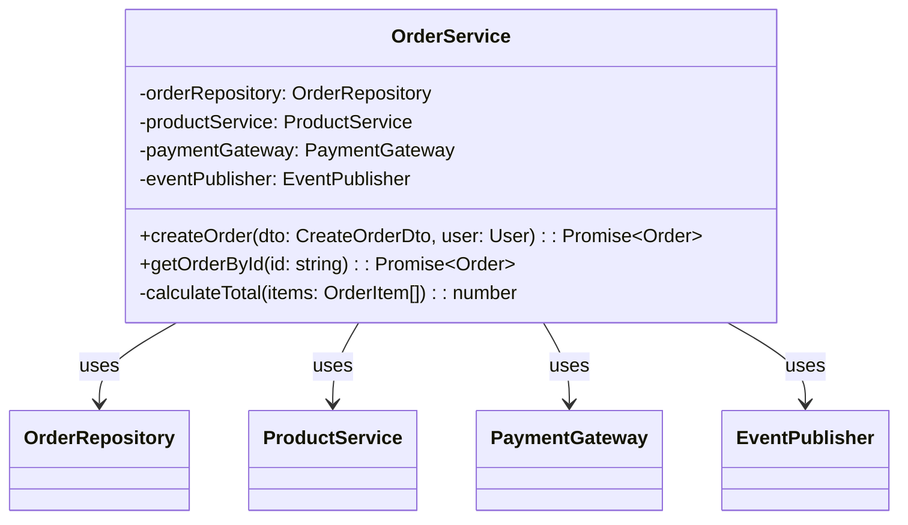
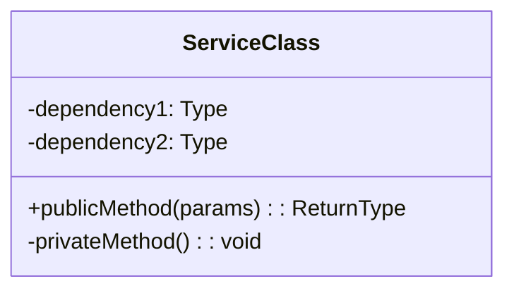
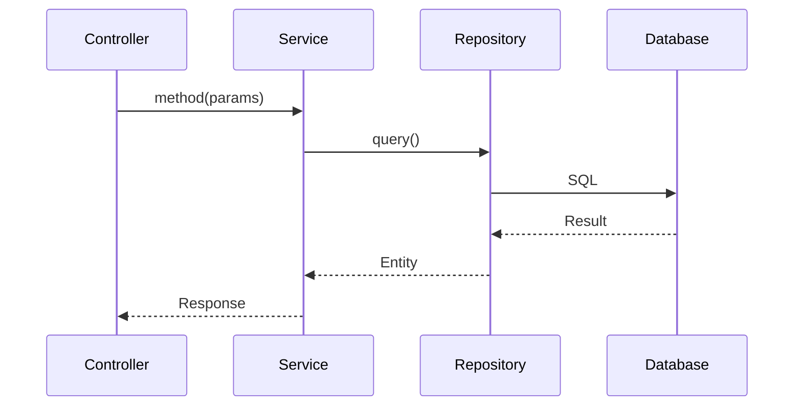

# HƯỚNG DẪN TOÀN DIỆN: TẠO LẠI TÀI LIỆU THIẾT KẾ CHI TIẾT (DETAILED DESIGN) TỪ CODEBASE BẰNG AI

---

## 📋 MỤC LỤC

1. [Tổng quan về Reverse Engineering Detailed Design](#1-tổng-quan)
2. [Đầu vào cần thiết](#2-đầu-vào)
3. [Quy trình phân tích codebase](#3-quy-trình-phân-tích)
4. [Cấu trúc thư mục tài liệu đầu ra](#4-cấu-trúc-thư-mục)
5. [Hướng dẫn chi tiết từng phần](#5-hướng-dẫn-chi-tiết)
6. [Template và mẫu](#6-template)
7. [Prompt System cho AI](#7-prompt-system)
8. [Checklist và Quality Assurance](#8-checklist)

---

## 1. TỔNG QUAN VỀ REVERSE ENGINEERING DETAILED DESIGN

### 1.1 Định nghĩa

```
┌─────────────────────────────────────────────────────────────────┐
│           REVERSE ENGINEERING DETAILED DESIGN                    │
├─────────────────────────────────────────────────────────────────┤
│                                                                  │
│   Existing Codebase      Analyze & Extract     Detailed Design   │
│   + Basic Design    →    (Phân tích)      →   (Tài liệu DD)     │
│                                                                  │
│   ┌─────────────────┐   ┌─────────────────┐   ┌──────────────┐  │
│   │ Source Code     │   │ Deep Analysis   │   │ Document     │  │
│   │ + Basic Design  │ → │ + Class Design  │ → │ Implementation│  │
│   │ + Database      │   │ + Algorithms    │   │ Details      │  │
│   │ + APIs          │   │ + Sequences     │   │              │  │
│   └─────────────────┘   └─────────────────┘   └──────────────┘  │
│                                                                  │
│   Ngược lại với Forward Engineering:                             │
│   Basic Design → Detailed Design → Code                          │
│                                                                  │
│   Reverse Engineering:                                           │
│   Code + Basic Design → Extract Implementation Details → DD     │
│                                                                  │
└─────────────────────────────────────────────────────────────────┘
```

### 1.2 Mục đích của Reverse Engineering Detailed Design

| Mục đích                        | Mô tả                                     |
| ------------------------------- | ----------------------------------------- |
| **Tài liệu hóa implementation** | Ghi lại chi tiết cách code được implement |
| **Developer onboarding**        | Giúp developer mới hiểu code nhanh hơn    |
| **Code review & audit**         | Hỗ trợ review logic và tìm issues         |
| **Refactoring planning**        | Hiểu rõ code trước khi refactor           |
| **Knowledge preservation**      | Lưu giữ kiến thức khi developer rời team  |
| **Maintenance support**         | Hỗ trợ debug và maintain code             |

### 1.3 So sánh với Basic Design Reverse Engineering

| Khía cạnh           | Basic Design RE                  | Detailed Design RE                     |
| ------------------- | -------------------------------- | -------------------------------------- |
| **Mức độ chi tiết** | High-level architecture          | Implementation-level details           |
| **Focus chính**     | What the system does             | How the system does it                 |
| **Diagrams**        | Component, Context, ERD overview | Class, Sequence, State, Activity       |
| **Code analysis**   | Structure và patterns            | Methods, algorithms, logic flow        |
| **Input bổ sung**   | Codebase + Summary docs          | Codebase + Summary docs + Basic Design |

---

## 2. ĐẦU VÀO CẦN THIẾT

### 2.1 Tổng quan các nguồn đầu vào

```
┌─────────────────────────────────────────────────────────────────┐
│            NGUỒN ĐẦU VÀO CHO REVERSE ENGINEERING DD              │
├─────────────────────────────────────────────────────────────────┤
│                                                                  │
│   ┌───────────────────┐    ┌───────────────────┐                │
│   │ 📄 TÀI LIỆU       │    │ 📁 CẤU TRÚC DỰ ÁN │                │
│   │ SUMMARY           │    │                   │                │
│   ├───────────────────┤    ├───────────────────┤                │
│   │ • README.md       │    │ • Folder tree     │                │
│   │ • Project docs    │    │ • Module layout   │                │
│   │ • API docs        │    │ • Config files    │                │
│   │ • Decision logs   │    │ • Build scripts   │                │
│   └───────────────────┘    └───────────────────┘                │
│                                                                  │
│   ┌───────────────────┐    ┌───────────────────┐                │
│   │ 💾 CODEBASE       │    │ 📋 BASIC DESIGN   │                │
│   │ (CHI TIẾT)        │    │ DOCUMENT          │                │
│   ├───────────────────┤    ├───────────────────┤                │
│   │ • Class designs   │    │ • System overview │                │
│   │ • Method impl     │    │ • Architecture    │                │
│   │ • Algorithms      │    │ • Data design     │                │
│   │ • Error handling  │    │ • API overview    │                │
│   │ • Security impl   │    │ • Screen design   │                │
│   │ • DB queries      │    │ • NFR overview    │                │
│   └───────────────────┘    └───────────────────┘                │
│                                                                  │
└─────────────────────────────────────────────────────────────────┘
```

### 2.2 Chi tiết từng nguồn đầu vào

#### 2.2.1 Tài liệu Summary (Nếu có)

| Loại tài liệu     | Mô tả                                      | Ưu tiên    |
| ----------------- | ------------------------------------------ | ---------- |
| README.md         | Tổng quan dự án, cách build, cấu hình      | Cao        |
| API Documentation | Swagger/OpenAPI specs, Postman collections | Cao        |
| Architecture Docs | Tài liệu kiến trúc có sẵn                  | Cao        |
| Decision Log      | Các quyết định thiết kế đã được ghi nhận   | Trung bình |

#### 2.2.2 Basic Design Document (BẮT BUỘC)

> ⚠️ **QUAN TRỌNG**: Basic Design Document là input bắt buộc cho Detailed Design Reverse Engineering. Nếu chưa có, cần tạo trước bằng Basic Design Reverse Engineering.

| Section trong BD    | Sử dụng cho DD Section       |
| ------------------- | ---------------------------- |
| System Overview     | Introduction, Design Context |
| System Architecture | System Overview, Tech Stack  |
| Functional Design   | Module Design                |
| Data Design         | Database Design chi tiết     |
| API Design          | API Design chi tiết          |
| Screen Design       | UI/UX Specifications         |
| Non-functional      | Security, Performance Design |
| Error Handling      | Error Handling chi tiết      |

#### 2.2.3 Codebase - Phân tích chi tiết

| Thành phần          | File patterns                            | Trích xuất được                   |
| ------------------- | ---------------------------------------- | --------------------------------- |
| **Classes/Modules** | `*.ts`, `*.java`, `*.py`, `*.cs`         | Class diagrams, method signatures |
| **Services**        | `*Service.*`, `*UseCase.*`               | Business logic, algorithms        |
| **Controllers**     | `*Controller.*`, `routes.*`              | API implementation details        |
| **Repositories**    | `*Repository.*`, `*Dao.*`                | Data access patterns, queries     |
| **DTOs/Models**     | `*Dto.*`, `*Request.*`, `*Response.*`    | Data structures, validations      |
| **Middlewares**     | `*Middleware.*`, `*Guard.*`, `*Filter.*` | Cross-cutting concerns            |
| **Error handlers**  | `*Exception.*`, `*Error.*`               | Error handling implementation     |
| **Security**        | `*Auth.*`, `*Security.*`, `*Guard.*`     | Security implementation           |
| **Tests**           | `*.spec.*`, `*.test.*`                   | Expected behaviors, edge cases    |

### 2.3 Template thu thập thông tin đầu vào

```markdown
# THÔNG TIN ĐẦU VÀO CHO REVERSE ENGINEERING DETAILED DESIGN

## 1. Thông tin dự án cơ bản

| Thông tin             | Giá trị                               |
| --------------------- | ------------------------------------- |
| Tên dự án             | [Tên dự án]                           |
| Đường dẫn source code | [Path to codebase]                    |
| Ngôn ngữ chính        | [Java/TypeScript/Python/Go/C#...]     |
| Framework             | [Spring/NestJS/Django/Gin/ASP.NET...] |
| Database              | [PostgreSQL/MySQL/MongoDB/...]        |

## 2. Basic Design Document

| Thông tin    | Giá trị             |
| ------------ | ------------------- |
| Đường dẫn BD | [Path to BD folder] |
| File index   | [Path to _index.md] |
| Trạng thái   | [Complete/Partial]  |

## 3. Tài liệu có sẵn khác

- [ ] README.md
- [ ] API Documentation (Swagger/OpenAPI)
- [ ] Database schema/ERD
- [ ] Test documentation
- [ ] Deployment guide
- [ ] Khác: **\_\_\_**

## 4. Phạm vi reverse engineering

- [ ] Full system (toàn bộ hệ thống)
- [ ] Specific modules: [Liệt kê các module]
- [ ] Specific areas:
  - [ ] Module Design (Class diagrams, Sequences)
  - [ ] Database Design chi tiết
  - [ ] API Design chi tiết với Business Logic
  - [ ] UI/UX Specifications
  - [ ] Security Implementation
  - [ ] Error Handling chi tiết
  - [ ] Logging & Monitoring
  - [ ] Deployment Design

## 5. Ngôn ngữ đầu ra mong muốn

- [ ] Tiếng Việt
- [ ] Tiếng Anh
- [ ] Tiếng Nhật
- [ ] Khác: **\_\_\_**

## 6. Yêu cầu đặc biệt

[Ghi chú thêm nếu có]
```

---

## 3. QUY TRÌNH PHÂN TÍCH CODEBASE

### 3.1 Workflow tổng quan

```
┌──────────────────────────────────────────────────────────────────┐
│          QUY TRÌNH REVERSE ENGINEERING DETAILED DESIGN           │
└──────────────────────────────────────────────────────────────────┘
                              │
                              ▼
┌──────────────────────────────────────────────────────────────────┐
│ BƯỚC 1: THU THẬP & CHUẨN BỊ                                      │
├──────────────────────────────────────────────────────────────────┤
│ • Đọc Basic Design Document (BẮT BUỘC)                           │
│ • Đọc tất cả tài liệu summary có sẵn                             │
│ • Phân tích cấu trúc thư mục project chi tiết                    │
│ • Xác định technology stack từ config files                      │
│ • Liệt kê các classes/modules cần phân tích                      │
└──────────────────────────────────────────────────────────────────┘
                              │
                              ▼
┌──────────────────────────────────────────────────────────────────┐
│ BƯỚC 2: PHÂN TÍCH MODULE/CLASS DESIGN                            │
├──────────────────────────────────────────────────────────────────┤
│ • Trích xuất class diagrams từ source code                       │
│ • Phân tích inheritance, composition, dependencies               │
│ • Document method signatures với đầy đủ parameters               │
│ • Trích xuất Sequence diagrams cho các use cases                 │
│ • Phân tích State diagrams (nếu có state management)             │
│ • Document algorithms và business logic                          │
└──────────────────────────────────────────────────────────────────┘
                              │
                              ▼
┌──────────────────────────────────────────────────────────────────┐
│ BƯỚC 3: PHÂN TÍCH DATABASE DESIGN CHI TIẾT                       │
├──────────────────────────────────────────────────────────────────┤
│ • Chi tiết hóa ERD với đầy đủ columns, types, constraints        │
│ • Trích xuất indexes, triggers, stored procedures                │
│ • Document query patterns từ repository layer                    │
│ • Phân tích data migration scripts                               │
│ • Document data dictionary với business rules                    │
└──────────────────────────────────────────────────────────────────┘
                              │
                              ▼
┌──────────────────────────────────────────────────────────────────┐
│ BƯỚC 4: PHÂN TÍCH API CHI TIẾT VỚI BUSINESS LOGIC                │
├──────────────────────────────────────────────────────────────────┤
│ • Chi tiết hóa API specs với request/response schemas            │
│ • Trích xuất validation rules từ DTOs                            │
│ • Document business logic flow cho mỗi API (QUAN TRỌNG)          │
│ • Tạo Sequence diagrams cho API calls                            │
│ • Document error handling cho từng API                           │
│ • Trích xuất pseudocode cho logic phức tạp                       │
└──────────────────────────────────────────────────────────────────┘
                              │
                              ▼
┌──────────────────────────────────────────────────────────────────┐
│ BƯỚC 5: PHÂN TÍCH UI/UX SPECIFICATIONS                           │
├──────────────────────────────────────────────────────────────────┤
│ • Chi tiết component specifications                              │
│ • Trích xuất validation rules từ forms                           │
│ • Document screen states và transitions                          │
│ • Phân tích data flow trong UI                                   │
└──────────────────────────────────────────────────────────────────┘
                              │
                              ▼
┌──────────────────────────────────────────────────────────────────┐
│ BƯỚC 6: PHÂN TÍCH CROSS-CUTTING CONCERNS                         │
├──────────────────────────────────────────────────────────────────┤
│ • Security implementation (auth, authorization, encryption)      │
│ • Error handling strategy và error codes                         │
│ • Logging implementation và log formats                          │
│ • Monitoring và metrics                                          │
│ • Deployment configuration                                       │
└──────────────────────────────────────────────────────────────────┘
                              │
                              ▼
┌──────────────────────────────────────────────────────────────────┐
│ BƯỚC 7: TỔNG HỢP & TẠO TÀI LIỆU                                  │
├──────────────────────────────────────────────────────────────────┤
│ • Compile tất cả findings vào các sections                       │
│ • Cross-reference với Basic Design                               │
│ • Validate với source code                                       │
│ • Format theo template chuẩn Detailed Design                     │
│ • Review và hoàn thiện                                           │
└──────────────────────────────────────────────────────────────────┘
```

### 3.2 Mapping từ Code sang Detailed Design Elements

```
┌─────────────────────────┬──────────────────────────┬───────────────────────────┐
│  CODE ELEMENT           │     DESIGN ELEMENT       │   DETAILED DESIGN SECTION │
├─────────────────────────┼──────────────────────────┼───────────────────────────┤
│ Class definitions       │ Class Diagrams           │ 05-module-design          │
│ Method implementations  │ Sequence Diagrams        │ 05-module-design          │
│ State management code   │ State Diagrams           │ 05-module-design          │
│ Complex algorithms      │ Algorithm descriptions   │ 05-module-design          │
│ Entity/Model details    │ Table Specifications     │ 06-database-design        │
│ Repository queries      │ Query patterns           │ 06-database-design        │
│ Migration files         │ Migration scripts        │ 06-database-design        │
│ Controller + Service    │ API Business Logic       │ 07-api-design             │
│ DTO validations         │ Request/Response specs   │ 07-api-design             │
│ UI Components           │ Component specifications │ 08-ui-specifications      │
│ Form validations        │ Validation rules         │ 08-ui-specifications      │
│ Auth/Guard code         │ Security implementation  │ 09-security-design        │
│ Exception handlers      │ Error handling strategy  │ 10-error-handling         │
│ Logger configurations   │ Logging design           │ 11-logging-monitoring     │
│ Docker/K8s configs      │ Deployment design        │ 12-deployment-design      │
└─────────────────────────┴──────────────────────────┴───────────────────────────┘
```

### 3.3 Trích xuất Class Design từ Code

**Input (Source Code):**

```typescript
// TypeScript/NestJS example
@Injectable()
export class OrderService {
  constructor(
    private readonly orderRepository: OrderRepository,
    private readonly productService: ProductService,
    private readonly paymentGateway: PaymentGateway,
    private readonly eventPublisher: EventPublisher
  ) {}

  async createOrder(dto: CreateOrderDto, user: User): Promise<Order> {
    // Business logic
  }

  async getOrderById(id: string): Promise<Order> {
    // Implementation
  }

  private calculateTotal(items: OrderItem[]): number {
    // Calculation logic
  }
}
```

**Output (Class Diagram - Mermaid):**



**Output (Class Specification Table):**

| Attribute   | Value              |
| ----------- | ------------------ |
| Class Name  | OrderService       |
| Type        | Service            |
| Package     | src/modules/order/ |
| Source File | order.service.ts   |

| Method         | Parameters                      | Return Type    | Access  | Description            |
| -------------- | ------------------------------- | -------------- | ------- | ---------------------- |
| createOrder    | dto: CreateOrderDto, user: User | Promise<Order> | public  | Creates new order      |
| getOrderById   | id: string                      | Promise<Order> | public  | Gets order by ID       |
| calculateTotal | items: OrderItem[]              | number         | private | Calculates order total |

---

## 4. CẤU TRÚC THƯ MỤC TÀI LIỆU ĐẦU RA

> ⚠️ **QUAN TRỌNG**: Output tuân theo format chuẩn của Detailed Design Document.

### 4.1 Cấu trúc thư mục chuẩn

Tên thư mục được đặt theo ngôn ngữ của tài liệu:

- Tiếng Việt: `Tài liệu Thiết kế Chi tiết`
- Tiếng Anh: `Detailed Design Document`
- Tiếng Nhật: `詳細設計書`

```
📁 [Tên thư mục chứa tài liệu]/
├── 📁 Detailed Design Document/           # Hoặc tên theo ngôn ngữ phù hợp
│   ├── 📄 _index.md                        # File index - BẮT BUỘC
│   ├── 📄 01-introduction.md               # Giới thiệu và tổng quan
│   ├── 📄 02-references-terminology.md     # Tài liệu tham chiếu, thuật ngữ
│   ├── 📄 03-system-overview.md            # Tổng quan hệ thống
│   ├── 📄 04-design-considerations.md      # Các cân nhắc thiết kế
│   ├── 📄 05-module-design.md              # Thiết kế module chi tiết
│   ├── 📄 06-database-design.md            # Thiết kế database chi tiết
│   ├── 📄 07-api-design.md                 # Thiết kế API chi tiết
│   ├── 📄 08-ui-specifications.md          # Đặc tả UI/UX chi tiết
│   ├── 📄 09-security-design.md            # Thiết kế bảo mật
│   ├── 📄 10-error-handling.md             # Xử lý lỗi chi tiết
│   ├── 📄 11-logging-monitoring.md         # Logging và Monitoring
│   ├── 📄 12-deployment-design.md          # Thiết kế triển khai
│   └── 📄 13-appendices.md                 # Phụ lục
```

### 4.2 File Index (\_index.md) - Template cho Reverse Engineering

```markdown
# [TÊN DỰ ÁN] - Tài liệu Thiết kế Chi tiết (Reverse Engineered)

## Thông tin tài liệu

| Thông tin               | Giá trị                          |
| ----------------------- | -------------------------------- |
| Tên dự án               | [Project Name]                   |
| Nguồn gốc               | Reverse Engineered from Codebase |
| Phiên bản code analyzed | [Git commit hash / version]      |
| Basic Design Reference  | [Path to Basic Design]           |
| Ngày tạo                | [DD/MM/YYYY]                     |
| Trạng thái              | Draft / Review / Approved        |

## Tổng quan dự án

[Mô tả ngắn gọn về dự án được trích xuất từ README hoặc Basic Design - 3-5 câu]

## Nguồn dữ liệu phân tích

| Nguồn           | Đường dẫn/Mô tả             |
| --------------- | --------------------------- |
| Source Code     | [Path to codebase]          |
| Basic Design    | [Path to BD folder]         |
| Tài liệu có sẵn | [List existing docs]        |
| Database Schema | [Path to schema/migrations] |
| API Docs        | [Path to Swagger/OpenAPI]   |

## Cấu trúc tài liệu

| STT | File                         | Nội dung chính        | Mô tả                                         |
| --- | ---------------------------- | --------------------- | --------------------------------------------- |
| 1   | 01-introduction.md           | Giới thiệu            | Mục đích, phạm vi, đối tượng sử dụng          |
| 2   | 02-references-terminology.md | Tham chiếu, thuật ngữ | Tài liệu liên quan, định nghĩa thuật ngữ      |
| 3   | 03-system-overview.md        | Tổng quan hệ thống    | Technology stack, architecture pattern        |
| 4   | 04-design-considerations.md  | Cân nhắc thiết kế     | Assumptions, constraints, design decisions    |
| 5   | 05-module-design.md          | Thiết kế module       | Class diagrams, sequence diagrams, algorithms |
| 6   | 06-database-design.md        | Thiết kế database     | ERD chi tiết, table specs, indexes            |
| 7   | 07-api-design.md             | Thiết kế API          | API specs với Business Logic                  |
| 8   | 08-ui-specifications.md      | Đặc tả UI/UX          | Component specs, validation rules             |
| 9   | 09-security-design.md        | Thiết kế bảo mật      | Authentication, authorization, encryption     |
| 10  | 10-error-handling.md         | Xử lý lỗi             | Error codes, exception handling               |
| 11  | 11-logging-monitoring.md     | Logging & Monitoring  | Log formats, metrics, alerts                  |
| 12  | 12-deployment-design.md      | Thiết kế triển khai   | Infrastructure, CI/CD                         |
| 13  | 13-appendices.md             | Phụ lục               | Traceability matrix, full specs               |

## Thông tin chính cho AI Context

### Technology Stack (từ code analysis)

- Frontend: [Technologies]
- Backend: [Technologies]
- Database: [Technologies]
- Infrastructure: [Technologies]

### Modules/Services chính

- [Module 1]: [Chức năng chính và classes quan trọng]
- [Module 2]: [Chức năng chính và classes quan trọng]

### Design Patterns được sử dụng

- [Pattern 1]: [Mục đích sử dụng]
- [Pattern 2]: [Mục đích sử dụng]

### Lưu ý về Reverse Engineering

- ⚠️ Tài liệu này được tạo từ phân tích code
- ⚠️ Business Logic được trích xuất từ implementation
- ⚠️ [Các assumptions trong quá trình phân tích]

## Tham chiếu đến tài liệu liên quan

| Loại tài liệu     | Đường dẫn            |
| ----------------- | -------------------- |
| Basic Design      | [Link to BD doc]     |
| Source Code       | [Link to repository] |
| API Documentation | [Link - nếu có]      |

---

_File này được tạo tự động từ quá trình Reverse Engineering._
```

---

## 5. HƯỚNG DẪN CHI TIẾT TỪNG PHẦN

### 5.1 Trích xuất Module Design

> ⭐ **QUAN TRỌNG**: Module Design là phần quan trọng nhất của Detailed Design, cần phân tích sâu vào implementation.

**Nguồn dữ liệu:**

- Service/UseCase classes
- Controller classes
- Repository/DAO classes
- Domain entities
- Test files (để hiểu behaviors)

**Output cần tạo:**

#### Class Diagram cho mỗi module



#### Method Specifications

| Method      | Parameters          | Return | Description                       | Source              |
| ----------- | ------------------- | ------ | --------------------------------- | ------------------- |
| createOrder | dto: CreateOrderDto | Order  | Creates new order with validation | order.service.ts:45 |

#### Sequence Diagrams cho Use Cases



#### Algorithm Descriptions

**Luôn mô tả bằng ngôn ngữ tự nhiên trước, sau đó mới có pseudocode nếu cần:**

```markdown
**Mô tả logic xử lý [Tên logic]:**

**Mục đích:** [Mô tả mục đích]

**Các bước xử lý:**

1. Bước 1: [Mô tả]
2. Bước 2: [Mô tả]
3. ...

**Pseudocode (kèm comment):**
[Code với comment giải thích]
```

### 5.2 Trích xuất API Design với Business Logic

> ⭐ **BẮT BUỘC**: Mỗi API phải có phần Business Logic chi tiết.

**Cấu trúc Business Logic cho mỗi API:**

```markdown
## API: [Method] [Endpoint]

### Thông tin cơ bản

| Item          | Value            | Source                |
| ------------- | ---------------- | --------------------- |
| URL           | /api/v1/resource | controller.ts:15      |
| Method        | POST             | @Post() decorator     |
| Auth Required | Yes              | @UseGuards(AuthGuard) |

### Business Logic ⭐

> **Mô tả tổng quan:** [API này làm gì, mục đích business]

**Luồng xử lý chi tiết:**

1. **Bước 1 - Validation:**

   - Kiểm tra gì?
   - Lỗi trả về gì?

2. **Bước 2 - Authorization:**

   - Ai được phép?
   - Kiểm tra thế nào?

3. **Bước 3 - Business Rules:**

   - Quy tắc nghiệp vụ nào áp dụng?

4. **Bước 4 - Data Processing:**

   - Xử lý dữ liệu như thế nào?

5. **Bước 5 - Persistence:**

   - Lưu trữ ở đâu?

6. **Bước 6 - Response:**
   - Trả về gì?

**Bảng quyết định xử lý lỗi:**

| Điều kiện     | Kết quả | HTTP Status | Error Code   |
| ------------- | ------- | ----------- | ------------ |
| [Condition 1] | Reject  | 400         | [ERROR_CODE] |
| [All OK]      | Success | 201         | -            |

**Sequence Diagram:**
[Mermaid diagram]

**Pseudocode (kèm giải thích):**
[Code với comment]
```

### 5.3 Trích xuất Database Design chi tiết

**Output Format cho mỗi table:**

```markdown
### Table: [table_name]

**Source:** `src/entities/[Entity].ts`

**Mô tả:** [Mô tả mục đích của table]

| No  | Column Name | Data Type    | PK  | FK  | NN  | Default           | Description   |
| --- | ----------- | ------------ | --- | --- | --- | ----------------- | ------------- |
| 1   | id          | UUID         | ○   |     | ○   | gen_random_uuid() | Primary key   |
| 2   | name        | VARCHAR(100) |     |     | ○   |                   | Entity name   |
| 3   | created_at  | TIMESTAMP    |     |     | ○   | CURRENT_TIMESTAMP | Creation time |

**Indexes:**

| Index Name     | Columns | Type  | Purpose     | Source           |
| -------------- | ------- | ----- | ----------- | ---------------- |
| idx_table_name | (name)  | BTREE | Fast lookup | @Index decorator |

**Relationships:**

| Column  | Target Table | Type      | Cascade  | Source       |
| ------- | ------------ | --------- | -------- | ------------ |
| user_id | users        | ManyToOne | SET NULL | @ManyToOne() |

**Query Patterns (từ Repository):**

| Query         | Used By     | Indexes Used    | Source             |
| ------------- | ----------- | --------------- | ------------------ |
| findByEmail() | UserService | idx_users_email | user.repository.ts |
```

### 5.4 Trích xuất Security Design

**Nguồn dữ liệu:**

- Auth modules/guards
- Security configurations
- Encryption utilities
- JWT/OAuth implementations

**Output Format:**

```markdown
## Security Implementation

### Authentication

| Aspect        | Implementation   | Source          |
| ------------- | ---------------- | --------------- |
| Method        | JWT Bearer Token | jwt.strategy.ts |
| Token Expiry  | 15 minutes       | auth.module.ts  |
| Refresh Token | 7 days           | auth.service.ts |

### Password Security

| Aspect      | Implementation | Source             |
| ----------- | -------------- | ------------------ |
| Algorithm   | Bcrypt         | auth.service.ts:45 |
| Cost Factor | 12             | auth.service.ts:46 |

### Authorization

| Role  | Permissions (extracted from Guards)  |
| ----- | ------------------------------------ |
| admin | \*, all endpoints                    |
| user  | GET/PUT own profile, GET/POST orders |
```

### 5.5 Trích xuất Error Handling

**Output Format:**

````markdown
## Error Handling Implementation

### Error Code System

**Format:** [Extracted from exception class naming]

### Error Code List (Extracted from codebase)

| Code      | HTTP | Message             | Thrown By    | Source               |
| --------- | ---- | ------------------- | ------------ | -------------------- |
| AUTH_001  | 401  | Invalid credentials | AuthService  | auth.service.ts:78   |
| USER_001  | 404  | User not found      | UserService  | user.service.ts:45   |
| ORDER_001 | 422  | Insufficient stock  | OrderService | order.service.ts:112 |

### Error Response Format

```json
{
  "success": false,
  "error": {
    "code": "string",
    "message": "string",
    "details": {}
  }
}
```
````

**Source:** `src/shared/filters/http-exception.filter.ts`

````

---

## 6. TEMPLATE VÀ MẪU

### 6.1 Template File 05-module-design.md

```markdown
# Thiết kế Module

## 1. Tổng quan

| Mục           | Giá trị                         |
| ------------- | ------------------------------- |
| Số lượng modules | [N]                          |
| Architecture  | [Pattern name]                  |
| Source        | Extracted from src/ structure   |

## 2. Module: [Module Name]

### 2.1 Module Overview

| Attribute     | Value                  |
| ------------- | ---------------------- |
| Module Path   | src/modules/[name]/    |
| Description   | [Mô tả chức năng]      |
| Dependencies  | [List dependencies]    |

### 2.2 Class Diagram

```mermaid
classDiagram
    [Extracted class diagram]
````

### 2.3 Class Specifications

#### Class: [ClassName]

**Source:** `src/modules/[name]/[file].ts`

| Attribute    | Value                         |
| ------------ | ----------------------------- |
| Type         | Service/Controller/Repository |
| Dependencies | [List]                        |

**Methods:**

| Method   | Parameters | Return Type | Access | Description |
| -------- | ---------- | ----------- | ------ | ----------- |
| [method] | [params]   | [type]      | public | [desc]      |

**Method Detail: [methodName]()**

[Mô tả chi tiết bằng ngôn ngữ tự nhiên]

### 2.4 Sequence Diagrams

#### Use Case: [UC-xxx] - [Name]

```mermaid
sequenceDiagram
    [Extracted sequence]
```

---

_Extracted from: src/modules/[name]/_

````

### 6.2 Template File 07-api-design.md

```markdown
# Thiết kế API Chi tiết

## 1. API Overview

| Attribute | Value |
|-----------|-------|
| Base URL | [Extracted from config] |
| Protocol | HTTPS |
| Format | JSON |
| Authentication | [Extracted from guards] |

## 2. API List

| ID       | Endpoint        | Method | Description     | Auth | Source              |
| -------- | --------------- | ------ | --------------- | ---- | ------------------- |
| API-001  | /api/v1/users   | POST   | Create user     | Yes  | user.controller.ts:15 |

## 3. API Specifications

### 3.1 API-001: POST /api/v1/users

**Source:** `src/modules/user/user.controller.ts:15`

#### Endpoint Information

| Item          | Value                |
| ------------- | -------------------- |
| URL           | /api/v1/users        |
| Method        | POST                 |
| Auth Required | Yes                  |
| Required Role | admin                |

#### Request Body (from CreateUserDto)

```json
{
  "email": "string",
  "password": "string"
}
````

**Validation Rules (from DTO decorators):**

| Field    | Type   | Required | Validation    | Source             |
| -------- | ------ | -------- | ------------- | ------------------ |
| email    | string | Yes      | @IsEmail()    | create-user.dto.ts |
| password | string | Yes      | @MinLength(8) | create-user.dto.ts |

#### Business Logic ⭐

> **Mô tả tổng quan:** [Extracted from service implementation]

**Luồng xử lý chi tiết:**

1. **Bước 1 - Validation:** [Extracted]
2. **Bước 2 - Business Rules:** [Extracted]
3. **Bước 3 - Persistence:** [Extracted]
4. **Bước 4 - Response:** [Extracted]

**Sequence Diagram:**

```mermaid
sequenceDiagram
    [Extracted from code flow]
```

**Pseudocode (kèm giải thích):**

```pseudocode
[Extracted and documented algorithm]
```

#### Response

**Success (201):**

```json
{
  "id": "uuid",
  "email": "string"
}
```

**Errors:**

| Status | Code       | Message       | Condition         |
| ------ | ---------- | ------------- | ----------------- |
| 400    | VALIDATION | Invalid input | Validation failed |
| 409    | DUPLICATE  | Email exists  | Duplicate email   |

---

_Extracted from: src/modules/user/\*_

````

---

## 7. PROMPT SYSTEM CHO AI

### 7.1 System Prompt

```markdown
# SYSTEM PROMPT: REVERSE ENGINEERING DETAILED DESIGN DOCUMENT GENERATOR

## ROLE
Bạn là Senior Software Architect chuyên về Reverse Engineering. Nhiệm vụ của bạn là phân tích codebase có sẵn kết hợp với Basic Design Document để tạo ra tài liệu Detailed Design chuyên nghiệp, đủ chi tiết để developer có thể hiểu và maintain code.

## EXPERTISE
- Deep Code Analysis và Pattern Recognition
- Class/Sequence/State Diagram extraction
- Algorithm documentation
- API Business Logic extraction
- Database implementation analysis
- Security implementation analysis

## INPUT PROCESSING RULES

### Rule 1: Source Analysis Priority
1. Đọc Basic Design Document trước (REQUIRED)
2. Phân tích source code chi tiết (classes, methods, logic)
3. Cross-reference với Basic Design
4. Document implementation details

### Rule 2: Extraction Guidelines
- Mọi thông tin PHẢI có source reference (file path, line number)
- Trích xuất Business Logic đầy đủ cho mỗi API
- Document algorithms bằng ngôn ngữ tự nhiên TRƯỚC, sau đó mới có code
- Ghi nhận assumptions khi inference

### Rule 3: Business Logic Requirements (QUAN TRỌNG)
Mỗi API PHẢI có:
- Mô tả tổng quan
- Luồng xử lý chi tiết (đánh số bước)
- Bảng quyết định xử lý lỗi
- Sequence Diagram
- Pseudocode với comments

### Rule 4: Quality Standards
- Accurate: Phản ánh đúng implementation
- Complete: Không bỏ sót logic quan trọng
- Traceable: Có thể trace về source code
- Readable: Developer có thể implement từ tài liệu

## OUTPUT SECTIONS
Tạo đầy đủ các sections:
1. Introduction
2. References & Terminology
3. System Overview
4. Design Considerations
5. Module Design (với Class/Sequence diagrams)
6. Database Design (chi tiết)
7. API Design (với Business Logic)
8. UI/UX Specifications
9. Security Design
10. Error Handling
11. Logging & Monitoring
12. Deployment Design
13. Appendices
````

### 7.2 User Prompt Template

```markdown
# REQUEST: TẠO TÀI LIỆU DETAILED DESIGN TỪ CODEBASE

## THÔNG TIN DỰ ÁN

### Tên dự án: [Project Name]

### Đường dẫn codebase: [Path]

### Basic Design Document: [Path to BD]

### Cấu trúc thư mục:
```

[Paste folder tree]

```

### Technology Stack:
- Backend: [Framework/Version]
- Frontend: [Framework/Version]
- Database: [Type/Version]

## YÊU CẦU ĐẦU RA

### Ngôn ngữ: [Tiếng Việt / English / 日本語]

### Mức độ chi tiết: Full detail với Business Logic

### Yêu cầu đặc biệt:
[Ghi chú thêm]

---

Hãy phân tích codebase và tạo tài liệu Detailed Design hoàn chỉnh với đầy đủ Business Logic cho mỗi API.
```

---

## 8. CHECKLIST VÀ QUALITY ASSURANCE

### 8.1 Pre-Analysis Checklist

```markdown
# CHECKLIST TRƯỚC KHI PHÂN TÍCH

## Input Documents

- [ ] Đã có Basic Design Document
- [ ] Đã có access vào codebase
- [ ] Đã xác định version/commit đang phân tích

## Chuẩn bị

- [ ] Đã đọc Basic Design overview
- [ ] Đã hiểu architecture từ BD
- [ ] Đã xác định modules cần phân tích chi tiết
```

### 8.2 Post-Generation Checklist

```markdown
# CHECKLIST SAU KHI TẠO TÀI LIỆU

## Hoàn thiện nội dung

- [ ] \_index.md có đầy đủ thông tin tổng quan
- [ ] Tất cả sections đã được tạo
- [ ] Mỗi section có source references

## Module Design

- [ ] Class diagrams cho tất cả modules
- [ ] Sequence diagrams cho use cases chính
- [ ] Method specifications đầy đủ
- [ ] Algorithms được mô tả bằng ngôn ngữ tự nhiên

## API Design

- [ ] Mỗi API có Business Logic section
- [ ] Có sequence diagrams
- [ ] Có bảng quyết định xử lý lỗi
- [ ] Có pseudocode với comments

## Database Design

- [ ] ERD chi tiết với constraints
- [ ] Table specifications đầy đủ
- [ ] Indexes và query patterns

## Cross-cutting Concerns

- [ ] Security implementation documented
- [ ] Error handling với error codes
- [ ] Logging configuration
- [ ] Deployment design

## Quality

- [ ] Cross-reference với Basic Design
- [ ] Source file references chính xác
- [ ] Mermaid diagrams render được
- [ ] Consistent formatting
```

### 8.3 Verification Matrix

```markdown
| Design Element  | Verification Method          | Source Check |
| --------------- | ---------------------------- | ------------ |
| Module Design   | Class files match            | ○            |
| Sequences       | Method call flow match       | ○            |
| Database Design | Entity/Migration match       | ○            |
| API Design      | Controller+Service match     | ○            |
| Business Logic  | Service implementation match | ○            |
| Security        | Auth/Guard files match       | ○            |
| Error Handling  | Exception files match        | ○            |
```

---

## 9. KẾT LUẬN

### Tóm tắt quy trình

```
┌─────────────────────────────────────────────────────────────────┐
│          REVERSE ENGINEERING DETAILED DESIGN WORKFLOW            │
├─────────────────────────────────────────────────────────────────┤
│                                                                  │
│  1. COLLECT INPUTS                                               │
│     ├── Basic Design Document (BẮT BUỘC)                         │
│     ├── Source code (detailed analysis)                          │
│     └── Summary documents                                        │
│                         │                                        │
│                         ▼                                        │
│  2. DEEP CODE ANALYSIS                                           │
│     ├── Extract Class Diagrams                                   │
│     ├── Extract Sequence Diagrams                                │
│     ├── Document Algorithms                                      │
│     ├── Extract Business Logic for each API                      │
│     └── Analyze cross-cutting concerns                           │
│                         │                                        │
│                         ▼                                        │
│  3. GENERATE DOCUMENTATION                                       │
│     ├── Module Design với diagrams                               │
│     ├── Database Design chi tiết                                 │
│     ├── API Design với Business Logic                            │
│     ├── Security/Error/Logging Design                            │
│     └── Deployment Design                                        │
│                         │                                        │
│                         ▼                                        │
│  4. VALIDATE & REFINE                                            │
│     ├── Cross-reference với Basic Design                         │
│     ├── Verify Business Logic accuracy                           │
│     └── Document assumptions                                     │
│                         │                                        │
│                         ▼                                        │
│  5. OUTPUT                                                       │
│     └── Detailed Design Document (Complete)                      │
│                                                                  │
└─────────────────────────────────────────────────────────────────┘
```

### Best Practices

1. **Basic Design là foundation** - Luôn đọc Basic Design trước khi deep dive vào code
2. **Business Logic là key** - Mỗi API phải có Business Logic đầy đủ
3. **Natural language first** - Mô tả logic bằng văn bản trước khi có code
4. **Source references** - Mọi thông tin phải có thể trace về code
5. **Cross-validation** - Validate với cả Basic Design và source code
