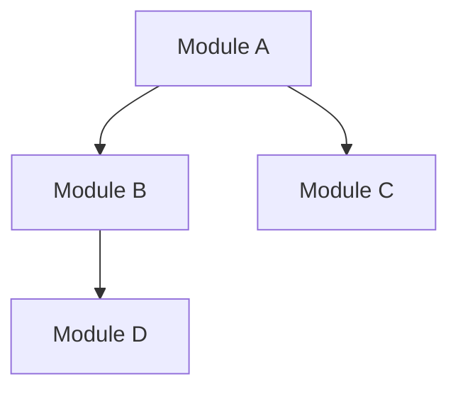

# Make-Plan Templates

> Templates để sử dụng trong workflow `/make-plan`

---

## 1. Implementation_Plan.md Template

```markdown
# Implementation Plan - {Tên dự án}

## 1. Thông tin chung

- **Ngày tạo:** {YYYY-MM-DD}
- **Nguồn DD:** {Link đến Detailed Design folder}
- **Nguồn BD:** {Link đến Basic Design folder}
- **Tech Stack:** {Liệt kê}

## 2. Danh sách TẤT CẢ Components

### 2.1 Modules (từ DD 04-module-design)

| #   | Module          | DD Reference | BD Reference | Priority | Estimate |
| --- | --------------- | ------------ | ------------ | -------- | -------- |
| 1   | User Management | §4.2.1       | BD 03#MOD-01 | High     | Xh       |

### 2.2 Use Cases (từ DD 05-component-design)

| #   | UC ID  | UC Name  | DD Section | BD Reference | Type     |
| --- | ------ | -------- | ---------- | ------------ | -------- |
| 1   | UC-001 | Login    | §5.2       | -            | Detailed |
| 2   | UC-021 | Escalate | §5.9 table | BD 03#UC-021 | BD Ref   |

### 2.3 Batch Jobs (từ DD 05-component-design)

| #   | BAT ID  | Batch Name | DD Section | BD Reference |
| --- | ------- | ---------- | ---------- | ------------ |
| 1   | BAT-001 | Reminder   | §5.8       | BD 07#BAT-01 |

### 2.4 Database Tables (từ DD 06-database-design)

| #   | Table Name | DD Reference | BD Reference  |
| --- | ---------- | ------------ | ------------- |
| 1   | m_users    | §6.2.1       | BD 05#m_users |

### 2.5 APIs / Actions (từ DD 07-api-design)

| #   | API/Action  | Method | DD Reference | BD Reference |
| --- | ----------- | ------ | ------------ | ------------ |
| 1   | POST /login | POST   | §7.2.1       | BD 06#login  |

### 2.6 UI Screens (từ DD 08-ui-specifications)

| #   | SCR ID  | Screen Name | DD Section | BD Reference |
| --- | ------- | ----------- | ---------- | ------------ |
| 1   | SCR-001 | Login       | §8.2       | BD 04#SCR-01 |

### 2.7 Security (từ DD 09-security-design)

| #   | Feature        | DD Section | BD Reference |
| --- | -------------- | ---------- | ------------ |
| 1   | Authentication | §9.2       | BD 08#8.3.1  |

### 2.8 Error Handling (từ DD 10-error-handling)

| #   | Feature           | DD Section | BD Reference |
| --- | ----------------- | ---------- | ------------ |
| 1   | Exception classes | §10.3      | BD 09#9.3    |

## 3. Coverage Summary

| Category       | DD Count | BD Ref Count | Total | Status |
| -------------- | -------- | ------------ | ----- | ------ |
| Modules        | X        | Y            | X+Y   | ✅     |
| Use Cases      | X        | Y            | X+Y   | ✅     |
| Batches        | X        | Y            | X+Y   | ✅     |
| Tables         | X        | -            | X     | ✅     |
| APIs/Actions   | X        | Y            | X+Y   | ✅     |
| Screens        | X        | Y            | X+Y   | ✅     |
| Security       | X        | -            | X     | ✅     |
| Error Handling | X        | -            | X     | ✅     |

## 4. BD Reference Items Summary

> Các items cần đọc từ BD để lấy chi tiết

| Category | Item ID | BD Section              | Đã đọc |
| -------- | ------- | ----------------------- | ------ |
| Use Case | UC-021  | BD 03-functional#UC-021 | ⬜     |
| ...      | ...     | ...                     | ...    |
```

---

## 2. Interface_Contracts.md Template

````markdown
# Interface Contracts - {Tên dự án}

## 1. Shared Types

### 1.1 Base Entity

```java
public abstract class BaseEntity {
    protected Long id;
    protected LocalDateTime createdAt;
    protected LocalDateTime updatedAt;
    protected String createdBy;
    protected String updatedBy;
}
```
````

### 1.2 Pagination

```java
public class PageRequest {
    private int page = 1;
    private int size = 20;
    private String sortBy;
    private String sortOrder; // ASC, DESC
}

public class PageResponse<T> {
    private List<T> items;
    private int page;
    private int size;
    private long totalItems;
    private int totalPages;
}
```

### 1.3 Common Enums

```java
// Extract từ DD 04-module-design
public enum Status {
    // ...
}
```

## 2. Module Interfaces

> Tạo interface cho MỖI module trong DD 04-module-design

### 2.1 I{Module1}Service

```java
/**
 * Service interface cho {Module1}
 *
 * DD Reference: 04-module-design.md#4.2.X
 */
public interface I{Module1}Service {

    /**
     * Method description
     * @param param Description
     * @return Description
     * @throws ExceptionType when...
     */
    ReturnType methodName(ParamType param);
}
```

## 3. Cross-Module Dependencies



| From Module | To Module | Dependency Type | Notes |
| ----------- | --------- | --------------- | ----- |
| Auth        | User      | Uses            | Login |

````

---

## 3. _module_overview.md Template

```markdown
# Module: {Tên Module}

## Thông tin

| Thuộc tính       | Giá trị             |
| ---------------- | ------------------- |
| Module ID        | MOD-{XX}            |
| Priority         | High / Medium / Low |
| Dependencies     | MOD-{YY}, MOD-{ZZ}  |
| Estimated Effort | X man-days          |
| DD Reference     | 04-module-design.md#4.2.X |

## Scope

### Bao gồm

- {Feature 1}
- {Feature 2}

### Không bao gồm

- {Feature excluded}

## Components

| #   | Component  | Type | DD Section | BD Reference | Status |
| --- | ---------- | ---- | ---------- | ------------ | ------ |
| 1   | UC-XXX     | UC   | §5.2       | -            | ⬜     |
| 2   | UC-YYY     | UC   | §5.9 table | BD 03#UC-YYY | ⬜     |

## Dependencies

- **Requires:** MOD-01 (Foundation) hoàn thành trước
- **Required by:** MOD-05 (Other Module)

## File Structure (gợi ý)

````

src/main/java/com/project/{module}/
├── action/
│ └── {Module}Action.java
├── service/
│ ├── {Module}Service.java
│ └── {Module}ServiceImpl.java
├── dao/
│ └── {Module}Dao.java
└── dto/
└── {Module}Dto.java

```

```

---

## 4. Master_Plan.md Template

```markdown
# Master Plan - {Tên dự án}

## Overview

| Metric        | Value   |
| ------------- | ------- |
| Total Modules | X       |
| Total Tasks   | Y       |
| BD Ref Items  | Z       |
| Est. Duration | W weeks |

## Module List

| #   | Module                                            | Tasks | Priority | Dependencies |
| --- | ------------------------------------------------- | ----- | -------- | ------------ |
| 1   | [Module_01_Foundation](./Module_01_Foundation/)   | 5     | High     | -            |
| 2   | [Module_02_Auth](./Module_02_Auth/)               | 8     | High     | 01           |
| ... | ...                                               | ...   | ...      | ...          |
| 99  | [Module_99_Integration](./Module_99_Integration/) | 10    | High     | All          |

## Task Summary by Module

### Module 01: Foundation

- 1.1 Project initialization
- 1.2 Database setup
- 1.3 Core configurations

### Module 02: Auth

- 2.1 Login implementation
- 2.2 Session management
- ...

## BD Reference Items

| Module    | BD Ref Item | BD Section   | Task ID |
| --------- | ----------- | ------------ | ------- |
| Module 03 | UC-021      | BD 03#UC-021 | 3.5     |
| ...       | ...         | ...          | ...     |
```

---

## 5. Screen-API Mapping Template

```markdown
## Frontend-Backend Integration

### Screen-API Mapping

| #   | Screen (DD 08)    | APIs cần gọi (DD 07) | Status |
| --- | ----------------- | -------------------- | ------ |
| 1   | SCR-001 Login     | POST /auth/login     | ⬜     |
| 2   | SCR-003 Dashboard | GET /dashboard/data  | ⬜     |
| ... | ...               | ...                  | ...    |

### API Coverage Summary

| API Group | Total APIs | Used by Screens | Orphan APIs | Status |
| --------- | ---------- | --------------- | ----------- | ------ |
| Auth      | 3          | 3               | 0           | ✅     |
| Proposal  | 10         | 10              | 0           | ✅     |
| ...       | ...        | ...             | ...         | ...    |

### Error Handling Tests

| Test ID | Scenario         | Screen      | Expected Behavior |
| ------- | ---------------- | ----------- | ----------------- |
| ERR-001 | API timeout      | All screens | Show timeout msg  |
| ERR-002 | 401 Unauthorized | All screens | Redirect to login |
| ERR-003 | 500 Server Error | All screens | Show error page   |
| ERR-004 | Network offline  | All screens | Show offline msg  |
```

---

_Created: 2025-12-21_
_For use with: /make-plan workflow_
