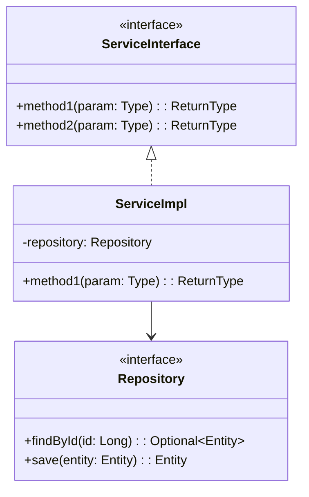
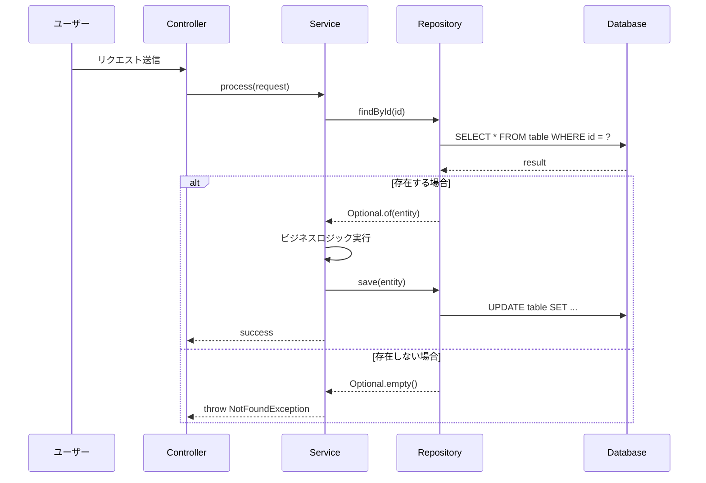

# Create Detailed Design Document - Full Detail Skill

This skill ensures DD documents are created with COMPLETE DETAIL for every component, and automatically splits large chapters into organized subfolders.

## Purpose

Create comprehensive DD documents with:
- **FULL DETAIL** for ALL design components (not just outlines)
- **Complete DDL** with all constraints, indexes, comments
- **Complete OpenAPI** with all schemas, examples, error codes
- **Complete Pseudocode** with if/else/try-catch/loop
- **Complete Sequence Diagrams** with SQL queries and error flows
- **Automatic subfolder splitting** for large chapters

## When to Use

- Creating DD that is truly implementation-ready (developers can code directly)
- Generating specifications with complete technical detail
- Creating DD for large systems with many modules/tables/APIs

## Key Principles

### 1. FULL DETAIL Requirement

Every design component MUST be written with **complete implementation detail**:

| Component | Required Detail Level |
|-----------|----------------------|
| DDL | Full CREATE TABLE with all columns, types, constraints, indexes, COMMENTs |
| OpenAPI | Complete paths with parameters, requestBody, responses, schemas, examples |
| Sequence | Mermaid with participants, SQL queries, alt/loop/opt, error handling |
| Pseudocode | Complete algorithm with input validation, business logic, exception handling |
| Class Diagram | All classes, methods, fields, relationships, visibility |

### 2. Auto-Split Thresholds

Monitor content size and split automatically:

| Chapter | Threshold | Split Strategy |
|---------|-----------|----------------|
| 05-module-design | >500 lines OR >5 modules | Split by module group (FI, CO, SYS) |
| 06-component-design | >500 lines OR >10 UCs | Split by category (sequence, pseudocode, batch, rules) |
| 07-database-design | >500 lines OR >20 tables | Split by module (GL, AR, AP, AA, BK, CO, SYS) |
| 08-api-design | >500 lines OR >15 APIs | Split by module (GL, AR, AP, etc.) |
| 09-ui-specifications | >500 lines OR >10 screens | Split by screen group |

### 3. Subfolder Structure

When splitting, create this structure:

```
XX-chapter-name.md           # Main file (overview + links to subfolder)
XX-chapter-name/
  ├── _index.md              # Common specs, conventions, ER diagrams
  ├── 01-group-a.md          # First group of content
  ├── 02-group-b.md          # Second group of content
  └── ...
```

## Workflow Steps

### Phase 0: Preparation

1. **Collect Parameters**: Get folder path with SRS and BD
2. **Load Reference Files**: Load from `.ai-instructions/`:
   - `detailed-design-instructions.md`
   - `dd-content-requirements.md`
   - `dd-element-coverage-requirements.md`
3. **Analyze BD**: Count elements to estimate chapter sizes:
   - Count modules → estimate 05 size
   - Count UCs + batches → estimate 06 size
   - Count tables → estimate 07 size
   - Count APIs → estimate 08 size
   - Count screens → estimate 09 size
4. **Create Progress File**: `dd-progress.md` for resume capability

### Phase 1: Foundation (00-04)

1. **00-bd-dd-mapping.md**: Coverage tables with links
2. **01-introduction.md**: Document info, revision history
3. **02-references-terminology.md**: References, terminology tables
4. **03-system-overview.md**: Architecture diagram, tech stack, actors
5. **04-design-considerations.md**: NFRs, assumptions, constraints

### Phase 2: Core Design (05-06)

#### 05-module-design

**Analyze first**: Count modules from BD
- If ≤5 modules and estimated <500 lines → Single file
- If >5 modules OR estimated >500 lines → **Create subfolder**

**Subfolder structure for 05**:
```
05-module-design.md           # Overview, module list, links
05-module-design/
  ├── _index.md              # Common patterns, base classes
  ├── fi-01.md               # FI modules (GL, AR, AP)
  ├── co-01.md               # CO modules (CCA, PCA, IO, PB)
  └── sys-01.md              # SYS modules (User, Auth, Workflow)
```

**Full detail per module**:
```markdown
### [Module Name] モジュール

#### クラス図



#### メソッド一覧

| メソッド | 引数 | 戻り値 | 説明 |
|---------|------|--------|------|
| method1 | param: Type | ReturnType | Description |
```

#### 06-component-design

**Analyze first**: Count UCs and batches from BD
- If ≤10 UCs and <45 batches → Single file
- If >10 UCs OR >500 lines → **Create subfolder**

**Subfolder structure for 06**:
```
06-component-design.md        # Overview, UC list, batch list
06-component-design/
  ├── _index.md              # Common patterns, error handling
  ├── sequence-01.md         # All sequence diagrams
  ├── pseudocode-01.md       # All pseudocodes
  ├── batch-01.md            # All batch designs
  └── business-rules-01.md   # Business rules, validations, state transitions
```

**Full detail per UC**:
```markdown
### UC-XXX: [Use Case Name]

#### 処理概要
[Description of what this UC does]

#### シーケンス図



#### 疑似コード

```
FUNCTION processUseCase(request):
    INPUT: request object with fields
    OUTPUT: result or exception

    // 1. Input Validation
    IF request.field1 IS NULL:
        THROW ValidationException("field1 is required")

    // 2. Authorization Check
    IF NOT hasPermission(currentUser, "PERMISSION_NAME"):
        THROW AuthorizationException("Permission denied")

    // 3. Business Logic
    TRY:
        entity = repository.findById(request.id)
        IF entity IS NULL:
            THROW NotFoundException("Entity not found")

        // Apply business rules
        entity.field = calculateNewValue(request)

        // Save changes
        result = repository.save(entity)

        // Send notification
        notificationService.send(result)

        RETURN result
    CATCH DatabaseException as e:
        LOG.error("Database error", e)
        THROW SystemException("Database operation failed")
```

#### バリデーションルール

| フィールド | 必須 | 型 | 最大長 | バリデーション | エラーコード |
|-----------|------|-----|--------|---------------|-------------|
| field1 | Yes | String | 100 | Not empty | VAL-001 |
```

### Phase 3: Data & Interfaces (07-08)

#### 07-database-design

**Analyze first**: Count tables from BD
- If ≤20 tables → Single file
- If >20 tables → **Create subfolder**

**Subfolder structure for 07**:
```
07-database-design.md         # Overview, table summary, links
07-database-design/
  ├── _index.md              # ER diagram, naming conventions, common columns
  ├── gl-tables.md           # GL module DDL
  ├── ar-ap-tables.md        # AR/AP module DDL
  ├── aa-bk-tables.md        # AA/BK module DDL
  ├── co-tables.md           # CO module DDL
  └── sys-tables.md          # SYS module DDL
```

**Full detail per table**:
```markdown
### テーブル名 (table_name)

```sql
CREATE TABLE schema.table_name (
    id                  BIGSERIAL NOT NULL,
    code                VARCHAR(20) NOT NULL,
    name                VARCHAR(200) NOT NULL,
    description         VARCHAR(500),
    status              VARCHAR(10) NOT NULL DEFAULT 'ACT',
    amount              DECIMAL(18,2) NOT NULL DEFAULT 0,
    reference_id        BIGINT,
    is_active           BOOLEAN NOT NULL DEFAULT TRUE,
    is_deleted          BOOLEAN NOT NULL DEFAULT FALSE,
    created_at          TIMESTAMP NOT NULL DEFAULT CURRENT_TIMESTAMP,
    created_by          VARCHAR(50) NOT NULL,
    updated_at          TIMESTAMP NOT NULL DEFAULT CURRENT_TIMESTAMP,
    updated_by          VARCHAR(50) NOT NULL,
    version             INTEGER NOT NULL DEFAULT 1,
    CONSTRAINT pk_table_name PRIMARY KEY (id),
    CONSTRAINT uk_table_name_code UNIQUE (code),
    CONSTRAINT fk_table_name_ref FOREIGN KEY (reference_id)
        REFERENCES schema.ref_table(id),
    CONSTRAINT ck_table_name_status CHECK (status IN ('ACT', 'INA', 'DEL'))
);

-- Indexes
CREATE INDEX ix_table_name_status ON schema.table_name (status);
CREATE INDEX ix_table_name_ref ON schema.table_name (reference_id);
CREATE INDEX ix_table_name_search ON schema.table_name (code, status)
    WHERE is_deleted = FALSE;

-- Comments
COMMENT ON TABLE schema.table_name IS 'テーブル説明';
COMMENT ON COLUMN schema.table_name.id IS '主キーID';
COMMENT ON COLUMN schema.table_name.code IS 'コード（一意）';
COMMENT ON COLUMN schema.table_name.status IS 'ステータス: ACT=有効, INA=無効, DEL=削除';
```
```

#### 08-api-design

**Analyze first**: Count APIs from BD
- If ≤15 APIs → Single file
- If >15 APIs → **Create subfolder**

**Subfolder structure for 08**:
```
08-api-design.md              # Overview, API summary, auth, pagination
08-api-design/
  ├── _index.md              # Common specs, error format, pagination
  ├── gl-apis.md             # GL module APIs
  ├── ar-apis.md             # AR module APIs
  ├── ap-apis.md             # AP module APIs
  └── sys-apis.md            # SYS module APIs
```

**Full detail per API**:
```markdown
### GET /api/v1/resources/{id}

#### 概要
Get a specific resource by ID.

#### パラメータ

| パラメータ | 位置 | 型 | 必須 | 説明 |
|-----------|------|-----|------|------|
| id | path | integer | Yes | Resource ID |

#### レスポンス

**200 OK**
```json
{
  "success": true,
  "data": {
    "id": 1,
    "code": "RES001",
    "name": "Resource Name",
    "status": "ACT",
    "createdAt": "2025-01-01T00:00:00Z"
  }
}
```

**404 Not Found**
```json
{
  "success": false,
  "error": {
    "code": "RES-DAT-001",
    "message": "Resource not found",
    "traceId": "abc123"
  }
}
```

#### 処理ステップ

1. Validate path parameter `id`
2. Check authorization: requires `RESOURCE_READ` permission
3. Query database: `SELECT * FROM resources WHERE id = ? AND is_deleted = FALSE`
4. If not found: return 404
5. Return resource data

#### SQL

```sql
SELECT r.*,
       c.name as category_name
FROM resources r
LEFT JOIN categories c ON r.category_id = c.id
WHERE r.id = :id AND r.is_deleted = FALSE
```
```

### Phase 4: Quality & Finalization (09-15)

#### 09-ui-specifications

**Analyze first**: Count screens from BD
- If ≤10 screens → Single file
- If >10 screens → **Create subfolder by screen group**

Continue with files 10-15 as single files (typically smaller).

### Phase 5: Validation & Completion

1. **Run validation**: Check all CRITICAL items present
2. **Check coverage**: Verify 100% coverage of BD elements
3. **Verify links**: All subfolder links work correctly
4. **Update progress**: Mark completion in `dd-progress.md`
5. **Create 15-checklist-results.md**: Document final status

## Content Completeness Checklist

After each chapter, verify:

### 05-module-design
- [ ] Class diagram for EVERY service (with methods, fields)
- [ ] Interface definitions with method signatures
- [ ] Repository interfaces with CRUD methods
- [ ] Entity classes with ALL fields
- [ ] Enum definitions for status/type fields
- [ ] Dependencies documented

### 06-component-design
- [ ] Sequence diagram for EVERY UC (with SQL, alt/loop)
- [ ] Pseudocode for complex business logic (with try/catch)
- [ ] Batch flowchart for EVERY batch job
- [ ] Validation rules table per UC
- [ ] Business rules table with IDs
- [ ] State transition diagrams

### 07-database-design
- [ ] DDL for EVERY table in BD
- [ ] All columns with proper data types
- [ ] Primary keys defined
- [ ] Foreign keys with references
- [ ] Check constraints for enums
- [ ] Indexes for search/query columns
- [ ] Comments for tables and important columns
- [ ] ER diagram (overall + per module)

### 08-api-design
- [ ] Endpoint spec for EVERY API in BD
- [ ] Path, query, body parameters
- [ ] Request body JSON schema
- [ ] Response body JSON schema (success + errors)
- [ ] Processing steps
- [ ] SQL queries used
- [ ] Error code references

## Assessment Criteria

```
PASS        = CRITICAL 17/17 + REQUIRED >=70% + All detail complete
COND. PASS  = CRITICAL 17/17 + REQUIRED 50-69% (detail incomplete)
FAIL        = Missing CRITICAL OR <50% REQUIRED OR outline-only content
```

## Critical Rules

1. **No outline-only content** - Every section must have complete detail
2. **DDL must be executable** - Copy-paste into PostgreSQL should work
3. **Pseudocode must be implementable** - Developer can code from it
4. **Sequence must show data flow** - Include SQL queries and error paths
5. **Split early, not late** - Check thresholds before writing
6. **Links must work** - Verify all subfolder links after splitting
7. **Update progress** - Track completion for resume capability

## Example: Large System DD Structure

For a system with 20 modules, 120 tables, 150 APIs:

```
詳細設計書/
├── _index.md
├── 00-bd-dd-mapping.md
├── 01-introduction.md
├── 02-references-terminology.md
├── 03-system-overview.md
├── 04-design-considerations.md
├── 05-module-design.md           # Overview + links
├── 05-module-design/
│   ├── _index.md
│   ├── fi-01.md
│   ├── co-01.md
│   └── sys-01.md
├── 06-component-design.md        # Overview + links
├── 06-component-design/
│   ├── _index.md
│   ├── sequence-01.md
│   ├── pseudocode-01.md
│   ├── batch-01.md
│   └── business-rules-01.md
├── 07-database-design.md         # Overview + links
├── 07-database-design/
│   ├── _index.md
│   ├── gl-tables.md
│   ├── ar-ap-tables.md
│   └── aa-co-sys-tables.md
├── 08-api-design.md              # Overview + links
├── 08-api-design/
│   ├── _index.md
│   ├── gl-apis.md
│   ├── ar-apis.md
│   └── sys-apis.md
├── 09-ui-specifications.md
├── 10-security-design.md
├── 11-error-handling.md
├── 12-logging-monitoring.md
├── 13-deployment-design.md
├── 14-appendices.md
└── 15-checklist-results.md
```

---

_Last updated: 2025-12-29_
