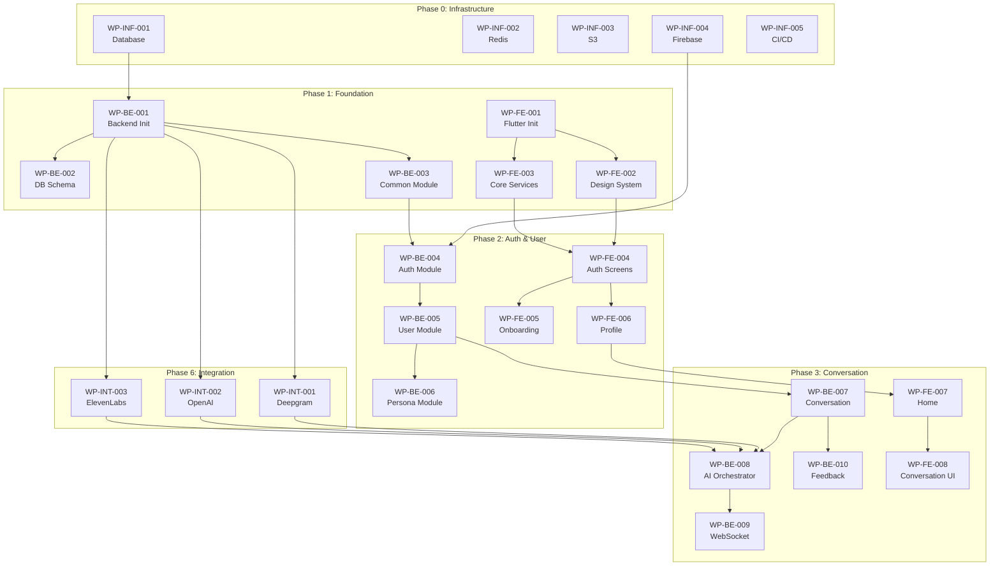

# Master Plan - SpeakPal AI

## 1. Project Overview

| Item                  | Value                             |
| --------------------- | --------------------------------- |
| Project Name          | SpeakPal AI - AI 英会話練習アプリ |
| Technology Stack      | Flutter + NestJS + PostgreSQL     |
| Total Modules         | 13                                |
| Total Use Cases       | 33                                |
| Total APIs            | 52 (42 REST + 10 WebSocket)       |
| Total Screens         | 20                                |
| Total Database Tables | 18                                |
| Total Batches         | 8                                 |

---

## 2. Technology Stack

### 2.1. Frontend (Mobile)

| Technology       | Version | Purpose                   |
| ---------------- | ------- | ------------------------- |
| Flutter          | 3.x     | Cross-platform Mobile App |
| Dart             | 3.x     | Programming Language      |
| Riverpod         | 2.x     | State Management          |
| Go Router        | -       | Navigation                |
| Dio              | -       | HTTP Client               |
| Socket.io Client | -       | WebSocket Client          |

### 2.2. Frontend (Web - Optional)

| Technology    | Version | Purpose          |
| ------------- | ------- | ---------------- |
| React         | 18.x    | Web Application  |
| Redux Toolkit | 2.x     | State Management |
| TypeScript    | 5.x     | Type Safety      |

### 2.3. Backend

| Technology | Version | Purpose              |
| ---------- | ------- | -------------------- |
| NestJS     | 10.x    | API Framework        |
| TypeScript | 5.x     | Programming Language |
| Prisma     | 5.x     | ORM                  |
| Socket.io  | 4.x     | WebSocket Server     |
| BullMQ     | 4.x     | Job Queue            |
| Jest       | -       | Unit Testing         |

### 2.4. Database & Cache

| Technology | Version | Purpose         |
| ---------- | ------- | --------------- |
| PostgreSQL | 15.x    | Main Database   |
| Redis      | 7.x     | Cache & Session |

### 2.5. External Services

| Service        | Provider             | Purpose                 |
| -------------- | -------------------- | ----------------------- |
| STT            | Deepgram             | Speech-to-Text          |
| LLM            | OpenAI GPT-4o        | Conversation AI         |
| TTS            | ElevenLabs           | Text-to-Speech          |
| Authentication | Firebase             | OAuth & User Management |
| Payment        | App Store/Play Store | In-App Purchase         |
| Storage        | AWS S3               | File Storage            |
| Monitoring     | Datadog              | Logging & Metrics       |

---

## 3. Work Packages

### 3.1. Phase 0: Infrastructure Setup (Prerequisites)

| ID         | Work Package              | Description                         | Est. Days | Dependencies | DD References                                                        |
| ---------- | ------------------------- | ----------------------------------- | --------- | ------------ | -------------------------------------------------------------------- |
| WP-INF-001 | PostgreSQL Database Setup | Setup PostgreSQL, create database   | 1         | -            | `07-database-design.md`, `13-deployment-design.md`                   |
| WP-INF-002 | Redis Cache Setup         | Setup Redis for caching/sessions    | 0.5       | -            | `03-system-overview.md#tech-stack`, `13-deployment-design.md`        |
| WP-INF-003 | AWS S3 Storage Setup      | Configure S3 bucket for audio files | 0.5       | -            | `03-system-overview.md#external-services`, `13-deployment-design.md` |
| WP-INF-004 | Firebase Project Setup    | Configure Firebase for auth         | 0.5       | -            | `03-system-overview.md#external-services`, `10-security-design.md`   |
| WP-INF-005 | CI/CD Pipeline Setup      | GitHub Actions for build/deploy     | 1         | -            | `13-deployment-design.md`                                            |

**Phase 0 Subtotal: ~3.5 days**

---

### 3.2. Phase 1: Foundation

| ID        | Work Package                | Description                              | Est. Days | Dependencies | DD References                                                 |
| --------- | --------------------------- | ---------------------------------------- | --------- | ------------ | ------------------------------------------------------------- |
| WP-BE-001 | Backend Project Init        | NestJS project, folder structure, config | 1         | WP-INF-001   | `03-system-overview.md`, `05-module-design.md`                |
| WP-BE-002 | Database Schema & Migration | Prisma schema, initial migrations        | 2         | WP-BE-001    | `07-database-design.md`, `07-database-design/*.md`            |
| WP-BE-003 | Common Module               | Base classes, utilities, exceptions      | 2         | WP-BE-001    | `05-module-design.md`, `11-error-handling.md`                 |
| WP-FE-001 | Flutter Project Init        | Flutter project, folder structure        | 1         | -            | `03-system-overview.md#tech-stack`, `09-ui-specifications.md` |
| WP-FE-002 | Design System & Theme       | Colors, typography, base components      | 3         | WP-FE-001    | `09-ui-specifications.md#design-system`                       |
| WP-FE-003 | Core Services Setup         | API client, socket client, storage       | 2         | WP-FE-001    | `08-api-design.md`, `03-system-overview.md`                   |

**Phase 1 Subtotal: ~11 days**

---

### 3.3. Phase 2: Core Modules (Auth & User)

| ID        | Work Package            | Description                        | Est. Days | Dependencies          | DD References                                                                                   |
| --------- | ----------------------- | ---------------------------------- | --------- | --------------------- | ----------------------------------------------------------------------------------------------- |
| WP-BE-004 | Auth Module (BE)        | JWT, OAuth, guards, login/register | 4         | WP-BE-003, WP-INF-004 | `05-module-design/auth-module.md`, `08-api-design.md#auth`, `10-security-design.md`             |
| WP-BE-005 | User Module (BE)        | User CRUD, profile, settings       | 3         | WP-BE-004             | `05-module-design/user-module.md`, `08-api-design.md#user`, `07-database-design/user-tables.md` |
| WP-BE-006 | Persona Module (BE)     | AI persona management              | 2         | WP-BE-005             | `05-module-design.md#persona`, `08-api-design.md#user`                                          |
| WP-FE-004 | Auth Screens (FE)       | Login, Register, Forgot Password   | 3         | WP-FE-002, WP-FE-003  | `09-ui-specifications.md#auth`, `06-component-design.md#uc001-005`                              |
| WP-FE-005 | Onboarding Screens (FE) | Level test, persona setup          | 2         | WP-FE-004             | `09-ui-specifications.md#onboarding`, `06-component-design.md#uc006-008`                        |
| WP-FE-006 | Profile & Settings (FE) | User profile, app settings         | 2         | WP-FE-004             | `09-ui-specifications.md#profile`, `06-component-design.md#uc030-033`                           |

**Phase 2 Subtotal: ~16 days**

---

### 3.4. Phase 3: Core Business - Conversation

| ID        | Work Package              | Description                           | Est. Days | Dependencies              | DD References                                                                                                           |
| --------- | ------------------------- | ------------------------------------- | --------- | ------------------------- | ----------------------------------------------------------------------------------------------------------------------- |
| WP-BE-007 | Conversation Module (BE)  | Session management, turn handling     | 4         | WP-BE-005                 | `05-module-design/conversation-module.md`, `08-api-design.md#conversation`, `07-database-design/conversation-tables.md` |
| WP-BE-008 | AI Orchestrator (BE)      | Coordinate STT → LLM → TTS pipeline   | 5         | WP-BE-007, WP-INT-001~003 | `05-module-design/conversation-module.md#ai-orchestrator`, `03-system-overview.md#ai-pipeline`                          |
| WP-BE-009 | WebSocket Gateway (BE)    | Real-time audio streaming             | 3         | WP-BE-008                 | `08-api-design.md#websocket`, `05-module-design/conversation-module.md`                                                 |
| WP-BE-010 | Feedback Module (BE)      | Error analysis, correction generation | 3         | WP-BE-007                 | `05-module-design/feedback-module.md`, `08-api-design.md#feedback`                                                      |
| WP-FE-007 | Home & Dashboard (FE)     | Main screen, quick actions            | 3         | WP-FE-006                 | `09-ui-specifications.md#home`, `06-component-design.md#home`                                                           |
| WP-FE-008 | Conversation Screen (FE)  | Voice input, AI response, real-time   | 5         | WP-FE-007, WP-BE-009      | `09-ui-specifications.md#conversation`, `06-component-design.md#uc009-016`                                              |
| WP-FE-009 | Conversation Summary (FE) | Post-conversation review, corrections | 2         | WP-FE-008                 | `09-ui-specifications.md#summary`, `06-component-design.md#uc017`                                                       |

**Phase 3 Subtotal: ~25 days**

---

### 3.5. Phase 4: Learning & Gamification

| ID        | Work Package              | Description                        | Est. Days | Dependencies | DD References                                                              |
| --------- | ------------------------- | ---------------------------------- | --------- | ------------ | -------------------------------------------------------------------------- |
| WP-BE-011 | Learning Module (BE)      | Vocabulary, scenarios, challenges  | 4         | WP-BE-005    | `05-module-design/learning-module.md`, `08-api-design.md#learning`         |
| WP-BE-012 | Gamification Module (BE)  | XP, levels, streaks, badges        | 4         | WP-BE-011    | `05-module-design/gamification-module.md`, `08-api-design.md#gamification` |
| WP-BE-013 | Progress Module (BE)      | Statistics, reports, history       | 3         | WP-BE-012    | `05-module-design.md#progress`, `08-api-design.md#learning`                |
| WP-FE-010 | Learning Screens (FE)     | Vocabulary list, review, scenarios | 4         | WP-FE-007    | `09-ui-specifications.md#learning`, `06-component-design.md#uc018-022`     |
| WP-FE-011 | Gamification Screens (FE) | Achievements, badges, leaderboard  | 3         | WP-FE-010    | `09-ui-specifications.md#gamification`, `06-component-design.md#uc023-025` |
| WP-FE-012 | Progress Screens (FE)     | Statistics dashboard, history      | 2         | WP-FE-011    | `09-ui-specifications.md#progress`, `06-component-design.md#uc026-029`     |

**Phase 4 Subtotal: ~20 days**

---

### 3.6. Phase 5: Social & Subscription

| ID        | Work Package              | Description                          | Est. Days | Dependencies | DD References                                                                 |
| --------- | ------------------------- | ------------------------------------ | --------- | ------------ | ----------------------------------------------------------------------------- |
| WP-BE-014 | Social Module (BE)        | Invitations, groups, rankings        | 3         | WP-BE-012    | `05-module-design.md#social`, `08-api-design.md#social`                       |
| WP-BE-015 | Subscription Module (BE)  | Plans, usage limits, IAP integration | 4         | WP-BE-005    | `05-module-design.md#subscription`, `08-api-design.md#subscription`           |
| WP-BE-016 | Notification Module (BE)  | Push notifications, reminders        | 2         | WP-BE-005    | `05-module-design.md#notification`, `08-api-design.md#notification`           |
| WP-FE-013 | Social Screens (FE)       | Invite friends, groups, leaderboard  | 3         | WP-FE-011    | `09-ui-specifications.md#social`, `06-component-design.md#social`             |
| WP-FE-014 | Subscription Screens (FE) | Plans, upgrade, manage subscription  | 2         | WP-FE-006    | `09-ui-specifications.md#subscription`, `06-component-design.md#subscription` |

**Phase 5 Subtotal: ~14 days**

---

### 3.7. Phase 6: External Service Integration

| ID         | Work Package               | Description                     | Est. Days | Dependencies | DD References                                                                            |
| ---------- | -------------------------- | ------------------------------- | --------- | ------------ | ---------------------------------------------------------------------------------------- |
| WP-INT-001 | Deepgram STT Integration   | Speech-to-Text streaming API    | 3         | WP-BE-001    | `03-system-overview.md#external-services`, `05-module-design/conversation-module.md#stt` |
| WP-INT-002 | OpenAI GPT-4o Integration  | Conversation AI, error analysis | 3         | WP-BE-001    | `03-system-overview.md#external-services`, `05-module-design/conversation-module.md#llm` |
| WP-INT-003 | ElevenLabs TTS Integration | Text-to-Speech streaming API    | 3         | WP-BE-001    | `03-system-overview.md#external-services`, `05-module-design/conversation-module.md#tts` |
| WP-INT-004 | App Store IAP Integration  | iOS In-App Purchase             | 2         | WP-BE-015    | `03-system-overview.md#external-services`, `05-module-design.md#subscription`            |
| WP-INT-005 | Play Store IAP Integration | Android In-App Purchase         | 2         | WP-BE-015    | `03-system-overview.md#external-services`, `05-module-design.md#subscription`            |

**Phase 6 Subtotal: ~13 days**

---

### 3.8. Phase 7: Quality Assurance

| ID        | Work Package              | Description                       | Est. Days | Dependencies         | DD References                                                         |
| --------- | ------------------------- | --------------------------------- | --------- | -------------------- | --------------------------------------------------------------------- |
| WP-QA-001 | Backend Unit Tests        | Jest tests for all services       | 5         | WP-BE-016            | `05-module-design.md`, `08-api-design.md`                             |
| WP-QA-002 | Backend Integration Tests | API & WebSocket integration tests | 3         | WP-QA-001            | `08-api-design.md`, `11-error-handling.md`                            |
| WP-QA-003 | Flutter Widget Tests      | Widget & unit tests               | 4         | WP-FE-014            | `09-ui-specifications.md`, `06-component-design.md`                   |
| WP-QA-004 | E2E Testing               | End-to-end user flow tests        | 4         | WP-QA-002, WP-QA-003 | `06-component-design.md`, `14-appendices.md#test-cases`               |
| WP-QA-005 | Performance Testing       | Load testing, optimization        | 3         | WP-QA-004            | `04-design-considerations.md#performance`, `12-logging-monitoring.md` |
| WP-QA-006 | Security Audit            | OWASP checks, penetration testing | 2         | WP-QA-004            | `10-security-design.md`                                               |

**Phase 7 Subtotal: ~21 days**

---

### 3.9. Phase 8: Deployment & Launch

| ID         | Work Package          | Description                         | Est. Days | Dependencies           | DD References                                         |
| ---------- | --------------------- | ----------------------------------- | --------- | ---------------------- | ----------------------------------------------------- |
| WP-DEP-001 | Kubernetes Setup      | K8s cluster, manifests, Helm charts | 3         | WP-QA-005              | `13-deployment-design.md`                             |
| WP-DEP-002 | Monitoring Setup      | Datadog, alerting, dashboards       | 2         | WP-DEP-001             | `12-logging-monitoring.md`, `13-deployment-design.md` |
| WP-DEP-003 | Staging Deployment    | Deploy to staging environment       | 1         | WP-DEP-002             | `13-deployment-design.md#staging`                     |
| WP-DEP-004 | App Store Submission  | iOS app submission & review         | 3         | WP-DEP-003             | `13-deployment-design.md#app-store`                   |
| WP-DEP-005 | Play Store Submission | Android app submission & review     | 2         | WP-DEP-003             | `13-deployment-design.md#play-store`                  |
| WP-DEP-006 | Production Deployment | Deploy to production                | 1         | WP-DEP-004, WP-DEP-005 | `13-deployment-design.md#production`                  |

**Phase 8 Subtotal: ~12 days**

---

## 4. Dependency Graph



---

## 5. Summary

| Phase     | Description             | Work Packages | Est. Days       |
| --------- | ----------------------- | ------------- | --------------- |
| Phase 0   | Infrastructure Setup    | 5             | 3.5             |
| Phase 1   | Foundation              | 6             | 11              |
| Phase 2   | Auth & User             | 6             | 16              |
| Phase 3   | Conversation (Core)     | 7             | 25              |
| Phase 4   | Learning & Gamification | 6             | 20              |
| Phase 5   | Social & Subscription   | 5             | 14              |
| Phase 6   | External Integration    | 5             | 13              |
| Phase 7   | Quality Assurance       | 6             | 21              |
| Phase 8   | Deployment & Launch     | 6             | 12              |
| **Total** |                         | **52**        | **~135.5 days** |

---

## 6. Critical Path

```
INF-001 → BE-001 → BE-002 → BE-003 → BE-004 → BE-005 → BE-007 → BE-008 → BE-009 → FE-008 → QA-004 → DEP-006
```

Estimated Critical Path Duration: **~95 days** (with parallelization of FE/BE work)

---

## 7. Risk Considerations

| Risk                           | Impact | Mitigation                             |
| ------------------------------ | ------ | -------------------------------------- |
| AI API latency issues          | High   | Implement streaming, timeout handling  |
| App Store review delays        | Medium | Submit early, follow guidelines        |
| Audio processing complexity    | High   | Use proven libraries, thorough testing |
| Cross-platform inconsistencies | Medium | Extensive device testing               |

---

## 8. Next Steps

1. **Create Detailed Plan** - Use `/create-detailed-plan` workflow to break down each Work Package into specific tasks
2. **Prioritize** - Identify MVP-critical Work Packages
3. **Resource Allocation** - Assign team members to Work Packages
4. **Start Implementation** - Begin with Phase 0 & Phase 1

---

_Generated from: docs/SpeakPal/詳細設計書_
_Created: 2025-12-29_
_Workflow: /create-master-plan_
