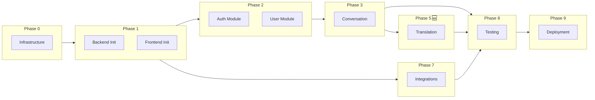

# Implementation Plan - SpeakPal AI

## Overview

| Item                | Value                               |
| ------------------- | ----------------------------------- |
| Project Name        | SpeakPal AI - AI 英会話練習アプリ   |
| Master Plan         | [MASTER-PLAN.md](../MASTER-PLAN.md) |
| DD Path             | [詳細設計書](../詳細設計書/)        |
| Total Phases        | 10                                  |
| Total Work Packages | 61                                  |
| Total Tasks         | ~341                                |
| Estimated Duration  | ~164.5 days (~1316 hours)           |
| Created             | 2025-12-29                          |
| Updated             | 2026-01-07                          |

---

## Technology Stack

| Layer    | Technology                         |
| -------- | ---------------------------------- |
| Frontend | Flutter 3.x, Riverpod, Go Router   |
| Backend  | NestJS 10.x, Prisma, Socket.io     |
| Database | PostgreSQL 15.x, Redis 7.x         |
| AI       | Deepgram (STT), GPT-4o, ElevenLabs |
| Infra    | Docker, Kubernetes, GitHub Actions |

---

## Phase Navigation

| Phase   | Description             | WPs | Tasks | Est. Days | File/Folder                                              |
| ------- | ----------------------- | --- | ----- | --------- | -------------------------------------------------------- |
| Phase 0 | Infrastructure Setup    | 5   | 17    | 3.5       | [phase-0-infrastructure.md](./phase-0-infrastructure.md) |
| Phase 1 | Foundation              | 6   | 35    | 11        | [phase-1-foundation.md](./phase-1-foundation.md)         |
| Phase 2 | Auth & User             | 6   | 41    | 16        | [phase-2-auth-user/](./phase-2-auth-user/)               |
| Phase 3 | Conversation (Core)     | 7   | 50    | 25        | [phase-3-conversation/](./phase-3-conversation/)         |
| Phase 4 | Learning & Gamification | 6   | 42    | 20        | [phase-4-learning/](./phase-4-learning/)                 |
| Phase 5 | Translation Practice 🆕 | 8   | 48    | 22        | [phase-5-translation/](./phase-5-translation/)           |
| Phase 6 | Social & Subscription   | 5   | 32    | 14        | [phase-6-social.md](./phase-5-social.md)                 |
| Phase 7 | External Integration    | 5   | 30    | 13        | [phase-7-integration/](./phase-6-integration/)           |
| Phase 8 | Quality Assurance       | 7   | 30    | 28        | [phase-8-qa.md](./phase-7-qa.md)                         |
| Phase 9 | Deployment & Launch     | 6   | 16    | 12        | [phase-9-deployment.md](./phase-8-deployment.md)         |

---

## 🆕 New Phase: Translation Practice (Phase 5)

> Added: 2026-01-07

| Metric   | Value                                                                              |
| -------- | ---------------------------------------------------------------------------------- |
| UCs      | UC-034 ~ UC-038                                                                    |
| APIs     | 15 new REST APIs                                                                   |
| Tables   | 5 new tables                                                                       |
| Screens  | 4 new screens                                                                      |
| Features | Direct Translation, Intent Translation, Word Association, Instant Drill, Shadowing |

**Work Packages:**

- WP-DB-001: Translation Tables Migration
- WP-BE-017: Translation Service (BE)
- WP-BE-018: Quick Response Service (BE)
- WP-BE-019: Shadowing Service (BE)
- WP-FE-015: Direct Translation Screen
- WP-FE-016: Intent Translation Screen
- WP-FE-017: Quick Response Screens
- WP-FE-018: Shadowing Practice Screen

---

## Dependency Graph



---

## Task Summary

| Phase     | Description             | Work Packages | Tasks   | Est. Hours | Est. Days |
| --------- | ----------------------- | ------------- | ------- | ---------- | --------- |
| Phase 0   | Infrastructure Setup    | 5             | 17      | 28         | 3.5       |
| Phase 1   | Foundation              | 6             | 35      | 88         | 11        |
| Phase 2   | Auth & User             | 6             | 41      | 128        | 16        |
| Phase 3   | Conversation (Core)     | 7             | 50      | 200        | 25        |
| Phase 4   | Learning & Gamification | 6             | 42      | 160        | 20        |
| Phase 5   | Translation Practice 🆕 | 8             | 48      | 176        | 22        |
| Phase 6   | Social & Subscription   | 5             | 32      | 112        | 14        |
| Phase 7   | External Integration    | 5             | 30      | 104        | 13        |
| Phase 8   | Quality Assurance       | 7             | 30      | 224        | 28        |
| Phase 9   | Deployment & Launch     | 6             | 16      | 96         | 12        |
| **Total** |                         | **61**        | **341** | **1316**   | **164.5** |

---

## Quick Links

- 📋 [CHECKLIST.md](./CHECKLIST.md) - Implementation checklist (track progress)
- 📊 [MASTER-PLAN.md](../MASTER-PLAN.md) - Master Plan
- 📚 [詳細設計書](../詳細設計書/) - Detailed Design Document

---

## How to Use

1. **Start with Phase 0** - Setup infrastructure first
2. **Follow phase order** - Respect dependencies between phases
3. **Use CHECKLIST.md** - Track completed tasks
4. **Run `/implement-task`** - For guided implementation of specific tasks
5. **Run `/implement-phase`** - For implementing entire phase

---

## Critical Path

```
Phase 0 → Phase 1 → Phase 2 → Phase 3 → Phase 5 → Phase 8 → Phase 9
     ↘ Phase 7 ↗
```

**Estimated Critical Path Duration**: ~110 days (with parallelization)

---

## Change History

| Date       | Change                                             |
| ---------- | -------------------------------------------------- |
| 2025-12-29 | Initial plan created                               |
| 2026-01-07 | Added Phase 5: Translation Practice (48 new tasks) |

---

_Generated from: MASTER-PLAN.md_
_Last Updated: 2026-01-07_
_Workflow: /create-detailed-plan v3.0_
