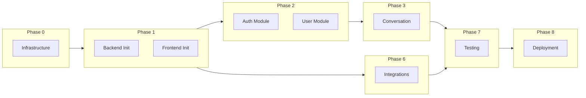

# Implementation Plan - SpeakPal AI

## Overview

| Item                | Value                               |
| ------------------- | ----------------------------------- |
| Project Name        | SpeakPal AI - AI 英会話練習アプリ   |
| Master Plan         | [MASTER-PLAN.md](../MASTER-PLAN.md) |
| DD Path             | [詳細設計書](../詳細設計書/)        |
| Total Phases        | 9                                   |
| Total Work Packages | 52                                  |
| Total Tasks         | ~293                                |
| Estimated Duration  | ~135.5 days (~1084 hours)           |
| Created             | 2025-12-29                          |

---

## Technology Stack

| Layer    | Technology                         |
| -------- | ---------------------------------- |
| Frontend | Flutter 3.x, Riverpod, Go Router   |
| Backend  | NestJS 10.x, Prisma, Socket.io     |
| Database | PostgreSQL 15.x, Redis 7.x         |
| AI       | Deepgram (STT), GPT-4o, ElevenLabs |
| Infra    | Docker, Kubernetes, GitHub Actions |

---

## Phase Navigation

| Phase   | Description             | WPs | Tasks | Est. Days | File/Folder                                              |
| ------- | ----------------------- | --- | ----- | --------- | -------------------------------------------------------- |
| Phase 0 | Infrastructure Setup    | 5   | 17    | 3.5       | [phase-0-infrastructure.md](./phase-0-infrastructure.md) |
| Phase 1 | Foundation              | 6   | 35    | 11        | [phase-1-foundation.md](./phase-1-foundation.md)         |
| Phase 2 | Auth & User             | 6   | 41    | 16        | [phase-2-auth-user/](./phase-2-auth-user/)               |
| Phase 3 | Conversation (Core)     | 7   | 50    | 25        | [phase-3-conversation/](./phase-3-conversation/)         |
| Phase 4 | Learning & Gamification | 6   | 42    | 20        | [phase-4-learning/](./phase-4-learning/)                 |
| Phase 5 | Social & Subscription   | 5   | 32    | 14        | [phase-5-social.md](./phase-5-social.md)                 |
| Phase 6 | External Integration    | 5   | 30    | 13        | [phase-6-integration/](./phase-6-integration/)           |
| Phase 7 | Quality Assurance       | 6   | 30    | 21        | [phase-7-qa.md](./phase-7-qa.md)                         |
| Phase 8 | Deployment & Launch     | 6   | 16    | 12        | [phase-8-deployment.md](./phase-8-deployment.md)         |

---

## Dependency Graph



---

## Task Summary

| Phase     | Description             | Work Packages | Tasks   | Est. Hours | Est. Days |
| --------- | ----------------------- | ------------- | ------- | ---------- | --------- |
| Phase 0   | Infrastructure Setup    | 5             | 17      | 28         | 3.5       |
| Phase 1   | Foundation              | 6             | 35      | 88         | 11        |
| Phase 2   | Auth & User             | 6             | 41      | 128        | 16        |
| Phase 3   | Conversation (Core)     | 7             | 50      | 200        | 25        |
| Phase 4   | Learning & Gamification | 6             | 42      | 160        | 20        |
| Phase 5   | Social & Subscription   | 5             | 32      | 112        | 14        |
| Phase 6   | External Integration    | 5             | 30      | 104        | 13        |
| Phase 7   | Quality Assurance       | 6             | 30      | 168        | 21        |
| Phase 8   | Deployment & Launch     | 6             | 16      | 96         | 12        |
| **Total** |                         | **52**        | **293** | **1084**   | **135.5** |

---

## Quick Links

- 📋 [CHECKLIST.md](./CHECKLIST.md) - Implementation checklist (track progress)
- 📊 [MASTER-PLAN.md](../MASTER-PLAN.md) - Master Plan
- 📚 [詳細設計書](../詳細設計書/) - Detailed Design Document

---

## How to Use

1. **Start with Phase 0** - Setup infrastructure first
2. **Follow phase order** - Respect dependencies between phases
3. **Use CHECKLIST.md** - Track completed tasks
4. **Run `/implement-next-task`** - For guided implementation

---

## Critical Path

```
Phase 0 → Phase 1 → Phase 2 → Phase 3 → Phase 7 → Phase 8
     ↘ Phase 6 ↗
```

**Estimated Critical Path Duration**: ~95 days (with parallelization)

---

_Generated from: MASTER-PLAN.md_
_Created: 2025-12-29_
_Workflow: /create-detailed-plan v2.0_
