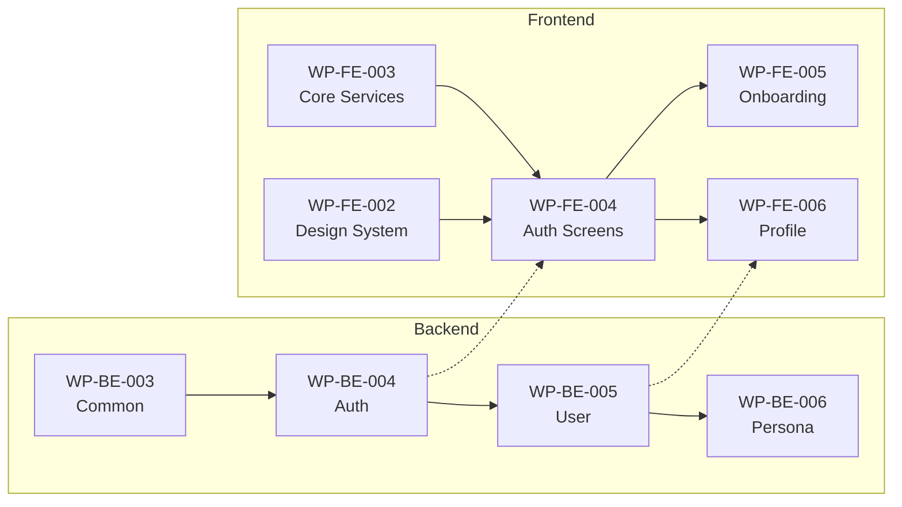

# Phase 2: Auth & User

## Overview

| Item          | Value                |
| ------------- | -------------------- |
| Phase         | 2                    |
| Description   | Auth & User Modules  |
| Work Packages | 6                    |
| Total Tasks   | 41                   |
| Est. Days     | 16                   |
| Dependencies  | Phase 1 (Foundation) |

---

## Work Packages

| ID        | Name                    | Tasks | Est. Hours | File                                                 |
| --------- | ----------------------- | ----- | ---------- | ---------------------------------------------------- |
| WP-BE-004 | Auth Module (BE)        | 8     | 32         | [wp-be-004-auth.md](./wp-be-004-auth.md)             |
| WP-BE-005 | User Module (BE)        | 6     | 24         | [wp-be-005-user.md](./wp-be-005-user.md)             |
| WP-BE-006 | Persona Module (BE)     | 5     | 16         | [wp-be-006-persona.md](./wp-be-006-persona.md)       |
| WP-FE-004 | Auth Screens (FE)       | 7     | 24         | [wp-fe-004-auth.md](./wp-fe-004-auth.md)             |
| WP-FE-005 | Onboarding Screens (FE) | 5     | 16         | [wp-fe-005-onboarding.md](./wp-fe-005-onboarding.md) |
| WP-FE-006 | Profile & Settings (FE) | 5     | 16         | [wp-fe-006-profile.md](./wp-fe-006-profile.md)       |

---

## Dependency Graph

---

## Phase Summary

| Category  | Work Packages | Tasks  | Est. Hours |
| --------- | ------------- | ------ | ---------- |
| Backend   | 3             | 19     | 72         |
| Frontend  | 3             | 22     | 56         |
| **Total** | **6**         | **41** | **128**    |

---

## DD References

- `05-module-design/auth-module.md` - Auth module design
- `05-module-design/user-module.md` - User module design
- `08-api-design/auth-apis.md` - Auth API endpoints
- `08-api-design/user-apis.md` - User API endpoints
- `09-ui-specifications/auth-screens.md` - Auth screen designs
- `10-security-design.md` - Security requirements
- `07-database-design/user-tables.md` - User tables

---

## Next Phase

→ [Phase 3: Conversation](../phase-3-conversation/)

---

_Back to: [\_index.md](../_index.md)_
