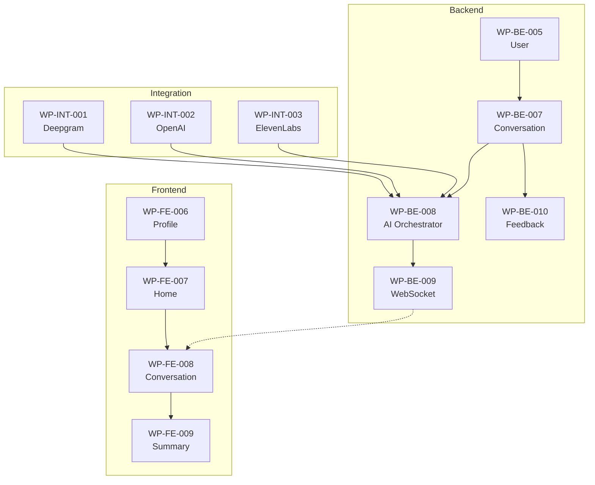

# Phase 3: Conversation (Core Business)

## Overview

| Item          | Value                      |
| ------------- | -------------------------- |
| Phase         | 3                          |
| Description   | Core Conversation Features |
| Work Packages | 7                          |
| Total Tasks   | 46                         |
| Est. Hours    | 105                        |
| Est. Days     | ~13 days (8h/day)          |
| Dependencies  | Phase 2 (Auth & User)      |

> 📁 **Structure**: Phase 3 có > 5 WPs nên được tổ chức thành thư mục với file riêng cho mỗi WP.

---

## Work Packages

| ID        | Name                      | Tasks | Est. Hours | File                                                           |
| --------- | ------------------------- | ----- | ---------- | -------------------------------------------------------------- |
| WP-BE-007 | Conversation Module (BE)  | 8     | 32         | [wp-be-007-conversation.md](./wp-be-007-conversation.md)       |
| WP-BE-008 | AI Orchestrator (BE)      | 7     | 40         | [wp-be-008-ai-orchestrator.md](./wp-be-008-ai-orchestrator.md) |
| WP-BE-009 | WebSocket Gateway (BE)    | 6     | 24         | [wp-be-009-websocket.md](./wp-be-009-websocket.md)             |
| WP-BE-010 | Feedback Module (BE)      | 6     | 24         | [wp-be-010-feedback.md](./wp-be-010-feedback.md)               |
| WP-FE-007 | Home & Dashboard (FE)     | 6     | 24         | [wp-fe-007-home.md](./wp-fe-007-home.md)                       |
| WP-FE-008 | Conversation Screen (FE)  | 8     | 40         | [wp-fe-008-conversation.md](./wp-fe-008-conversation.md)       |
| WP-FE-009 | Conversation Summary (FE) | 5     | 16         | [wp-fe-009-summary.md](./wp-fe-009-summary.md)                 |

---

## Dependency Graph

---

## Key Components

### Conversation Flow

1. User starts conversation (select mode, topic, persona)
2. Real-time audio streaming via WebSocket
3. STT (Deepgram) → Text processing
4. AI Response (GPT-4o) generation
5. TTS (ElevenLabs) → Audio response
6. Feedback generation (corrections, suggestions)
7. Session summary and XP calculation

### APIs (from 08-api-design.md)

- `POST /conversations` - Start conversation
- `GET /conversations/:id` - Get conversation details
- `POST /conversations/:id/end` - End conversation
- `GET /conversations/:id/turns` - Get conversation turns
- WebSocket events for real-time audio

---

## Phase Summary

| Category  | Work Packages | Tasks  | Est. Hours |
| --------- | ------------- | ------ | ---------- |
| Backend   | 4             | 27     | 63.5       |
| Frontend  | 3             | 19     | 42         |
| **Total** | **7**         | **46** | **105.5**  |

### Task Distribution by WP

| WP ID     | Name                      | Tasks | Hours | Detail File                         |
| --------- | ------------------------- | ----- | ----- | ----------------------------------- |
| WP-BE-007 | Conversation Module (BE)  | 8     | 18    | [→](./wp-be-007-conversation.md)    |
| WP-BE-008 | AI Orchestrator (BE)      | 7     | 21    | [→](./wp-be-008-ai-orchestrator.md) |
| WP-BE-009 | WebSocket Gateway (BE)    | 6     | 12.5  | [→](./wp-be-009-websocket.md)       |
| WP-BE-010 | Feedback Module (BE)      | 6     | 12    | [→](./wp-be-010-feedback.md)        |
| WP-FE-007 | Home & Dashboard (FE)     | 6     | 10.5  | [→](./wp-fe-007-home.md)            |
| WP-FE-008 | Conversation Screen (FE)  | 8     | 20.5  | [→](./wp-fe-008-conversation.md)    |
| WP-FE-009 | Conversation Summary (FE) | 5     | 11    | [→](./wp-fe-009-summary.md)         |

---

## DD References

- `05-module-design/conversation-module.md`
- `05-module-design/feedback-module.md`
- `06-component-design.md#uc009-016`
- `07-database-design/conversation-tables.md`
- `08-api-design/conversation-apis.md`
- `08-api-design/websocket-apis.md`
- `09-ui-specifications/conversation-screens.md`

---

## Work Package Details

### WP-BE-007: Conversation Module (BE)

**Tasks:**

1. **T001**: Create Module Structure
2. **T002**: Create Conversation DTOs
3. **T003**: Implement Conversation Repository
4. **T004**: Implement Session Management
5. **T005**: Implement Turn Handling
6. **T006**: Implement Conversation Controller
7. **T007**: Implement XP Calculation
8. **T008**: Add Unit Tests

**Key Features:**

- Session start/end management
- Turn tracking (user/AI messages)
- Duration tracking
- Score calculation
- Summary generation

---

### WP-BE-008: AI Orchestrator (BE)

**Tasks:**

1. **T001**: Create Orchestrator Module
2. **T002**: Implement Pipeline Coordinator
3. **T003**: Integrate STT (Deepgram)
4. **T004**: Integrate LLM (GPT-4o)
5. **T005**: Integrate TTS (ElevenLabs)
6. **T006**: Implement Streaming Handler
7. **T007**: Add Error Handling & Fallbacks

**Key Features:**

- Coordinate STT → LLM → TTS pipeline
- Handle streaming responses
- Manage conversation context
- Error handling with graceful fallbacks

---

### WP-BE-009: WebSocket Gateway (BE)

**Tasks:**

1. **T001**: Setup Socket.io Gateway
2. **T002**: Implement Connection Handler
3. **T003**: Implement Audio Stream Handler
4. **T004**: Implement Response Streaming
5. **T005**: Add Authentication Middleware
6. **T006**: Add Rate Limiting

**WebSocket Events:**

- `connection` - Client connects
- `audio_stream` - Client sends audio chunk
- `text_result` - Server sends STT result
- `ai_response_audio` - Server streams TTS audio
- `correction` - Server sends corrections

---

### WP-BE-010: Feedback Module (BE)

**Tasks:**

1. **T001**: Create Module Structure
2. **T002**: Implement Error Detection (via GPT)
3. **T003**: Implement Correction Generation
4. **T004**: Implement Suggestion Generation
5. **T005**: Implement Vocabulary Extraction
6. **T006**: Add Unit Tests

---

### WP-FE-007: Home & Dashboard (FE)

**Tasks:**

1. **T001**: Create Home Feature Structure
2. **T002**: Implement Home Screen Layout
3. **T003**: Create Quick Action Cards
4. **T004**: Create Recent Conversations Widget
5. **T005**: Create Daily Progress Widget
6. **T006**: Implement Navigation

---

### WP-FE-008: Conversation Screen (FE)

**Tasks:**

1. **T001**: Create Conversation Feature Structure
2. **T002**: Implement Mode/Topic Selection
3. **T003**: Implement Audio Recording
4. **T004**: Implement WebSocket Connection
5. **T005**: Implement Chat UI (bubbles, typing indicator)
6. **T006**: Implement Audio Playback
7. **T007**: Implement Real-time Corrections Display
8. **T008**: Implement Session Controls (pause, end)

---

### WP-FE-009: Conversation Summary (FE)

**Tasks:**

1. **T001**: Create Summary Screen
2. **T002**: Display Conversation Stats
3. **T003**: Display Corrections List
4. **T004**: Display New Vocabulary
5. **T005**: Implement Share/Save Actions

---

## Next Phase

→ [Phase 4: Learning & Gamification](../phase-4-learning/)

---

_Back to: [\_index.md](../_index.md)_
