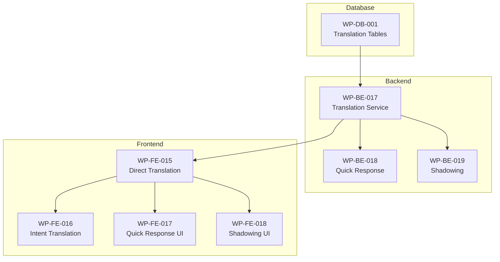

# Phase 5: Translation Practice 🆕

> 📅 Estimated: 22 days
> 📦 Work Packages: WP-BE-017 ~ WP-FE-018
> 📋 Tasks: ~48
> 🎯 New Feature: FR-034 ~ FR-038 対応

---

## 📊 Phase Overview

| Metric    | Value                                                                                                        |
| --------- | ------------------------------------------------------------------------------------------------------------ |
| WPs       | 8                                                                                                            |
| Tasks     | ~48                                                                                                          |
| Est. Days | 22                                                                                                           |
| Modules   | TranslationService, QuickResponseService, ShadowingService                                                   |
| UCs       | UC-034, UC-035, UC-036, UC-037, UC-038                                                                       |
| APIs      | 15 (Translation 4, Quick Response 7, Shadowing 4)                                                            |
| Tables    | 5 (translation_questions, translation_results, intent_questions, shadowing_contents, quick_response_results) |
| Screens   | 4 (Direct Translation, Intent Translation, Quick Response, Shadowing)                                        |

---

## 📁 Phase Structure

| File                                                                         | WP ID     | Description                      |
| ---------------------------------------------------------------------------- | --------- | -------------------------------- |
| [wp-be-017-translation-service.md](./wp-be-017-translation-service.md)       | WP-BE-017 | Translation Service (Backend)    |
| [wp-be-018-quick-response-service.md](./wp-be-018-quick-response-service.md) | WP-BE-018 | Quick Response Service (Backend) |
| [wp-be-019-shadowing-service.md](./wp-be-019-shadowing-service.md)           | WP-BE-019 | Shadowing Service (Backend)      |
| [wp-db-001-translation-tables.md](./wp-db-001-translation-tables.md)         | WP-DB-001 | Translation DB Migration         |
| [wp-fe-015-direct-translation.md](./wp-fe-015-direct-translation.md)         | WP-FE-015 | Direct Translation Screen        |
| [wp-fe-016-intent-translation.md](./wp-fe-016-intent-translation.md)         | WP-FE-016 | Intent Translation Screen        |
| [wp-fe-017-quick-response.md](./wp-fe-017-quick-response.md)                 | WP-FE-017 | Quick Response Screens           |
| [wp-fe-018-shadowing.md](./wp-fe-018-shadowing.md)                           | WP-FE-018 | Shadowing Practice Screen        |

---

## 🎯 Work Package Summary

| WP ID     | Work Package                   | Tasks  | Est. Hours | Dependencies          |
| --------- | ------------------------------ | ------ | ---------- | --------------------- |
| WP-DB-001 | Translation Tables Migration   | 4      | 8          | WP-BE-002             |
| WP-BE-017 | Translation Service (BE)       | 8      | 32         | WP-BE-005, WP-INT-001 |
| WP-BE-018 | Quick Response Service (BE)    | 6      | 24         | WP-BE-017             |
| WP-BE-019 | Shadowing Service (BE)         | 6      | 24         | WP-BE-017, WP-INT-003 |
| WP-FE-015 | Direct Translation Screen (FE) | 6      | 24         | WP-FE-008             |
| WP-FE-016 | Intent Translation Screen (FE) | 5      | 16         | WP-FE-015             |
| WP-FE-017 | Quick Response Screens (FE)    | 6      | 24         | WP-FE-015             |
| WP-FE-018 | Shadowing Practice Screen (FE) | 7      | 24         | WP-FE-015             |
| **Total** |                                | **48** | **176**    | -                     |

---

## 📊 Use Case Coverage

| UC ID  | UC Name              | BE WP     | FE WP     | Status |
| ------ | -------------------- | --------- | --------- | ------ |
| UC-034 | ダイレクト翻訳練習   | WP-BE-017 | WP-FE-015 | ⬜     |
| UC-035 | 高度意図翻訳練習     | WP-BE-017 | WP-FE-016 | ⬜     |
| UC-036 | ワード連想チャレンジ | WP-BE-018 | WP-FE-017 | ⬜     |
| UC-037 | 瞬間応答ドリル       | WP-BE-018 | WP-FE-017 | ⬜     |
| UC-038 | シャドーイング練習   | WP-BE-019 | WP-FE-018 | ⬜     |

---

## 📊 API Coverage

| API Category     | Count  | WP        | Status |
| ---------------- | ------ | --------- | ------ |
| Translation APIs | 4      | WP-BE-017 | ⬜     |
| Quick Response   | 7      | WP-BE-018 | ⬜     |
| Shadowing APIs   | 4      | WP-BE-019 | ⬜     |
| **Total**        | **15** | -         | ⬜     |

---

## 📋 Execution Order

---

## 📋 Progress Tracking

| WP ID     | WP Name                        | Tasks  | Completed | Progress |
| --------- | ------------------------------ | ------ | --------- | -------- |
| WP-DB-001 | Translation Tables Migration   | 4      | 0         | 0%       |
| WP-BE-017 | Translation Service (BE)       | 8      | 0         | 0%       |
| WP-BE-018 | Quick Response Service (BE)    | 6      | 0         | 0%       |
| WP-BE-019 | Shadowing Service (BE)         | 6      | 0         | 0%       |
| WP-FE-015 | Direct Translation Screen (FE) | 6      | 0         | 0%       |
| WP-FE-016 | Intent Translation Screen (FE) | 5      | 0         | 0%       |
| WP-FE-017 | Quick Response Screens (FE)    | 6      | 0         | 0%       |
| WP-FE-018 | Shadowing Practice Screen (FE) | 7      | 0         | 0%       |
| **Total** |                                | **48** | **0**     | **0%**   |

---

## 🔗 DD References

| DD Document                                   | Content        |
| --------------------------------------------- | -------------- |
| `06-component-design/translation-01.md`       | UC-034, UC-035 |
| `06-component-design/translation-02.md`       | UC-036~038     |
| `07-database-design/translation-tables.md`    | 5 Tables DDL   |
| `08-api-design/translation-apis.md`           | 15 APIs        |
| `09-ui-specifications/translation-screens.md` | 4 Screen specs |

---

_Created: 2026-01-07_
_Workflow: /create-detailed-plan v3.0_
