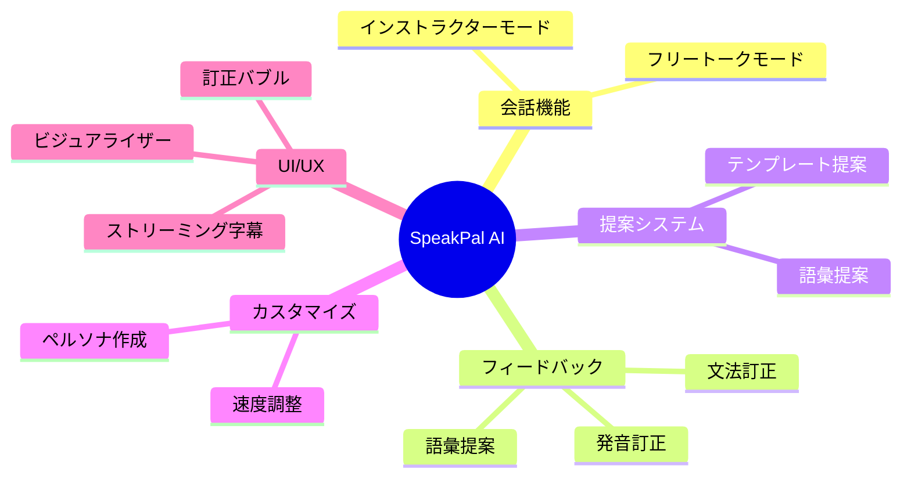
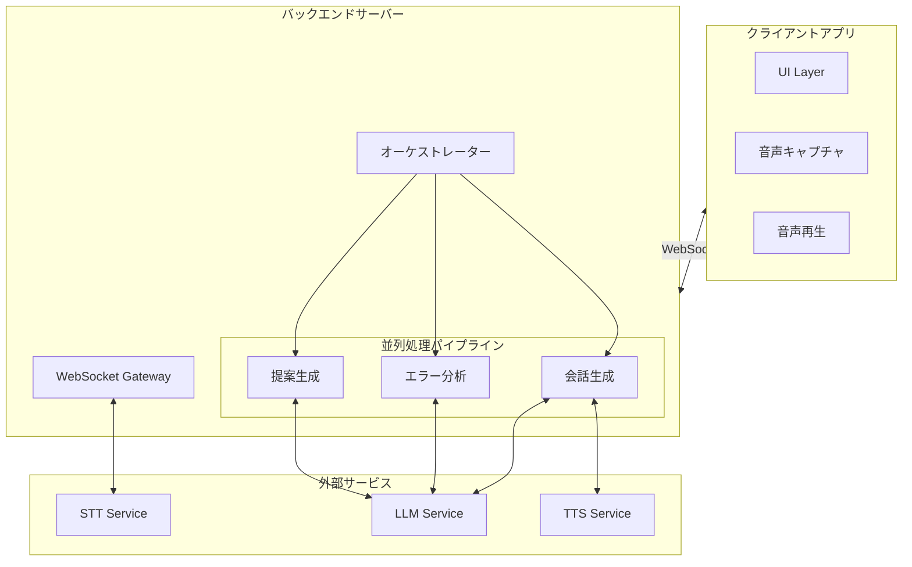

# 2. 全体概要

## 2.1. 製品の背景

### 2.1.1. 解決すべき課題

現在の英会話学習において、以下の課題が存在します：

| 課題 ID | 課題                           | 影響                           |
| ------- | ------------------------------ | ------------------------------ |
| P-001   | 人との会話への恐怖心           | 間違いを恐れて積極的に話せない |
| P-002   | 既存アプリの遅い応答速度       | 自然な会話リズムが得られない   |
| P-003   | 機械的な音声                   | 実際の会話練習として不十分     |
| P-004   | 適切な返答がわからない         | 会話が途切れやすい             |
| P-005   | 即時のエラーフィードバック不足 | 間違いに気づかず学習効果が低下 |

### 2.1.2. 製品ビジョン

SpeakPal AI は、「本物の人間のような」AI 会話体験を通じて、上記課題を解決します：

```
┌─────────────────────────────────────────────────────────────────┐
│                    SpeakPal AI のビジョン                        │
├─────────────────────────────────────────────────────────────────┤
│  🎯 超低遅延（<1秒）での自然な会話体験                          │
│  🎭 豊かな感情表現を持つAIペルソナ                              │
│  📚 教育的フィードバック（訂正・提案）                          │
│  🎓 学習者レベルに応じたパーソナライゼーション                  │
└─────────────────────────────────────────────────────────────────┘
```

---

## 2.2. 主要機能概要

### 2.2.1. 機能マップ



### 2.2.2. 機能一覧

| 機能 ID | 機能名               | 説明                              | 優先度 |
| ------- | -------------------- | --------------------------------- | ------ |
| FR-001  | 会話モード切替       | インストラクター/フリートーク切替 | Must   |
| FR-002  | インストラクター会話 | AI が主導する会話機能             | Must   |
| FR-003  | フリートーク会話     | ユーザー主導の自由会話            | Must   |
| FR-004  | スマート提案表示     | テンプレート＋語彙提案            | Must   |
| FR-005  | ストリーミング字幕   | リアルタイムカラオケ式字幕        | Must   |
| FR-006  | 即時訂正表示         | 発音・文法・語彙エラー表示        | Must   |
| FR-007  | AI 速度調整          | 0.75x〜1.25x スライダー           | Should |
| FR-008  | カスタムペルソナ作成 | 名前・声・性格設定                | Should |
| FR-009  | 割り込み対応         | ユーザーの発話割り込み検知        | Must   |
| FR-010  | フィラーワード       | 思考中のつなぎ言葉挿入            | Should |

---

## 2.3. ユーザー特性

### 2.3.1. ユーザーレベル定義

システムは 4 段階のユーザーレベルをサポートし、AI の振る舞いを自動調整します：

| レベル           | 学習者の特徴                                   | AI の振る舞い                                                   | デフォルト速度 |
| ---------------- | ---------------------------------------------- | --------------------------------------------------------------- | -------------- |
| **Beginner**     | 語彙が少ない、ためらいがち、単文のみ           | ゆっくり話す、Top500 語彙使用、短文、Yes/No・A/B 選択質問を優先 | 0.75x          |
| **Basic**        | 基本的なコミュニケーション、挨拶・自己紹介可能 | やや遅め、忍耐強く待つ、シンプルな文法                          | 0.85x          |
| **Intermediate** | 馴染みのあるトピックで流暢、議論を始められる   | 自然な速度、関係節・簡単なイディオム使用                        | 1.0x           |
| **Advanced**     | ネイティブレベルのコミュニケーション           | 速い速度、スラング使用、ニュアンスのある表現、抽象的なトピック  | 1.0x - 1.25x   |

### 2.3.2. ユーザーロール

| ロール         | 説明                           | 技術レベル |
| -------------- | ------------------------------ | ---------- |
| 学習者         | 英会話を練習するエンドユーザー | 一般       |
| システム管理者 | システムの運用・保守担当       | 技術者     |

---

## 2.4. 制約条件

### 2.4.1. 技術的制約

| 制約 ID | 制約内容                   | 理由                         |
| ------- | -------------------------- | ---------------------------- |
| TC-001  | 音声応答遅延 < 1000ms      | 自然な会話体験に必要         |
| TC-002  | WebSocket 必須             | 双方向リアルタイム通信に必要 |
| TC-003  | 常時インターネット接続必須 | クラウド AI サービス利用     |
| TC-004  | マイク・スピーカー必須     | 音声会話機能に必要           |

### 2.4.2. 法的制約

| 制約 ID | 制約内容                     | 対応                               |
| ------- | ---------------------------- | ---------------------------------- |
| LC-001  | 音声データのプライバシー保護 | 音声データの暗号化・適切な保持期間 |
| LC-002  | 個人情報保護法への準拠       | プライバシーポリシー整備           |

### 2.4.3. ビジネス制約

| 制約 ID | 制約内容                                        | 影響                 |
| ------- | ----------------------------------------------- | -------------------- |
| BC-001  | 外部 AI サービス（OpenAI, Deepgram 等）への依存 | サービス障害時の影響 |
| BC-002  | API 利用コスト                                  | 運用コストの考慮     |

---

## 2.5. 前提条件と依存関係

### 2.5.1. 前提条件

| 前提 ID | 内容                                                     |
| ------- | -------------------------------------------------------- |
| AS-001  | ユーザーは安定したインターネット接続を持つ               |
| AS-002  | ユーザーのデバイスにはマイクとスピーカーが装備されている |
| AS-003  | ユーザーは英語の基本的な理解がある（完全初心者は対象外） |
| AS-004  | 外部 AI サービスの API は安定して利用可能である          |

### 2.5.2. 依存関係

| 依存 ID | 外部システム/サービス     | 用途                 | 必須度 |
| ------- | ------------------------- | -------------------- | ------ |
| DEP-001 | Deepgram / OpenAI Whisper | Speech-to-Text 変換  | Must   |
| DEP-002 | GPT-4o / Groq (Llama 3)   | 会話生成、エラー分析 | Must   |
| DEP-003 | ElevenLabs / OpenAI TTS   | Text-to-Speech 変換  | Must   |

---

## 2.6. システム構成概要


