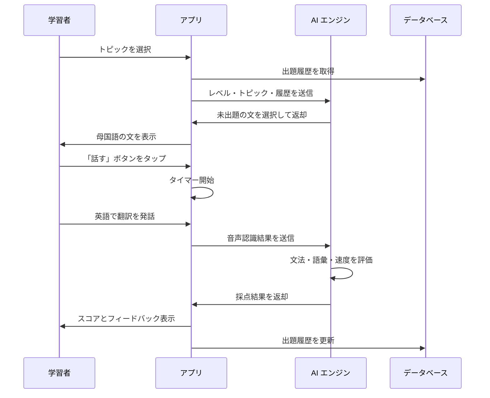
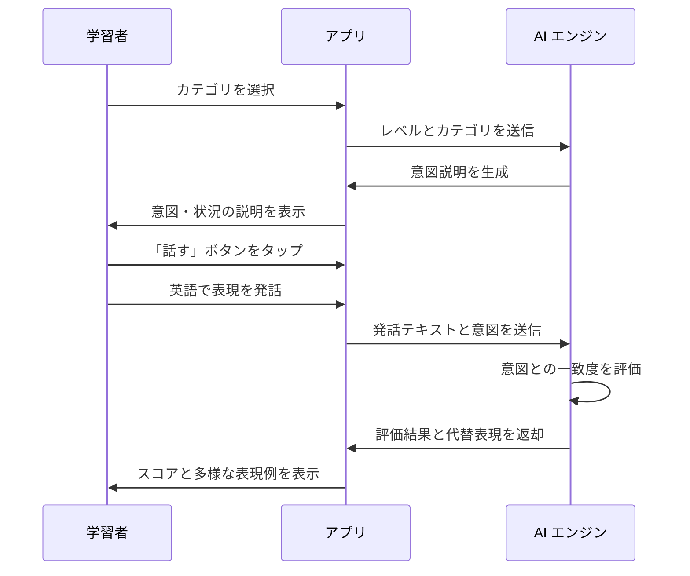
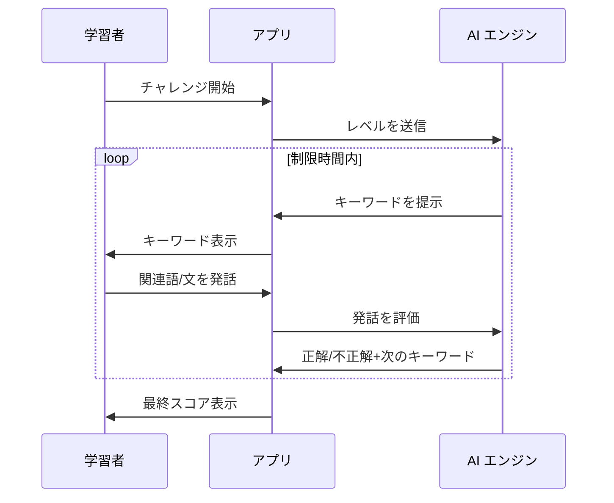
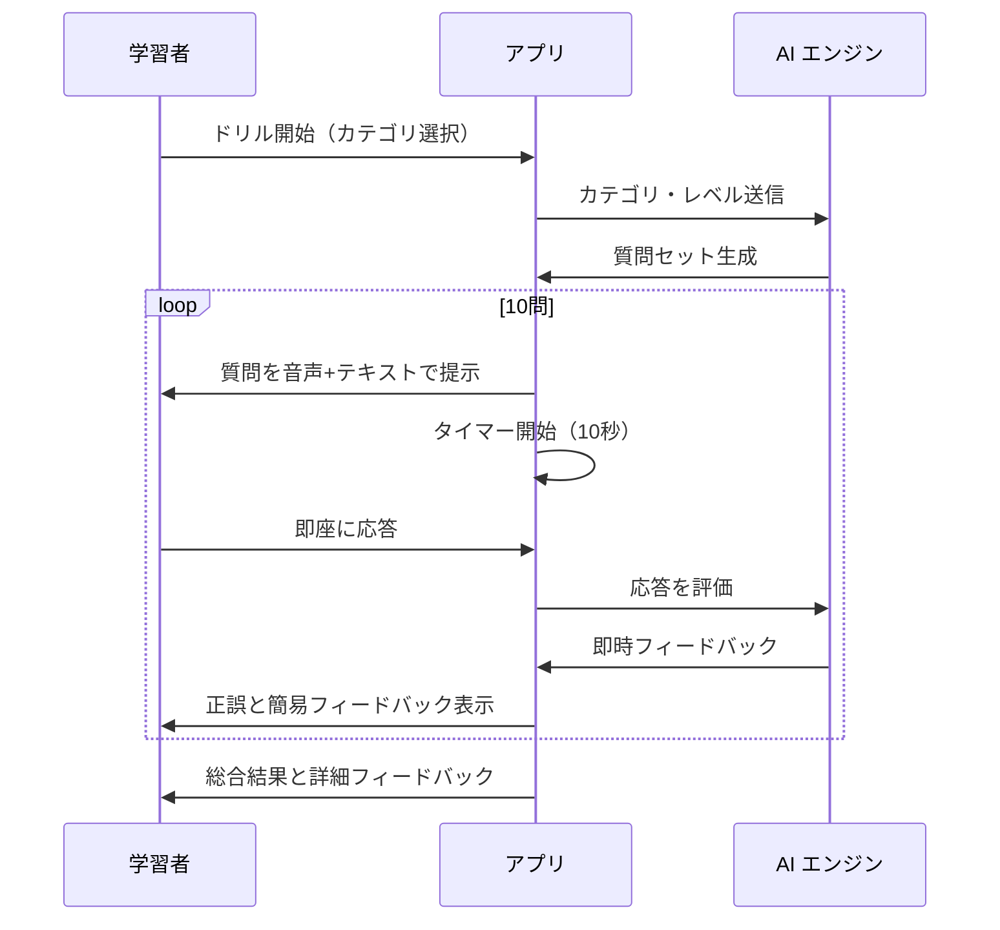
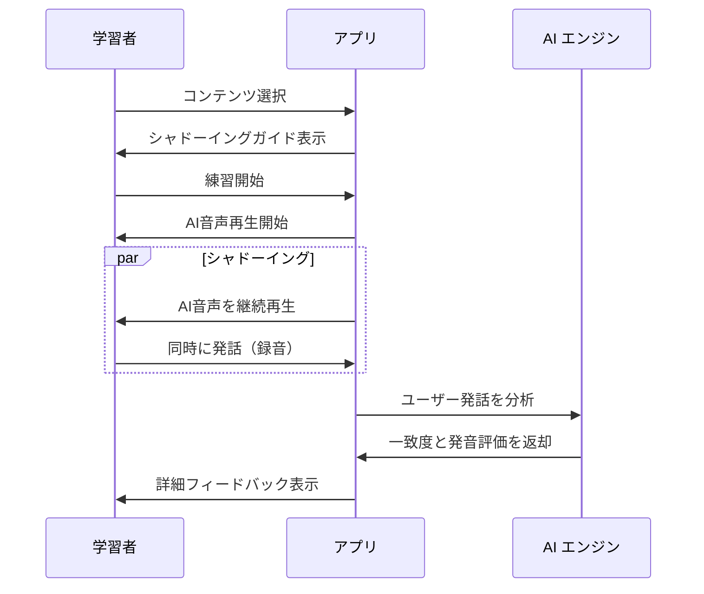

# 翻訳練習機能 (Translation Practice)

> このファイルは翻訳練習とスピーキング反射機能に関する機能要件を定義します: FR-034 〜 FR-038

---

## FR-034: ダイレクト翻訳練習

### 概要

選択したトピックと学習者のレベルに応じて、母国語（日本語/ベトナム語など）の文を表示し、学習者が英語で口頭翻訳する機能。AI が文法、語彙使用、応答速度を基に採点する。

### アクター

| アクター | 役割                 |
| -------- | -------------------- |
| 学習者   | 翻訳練習を行う       |
| AI       | 問題提示と採点を行う |

### 事前条件

- ユーザーがログイン済みであること
- 学習者のレベル（Beginner/Intermediate/Upper-Intermediate/Advanced）が設定済みであること
- 少なくとも 1 つのトピックが選択されていること

### 主フロー

1. 学習者がトピック（例: 日常会話、ビジネス、旅行）を選択する
2. システムが学習者のレベルに応じた難易度の文を選択する
3. 過去 7 日間に出題されていない文をランダムに選ぶ
4. 母国語の文を画面に表示する
5. 学習者が「話す」ボタンをタップする
6. タイマーが開始され、応答時間の計測を開始する
7. 学習者が英語で翻訳を口頭で発話する
8. システムが音声認識で発話をテキスト化する
9. AI が以下の観点で採点する:
   - 文法正確性（40%）
   - 語彙の適切さ（30%）
   - 応答速度（30%）
10. 採点結果とフィードバックを表示する
11. 模範解答を表示し、比較できるようにする

### 代替フロー

| ケース ID | 条件                   | 処理                                       |
| --------- | ---------------------- | ------------------------------------------ |
| ALT-034-1 | 発話が認識されない場合 | 再度発話を促すメッセージを表示             |
| ALT-034-2 | タイムアウト（30 秒）  | 時間切れとして 0 点、模範解答を表示        |
| ALT-034-3 | 全文出題済みの場合     | トピック内の履歴をリセットして再出題可能に |
| ALT-034-4 | ネットワークエラー時   | オフライン用の文を表示、後で同期           |

### 例外フロー

| ケース ID | エラー             | 処理                               |
| --------- | ------------------ | ---------------------------------- |
| EXC-034-1 | マイク権限未取得   | 権限設定画面への誘導               |
| EXC-034-2 | AI サービス障害    | エラーメッセージ表示、リトライ案内 |
| EXC-034-3 | 音声認識精度が低い | 手動入力オプションを提供           |

### 事後条件

- 練習結果が学習履歴に保存される
- 出題した文が履歴に記録され、重複出題を防ぐ
- XP ポイントが付与される

### ビジネスルール

| ルール ID | ルール名           | ルール詳細                                                                    |
| --------- | ------------------ | ----------------------------------------------------------------------------- |
| BR-095    | 重複回避期間       | 同一トピック内で過去 7 日間に出題された文は再出題しない                       |
| BR-096    | レベル別文の難易度 | Beginner: 5-8 語、Intermediate: 8-12 語、Upper: 12-18 語、Advanced: 18 語以上 |
| BR-097    | 応答速度スコア     | 5 秒以内: 満点、10 秒以内: 80%、15 秒以内: 60%、20 秒以内: 40%、20 秒超: 20%  |
| BR-098    | XP 付与ルール      | 完了で 20XP、80 点以上で追加 10XP、連続 5 問正解でボーナス 30XP               |
| BR-099    | 日次制限           | Free プラン: 10 問/日、Pro: 50 問/日、Plus: 無制限                            |
| BR-100    | トピック管理       | Free プラン: 3 トピックまで、有料プラン: 全トピック利用可能                   |

### バリデーションルール

| ルール ID  | 対象フィールド | ルール               |
| ---------- | -------------- | -------------------- |
| VAL-034-01 | トピック選択   | 1 つ以上選択必須     |
| VAL-034-02 | 音声認識結果   | 1 語以上の認識が必要 |
| VAL-034-03 | 応答時間       | 30 秒以内であること  |

---

## FR-035: 高度意図翻訳練習

### 概要

母国語の文ではなく、伝えたい「意図・状況」を説明し、学習者がその意図を表現する英語フレーズを自由に発話する機能。表現の多様性と適切さを評価する。

### アクター

| アクター | 役割                       |
| -------- | -------------------------- |
| 学習者   | 意図に合った英語表現を発話 |
| AI       | 意図説明と発話評価を行う   |

### 事前条件

- ユーザーがログイン済みであること
- 学習者のレベルが Intermediate 以上であること（Beginner は利用不可）

### 主フロー

1. 学習者がシチュエーションカテゴリを選択する
2. AI が意図・状況の説明を生成して表示する
   - 例:「**友達が落ち込んでいます。励ましの言葉をかけてください**」
   - 例:「**会議で意見が対立しています。丁寧に反対意見を述べてください**」
3. 学習者が「話す」ボタンをタップする
4. 学習者が意図を表現する英語フレーズを発話する
5. AI が以下の観点で評価する:
   - 意図との一致度（40%）
   - 表現の自然さ（30%）
   - 語彙の適切さ／多様性（30%）
6. 評価結果を表示する
7. 同じ意図を表現する複数の代替フレーズを表示する
8. ユーザーが代替フレーズを音声で確認できる

### 代替フロー

| ケース ID | 条件                 | 処理                                   |
| --------- | -------------------- | -------------------------------------- |
| ALT-035-1 | 意図と無関係な発話   | 意図の再確認を促し、ヒントを表示       |
| ALT-035-2 | 発話内容が短すぎる   | より詳細な表現を促すガイダンス表示     |
| ALT-035-3 | 複数の正解がある場合 | 複数パターンとそれぞれの使用場面を説明 |

### 例外フロー

| ケース ID | エラー             | 処理                         |
| --------- | ------------------ | ---------------------------- |
| EXC-035-1 | マイク権限未取得   | 権限設定画面への誘導         |
| EXC-035-2 | 意図生成エラー     | プリセット意図を使用         |
| EXC-035-3 | 評価精度が低い場合 | 手動フィードバック入力を許可 |

### 事後条件

- 練習結果が学習履歴に保存される
- 学習した表現が単語帳に自動追加される（オプション）
- XP ポイントが付与される

### ビジネスルール

| ルール ID | ルール名         | ルール詳細                                               |
| --------- | ---------------- | -------------------------------------------------------- |
| BR-101    | レベル制限       | この機能は Intermediate 以上のレベルのユーザーのみ利用可 |
| BR-102    | 評価の柔軟性     | 同一意図に対して複数の正解表現を許容する                 |
| BR-103    | 代替表現数       | 各意図に対して最低 3 つの代替表現を提示する              |
| BR-104    | XP 付与ルール    | 完了で 30XP、優秀評価（85 点以上）で追加 20XP            |
| BR-105    | カテゴリ別難易度 | ビジネス＞日常＞挨拶 の順で難易度が高い                  |
| BR-106    | 日次制限         | Free プラン: 5 問/日、Pro: 30 問/日、Plus: 無制限        |

### バリデーションルール

| ルール ID  | 対象フィールド | ルール             |
| ---------- | -------------- | ------------------ |
| VAL-035-01 | カテゴリ選択   | 1 つ選択必須       |
| VAL-035-02 | 発話内容       | 3 語以上であること |

---

## FR-036: ワード連想チャレンジ

### 概要

AI が提示するキーワードから素早く関連語句や文を連想して発話するチャレンジ。語彙力と瞬発力を同時に鍛える機能。

### アクター

| アクター | 役割                       |
| -------- | -------------------------- |
| 学習者   | 連想ワードを発話           |
| AI       | キーワード提示と評価を行う |

### 事前条件

- ユーザーがログイン済みであること
- レベル設定が完了していること

### 主フロー

1. 学習者がワード連想チャレンジを開始する
2. AI がキーワードを提示する（例:「Weather」）
3. 制限時間（5 秒）内に関連する単語、フレーズ、または文を発話する
   - 例:「sunny」「It's raining」「storm」など
4. AI が関連性を判定し、正解なら次のキーワードへ進む
5. 60 秒間で何問正解できるかを競う
6. チェーン（連続正解）でボーナスポイント獲得
7. 最終スコアとベスト記録を表示する

### 代替フロー

| ケース ID | 条件               | 処理                           |
| --------- | ------------------ | ------------------------------ |
| ALT-036-1 | 時間切れ           | スキップして次のキーワードへ   |
| ALT-036-2 | 関連性が低い発話   | 不正解としてチェーンをリセット |
| ALT-036-3 | 同じ単語を繰り返し | 重複として不正解扱い           |

### 例外フロー

| ケース ID | エラー             | 処理                 |
| --------- | ------------------ | -------------------- |
| EXC-036-1 | 音声認識失敗       | 自動スキップ         |
| EXC-036-2 | ネットワークエラー | オフラインモード切替 |

### 事後条件

- チャレンジ結果が記録される
- ハイスコアが更新される場合はランキングに反映
- XP ポイントが付与される

### ビジネスルール

| ルール ID | ルール名           | ルール詳細                                              |
| --------- | ------------------ | ------------------------------------------------------- |
| BR-107    | 制限時間           | 1 問あたり 5 秒、全体で 60 秒                           |
| BR-108    | チェーンボーナス   | 連続 5 問正解で 1.5 倍、10 問で 2 倍のポイント          |
| BR-109    | 重複禁止           | セッション内で同一の回答は不可                          |
| BR-110    | レベル別キーワード | レベルに応じてキーワードの難易度を調整                  |
| BR-111    | XP 付与            | 10 問正解で 50XP、20 問で 120XP、ハイスコア更新で +30XP |
| BR-112    | 日次チャレンジ     | 1 日 3 回まで無料、追加は有料                           |

### バリデーションルール

| ルール ID  | 対象     | ルール   |
| ---------- | -------- | -------- |
| VAL-036-01 | 発話内容 | 1 語以上 |
| VAL-036-02 | 応答時間 | 5 秒以内 |

---

## FR-037: 瞬間応答ドリル

### 概要

質問や状況が素早く次々と提示され、学習者が即座に英語で応答するドリル形式の練習。スピーキングの反射神経を鍛える機能。

### アクター

| アクター | 役割                     |
| -------- | ------------------------ |
| 学習者   | 質問に即座に応答         |
| AI       | 質問提示と応答評価を行う |

### 事前条件

- ユーザーがログイン済みであること
- レベル設定が完了していること

### 主フロー

1. 学習者がカテゴリを選択してドリルを開始する
   - カテゴリ例: 日常質問、意見表明、状況対応
2. AI が質問を音声とテキストで提示する
   - 例:「What do you usually have for breakfast?」
   - 例:「Do you agree that technology makes life easier? Why?」
3. 学習者は 10 秒以内に即座に英語で応答する
4. AI が応答の完成度と自然さを即時評価する
5. 10 問連続で実施する
6. 終了後に総合スコアと改善点を表示する

### 代替フロー

| ケース ID | 条件         | 処理                             |
| --------- | ------------ | -------------------------------- |
| ALT-037-1 | 応答なし     | 0 点として次の質問へ             |
| ALT-037-2 | 不完全な応答 | 部分点付与                       |
| ALT-037-3 | 一時停止要求 | 現在の問題は無効、再開時に新問題 |

### 例外フロー

| ケース ID | エラー       | 処理             |
| --------- | ------------ | ---------------- |
| EXC-037-1 | 音声出力失敗 | テキストのみ表示 |
| EXC-037-2 | 音声認識失敗 | 自動スキップ     |

### 事後条件

- ドリル結果が学習履歴に保存される
- 弱点カテゴリが分析される
- XP ポイントが付与される

### ビジネスルール

| ルール ID | ルール名     | ルール詳細                                 |
| --------- | ------------ | ------------------------------------------ |
| BR-113    | 応答時間制限 | 1 問あたり 10 秒                           |
| BR-114    | 質問数       | 1 セッション 10 問固定                     |
| BR-115    | 評価基準     | 速度 30%、正確性 40%、自然さ 30%           |
| BR-116    | XP 付与      | 完了で 40XP、平均 80 点以上で追加 25XP     |
| BR-117    | 日次制限     | Free: 2 回/日、Pro: 10 回/日、Plus: 無制限 |
| BR-118    | 弱点分析     | 3 回以上実施で弱点カテゴリを特定して表示   |

### バリデーションルール

| ルール ID  | 対象     | ルール             |
| ---------- | -------- | ------------------ |
| VAL-037-01 | カテゴリ | 1 つ選択必須       |
| VAL-037-02 | 応答     | 聞き取り可能な音声 |

---

## FR-038: シャドーイング練習

### 概要

AI が発話する英語をリアルタイムで聞きながら、同時に（または少し遅れて）真似して発話するシャドーイング練習機能。リスニングとスピーキングを同時に鍛える。

### アクター

| アクター | 役割                      |
| -------- | ------------------------- |
| 学習者   | AI の発話をシャドーイング |
| AI       | モデル音声提供と評価      |

### 事前条件

- ユーザーがログイン済みであること
- イヤホン/ヘッドホン使用推奨（エコー防止）

### 主フロー

1. 学習者がシャドーイングするコンテンツを選択する
   - 会話スクリプト、ニュース、スピーチなど
2. AI がモデル音声を再生開始する
3. 学習者が AI の音声を聞きながら同時に発話する
4. システムが学習者の発話を録音する
5. AI が以下の観点で分析する:
   - 追従タイミング（AI との時間差）
   - 発音の正確性
   - イントネーション・リズム
   - 発話の完成度
6. 詳細フィードバックを表示する
7. 苦手な部分のみをリピート練習できる

### 代替フロー

| ケース ID | 条件                 | 処理                       |
| --------- | -------------------- | -------------------------- |
| ALT-038-1 | 速度が速すぎる       | 速度 0.75x モードを提案    |
| ALT-038-2 | 特定部分のみ練習希望 | セクション選択モードへ切替 |
| ALT-038-3 | 字幕表示を希望       | 字幕 ON/OFF トグル         |

### 例外フロー

| ケース ID | エラー     | 処理                         |
| --------- | ---------- | ---------------------------- |
| EXC-038-1 | エコー発生 | エコーキャンセル有効化を促す |
| EXC-038-2 | 録音失敗   | 再録音を促す                 |

### 事後条件

- 練習結果が学習履歴に保存される
- 発音改善トレンドが記録される
- XP ポイントが付与される

### ビジネスルール

| ルール ID | ルール名       | ルール詳細                                   |
| --------- | -------------- | -------------------------------------------- |
| BR-119    | 速度調整       | 0.75x / 1.0x / 1.25x の 3 段階               |
| BR-120    | コンテンツ長   | 30 秒〜3 分のコンテンツを用意                |
| BR-121    | 評価基準       | 追従 20%、発音 40%、リズム 20%、完成度 20%   |
| BR-122    | XP 付与        | 完了で 35XP、90 点以上で追加 20XP            |
| BR-123    | 日次制限       | Free: 5 回/日、Pro: 20 回/日、Plus: 無制限   |
| BR-124    | コンテンツ制限 | Free: 基本コンテンツのみ、有料: 全コンテンツ |

### バリデーションルール

| ルール ID  | 対象       | ルール                       |
| ---------- | ---------- | ---------------------------- |
| VAL-038-01 | コンテンツ | 1 つ選択必須                 |
| VAL-038-02 | 発話録音   | 元音声の 50%以上の長さが必要 |

---

## 機能要件サマリー

| ID     | 機能名               | 説明                                             | 優先度 |
| ------ | -------------------- | ------------------------------------------------ | ------ |
| FR-034 | ダイレクト翻訳練習   | 母国語 → 英語の口頭翻訳練習                      | Must   |
| FR-035 | 高度意図翻訳練習     | 意図説明 → 英語表現の自由発話練習                | Must   |
| FR-036 | ワード連想チャレンジ | キーワードから関連語句を瞬時に発話               | Should |
| FR-037 | 瞬間応答ドリル       | 質問に即座に英語で応答するドリル                 | Must   |
| FR-038 | シャドーイング練習   | AI 音声と同時発話するリスニング&スピーキング練習 | Should |

---

## 関連ビジネスルール一覧

| ルール ID   | 機能   | 概要                 |
| ----------- | ------ | -------------------- |
| BR-095〜100 | FR-034 | ダイレクト翻訳ルール |
| BR-101〜106 | FR-035 | 高度意図翻訳ルール   |
| BR-107〜112 | FR-036 | ワード連想ルール     |
| BR-113〜118 | FR-037 | 瞬間応答ルール       |
| BR-119〜124 | FR-038 | シャドーイングルール |
