# 3. 機能要件

## 3.1. 機能要件概要

本セクションでは、SpeakPal AI の全機能要件を定義します。機能要件は以下のカテゴリに分類されています。

### カテゴリ一覧

| No. | カテゴリ                 | ファイル                                                 | 機能 ID                    |
| --- | ------------------------ | -------------------------------------------------------- | -------------------------- |
| 1   | 会話機能                 | [01-conversation.md](./01-conversation.md)               | FR-001〜003, 009, 010, 033 |
| 2   | フィードバック           | [02-feedback.md](./02-feedback.md)                       | FR-004〜006, 017           |
| 3   | カスタマイズ             | [03-customization.md](./03-customization.md)             | FR-007〜008                |
| 4   | ユーザー管理             | [04-user-management.md](./04-user-management.md)         | FR-011〜013                |
| 5   | サブスクリプション       | [05-subscription.md](./05-subscription.md)               | FR-014〜016                |
| 6   | ゲーミフィケーション     | [06-gamification.md](./06-gamification.md)               | FR-018〜020                |
| 7   | 学習進捗トラッキング     | [07-progress-tracking.md](./07-progress-tracking.md)     | FR-021〜023                |
| 8   | 構造化学習               | [08-structured-learning.md](./08-structured-learning.md) | FR-024〜026                |
| 9   | ソーシャル＆コミュニティ | [09-social.md](./09-social.md)                           | FR-027〜029                |
| 10  | 高度な学習機能           | [10-advanced-learning.md](./10-advanced-learning.md)     | FR-030〜032                |

---

## 3.2. 全機能要件一覧

| ID     | 機能名                 | 説明                              | 優先度 | カテゴリ       |
| ------ | ---------------------- | --------------------------------- | ------ | -------------- |
| FR-001 | 会話モード切替         | インストラクター/フリートーク切替 | Must   | 会話           |
| FR-002 | インストラクター会話   | AI が主導する会話機能             | Must   | 会話           |
| FR-003 | フリートーク会話       | ユーザー主導の自由会話            | Must   | 会話           |
| FR-004 | スマート提案表示       | テンプレート＋語彙提案            | Must   | フィードバック |
| FR-005 | ストリーミング字幕     | リアルタイムカラオケ式字幕        | Must   | フィードバック |
| FR-006 | 即時訂正表示           | 発音・文法・語彙エラー表示        | Must   | フィードバック |
| FR-007 | AI 速度調整            | 0.75x〜1.25x スライダー           | Should | カスタマイズ   |
| FR-008 | カスタムペルソナ作成   | 名前・声・性格設定                | Should | カスタマイズ   |
| FR-009 | 割り込み対応           | ユーザーの発話割り込み検知        | Must   | 会話           |
| FR-010 | フィラーワード         | 思考中のつなぎ言葉挿入            | Should | 会話           |
| FR-011 | ユーザー登録           | 新規アカウント作成                | Must   | ユーザー管理   |
| FR-012 | ログイン/認証          | ユーザー認証・セッション管理      | Must   | ユーザー管理   |
| FR-013 | パスワード変更         | パスワードの変更・リセット        | Must   | ユーザー管理   |
| FR-014 | サブスクリプション管理 | プラン表示・購入・更新            | Must   | サブスク       |
| FR-015 | 利用量制限             | AI 機能の日次リクエスト制限       | Must   | サブスク       |
| FR-016 | プラン変更             | アップグレード/ダウングレード     | Must   | サブスク       |
| FR-017 | 語彙解説               | AI 発話内の重要語彙の説明表示     | Should | フィードバック |
| FR-018 | 学習ストリーク         | 連続学習日数の記録＆通知          | Must   | ゲーミフィ     |
| FR-019 | 実績バッジ             | 学習マイルストーン達成バッジ      | Should | ゲーミフィ     |
| FR-020 | 経験値＆レベル         | XP ポイント＆レベルアップシステム | Should | ゲーミフィ     |
| FR-021 | 学習統計ダッシュボード | 学習進捗の可視化                  | Must   | 進捗           |
| FR-022 | 発音スコア履歴         | 発音改善の時系列グラフ            | Should | 進捗           |
| FR-023 | 週間/月間レポート      | 定期学習レポート送信              | Should | 進捗           |
| FR-024 | シナリオライブラリ     | 状況別会話シナリオ集              | Must   | 構造化学習     |
| FR-025 | デイリーチャレンジ     | 毎日の学習ミッション              | Must   | 構造化学習     |
| FR-026 | 単語帳＆復習           | 保存語彙の SRS 復習               | Must   | 構造化学習     |
| FR-027 | 友達招待               | リファラルプログラム              | Should | ソーシャル     |
| FR-028 | 週間ランキング         | ユーザー間の XP ランキング        | Should | ソーシャル     |
| FR-029 | グループ学習           | 友達とのグループ作成              | Could  | ソーシャル     |
| FR-030 | 発音詳細分析           | 音素レベルの発音フィードバック    | Should | 高度な学習     |
| FR-031 | ロールプレイモード     | 実践的な役割演技シナリオ          | Must   | 高度な学習     |
| FR-032 | TOEIC/IELTS 対策       | 試験スピーキング練習モード        | Could  | 高度な学習     |
| FR-033 | 発話確認モード         | 音声認識結果の確認＆修正機能      | Should | 会話           |

---

## 3.3. 優先度サマリー

| 優先度 | 件数 | 機能 ID                                                       |
| ------ | ---- | ------------------------------------------------------------- |
| Must   | 17   | FR-001〜006, 009, 011〜016, 018, 021, 024〜026, 031           |
| Should | 14   | FR-007〜008, 010, 017, 019〜020, 022〜023, 027〜028, 030, 033 |
| Could  | 2    | FR-029, 032                                                   |

---

## 3.4. ビジネスルール一覧

全ての機能要件に関連するビジネスルール（BR-001〜BR-094）の定義：

| カテゴリ           | ルール ID   | 概要                           |
| ------------------ | ----------- | ------------------------------ |
| 会話モード         | BR-001〜002 | モード切替、デフォルト設定     |
| インストラクター   | BR-003〜005 | AI 振る舞い、沈黙対応          |
| フリートーク       | BR-006〜007 | レベル対応、コンテンツフィルタ |
| 提案システム       | BR-008〜009 | 難易度調整、テンプレート形式   |
| 字幕表示           | BR-010〜011 | リアルタイム性、ハイライト同期 |
| 即時訂正           | BR-012〜013 | 表示タイミング、エラー色分け   |
| 速度調整           | BR-014〜015 | デフォルト速度、範囲制限       |
| ペルソナ           | BR-016〜017 | 名前一意性、作成上限           |
| 割り込み           | BR-018〜019 | 検知時間、誤検知対策           |
| フィラー           | BR-020〜021 | 多様性、連続使用禁止           |
| ユーザー登録       | BR-022〜025 | メール一意性、パスワード要件   |
| ログイン           | BR-026〜029 | セッション管理、ロック設定     |
| パスワード         | BR-030〜033 | リセット期限、履歴チェック     |
| サブスクリプション | BR-034〜038 | プラン定義、In-App Purchase    |
| 利用量制限         | BR-039〜042 | 日次リセット、カウント方法     |
| プラン変更         | BR-043〜046 | 即時適用、ダウングレード       |
| 語彙解説           | BR-047〜050 | レベル対応、ハイライト上限     |
| ストリーク         | BR-051〜054 | 判定、フリーズ                 |
| バッジ             | BR-055〜057 | 付与、XP ボーナス              |
| XP/レベル          | BR-058〜060 | 計算、レベルアップ             |
| 統計               | BR-061〜064 | データ集計、保持期間           |
| シナリオ           | BR-065〜067 | 利用制限                       |
| チャレンジ         | BR-068〜070 | デイリーチャレンジルール       |
| 単語帳             | BR-071〜073 | SRS 復習ルール                 |
| 招待               | BR-074〜076 | リファラル報酬                 |
| ランキング         | BR-077〜079 | リーグシステム                 |
| グループ           | BR-080〜081 | グループ制限                   |
| 発音分析           | BR-082〜083 | 詳細分析制限                   |
| ロールプレイ       | BR-084〜085 | 評価基準                       |
| 試験対策           | BR-086〜088 | 利用制限                       |
| 発話確認           | BR-089〜094 | 確認モード設定、タイムアウト   |

---

## 3.5. ユースケース図

```mermaid
flowchart TB
    subgraph Actors
        Guest[ゲスト]
        User[学習者]
        AI[AIペルソナ]
        Admin[システム管理者]
    end

    subgraph UserManagement["ユーザー管理"]
        UC11[UC-011: ユーザー登録]
        UC12[UC-012: ログイン/認証]
        UC13[UC-013: パスワード変更]
    end

    subgraph Subscription["サブスクリプション"]
        UC14[UC-014: サブスクリプション管理]
        UC15[UC-015: 利用量制限]
        UC16[UC-016: プラン変更]
    end

    subgraph ConversationModes["会話モード"]
        UC1[UC-001: モード切替]
        UC2[UC-002: インストラクター会話]
        UC3[UC-003: フリートーク会話]
        UC33[UC-033: 発話確認]
    end

    subgraph FeedbackSystem["フィードバックシステム"]
        UC4[UC-004: スマート提案表示]
        UC5[UC-005: ストリーミング字幕]
        UC6[UC-006: 即時訂正表示]
        UC17[UC-017: 語彙解説]
    end

    subgraph Customization["カスタマイズ"]
        UC7[UC-007: AI速度調整]
        UC8[UC-008: ペルソナ作成]
    end

    subgraph AudioHandling["音声処理"]
        UC9[UC-009: 割り込み対応]
        UC10[UC-010: フィラーワード]
    end

    subgraph Gamification["ゲーミフィケーション"]
        UC18[UC-018: 学習ストリーク]
        UC19[UC-019: 実績バッジ]
        UC20[UC-020: 経験値＆レベル]
    end

    subgraph Progress["学習進捗"]
        UC21[UC-021: 統計ダッシュボード]
        UC22[UC-022: 発音スコア履歴]
        UC23[UC-023: 週間/月間レポート]
    end

    subgraph StructuredLearning["構造化学習"]
        UC24[UC-024: シナリオライブラリ]
        UC25[UC-025: デイリーチャレンジ]
        UC26[UC-026: 単語帳＆復習]
    end

    subgraph Social["ソーシャル"]
        UC27[UC-027: 友達招待]
        UC28[UC-028: 週間ランキング]
        UC29[UC-029: グループ学習]
    end

    subgraph AdvancedLearning["高度な学習"]
        UC30[UC-030: 発音詳細分析]
        UC31[UC-031: ロールプレイ]
        UC32[UC-032: 試験対策]
    end

    Guest --> UC11
    Guest --> UC12
    User --> UserManagement
    User --> Subscription
    User --> ConversationModes
    User --> FeedbackSystem
    User --> Customization
    User --> Gamification
    User --> Progress
    User --> StructuredLearning
    User --> Social
    User --> AdvancedLearning

    AI --> UC2
    AI --> UC3
    AI --> UC9
    AI --> UC10
```

