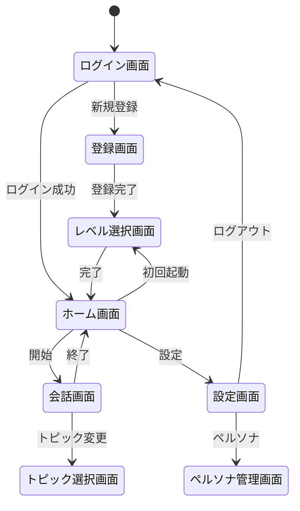
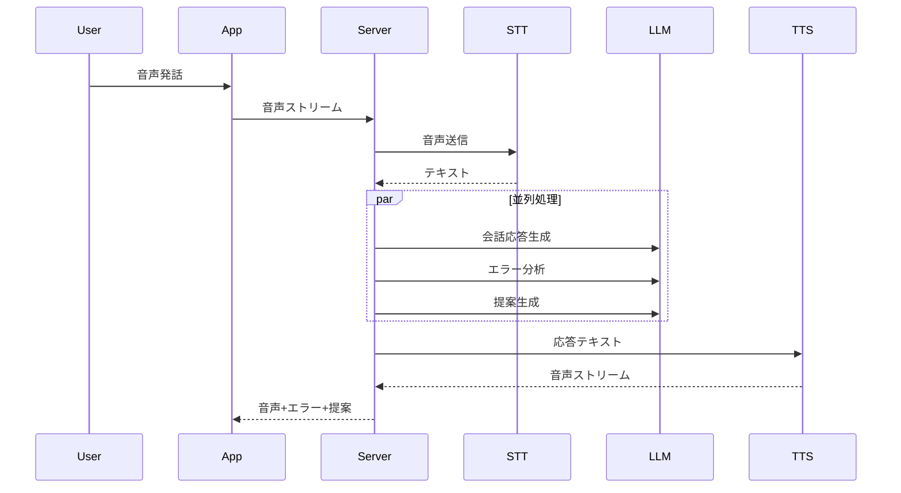

# 4. 外部インターフェース

## 4.1. ユーザーインターフェース（UI）

### 4.1.1. 画面一覧

| 画面 ID | 画面名                 | 説明                                 | 優先度 |
| ------- | ---------------------- | ------------------------------------ | ------ |
| SCR-001 | ホーム画面             | アプリ起動後のメイン画面             | Must   |
| SCR-002 | 会話画面               | AI との会話を行うメイン画面          | Must   |
| SCR-003 | 設定画面               | AI 速度、通知などの設定              | Must   |
| SCR-004 | ペルソナ管理画面       | カスタムペルソナの作成・編集         | Should |
| SCR-005 | レベル選択画面         | ユーザーレベルの選択・変更           | Must   |
| SCR-006 | トピック選択画面       | インストラクターモードのトピック選択 | Should |
| SCR-007 | 履歴画面               | 過去の会話履歴とフィードバック確認   | Should |
| SCR-008 | プロフィール画面       | ユーザー情報の表示・編集             | Should |
| SCR-009 | 登録画面               | 新規アカウント作成                   | Must   |
| SCR-010 | ログイン画面           | ユーザー認証（メール/ソーシャル）    | Must   |
| SCR-011 | サブスクリプション画面 | プラン確認・購入・変更               | Must   |
| SCR-012 | ストリーク画面         | 連続学習日数と報酬表示               | Must   |
| SCR-013 | バッジ一覧画面         | 獲得バッジと未獲得バッジ一覧         | Should |
| SCR-014 | 統計ダッシュボード画面 | 学習進捗グラフ・チャート             | Must   |
| SCR-015 | シナリオライブラリ画面 | 状況別シナリオ選択                   | Must   |
| SCR-016 | 単語帳画面             | 保存語彙リスト・SRS 復習             | Must   |
| SCR-017 | 招待画面               | 友達招待リンク生成・共有             | Should |
| SCR-018 | ランキング画面         | 週間 XP ランキング・リーグ表示       | Should |
| SCR-019 | グループ画面           | グループ作成・管理・チャット         | Could  |
| SCR-020 | 試験対策画面           | TOEIC/IELTS 練習モード選択           | Could  |

### 4.1.2. メイン会話画面レイアウト

```
┌─────────────────────────────────────────────────────────────────┐
│  【上部】ストリーミング字幕エリア                                │
│   "What do you like to do on weekends?" (ハイライト表示)        │
├─────────────────────────────────────────────────────────────────┤
│  【中央】ビジュアライザー（音声波形アニメーション）               │
│          ◉◉◉ AI発話中/聞き取り中 ◉◉◉                           │
├─────────────────────────────────────────────────────────────────┤
│  【オーバーレイ】訂正バブル                                      │
│   "I want go" → "I want to go" 🟡文法エラー                     │
├─────────────────────────────────────────────────────────────────┤
│  【下部】提案エリア                                              │
│   💡 "I usually [___] because [___]"                            │
│   📝 relax | exercise | hang out                                │
├─────────────────────────────────────────────────────────────────┤
│  🎤 マイクボタン                    ⏹ 終了ボタン                │
└─────────────────────────────────────────────────────────────────┘
```

### 4.1.3. 画面遷移図



---

## 4.2. ハードウェアインターフェース

| コンポーネント | 要件                      | 用途                   |
| -------------- | ------------------------- | ---------------------- |
| マイク         | 音声入力対応              | ユーザー音声キャプチャ |
| スピーカー     | 音声出力対応              | AI 音声再生            |
| インターネット | 安定接続（4G/Wi-Fi 推奨） | クラウドサービス通信   |

---

## 4.3. ソフトウェアインターフェース

### 4.3.1. 外部サービス連携

| サービス      | 用途           | プロトコル | 認証方式     |
| ------------- | -------------- | ---------- | ------------ |
| Deepgram      | Speech-to-Text | WebSocket  | API Key      |
| OpenAI GPT-4o | 会話生成＆分析 | WebSocket  | Bearer Token |
| ElevenLabs    | Text-to-Speech | HTTPS      | API Key      |

### 4.3.2. 並列処理パイプライン



---

## 4.4. 通信インターフェース

### 4.4.1. プロトコル

| プロトコル | 用途                            | ポート |
| ---------- | ------------------------------- | ------ |
| WebSocket  | 双方向リアルタイム音声/テキスト | 443    |
| HTTPS      | REST API 呼び出し               | 443    |

### 4.4.2. 遅延要件

| 処理                      | 最大遅延 | 目標遅延 |
| ------------------------- | -------- | -------- |
| ユーザー発話 →AI 応答開始 | 1000ms   | 800ms    |
| 割り込み検知 →AI 停止     | 500ms    | 300ms    |
| テキスト → 字幕表示       | 100ms    | 50ms     |
