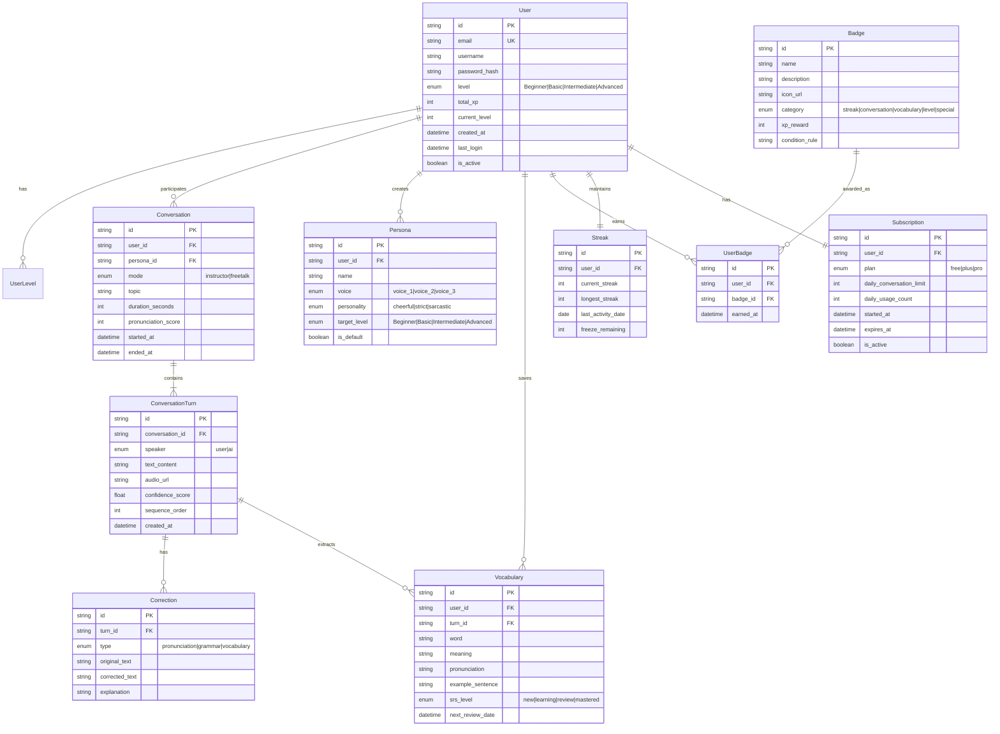

# 6. その他の要件

## 6.1. データベース要件

### 6.1.1. データエンティティ

| エンティティ     | 説明                   | 推定レコード数 |
| ---------------- | ---------------------- | -------------- |
| User             | ユーザー情報           | 100,000+       |
| UserLevel        | ユーザーレベル履歴     | 500,000+       |
| Conversation     | 会話セッション         | 1,000,000+     |
| ConversationTurn | 会話の各ターン（発話） | 10,000,000+    |
| Correction       | 訂正履歴               | 5,000,000+     |
| Persona          | カスタムペルソナ       | 500,000+       |
| Vocabulary       | 保存語彙（単語帳）     | 2,000,000+     |
| Badge            | 実績バッジ定義         | 100+           |
| UserBadge        | ユーザー獲得バッジ     | 1,000,000+     |
| Streak           | 学習ストリーク記録     | 500,000+       |
| DailyChallenge   | デイリーチャレンジ     | 1,000+         |
| Subscription     | サブスクリプション情報 | 100,000+       |

### 6.1.2. データ関係図（ER Diagram）

### 6.1.3. データ関係説明

| 関係                            | カーディナリティ | 説明                                        |
| ------------------------------- | ---------------- | ------------------------------------------- |
| User → UserLevel                | 1:N              | ユーザーはレベル変更履歴を複数持つ          |
| User → Conversation             | 1:N              | ユーザーは複数の会話セッションを持つ        |
| User → Persona                  | 1:N              | ユーザーは最大 5 つのカスタムペルソナを作成 |
| User → Vocabulary               | 1:N              | ユーザーは複数の語彙を保存できる            |
| User → UserBadge                | 1:N              | ユーザーは複数のバッジを獲得できる          |
| User → Streak                   | 1:1              | ユーザーは 1 つのストリーク記録を持つ       |
| User → Subscription             | 1:1              | ユーザーは 1 つのサブスクリプションを持つ   |
| Conversation → ConversationTurn | 1:N              | 会話は複数のターン（発話）を含む            |
| ConversationTurn → Correction   | 1:N              | 各ターンは複数の訂正を持つ可能性がある      |
| ConversationTurn → Vocabulary   | 1:N              | ターンから複数の重要語彙を抽出できる        |
| Badge → UserBadge               | 1:N              | 同じバッジが複数のユーザーに付与される      |

### 6.1.2. データ保持ポリシー

| データタイプ | 保持期間           | 削除方法       |
| ------------ | ------------------ | -------------- |
| 音声データ   | 処理後即時削除     | 自動削除       |
| 会話テキスト | 1 年間             | 定期バッチ削除 |
| ユーザー設定 | アカウント削除まで | ユーザー要求時 |
| 訂正履歴     | 6 ヶ月間           | 定期バッチ削除 |

---

## 6.2. ローカライゼーション

### 6.2.1. 対応言語

| 言語       | コード | 優先度 | 備考             |
| ---------- | ------ | ------ | ---------------- |
| 日本語     | ja     | Must   | 初期リリース対応 |
| 英語       | en     | Must   | 初期リリース対応 |
| 中国語簡体 | zh-CN  | Should | Phase 2 対応     |
| 韓国語     | ko     | Could  | Phase 3 対応     |

### 6.2.2. タイムゾーン

- ユーザーのローカルタイムゾーンを自動検出
- サーバー側は UTC で統一管理
- 表示時にユーザータイムゾーンに変換

---

## 6.3. ドキュメント要件

| ドキュメント       | 対象           | 形式     |
| ------------------ | -------------- | -------- |
| ユーザーマニュアル | エンドユーザー | PDF/Web  |
| アプリ内ヘルプ     | エンドユーザー | In-app   |
| API 仕様書         | 開発者         | OpenAPI  |
| 運用マニュアル     | 運用チーム     | Markdown |
| 障害対応手順書     | 運用チーム     | Markdown |

---

## 6.4. インストール＆デプロイメント

### 6.4.1. クライアントアプリ

| プラットフォーム | 配布方法          |
| ---------------- | ----------------- |
| iOS              | App Store         |
| Android          | Google Play Store |
| Web              | CDN 経由          |

### 6.4.2. サーバーサイド

| コンポーネント     | デプロイ方法                    |
| ------------------ | ------------------------------- |
| API サーバー       | コンテナ化（Docker/Kubernetes） |
| WebSocket サーバー | 専用インスタンス                |
| データベース       | マネージドサービス（RDS 等）    |

### 6.4.3. 環境

| 環境        | 用途             |
| ----------- | ---------------- |
| Development | 開発・単体テスト |
| Staging     | 結合テスト・UAT  |
| Production  | 本番サービス     |

---

## 6.5. 監視・ログ要件

### 6.5.1. 監視項目

| 監視項目            | 閾値      | アラート |
| ------------------- | --------- | -------- |
| サーバー CPU 使用率 | > 80%     | Warning  |
| メモリ使用率        | > 85%     | Warning  |
| API 応答時間        | > 2000ms  | Critical |
| エラー率            | > 1%      | Critical |
| 接続数              | > 900 CCU | Warning  |

### 6.5.2. ログ出力

| ログタイプ   | 保持期間 | 用途             |
| ------------ | -------- | ---------------- |
| アクセスログ | 30 日    | トラフィック分析 |
| エラーログ   | 90 日    | 障害調査         |
| 監査ログ     | 1 年     | セキュリティ監査 |
