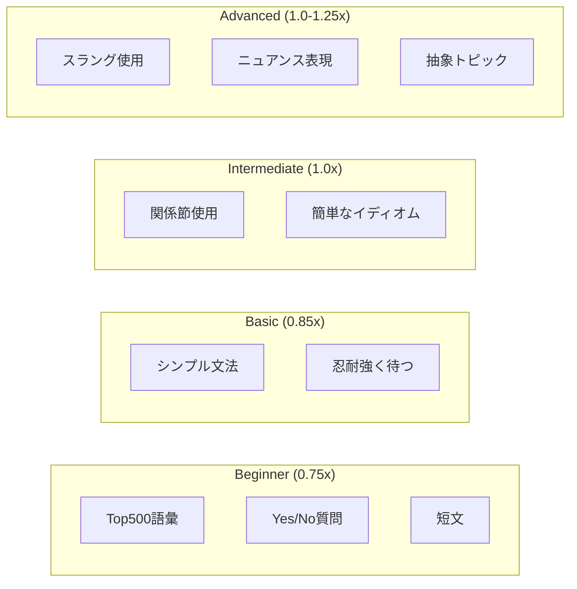

# 7. 付録

## 7.1. トレーサビリティマトリクス

### 7.1.1. 機能要件 → ユースケース マッピング

| 要件 ID | 要件名                 | ユースケース | 優先度 |
| ------- | ---------------------- | ------------ | ------ |
| FR-001  | 会話モード切替         | UC-001       | Must   |
| FR-002  | インストラクター会話   | UC-002       | Must   |
| FR-003  | フリートーク会話       | UC-003       | Must   |
| FR-004  | スマート提案表示       | UC-004       | Must   |
| FR-005  | ストリーミング字幕     | UC-005       | Must   |
| FR-006  | 即時訂正表示           | UC-006       | Must   |
| FR-007  | AI 速度調整            | UC-007       | Should |
| FR-008  | カスタムペルソナ作成   | UC-008       | Should |
| FR-009  | 割り込み対応           | UC-009       | Must   |
| FR-010  | フィラーワード         | UC-010       | Should |
| FR-011  | ユーザー登録           | UC-011       | Must   |
| FR-012  | ログイン/認証          | UC-012       | Must   |
| FR-013  | パスワード変更         | UC-013       | Must   |
| FR-014  | サブスクリプション管理 | UC-014       | Must   |
| FR-015  | 利用量制限             | UC-015       | Must   |
| FR-016  | プラン変更             | UC-016       | Must   |
| FR-017  | 語彙解説               | UC-017       | Should |
| FR-018  | 学習ストリーク         | UC-018       | Must   |
| FR-019  | 実績バッジ             | UC-019       | Should |
| FR-020  | 経験値＆レベル         | UC-020       | Should |
| FR-021  | 学習統計ダッシュボード | UC-021       | Must   |
| FR-022  | 発音スコア履歴         | UC-022       | Should |
| FR-023  | 週間/月間レポート      | UC-023       | Should |
| FR-024  | シナリオライブラリ     | UC-024       | Must   |
| FR-025  | デイリーチャレンジ     | UC-025       | Must   |
| FR-026  | 単語帳＆復習           | UC-026       | Must   |
| FR-027  | 友達招待               | UC-027       | Should |
| FR-028  | 週間ランキング         | UC-028       | Should |
| FR-029  | グループ学習           | UC-029       | Could  |
| FR-030  | 発音詳細分析           | UC-030       | Should |
| FR-031  | ロールプレイモード     | UC-031       | Must   |
| FR-032  | TOEIC/IELTS 対策       | UC-032       | Could  |
| FR-033  | 発話確認モード         | UC-033       | Should |

### 7.1.2. 機能要件 → 画面 マッピング

| 要件 ID | 関連画面                                     |
| ------- | -------------------------------------------- |
| FR-001  | SCR-002（会話画面）                          |
| FR-002  | SCR-002, SCR-006                             |
| FR-003  | SCR-002                                      |
| FR-004  | SCR-002                                      |
| FR-005  | SCR-002                                      |
| FR-006  | SCR-002                                      |
| FR-007  | SCR-003（設定画面）                          |
| FR-008  | SCR-004（ペルソナ管理画面）                  |
| FR-009  | SCR-002                                      |
| FR-010  | SCR-002                                      |
| FR-011  | SCR-009（登録画面）                          |
| FR-012  | SCR-010（ログイン画面）                      |
| FR-013  | SCR-003, SCR-010                             |
| FR-014  | SCR-011（サブスクリプション画面）            |
| FR-015  | SCR-002, SCR-001                             |
| FR-016  | SCR-011                                      |
| FR-017  | SCR-002, SCR-007                             |
| FR-018  | SCR-001, SCR-012（ホーム、ストリーク画面）   |
| FR-019  | SCR-008, SCR-013（プロフィール、バッジ画面） |
| FR-020  | SCR-001, SCR-008（ホーム、プロフィール）     |
| FR-021  | SCR-014（統計ダッシュボード画面）            |
| FR-022  | SCR-014                                      |
| FR-023  | 通知/メール                                  |
| FR-024  | SCR-015（シナリオライブラリ画面）            |
| FR-025  | SCR-001（ホーム画面）                        |
| FR-026  | SCR-016（単語帳画面）                        |
| FR-027  | SCR-017（招待画面）                          |
| FR-028  | SCR-018（ランキング画面）                    |
| FR-029  | SCR-019（グループ画面）                      |
| FR-030  | SCR-002（会話画面）                          |
| FR-031  | SCR-015（シナリオ画面）                      |
| FR-032  | SCR-020（試験対策画面）                      |
| FR-033  | SCR-002, SCR-003（会話画面、設定画面）       |

---

## 7.2. 決定ログ参照

決定ログは以下のファイルで管理されています：

📄 [decision-log.md](../decision-log.md)

決定ログには以下の情報が記録されています：

- AI による推奨事項とその根拠
- ユーザー指定情報
- 確認待ちの項目

---

## 7.3. 未解決事項（Open Issues）

| ID     | 課題                             | ステータス | 担当     |
| ------ | -------------------------------- | ---------- | -------- |
| OI-001 | オフラインモードの将来対応検討   | 検討中     | PM       |
| OI-002 | サブスクリプション料金の最終決定 | 検討中     | Business |
| OI-003 | 他言語（中国語等）対応時期の決定 | 未着手     | PM       |
| OI-004 | Ultra 等の追加プランの詳細決定   | 未着手     | Business |

---

## 7.4. 改訂履歴

| バージョン | 日付                | 作成者 | 変更内容                                               |
| ---------- | ------------------- | ------ | ------------------------------------------------------ |
| 1.0        | 2025 年 12 月 29 日 | AI     | 初版作成                                               |
| 1.1        | 2025 年 12 月 29 日 | AI     | ユーザー管理・認証機能追加 (FR-011〜013)               |
| 1.2        | 2025 年 12 月 29 日 | AI     | サブスクリプション機能追加 (FR-014〜016)               |
| 1.3        | 2025 年 12 月 29 日 | AI     | 語彙解説機能追加 (FR-017)                              |
| 1.4        | 2025 年 12 月 29 日 | AI     | ゲーミフィケーション・ソーシャル機能追加 (FR-018〜032) |
| 1.5        | 2025 年 12 月 29 日 | AI     | 発話確認モード追加 (FR-033) - 音声認識結果の確認＆修正 |

---

## 7.5. 用語集（補足）

| 用語             | 説明                                     |
| ---------------- | ---------------------------------------- |
| Confidence Score | 音声認識の確信度（0〜1 の値）            |
| Idiom            | 慣用句・熟語                             |
| Slang            | 俗語・口語表現                           |
| Nuance           | 微妙なニュアンス・言葉の含み             |
| MoSCoW           | Must/Should/Could/Won't の優先度分類法   |
| CCU              | Concurrent Users（同時接続ユーザー数）   |
| MTTR             | Mean Time To Recovery（平均復旧時間）    |
| WCAG             | Web Content Accessibility Guidelines     |
| XP               | Experience Points（経験値）              |
| SRS              | Spaced Repetition System（間隔反復学習） |
| Streak           | 連続学習日数                             |
| Gamification     | ゲーム要素を学習に取り入れる手法         |

---

## 7.6. 参考図表

### 7.6.1. ユーザーレベル別 AI 振る舞い

### 7.6.2. エラー表示凡例

| 色    | エラータイプ | 例                       |
| ----- | ------------ | ------------------------ |
| 🔴 赤 | 発音エラー   | 認識確信度が低い単語     |
| 🟡 黄 | 文法エラー   | "want go" → "want to go" |
| 🔵 青 | 語彙提案     | "good" → "excellent"     |

---

## 7.7. 承認（Approval）

### 7.7.1. 承認マトリクス

本ドキュメントは以下の関係者による承認を必要とします：

| 役割                   | 責任範囲                       | 承認要件 |
| ---------------------- | ------------------------------ | -------- |
| プロダクトマネージャー | ビジネス要件、スコープ、優先度 | 必須     |
| テクニカルリード       | 技術的実現可能性、設計妥当性   | 必須     |
| UX デザイナー          | UI/UX 要件、ユーザビリティ     | 推奨     |
| QA リード              | テスト可能性、品質基準         | 推奨     |
| セキュリティ担当       | セキュリティ要件               | 必須     |
| ステークホルダー代表   | 全体的なビジネス承認           | 必須     |

### 7.7.2. 承認記録

| 役割                   | 氏名 | 署名 | 日付 | コメント |
| ---------------------- | ---- | ---- | ---- | -------- |
| プロダクトマネージャー |      |      |      |          |
| テクニカルリード       |      |      |      |          |
| UX デザイナー          |      |      |      |          |
| QA リード              |      |      |      |          |
| セキュリティ担当       |      |      |      |          |
| ステークホルダー代表   |      |      |      |          |

### 7.7.3. 承認ステータス

| ステータス     | 説明                               |
| -------------- | ---------------------------------- |
| ☐ ドラフト     | 作成中、レビュー前                 |
| ☐ レビュー中   | レビュー進行中                     |
| ☑ 条件付き承認 | 軽微な修正を条件に承認             |
| ☐ 承認済み     | 全ての承認者により承認完了         |
| ☐ 却下         | 重大な問題があり、大幅な修正が必要 |

**現在のステータス**: ☑ 条件付き承認（2025 年 12 月 29 日時点）

**承認条件**:

1. ER Diagram の追加 → ✅ 完了
2. Approval Section の追加 → ✅ 完了
3. Review Record の追加 → ✅ 完了

---

## 7.8. レビュー記録（Review Record）

### 7.8.1. レビュー履歴

| レビュー ID | 日付       | レビュアー   | レビュータイプ | ステータス |
| ----------- | ---------- | ------------ | -------------- | ---------- |
| REV-001     | 2025-12-29 | AI Assistant | SRS Checklist  | 完了       |

### 7.8.2. レビュー詳細

#### REV-001: SRS Checklist レビュー

| 項目         | 内容                            |
| ------------ | ------------------------------- |
| レビュー日   | 2025-12-29                      |
| レビュアー   | AI Assistant                    |
| レビュー方法 | 55 項目チェックリストによる評価 |
| 結果         | 条件付き承認（87% 達成）        |
| 発見事項数   | 3 件（重大）、5 件（中程度）    |

**重大な発見事項（解決済み）**:

| ID      | カテゴリ | 発見事項               | 対応状況 | 解決日     |
| ------- | -------- | ---------------------- | -------- | ---------- |
| ISS-001 | データ   | ER Diagram が未記載    | ✅ 解決  | 2025-12-29 |
| ISS-002 | 承認     | 承認セクションが未記載 | ✅ 解決  | 2025-12-29 |
| ISS-003 | 品質     | レビュー記録が未記載   | ✅ 解決  | 2025-12-29 |

**中程度の発見事項（未解決）**:

| ID      | カテゴリ | 発見事項                              | 推奨対応                     | ステータス |
| ------- | -------- | ------------------------------------- | ---------------------------- | ---------- |
| ISS-004 | 認可     | Role-Permission Matrix が詳細でない   | Access Control Matrix を追加 | 未着手     |
| ISS-005 | 信頼性   | Backup strategy, RTO/RPO が未定義     | 信頼性要件を詳細化           | 未着手     |
| ISS-006 | UI       | 主要画面の Wireframe が不足           | 5+ 画面の Wireframe を追加   | 未着手     |
| ISS-007 | レポート | 週間/月間レポートの出力形式が未定義   | Report format を詳細化       | 未着手     |
| ISS-008 | データ   | Entity の属性（フィールド）定義が不足 | Data Dictionary を追加       | 未着手     |

### 7.8.3. 次回レビュー予定

| 項目           | 内容                            |
| -------------- | ------------------------------- |
| 予定日         | TBD（Basic Design 完了後）      |
| レビュータイプ | Design Traceability Review      |
| レビュアー     | TBD                             |
| 確認ポイント   | SRS → Basic Design の整合性確認 |

---

## 7.9. ドキュメント品質メトリクス

| メトリック                    | 値       | 目標 | ステータス |
| ----------------------------- | -------- | ---- | ---------- |
| チェックリスト達成率          | 87%      | ≥85% | ✅ 達成    |
| 重大な未解決事項              | 0 件     | 0 件 | ✅ 達成    |
| 機能要件カバレッジ            | 32/32 FR | 100% | ✅ 達成    |
| ビジネスルール定義率          | 88 BR    | ≥50  | ✅ 達成    |
| トレーサビリティ（FR→UC）     | 100%     | 100% | ✅ 達成    |
| トレーサビリティ（FR→Screen） | 100%     | 100% | ✅ 達成    |
