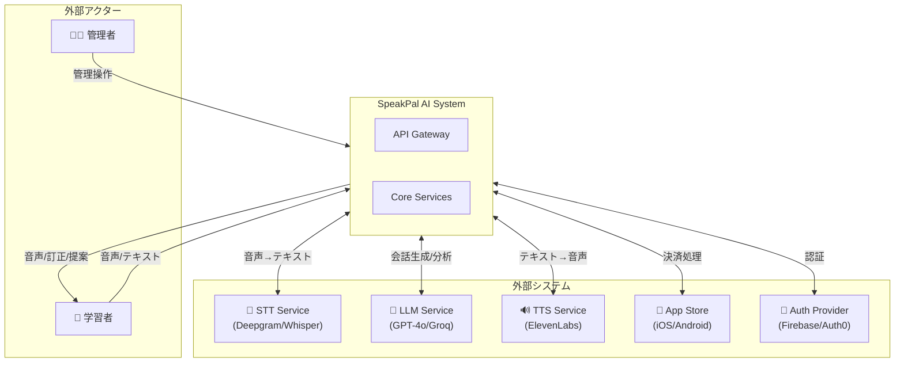
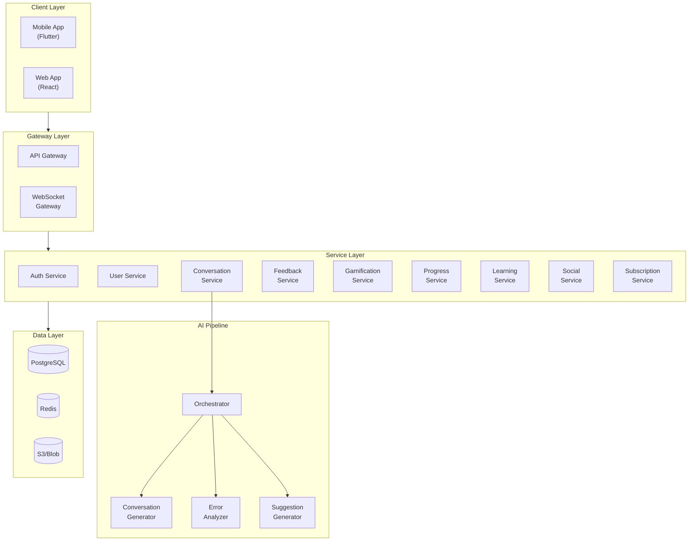
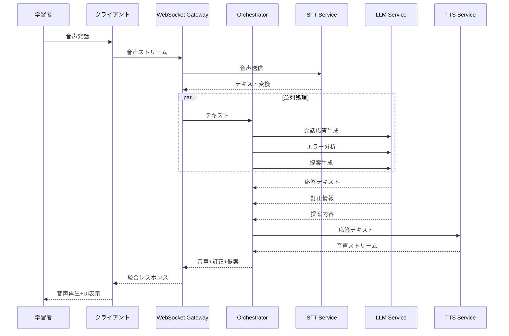
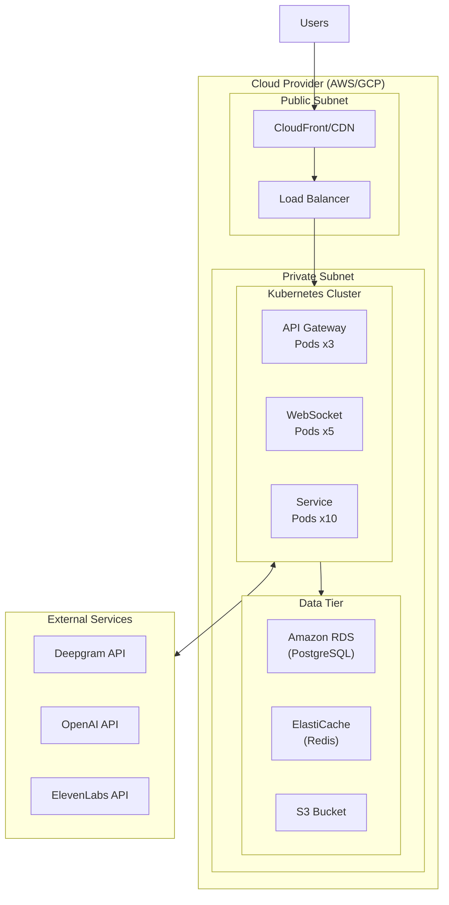
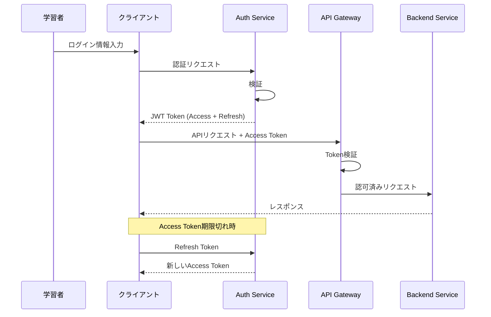
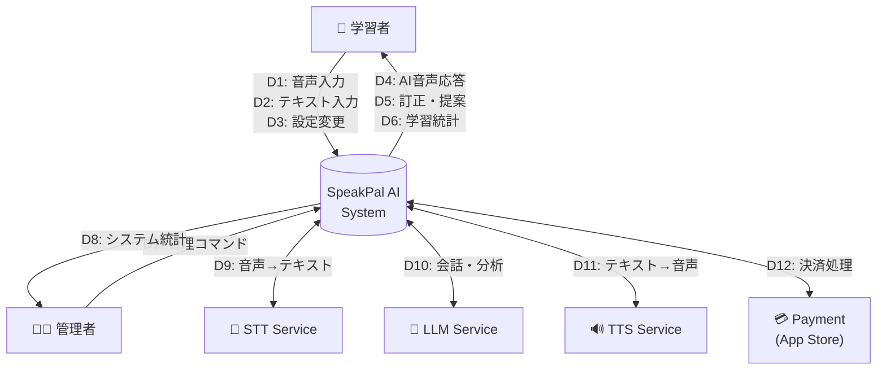
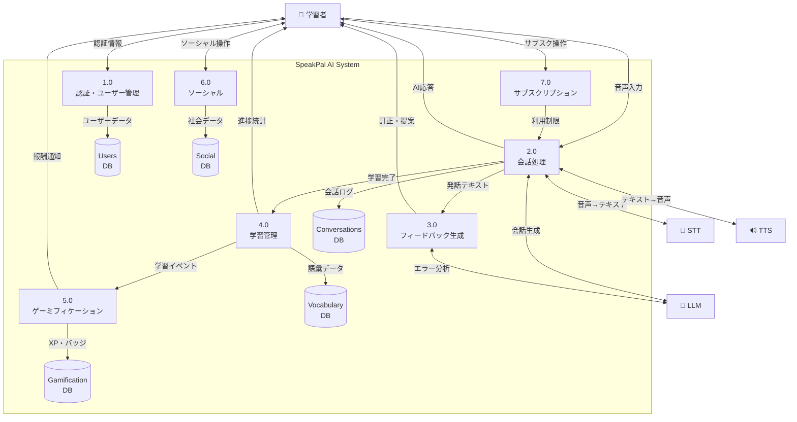

# 2. システムアーキテクチャ

## 2.1. 概要

本章では、SpeakPal AI のシステムアーキテクチャを定義します。リアルタイム音声通信と AI 処理を中心とした設計となっています。

---

## 2.2. アーキテクチャパターン

### 2.2.1. 採用パターン

| パターン         | 採用理由                                 |
| ---------------- | ---------------------------------------- |
| マイクロサービス | 機能ごとの独立スケーリング・デプロイ     |
| イベント駆動     | リアルタイム処理・非同期並列処理         |
| API Gateway      | 認証・レート制限・ルーティングの一元管理 |
| CQRS             | 読み書き負荷の分離（統計・ランキング）   |

### 2.2.2. レイヤー構成

```
┌─────────────────────────────────────────────────────────────────┐
│                     PRESENTATION LAYER                          │
│  ┌───────────────────────────────┐  ┌─────────────┐              │
│  │      Mobile App (Flutter)     │  │   Web App   │              │
│  │       iOS / Android           │  │  (React)    │              │
│  └───────────────────────────────┘  └─────────────┘              │
├─────────────────────────────────────────────────────────────────┤
│                     API GATEWAY LAYER                           │
│  ┌─────────────────────────────────────────────────────────┐    │
│  │   Kong / AWS API Gateway                                 │    │
│  │   - 認証・認可                                           │    │
│  │   - レート制限                                           │    │
│  │   - WebSocketアップグレード                               │    │
│  └─────────────────────────────────────────────────────────┘    │
├─────────────────────────────────────────────────────────────────┤
│                     SERVICE LAYER                               │
│  ┌───────────┐ ┌───────────┐ ┌───────────┐ ┌───────────┐       │
│  │   Auth    │ │ User      │ │ Convers-  │ │ Feedback  │       │
│  │  Service  │ │ Service   │ │ ation     │ │  Service  │       │
│  └───────────┘ └───────────┘ └───────────┘ └───────────┘       │
│  ┌───────────┐ ┌───────────┐ ┌───────────┐ ┌───────────┐       │
│  │ Gamifi-   │ │ Progress  │ │ Learning  │ │  Social   │       │
│  │ cation    │ │  Service  │ │  Service  │ │  Service  │       │
│  └───────────┘ └───────────┘ └───────────┘ └───────────┘       │
├─────────────────────────────────────────────────────────────────┤
│                     DATA LAYER                                  │
│  ┌───────────┐ ┌───────────┐ ┌───────────┐ ┌───────────┐       │
│  │PostgreSQL │ │   Redis   │ │  S3/Blob  │ │  Elastic  │       │
│  │ (Main DB) │ │  (Cache)  │ │ (Storage) │ │ (Search)  │       │
│  └───────────┘ └───────────┘ └───────────┘ └───────────┘       │
└─────────────────────────────────────────────────────────────────┘
```

---

## 2.3. システムコンテキスト図



---

## 2.4. コンポーネント図

### 2.4.1. 全体コンポーネント



### 2.4.2. 会話処理パイプライン



---

## 2.5. デプロイメント図



---

## 2.6. 技術スタック

### 2.6.1. フロントエンド

| カテゴリ         | 技術                    | バージョン | 目的                               |
| ---------------- | ----------------------- | ---------- | ---------------------------------- |
| Mobile App       | Flutter / Dart          | 3.x / 3.x  | iOS/Android クロスプラットフォーム |
| 状態管理(Mobile) | Riverpod / Bloc         | Latest     | Flutter 状態管理                   |
| Web              | React                   | 18.x       | Web アプリケーション               |
| 状態管理(Web)    | Redux Toolkit / Zustand | Latest     | グローバル状態管理                 |
| スタイリング     | Tailwind CSS            | 3.x        | Web UI スタイリング                |
| 音声処理         | just_audio / record     | Latest     | Flutter 音声キャプチャ・再生       |

### 2.6.2. バックエンド

| カテゴリ       | 技術                 | バージョン | 目的                   |
| -------------- | -------------------- | ---------- | ---------------------- |
| 言語           | Node.js / TypeScript | 20.x / 5.x | サーバーサイド開発     |
| フレームワーク | NestJS               | 10.x       | API サービス           |
| WebSocket      | Socket.io            | 4.x        | リアルタイム通信       |
| ORM            | Prisma               | 5.x        | データベースアクセス   |
| キュー         | BullMQ               | 4.x        | バックグラウンドジョブ |

### 2.6.3. データベース

| カテゴリ     | 技術            | バージョン | 目的                   |
| ------------ | --------------- | ---------- | ---------------------- |
| RDBMS        | PostgreSQL      | 15.x       | メインデータストア     |
| キャッシュ   | Redis           | 7.x        | セッション・キャッシュ |
| 検索         | Elasticsearch   | 8.x        | 全文検索               |
| オブジェクト | S3 / Azure Blob | -          | ファイルストレージ     |

### 2.6.4. インフラ・運用

| カテゴリ             | 技術              | 目的                 |
| -------------------- | ----------------- | -------------------- |
| コンテナ             | Docker            | コンテナ化           |
| オーケストレーション | Kubernetes        | コンテナ管理         |
| CI/CD                | GitHub Actions    | 自動ビルド・デプロイ |
| 監視                 | Datadog / Grafana | メトリクス・ログ監視 |
| APM                  | Sentry            | エラートラッキング   |

---

## 2.7. セキュリティアーキテクチャ

### 2.7.1. 認証・認可フロー



### 2.7.2. セキュリティレイヤー

| レイヤー | 対策                                               |
| -------- | -------------------------------------------------- |
| 通信     | TLS 1.3 による暗号化                               |
| 認証     | JWT + Refresh Token、OAuth 2.0 対応                |
| 認可     | RBAC (Role-Based Access Control)                   |
| データ   | DB 暗号化（at rest）、センシティブデータマスキング |
| API      | レート制限、CORS 設定                              |
| コード   | 依存関係スキャン、SAST                             |

---

## 2.8. スケーラビリティ設計

### 2.8.1. 水平スケーリング

| コンポーネント   | スケーリング戦略                  | トリガー               |
| ---------------- | --------------------------------- | ---------------------- |
| API Gateway      | Pod Auto-scaling                  | CPU > 70%              |
| WebSocket Server | Pod Auto-scaling + Sticky Session | Connection Count > 200 |
| Service Pods     | Pod Auto-scaling                  | CPU > 70%              |
| PostgreSQL       | Read Replica                      | Query Latency > 100ms  |
| Redis            | Cluster Mode                      | Memory > 80%           |

### 2.8.2. キャパシティプランニング

| メトリック                | 初期値    | スケール目標 |
| ------------------------- | --------- | ------------ |
| 同時接続数                | 1,000 CCU | 10,000 CCU   |
| 日次アクティブユーザー    | 10,000    | 100,000      |
| 1 秒あたり API リクエスト | 1,000 RPS | 10,000 RPS   |

---

## 2.9. パッケージ構成

```
speakpal/
├── apps/
│   ├── mobile/               # Flutter モバイルアプリ (iOS/Android)
│   └── web/                  # React Web アプリ
├── services/
│   ├── api-gateway/          # API Gateway
│   ├── auth-service/         # 認証サービス
│   ├── user-service/         # ユーザーサービス
│   ├── conversation-service/ # 会話サービス
│   ├── feedback-service/     # フィードバックサービス
│   ├── gamification-service/ # ゲーミフィケーション
│   ├── progress-service/     # 進捗サービス
│   ├── learning-service/     # 学習サービス
│   ├── social-service/       # ソーシャルサービス
│   └── subscription-service/ # サブスクサービス
├── packages/
│   ├── shared-types/         # 共有型定義
│   ├── shared-utils/         # 共有ユーティリティ
│   └── ai-pipeline/          # AI処理パイプライン
└── infrastructure/
    ├── kubernetes/           # K8s マニフェスト
    ├── terraform/            # IaC
    └── docker/               # Dockerfile群
```

---

## 2.10. データフローダイアグラム (DFD)

### 2.10.1. DFD レベル 0 (コンテキスト図)



### 2.10.2. コンテキスト図のデータフロー一覧

| フロー ID | From   | To      | データ内容                       |
| --------- | ------ | ------- | -------------------------------- |
| D1        | 学習者 | System  | 音声ストリーム、発話音声         |
| D2        | 学習者 | System  | テキスト入力、チャットメッセージ |
| D3        | 学習者 | System  | 設定変更（速度、ペルソナ等）     |
| D4        | System | 学習者  | AI 音声応答ストリーム            |
| D5        | System | 学習者  | 発音訂正、文法訂正、語彙提案     |
| D6        | System | 学習者  | 学習統計、進捗レポート           |
| D7        | 管理者 | System  | ユーザー管理、コンテンツ管理     |
| D8        | System | 管理者  | システムメトリクス、ユーザー統計 |
| D9        | System | STT     | 音声データ → テキスト変換        |
| D10       | System | LLM     | 会話生成、エラー分析、提案生成   |
| D11       | System | TTS     | テキスト → 音声変換              |
| D12       | System | Payment | サブスクリプション決済処理       |

### 2.10.3. DFD レベル 1 (システム概要)



### 2.10.4. プロセス定義

| プロセス ID | プロセス名           | 説明                                       |
| ----------- | -------------------- | ------------------------------------------ |
| 1.0         | 認証・ユーザー管理   | ユーザー登録、ログイン、プロフィール管理   |
| 2.0         | 会話処理             | 音声入力 →AI 処理 → 音声出力のメインフロー |
| 3.0         | フィードバック生成   | 発音・文法・語彙エラー分析と提案生成       |
| 4.0         | 学習管理             | 語彙保存、シナリオ、チャレンジ、復習管理   |
| 5.0         | ゲーミフィケーション | ストリーク、XP、バッジ、レベル管理         |
| 6.0         | ソーシャル           | 招待、ランキング、グループ管理             |
| 7.0         | サブスクリプション   | プラン管理、利用量制限、決済連携           |

### 2.10.5. データストア定義

| ストア ID | ストア名         | 主要エンティティ                           |
| --------- | ---------------- | ------------------------------------------ |
| D1        | Users DB         | User, UserLevel, Persona                   |
| D2        | Conversations DB | Conversation, ConversationTurn, Correction |
| D3        | Vocabulary DB    | Vocabulary, Scenario, Challenge            |
| D4        | Gamification DB  | Streak, Badge, UserBadge, XP               |
| D5        | Social DB        | Invitation, Ranking, Group                 |

### 2.10.6. 外部エンティティ定義

| エンティティ | タイプ       | データ交換内容                   |
| ------------ | ------------ | -------------------------------- |
| 学習者       | ユーザー     | 音声、テキスト、設定、アクション |
| 管理者       | ユーザー     | 管理コマンド、統計閲覧           |
| STT Service  | 外部システム | 音声 → テキスト変換              |
| LLM Service  | 外部システム | 会話生成、エラー分析、提案生成   |
| TTS Service  | 外部システム | テキスト → 音声変換              |
| Payment      | 外部システム | サブスクリプション決済           |

---

← [目次](./_index.md) | _次のセクション: [03-functional-design.md](./03-functional-design.md)_
