# 3. 機能設計

## 3.1. 概要

本章では、SpeakPal AI の機能設計を定義します。SRS で定義された 33 機能要件を 33 ユースケースにマッピングし、詳細な設計を提供します。

### 統計情報

| 項目             | 内容                                                                                                          |
| ---------------- | ------------------------------------------------------------------------------------------------------------- |
| モジュール数     | 10 (会話、フィードバック、カスタマイズ、ユーザー管理、サブスク、ゲーミフィ、進捗、学習、ソーシャル、高度学習) |
| 総ユースケース数 | 33                                                                                                            |
| Must UC 数       | 17                                                                                                            |
| Should UC 数     | 14                                                                                                            |
| Could UC 数      | 2                                                                                                             |

---

## 3.2. ドキュメント構成

| ファイル名                                                        | 内容                    | UC 数 |
| ----------------------------------------------------------------- | ----------------------- | ----- |
| [\_index.md](./03-functional-design/_index.md)                    | 概要・共通仕様          | -     |
| [conversation-01.md](./03-functional-design/conversation-01.md)   | 会話機能 UC             | 6     |
| [feedback-01.md](./03-functional-design/feedback-01.md)           | フィードバック UC       | 4     |
| [customization-01.md](./03-functional-design/customization-01.md) | カスタマイズ UC         | 2     |
| [user-01.md](./03-functional-design/user-01.md)                   | ユーザー管理 UC         | 3     |
| [subscription-01.md](./03-functional-design/subscription-01.md)   | サブスクリプション UC   | 3     |
| [gamification-01.md](./03-functional-design/gamification-01.md)   | ゲーミフィケーション UC | 3     |
| [progress-01.md](./03-functional-design/progress-01.md)           | 学習進捗 UC             | 3     |
| [learning-01.md](./03-functional-design/learning-01.md)           | 構造化学習 UC           | 3     |
| [social-01.md](./03-functional-design/social-01.md)               | ソーシャル UC           | 3     |
| [advanced-01.md](./03-functional-design/advanced-01.md)           | 高度な学習 UC           | 3     |

---

## 3.3. 要件カバレッジサマリー

> このセクションは、SRS の機能要件が BD のユースケースで適切にカバーされていることを示します。

### 3.3.1. カバレッジ統計

| メトリック               | 値       |
| ------------------------ | -------- |
| SRS 内 FR 総数           | 33       |
| UC でカバーされた FR 数  | 33       |
| カバーされていない FR 数 | 0        |
| **カバレッジ率**         | **100%** |

### 3.3.2. 優先度別カバレッジ

| 優先度 | 総数 | カバー済み | 未カバー | カバレッジ率 | ステータス |
| ------ | ---- | ---------- | -------- | ------------ | ---------- |
| Must   | 17   | 17         | 0        | 100%         | ✅ PASS    |
| Should | 14   | 14         | 0        | 100%         | ✅ PASS    |
| Could  | 2    | 2          | 0        | 100%         | ✅ PASS    |

### 3.3.3. FR→UC マッピングテーブル

| FR ID  | FR 機能名              | カテゴリ       | 優先度 | マッピング UC | ステータス  |
| ------ | ---------------------- | -------------- | ------ | ------------- | ----------- |
| FR-001 | 会話モード切替         | 会話           | Must   | UC-001        | ✅ カバー済 |
| FR-002 | インストラクター会話   | 会話           | Must   | UC-002        | ✅ カバー済 |
| FR-003 | フリートーク会話       | 会話           | Must   | UC-003        | ✅ カバー済 |
| FR-004 | スマート提案表示       | フィードバック | Must   | UC-004        | ✅ カバー済 |
| FR-005 | ストリーミング字幕     | フィードバック | Must   | UC-005        | ✅ カバー済 |
| FR-006 | 即時訂正表示           | フィードバック | Must   | UC-006        | ✅ カバー済 |
| FR-007 | AI 速度調整            | カスタマイズ   | Should | UC-007        | ✅ カバー済 |
| FR-008 | カスタムペルソナ作成   | カスタマイズ   | Should | UC-008        | ✅ カバー済 |
| FR-009 | 割り込み対応           | 会話           | Must   | UC-009        | ✅ カバー済 |
| FR-010 | フィラーワード         | 会話           | Should | UC-010        | ✅ カバー済 |
| FR-011 | ユーザー登録           | ユーザー管理   | Must   | UC-011        | ✅ カバー済 |
| FR-012 | ログイン/認証          | ユーザー管理   | Must   | UC-012        | ✅ カバー済 |
| FR-013 | パスワード変更         | ユーザー管理   | Must   | UC-013        | ✅ カバー済 |
| FR-014 | サブスクリプション管理 | サブスク       | Must   | UC-014        | ✅ カバー済 |
| FR-015 | 利用量制限             | サブスク       | Must   | UC-015        | ✅ カバー済 |
| FR-016 | プラン変更             | サブスク       | Must   | UC-016        | ✅ カバー済 |
| FR-017 | 語彙解説               | フィードバック | Should | UC-017        | ✅ カバー済 |
| FR-018 | 学習ストリーク         | ゲーミフィ     | Must   | UC-018        | ✅ カバー済 |
| FR-019 | 実績バッジ             | ゲーミフィ     | Should | UC-019        | ✅ カバー済 |
| FR-020 | 経験値＆レベル         | ゲーミフィ     | Should | UC-020        | ✅ カバー済 |
| FR-021 | 学習統計ダッシュボード | 進捗           | Must   | UC-021        | ✅ カバー済 |
| FR-022 | 発音スコア履歴         | 進捗           | Should | UC-022        | ✅ カバー済 |
| FR-023 | 週間/月間レポート      | 進捗           | Should | UC-023        | ✅ カバー済 |
| FR-024 | シナリオライブラリ     | 構造化学習     | Must   | UC-024        | ✅ カバー済 |
| FR-025 | デイリーチャレンジ     | 構造化学習     | Must   | UC-025        | ✅ カバー済 |
| FR-026 | 単語帳＆復習           | 構造化学習     | Must   | UC-026        | ✅ カバー済 |
| FR-027 | 友達招待               | ソーシャル     | Should | UC-027        | ✅ カバー済 |
| FR-028 | 週間ランキング         | ソーシャル     | Should | UC-028        | ✅ カバー済 |
| FR-029 | グループ学習           | ソーシャル     | Could  | UC-029        | ✅ カバー済 |
| FR-030 | 発音詳細分析           | 高度な学習     | Should | UC-030        | ✅ カバー済 |
| FR-031 | ロールプレイモード     | 高度な学習     | Must   | UC-031        | ✅ カバー済 |
| FR-032 | TOEIC/IELTS 対策       | 高度な学習     | Could  | UC-032        | ✅ カバー済 |
| FR-033 | 発話確認モード         | 会話           | Should | UC-033        | ✅ カバー済 |

---

## 3.4. ユースケース一覧

| UC ID  | UC 名                  | アクター   | マッピング FR | 優先度 | 詳細ファイル                                                      |
| ------ | ---------------------- | ---------- | ------------- | ------ | ----------------------------------------------------------------- |
| UC-001 | モード切替             | 学習者     | FR-001        | Must   | [conversation-01.md](./03-functional-design/conversation-01.md)   |
| UC-002 | インストラクター会話   | 学習者, AI | FR-002        | Must   | [conversation-01.md](./03-functional-design/conversation-01.md)   |
| UC-003 | フリートーク会話       | 学習者, AI | FR-003        | Must   | [conversation-01.md](./03-functional-design/conversation-01.md)   |
| UC-004 | スマート提案表示       | AI         | FR-004        | Must   | [feedback-01.md](./03-functional-design/feedback-01.md)           |
| UC-005 | ストリーミング字幕     | System     | FR-005        | Must   | [feedback-01.md](./03-functional-design/feedback-01.md)           |
| UC-006 | 即時訂正表示           | AI         | FR-006        | Must   | [feedback-01.md](./03-functional-design/feedback-01.md)           |
| UC-007 | AI 速度調整            | 学習者     | FR-007        | Should | [customization-01.md](./03-functional-design/customization-01.md) |
| UC-008 | ペルソナ作成           | 学習者     | FR-008        | Should | [customization-01.md](./03-functional-design/customization-01.md) |
| UC-009 | 割り込み対応           | 学習者, AI | FR-009        | Must   | [conversation-01.md](./03-functional-design/conversation-01.md)   |
| UC-010 | フィラーワード         | AI         | FR-010        | Should | [conversation-01.md](./03-functional-design/conversation-01.md)   |
| UC-011 | ユーザー登録           | ゲスト     | FR-011        | Must   | [user-01.md](./03-functional-design/user-01.md)                   |
| UC-012 | ログイン/認証          | ゲスト     | FR-012        | Must   | [user-01.md](./03-functional-design/user-01.md)                   |
| UC-013 | パスワード変更         | 学習者     | FR-013        | Must   | [user-01.md](./03-functional-design/user-01.md)                   |
| UC-014 | サブスクリプション管理 | 学習者     | FR-014        | Must   | [subscription-01.md](./03-functional-design/subscription-01.md)   |
| UC-015 | 利用量制限             | System     | FR-015        | Must   | [subscription-01.md](./03-functional-design/subscription-01.md)   |
| UC-016 | プラン変更             | 学習者     | FR-016        | Must   | [subscription-01.md](./03-functional-design/subscription-01.md)   |
| UC-017 | 語彙解説               | 学習者     | FR-017        | Should | [feedback-01.md](./03-functional-design/feedback-01.md)           |
| UC-018 | 学習ストリーク         | System     | FR-018        | Must   | [gamification-01.md](./03-functional-design/gamification-01.md)   |
| UC-019 | 実績バッジ             | System     | FR-019        | Should | [gamification-01.md](./03-functional-design/gamification-01.md)   |
| UC-020 | 経験値＆レベル         | System     | FR-020        | Should | [gamification-01.md](./03-functional-design/gamification-01.md)   |
| UC-021 | 統計ダッシュボード     | 学習者     | FR-021        | Must   | [progress-01.md](./03-functional-design/progress-01.md)           |
| UC-022 | 発音スコア履歴         | 学習者     | FR-022        | Should | [progress-01.md](./03-functional-design/progress-01.md)           |
| UC-023 | 週間/月間レポート      | System     | FR-023        | Should | [progress-01.md](./03-functional-design/progress-01.md)           |
| UC-024 | シナリオライブラリ     | 学習者     | FR-024        | Must   | [learning-01.md](./03-functional-design/learning-01.md)           |
| UC-025 | デイリーチャレンジ     | 学習者     | FR-025        | Must   | [learning-01.md](./03-functional-design/learning-01.md)           |
| UC-026 | 単語帳＆復習           | 学習者     | FR-026        | Must   | [learning-01.md](./03-functional-design/learning-01.md)           |
| UC-027 | 友達招待               | 学習者     | FR-027        | Should | [social-01.md](./03-functional-design/social-01.md)               |
| UC-028 | 週間ランキング         | 学習者     | FR-028        | Should | [social-01.md](./03-functional-design/social-01.md)               |
| UC-029 | グループ学習           | 学習者     | FR-029        | Could  | [social-01.md](./03-functional-design/social-01.md)               |
| UC-030 | 発音詳細分析           | 学習者     | FR-030        | Should | [advanced-01.md](./03-functional-design/advanced-01.md)           |
| UC-031 | ロールプレイ           | 学習者     | FR-031        | Must   | [advanced-01.md](./03-functional-design/advanced-01.md)           |
| UC-032 | 試験対策               | 学習者     | FR-032        | Could  | [advanced-01.md](./03-functional-design/advanced-01.md)           |
| UC-033 | 発話確認               | 学習者     | FR-033        | Should | [conversation-01.md](./03-functional-design/conversation-01.md)   |

---

## 3.5. ユースケース図

```mermaid
flowchart TB
    subgraph Actors
        Guest["ゲスト"]
        User["学習者"]
        AI["AIペルソナ"]
        System["System"]
    end

    subgraph UserManagement["ユーザー管理"]
        UC11[UC-011: ユーザー登録]
        UC12[UC-012: ログイン/認証]
        UC13[UC-013: パスワード変更]
    end

    subgraph Subscription["サブスクリプション"]
        UC14[UC-014: サブスクリプション管理]
        UC15[UC-015: 利用量制限]
        UC16[UC-016: プラン変更]
    end

    subgraph ConversationModes["会話モード"]
        UC1[UC-001: モード切替]
        UC2[UC-002: インストラクター会話]
        UC3[UC-003: フリートーク会話]
        UC9[UC-009: 割り込み対応]
        UC10[UC-010: フィラーワード]
        UC33[UC-033: 発話確認]
    end

    subgraph FeedbackSystem["フィードバックシステム"]
        UC4[UC-004: スマート提案表示]
        UC5[UC-005: ストリーミング字幕]
        UC6[UC-006: 即時訂正表示]
        UC17[UC-017: 語彙解説]
    end

    subgraph Customization["カスタマイズ"]
        UC7[UC-007: AI速度調整]
        UC8[UC-008: ペルソナ作成]
    end

    subgraph Gamification["ゲーミフィケーション"]
        UC18[UC-018: 学習ストリーク]
        UC19[UC-019: 実績バッジ]
        UC20[UC-020: 経験値＆レベル]
    end

    subgraph Progress["学習進捗"]
        UC21[UC-021: 統計ダッシュボード]
        UC22[UC-022: 発音スコア履歴]
        UC23[UC-023: 週間/月間レポート]
    end

    subgraph StructuredLearning["構造化学習"]
        UC24[UC-024: シナリオライブラリ]
        UC25[UC-025: デイリーチャレンジ]
        UC26[UC-026: 単語帳＆復習]
    end

    subgraph Social["ソーシャル"]
        UC27[UC-027: 友達招待]
        UC28[UC-028: 週間ランキング]
        UC29[UC-029: グループ学習]
    end

    subgraph AdvancedLearning["高度な学習"]
        UC30[UC-030: 発音詳細分析]
        UC31[UC-031: ロールプレイ]
        UC32[UC-032: 試験対策]
    end

    Guest --> UC11
    Guest --> UC12
    User --> UserManagement
    User --> Subscription
    User --> ConversationModes
    User --> Customization
    User --> Progress
    User --> StructuredLearning
    User --> Social
    User --> AdvancedLearning

    AI --> UC2
    AI --> UC3
    AI --> UC4
    AI --> UC6
    AI --> UC9
    AI --> UC10

    System --> FeedbackSystem
    System --> Gamification
    System --> UC15
    System --> UC23
```

---

## 3.6. Coverage Summary

| Module               | Total UCs | Detailed | Coverage |
| -------------------- | --------- | -------- | -------- |
| 会話機能             | 6         | 6        | 100%     |
| フィードバック       | 4         | 4        | 100%     |
| カスタマイズ         | 2         | 2        | 100%     |
| ユーザー管理         | 3         | 3        | 100%     |
| サブスクリプション   | 3         | 3        | 100%     |
| ゲーミフィケーション | 3         | 3        | 100%     |
| 学習進捗             | 3         | 3        | 100%     |
| 構造化学習           | 3         | 3        | 100%     |
| ソーシャル           | 3         | 3        | 100%     |
| 高度な学習           | 3         | 3        | 100%     |
| **Total**            | **33**    | **33**   | **100%** |

---

← [目次](./_index.md) | _次のセクション: [04-screen-design.md](./04-screen-design.md)_
