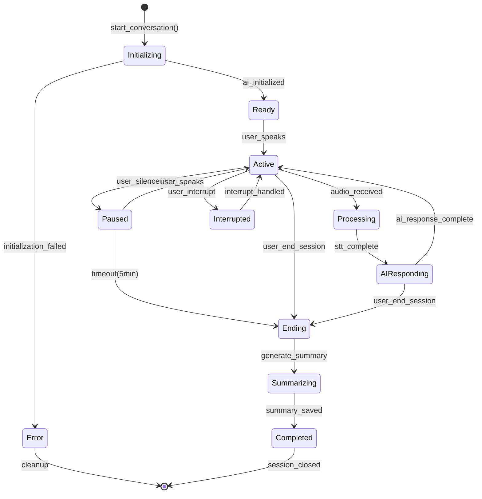
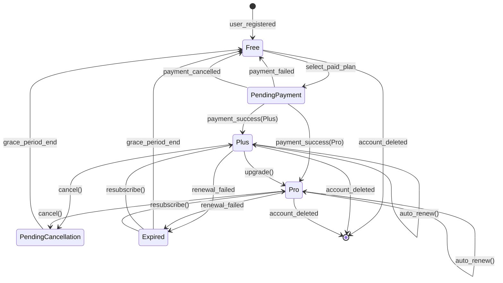
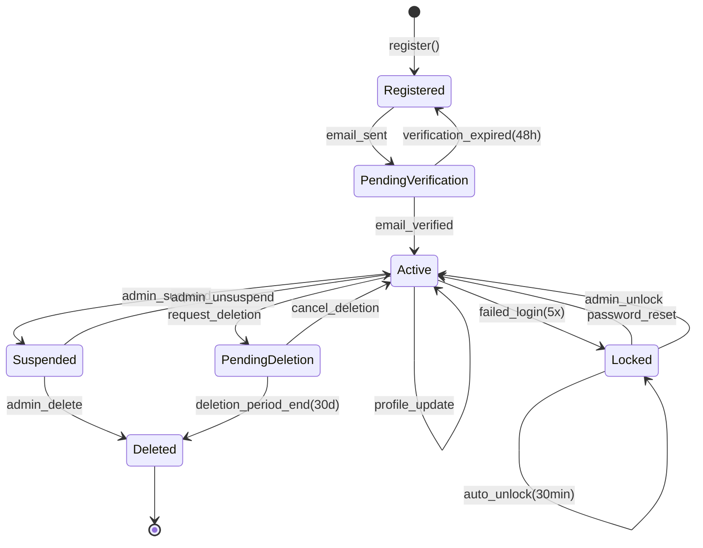
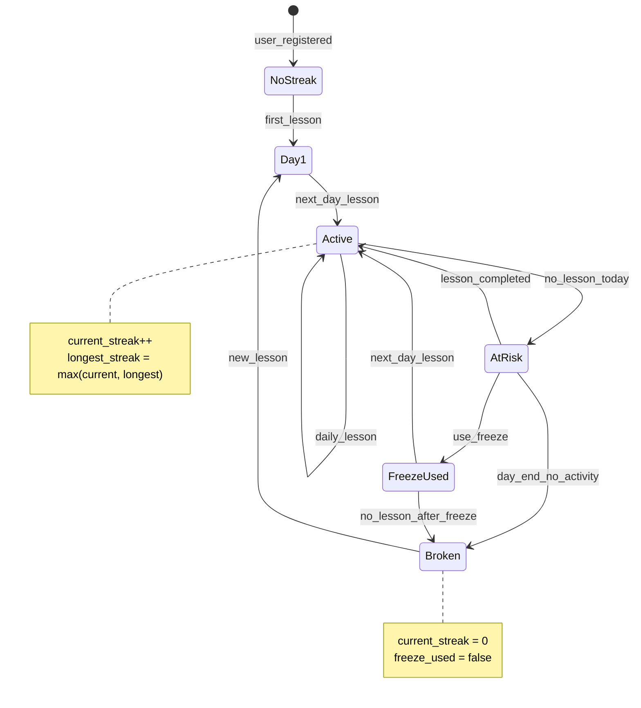

# 機能設計 - 共通仕様

## 1. 概要

このフォルダには、SpeakPal AI の機能設計詳細が含まれています。

---

## 2. ファイル構成

| ファイル名          | 内容                                | UC 数 |
| ------------------- | ----------------------------------- | ----- |
| conversation-01.md  | 会話機能 UC-001〜003, 009, 010, 033 | 6     |
| feedback-01.md      | フィードバック UC-004〜006, 017     | 4     |
| customization-01.md | カスタマイズ UC-007〜008            | 2     |
| user-01.md          | ユーザー管理 UC-011〜013            | 3     |
| subscription-01.md  | サブスクリプション UC-014〜016      | 3     |
| gamification-01.md  | ゲーミフィケーション UC-018〜020    | 3     |
| progress-01.md      | 学習進捗 UC-021〜023                | 3     |
| learning-01.md      | 構造化学習 UC-024〜026              | 3     |
| social-01.md        | ソーシャル UC-027〜029              | 3     |
| advanced-01.md      | 高度な学習 UC-030〜032              | 3     |

---

## 3. 共通アクター定義

| アクター ID | アクター名 | 説明             |
| ----------- | ---------- | ---------------- |
| ACT-001     | ゲスト     | 未登録ユーザー   |
| ACT-002     | 学習者     | 登録済みユーザー |
| ACT-003     | AI         | AI ペルソナ      |
| ACT-004     | System     | システム自動処理 |

---

## 4. 共通ユースケースパターン

### 4.1. 基本フロー構造

```
1. 前提条件の確認
2. ユーザー操作/システムトリガー
3. バリデーション
4. メイン処理
5. 結果表示/通知
6. ログ記録
```

### 4.2. エラーハンドリングパターン

| エラータイプ       | 対応                           |
| ------------------ | ------------------------------ |
| 入力エラー         | フィールドレベルエラー表示     |
| 認証エラー         | ログイン画面へリダイレクト     |
| 権限エラー         | アクセス拒否メッセージ         |
| システムエラー     | 汎用エラーメッセージ＋リトライ |
| ネットワークエラー | オフライン通知＋リトライ       |

---

## 5. 共通ビジネスルール

### 5.1. 認証関連

| ルール ID | ルール内容                             |
| --------- | -------------------------------------- |
| CBR-001   | ログインセッションは 30 日間有効       |
| CBR-002   | 5 回連続ログイン失敗でアカウントロック |
| CBR-003   | パスワードリセットリンクは 24 時間有効 |

### 5.2. 利用量制限関連

| ルール ID | ルール内容                             |
| --------- | -------------------------------------- |
| CBR-004   | 日次リクエスト上限はプランにより異なる |
| CBR-005   | リセットは毎日 00:00 UTC               |
| CBR-006   | 制限到達時はアップグレード促進を表示   |

### 5.3. ゲーミフィケーション関連

| ルール ID | ルール内容                              |
| --------- | --------------------------------------- |
| CBR-007   | 1 日 1 回以上の学習でストリーク維持     |
| CBR-008   | ストリークフリーズは月 1 回まで使用可能 |
| CBR-009   | XP 計算: 会話時間 ×10 + 訂正数 ×5       |

---

## 6. State Diagrams (Lifecycle Entities)

> 📌 **ENHANCED**: State diagrams cho các entity có lifecycle phức tạp

### 6.1. Conversation Session State



#### 状態定義

| 状態         | 説明                   | 入力遷移              | 出力遷移                   |
| ------------ | ---------------------- | --------------------- | -------------------------- |
| Initializing | AI・WebSocket 初期化中 | start_conversation    | Ready, Error               |
| Ready        | 会話開始待ち           | ai_initialized        | Active                     |
| Active       | 会話進行中             | user_speaks           | Processing, Paused, Ending |
| Processing   | 音声処理中             | audio_received        | AIResponding               |
| AIResponding | AI 応答生成中          | stt_complete          | Active, Ending             |
| Paused       | 一時停止               | user_silence          | Active, Ending             |
| Interrupted  | 割り込み処理中         | user_interrupt        | Active                     |
| Ending       | 会話終了処理           | user_end_session      | Summarizing                |
| Summarizing  | サマリー生成中         | generate_summary      | Completed                  |
| Completed    | 会話完了               | summary_saved         | [終了]                     |
| Error        | エラー状態             | initialization_failed | [終了]                     |

---

### 6.2. Subscription State



#### 状態定義

| 状態                | 説明                         | プラン   | 制限         |
| ------------------- | ---------------------------- | -------- | ------------ |
| Free                | 無料プラン                   | Free     | 3 回/日      |
| Plus                | Plus プラン有効              | Plus     | 20 回/日     |
| Pro                 | Pro プラン有効               | Pro      | 無制限       |
| PendingPayment      | 決済待ち                     | -        | 現プラン維持 |
| PendingCancellation | 解約待ち（次回更新まで有効） | 現プラン | 現プラン維持 |
| Expired             | 期限切れ（7 日間猶予期間）   | Free     | 3 回/日      |

---

### 6.3. User Account State



#### 状態定義

| 状態                | 説明                | 許可操作               |
| ------------------- | ------------------- | ---------------------- |
| Registered          | 登録済み（未確認）  | メール確認、再送信     |
| PendingVerification | メール確認待ち      | 確認リンククリック     |
| Active              | アクティブ          | 全機能利用可能         |
| Locked              | ロック中            | パスワードリセットのみ |
| Suspended           | 管理者により停止    | 問い合わせのみ         |
| PendingDeletion     | 削除待ち（30 日間） | 削除キャンセル可能     |
| Deleted             | 削除済み            | なし                   |

---

### 6.4. Streak State



#### 状態遷移ルール

| 現在状態 | トリガー                 | 次状態     | アクション         |
| -------- | ------------------------ | ---------- | ------------------ |
| NoStreak | 初学習完了               | Day1       | streak=1           |
| Day1     | 翌日学習                 | Active     | streak=2           |
| Active   | 当日学習                 | Active     | streak++           |
| Active   | 当日未学習（23:59 まで） | AtRisk     | -                  |
| AtRisk   | 学習完了                 | Active     | streak++           |
| AtRisk   | フリーズ使用             | FreezeUsed | freeze--           |
| AtRisk   | 日付変更                 | Broken     | streak=0, 通知送信 |
| Broken   | 学習完了                 | Day1       | streak=1           |

---

_メインファイル: [../03-functional-design.md](../03-functional-design.md)_
