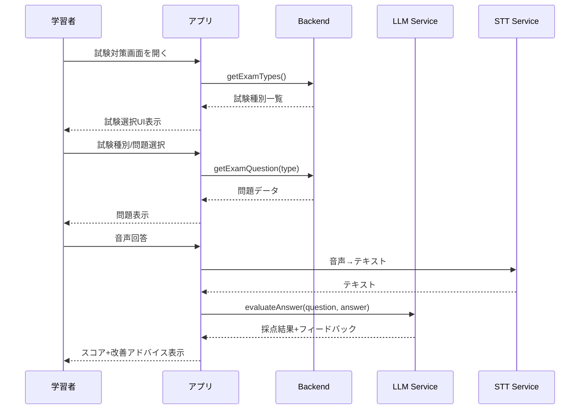
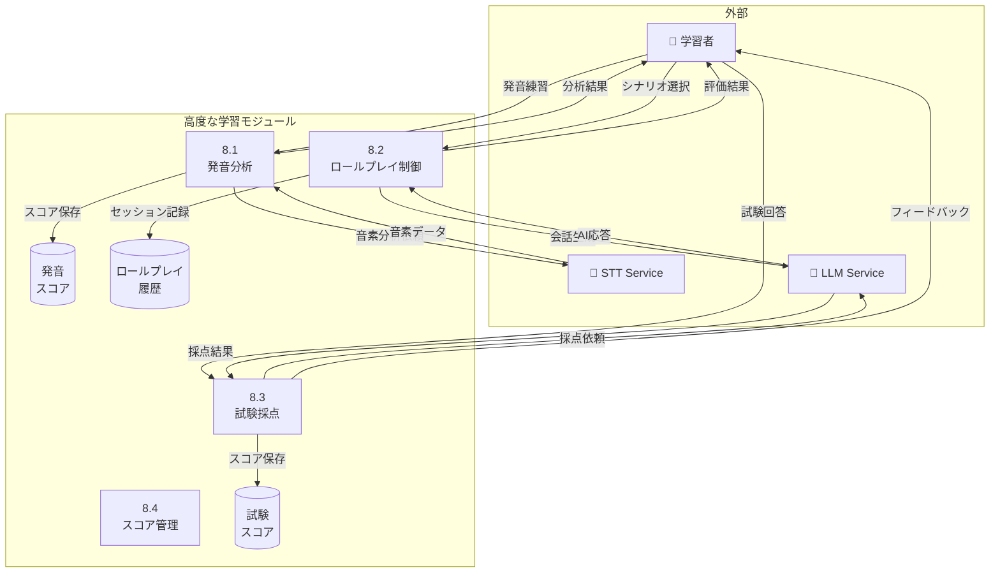

# 高度な学習 - ユースケース詳細

## UC-030: 発音詳細分析

### 基本情報

| 項目     | 内容                              |
| -------- | --------------------------------- |
| UC ID    | UC-030                            |
| UC 名    | 発音詳細分析                      |
| アクター | 学習者                            |
| 前提条件 | ユーザーはログイン済み、Plus 以上 |
| 事後条件 | 詳細な発音分析結果が表示される    |
| 関連 FR  | FR-030                            |
| 優先度   | Should                            |

### 基本フロー

1. 学習者が発音練習モードを開始
2. 指定のフレーズを発話
3. システムが音素レベルで分析
4. 分析結果を表示:
   - 各音素のスコア（0-100）
   - 問題のある音素をハイライト
   - 正しい発音の音声サンプル
   - 改善のためのアドバイス
5. 再練習または次のフレーズへ

### ビジネスルール

| ルール ID | ルール内容                               |
| --------- | ---------------------------------------- |
| BR-082    | 詳細分析は Plus/Pro プランのみ           |
| BR-083    | 1 日 10 回まで詳細分析可能（Pro 無制限） |

---

## UC-031: ロールプレイモード

### 基本情報

| 項目     | 内容                         |
| -------- | ---------------------------- |
| UC ID    | UC-031                       |
| UC 名    | ロールプレイモード           |
| アクター | 学習者                       |
| 前提条件 | ユーザーはログイン済み       |
| 事後条件 | ロールプレイセッションが完了 |
| 関連 FR  | FR-031                       |
| 優先度   | Must                         |

### 基本フロー

1. 学習者がロールプレイ一覧画面を開く
2. シナリオを選択（例: 面接、商談）
3. 役割を選択（例: 応募者、営業）
4. AI が相手役として会話開始
5. シナリオに沿って会話進行
6. 完了時に評価を表示:
   - 適切さスコア
   - 流暢さスコア
   - 改善ポイント

### ビジネスルール

| ルール ID | ルール内容                              |
| --------- | --------------------------------------- |
| BR-084    | 評価基準は適切さ・流暢さ・完成度の 3 軸 |
| BR-085    | シナリオ完了で XP 40+を獲得             |

---

## UC-032: TOEIC/IELTS 対策

### 基本情報

| 項目     | 内容                               |
| -------- | ---------------------------------- |
| UC ID    | UC-032                             |
| UC 名    | TOEIC/IELTS 対策                   |
| アクター | 学習者                             |
| 前提条件 | ユーザーはログイン済み、Pro プラン |
| 事後条件 | 試験対策セッションが完了           |
| 関連 FR  | FR-032                             |
| 優先度   | Could                              |

### 基本フロー

1. 学習者が試験対策画面を開く
2. 試験種別を選択（TOEIC Speaking/IELTS Speaking）
3. 問題タイプを選択
4. 模擬問題に回答（音声）
5. AI が採点・フィードバック
6. スコア推定と改善アドバイスを表示

### IELTS スピーキング問題タイプ

| Part | 内容               | 時間              |
| ---- | ------------------ | ----------------- |
| 1    | 自己紹介・日常質問 | 4-5 分            |
| 2    | キュートピック     | 1 分準備+2 分回答 |
| 3    | ディスカッション   | 4-5 分            |

### ビジネスルール

| ルール ID | ルール内容                                      |
| --------- | ----------------------------------------------- |
| BR-086    | 試験対策は Pro プランのみ                       |
| BR-087    | 採点は 4 つの評価軸（流暢さ、語彙、文法、発音） |
| BR-088    | 推定スコアはあくまで参考値                      |

### シーケンス図

---

## DFD レベル 2: 高度な学習モジュール

### データフローダイアグラム

### サブプロセス定義

| プロセス ID | プロセス名       | 入力          | 出力       | 説明               |
| ----------- | ---------------- | ------------- | ---------- | ------------------ |
| 8.1         | 発音分析         | 音声データ    | 音素スコア | 音素レベル発音分析 |
| 8.2         | ロールプレイ制御 | シナリオ/役割 | 会話/評価  | ロールプレイを制御 |
| 8.3         | 試験採点         | 回答音声      | 採点結果   | 試験回答を採点     |
| 8.4         | スコア管理       | 各種スコア    | 統計データ | スコアを記録・管理 |

---

_関連ファイル: [\_index.md](./_index.md) | [conversation-01.md](./conversation-01.md)_
_メインファイル: [../03-functional-design.md](../03-functional-design.md)_
