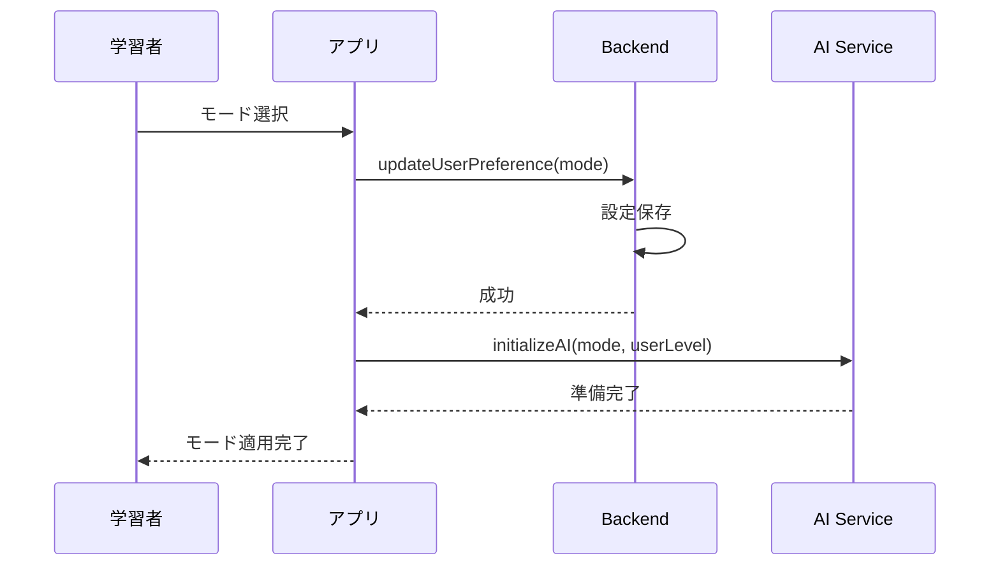
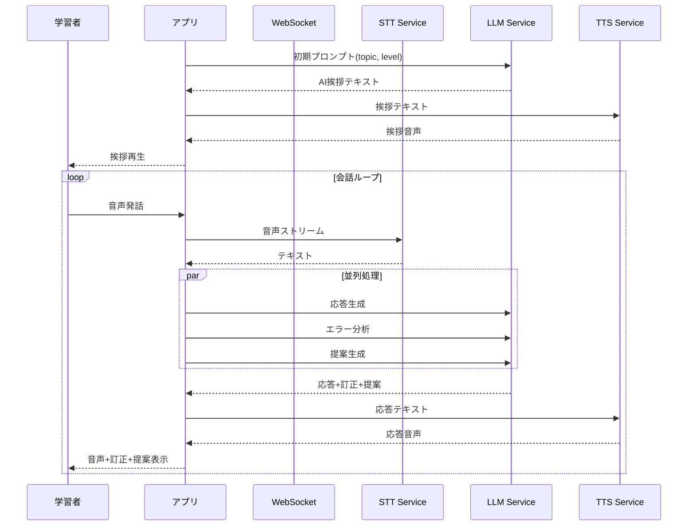
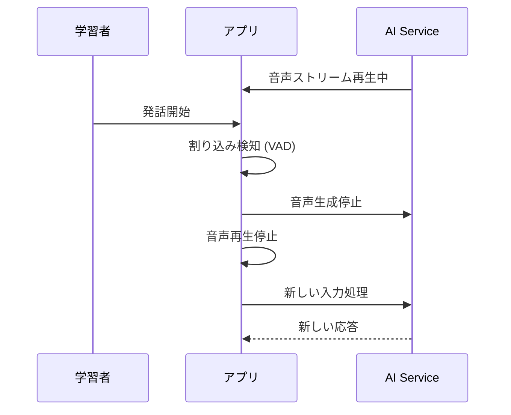
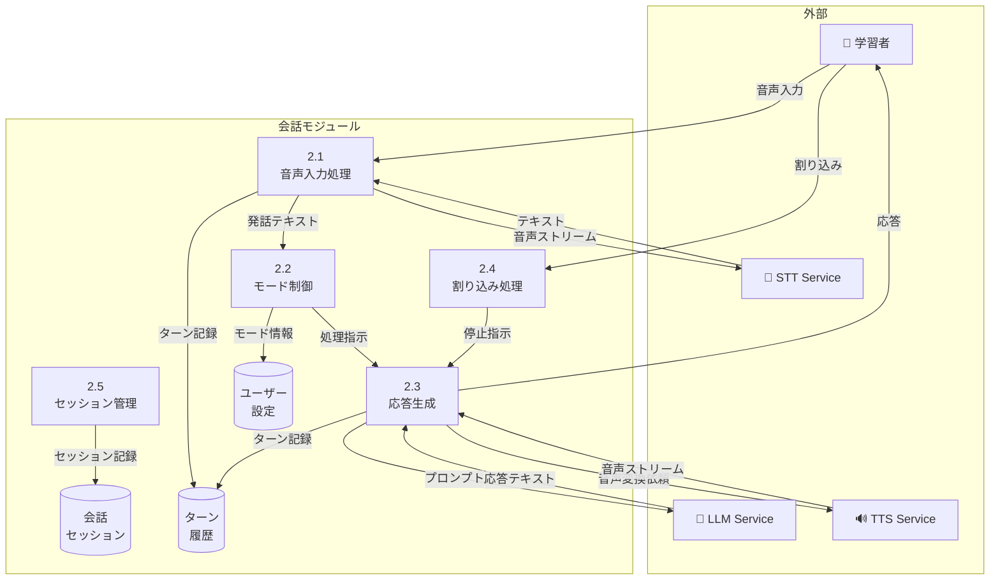

# 会話機能 - ユースケース詳細

## UC-001: モード切替

### 基本情報

| 項目     | 内容                       |
| -------- | -------------------------- |
| UC ID    | UC-001                     |
| UC 名    | モード切替                 |
| アクター | 学習者                     |
| 前提条件 | ユーザーはログイン済み     |
| 事後条件 | 選択したモードが有効になる |
| 関連 FR  | FR-001                     |
| 優先度   | Must                       |

### 基本フロー

1. 学習者が会話画面を開く
2. システムがモード選択 UI を表示（インストラクター/フリートーク）
3. 学習者がモードを選択
4. システムが選択モードを保存
5. 選択モードで AI が初期化される

### 代替フロー

- A1: 会話中のモード変更
  1. 学習者がモード変更を要求
  2. システムが確認ダイアログを表示
  3. 学習者が確認
  4. 現在の会話を終了し、新モードで再開

### シーケンス図

### ビジネスルール

| ルール ID | ルール内容                               |
| --------- | ---------------------------------------- |
| BR-001    | デフォルトモードはインストラクターモード |
| BR-002    | モード設定はユーザーごとに永続化される   |

---

## UC-002: インストラクター会話

### 基本情報

| 項目     | 内容                                   |
| -------- | -------------------------------------- |
| UC ID    | UC-002                                 |
| UC 名    | インストラクター会話                   |
| アクター | 学習者, AI                             |
| 前提条件 | インストラクターモードが選択されている |
| 事後条件 | 会話セッションが記録される             |
| 関連 FR  | FR-002                                 |
| 優先度   | Must                                   |

### 基本フロー

1. 学習者がトピックを選択（オプション）
2. AI が挨拶と最初の質問を発話
3. 学習者が応答（音声）
4. システムが STT でテキスト変換
5. AI が応答を生成し、TTS で音声出力
6. 3-5 を繰り返し
7. 学習者が終了を選択
8. システムが会話サマリーを表示

### 代替フロー

- A1: ユーザーが沈黙
  1. 10 秒間の沈黙を検知
  2. AI が「Are you still there?」などの確認
  3. さらに 10 秒沈黙で会話一時停止

### シーケンス図

### ビジネスルール

| ルール ID | ルール内容                                   |
| --------- | -------------------------------------------- |
| BR-003    | AI はユーザーレベルに応じた語彙・速度で話す  |
| BR-004    | Beginner: Yes/No 質問を優先、Top500 語彙使用 |
| BR-005    | 沈黙 10 秒で確認、20 秒で一時停止            |

---

## UC-003: フリートーク会話

### 基本情報

| 項目     | 内容                               |
| -------- | ---------------------------------- |
| UC ID    | UC-003                             |
| UC 名    | フリートーク会話                   |
| アクター | 学習者, AI                         |
| 前提条件 | フリートークモードが選択されている |
| 事後条件 | 会話セッションが記録される         |
| 関連 FR  | FR-003                             |
| 優先度   | Must                               |

### 基本フロー

1. 学習者が会話を開始（最初に発話）
2. システムが STT でテキスト変換
3. AI が応答を生成し、TTS で音声出力
4. 2-3 を繰り返し
5. 学習者が終了を選択
6. システムが会話サマリーを表示

### 代替フロー

- A1: 不適切なコンテンツ検知
  1. システムが不適切な発話を検知
  2. 警告メッセージを表示
  3. 会話を安全なトピックへリダイレクト

### ビジネスルール

| ルール ID | ルール内容                                  |
| --------- | ------------------------------------------- |
| BR-006    | AI はユーザーレベルに応じた語彙・速度で応答 |
| BR-007    | 不適切なコンテンツはフィルタリングする      |

---

## UC-009: 割り込み対応

### 基本情報

| 項目     | 内容                                  |
| -------- | ------------------------------------- |
| UC ID    | UC-009                                |
| UC 名    | 割り込み対応                          |
| アクター | 学習者, AI                            |
| 前提条件 | 会話中                                |
| 事後条件 | AI 発話が中断され、ユーザー発話を処理 |
| 関連 FR  | FR-009                                |
| 優先度   | Must                                  |

### 基本フロー

1. AI が発話中
2. 学習者が発話を開始（割り込み）
3. システムが割り込みを検知（300ms 以内）
4. AI 音声を即座に停止
5. 学習者の発話を処理
6. AI が新しい応答を生成

### シーケンス図

### ビジネスルール

| ルール ID | ルール内容                             |
| --------- | -------------------------------------- |
| BR-018    | 割り込み検知は 300ms 以内              |
| BR-019    | 誤検知を避けるため、一定音量閾値を設定 |

---

## UC-010: フィラーワード

### 基本情報

| 項目     | 内容                       |
| -------- | -------------------------- |
| UC ID    | UC-010                     |
| UC 名    | フィラーワード             |
| アクター | AI                         |
| 前提条件 | 会話中                     |
| 事後条件 | 自然な会話体験が提供される |
| 関連 FR  | FR-010                     |
| 優先度   | Should                     |

### 基本フロー

1. LLM 応答生成に時間がかかる場合
2. システムがフィラーワードを挿入
3. 「Um...」「Let me see...」などを音声で再生
4. 本体の応答が準備でき次第、再生開始

### ビジネスルール

| ルール ID | ルール内容                                             |
| --------- | ------------------------------------------------------ |
| BR-020    | フィラーは多様性を持たせる（同じものを連続使用しない） |
| BR-021    | 800ms 以上の処理遅延時にフィラーを挿入                 |

---

## UC-033: 発話確認

### 基本情報

| 項目     | 内容                           |
| -------- | ------------------------------ |
| UC ID    | UC-033                         |
| UC 名    | 発話確認                       |
| アクター | 学習者                         |
| 前提条件 | 会話中、発話確認モードが有効   |
| 事後条件 | 音声認識結果が確認・修正される |
| 関連 FR  | FR-033                         |
| 優先度   | Should                         |

### 基本フロー

1. 学習者が発話
2. システムが STT でテキスト変換
3. 確認ダイアログを表示（認識結果）
4. 学習者が確認または修正
5. 確認後、AI が応答を生成

### 代替フロー

- A1: 自動確認モード（タイムアウト）
  1. 認識結果を 3 秒間表示
  2. ユーザー操作なしで自動確認

### ビジネスルール

| ルール ID | ルール内容                              |
| --------- | --------------------------------------- |
| BR-089    | 発話確認モードは設定で有効/無効切替可能 |
| BR-090    | 確認タイムアウトは 3 秒（設定可能）     |
| BR-091    | Beginner 向けにデフォルト有効           |

---

## DFD レベル 2: 会話モジュール

### データフローダイアグラム

### サブプロセス定義

| プロセス ID | プロセス名     | 入力           | 出力              | 説明                     |
| ----------- | -------------- | -------------- | ----------------- | ------------------------ |
| 2.1         | 音声入力処理   | 音声ストリーム | テキスト          | 音声をテキストに変換     |
| 2.2         | モード制御     | テキスト       | 処理指示          | モードに応じた処理を決定 |
| 2.3         | 応答生成       | 処理指示       | 音声+テキスト応答 | AI 応答を生成・音声化    |
| 2.4         | 割り込み処理   | 割り込み信号   | 停止指示          | 発話中断を制御           |
| 2.5         | セッション管理 | ターンデータ   | セッションログ    | 会話記録を永続化         |

### データストア詳細

| ストア ID | ストア名       | 主要データ                          |
| --------- | -------------- | ----------------------------------- |
| D2_1      | 会話セッション | session_id, user_id, mode, duration |
| D2_2      | ターン履歴     | turn_id, speaker, text, timestamp   |
| D2_3      | ユーザー設定   | user_id, mode_preference, speed     |

---

_関連ファイル: [\_index.md](./_index.md) | [feedback-01.md](./feedback-01.md)_
_メインファイル: [../03-functional-design.md](../03-functional-design.md)_
