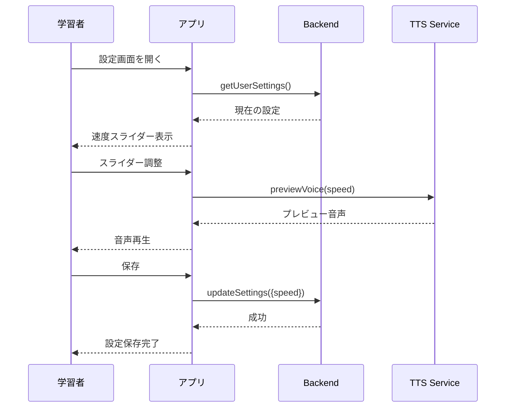
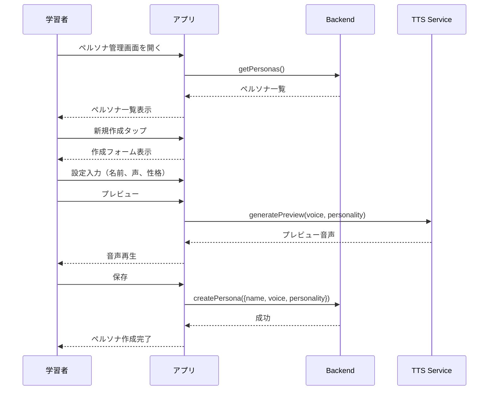
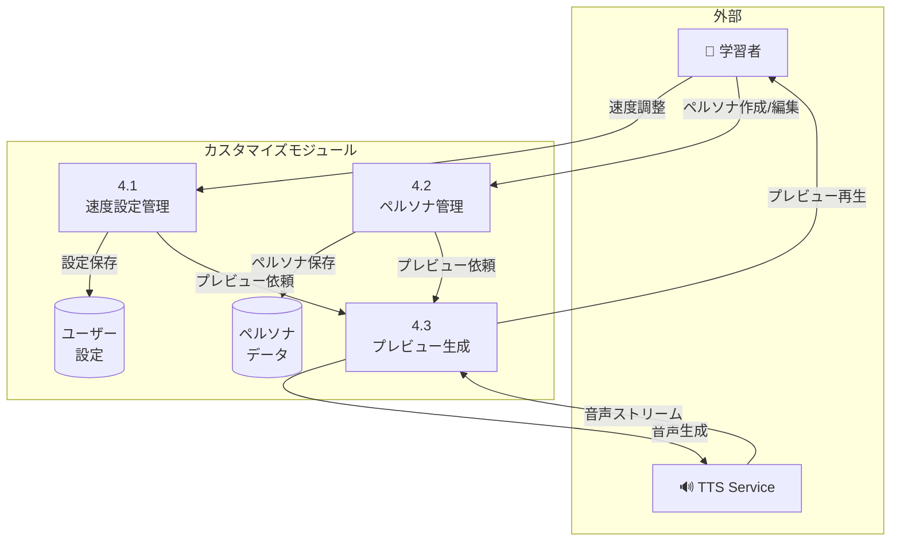

# カスタマイズ機能 - ユースケース詳細

## UC-007: AI 速度調整

### 基本情報

| 項目     | 内容                    |
| -------- | ----------------------- |
| UC ID    | UC-007                  |
| UC 名    | AI 速度調整             |
| アクター | 学習者                  |
| 前提条件 | ユーザーはログイン済み  |
| 事後条件 | AI 発話速度が変更される |
| 関連 FR  | FR-007                  |
| 優先度   | Should                  |

### 基本フロー

1. 学習者が設定画面を開く
2. 「AI 速度」スライダーを表示
3. 学習者がスライダーを調整（0.75x〜1.25x）
4. システムがリアルタイムでプレビュー音声を再生
5. 学習者が保存
6. 次回会話から AI 速度が適用

### シーケンス図

### ビジネスルール

| ルール ID | ルール内容                             |
| --------- | -------------------------------------- |
| BR-014    | デフォルト速度はユーザーレベルに依存   |
| BR-015    | 速度範囲: 0.75x（遅い）〜1.25x（速い） |

---

## UC-008: ペルソナ作成

### 基本情報

| 項目     | 内容                       |
| -------- | -------------------------- |
| UC ID    | UC-008                     |
| UC 名    | ペルソナ作成               |
| アクター | 学習者                     |
| 前提条件 | ユーザーはログイン済み     |
| 事後条件 | 新しいペルソナが作成される |
| 関連 FR  | FR-008                     |
| 優先度   | Should                     |

### 基本フロー

1. 学習者がペルソナ管理画面を開く
2. 「新規作成」ボタンをタップ
3. 以下を設定:
   - 名前（必須）
   - 声（選択式: voice_1/voice_2/voice_3）
   - 性格（選択式: cheerful/strict/sarcastic）
   - 対象レベル（選択式）
4. プレビュー音声を確認
5. 保存
6. 作成したペルソナが会話で使用可能に

### バリデーション

| フィールド | ルール           |
| ---------- | ---------------- |
| 名前       | 1〜20 文字、一意 |
| 声         | 選択必須         |
| 性格       | 選択必須         |
| 対象レベル | 選択必須         |

### ビジネスルール

| ルール ID | ルール内容                                  |
| --------- | ------------------------------------------- |
| BR-016    | ペルソナ名はユーザー内で一意                |
| BR-017    | 1 ユーザーあたり最大 5 ペルソナまで作成可能 |

### シーケンス図

---

## DFD レベル 2: カスタマイズモジュール

### データフローダイアグラム

### サブプロセス定義

| プロセス ID | プロセス名     | 入力          | 出力           | 説明                   |
| ----------- | -------------- | ------------- | -------------- | ---------------------- |
| 4.1         | 速度設定管理   | 速度値        | 設定データ     | AI 発話速度を管理      |
| 4.2         | ペルソナ管理   | ペルソナ情報  | ペルソナデータ | カスタムペルソナを管理 |
| 4.3         | プレビュー生成 | 設定/ペルソナ | 音声ストリーム | 設定のプレビュー音声   |

---

_関連ファイル: [\_index.md](./_index.md) | [user-01.md](./user-01.md)_
_メインファイル: [../03-functional-design.md](../03-functional-design.md)_
