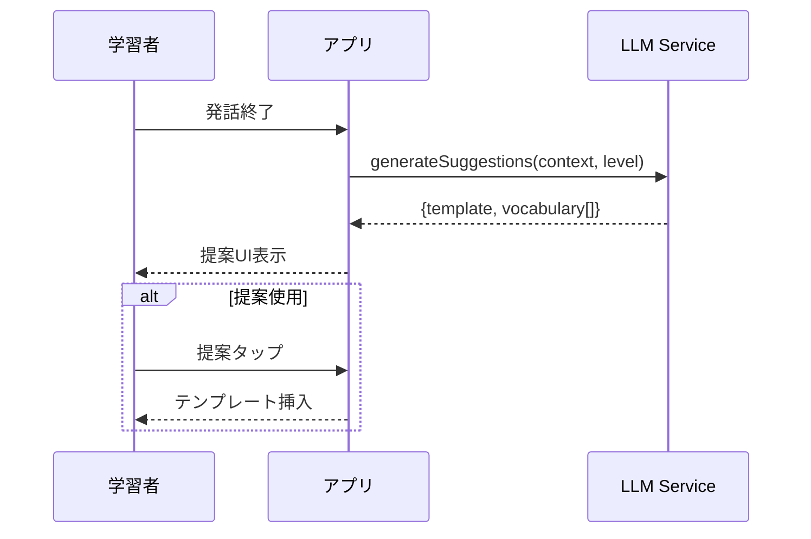
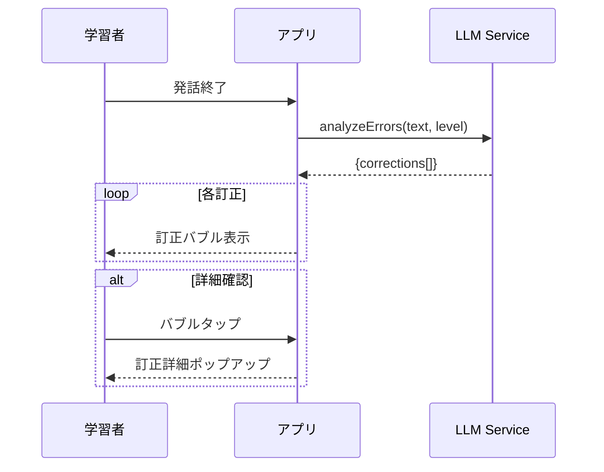
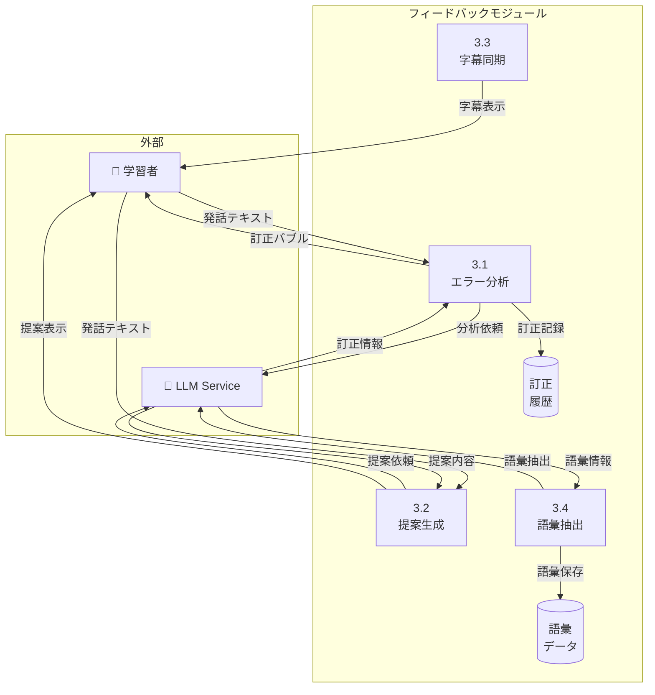

# フィードバック機能 - ユースケース詳細

## UC-004: スマート提案表示

### 基本情報

| 項目     | 内容                   |
| -------- | ---------------------- |
| UC ID    | UC-004                 |
| UC 名    | スマート提案表示       |
| アクター | AI, System             |
| 前提条件 | 会話中                 |
| 事後条件 | 提案が UI に表示される |
| 関連 FR  | FR-004                 |
| 優先度   | Must                   |

### 基本フロー

1. 学習者が発話終了
2. システムが並列で LLM に提案生成を依頼
3. LLM がテンプレート提案と語彙提案を生成
4. システムが画面下部に提案を表示
5. 学習者が提案をタップで使用（オプション）

### シーケンス図

### ビジネスルール

| ルール ID | ルール内容                                          |
| --------- | --------------------------------------------------- |
| BR-008    | 提案はユーザーレベルに応じた難易度で生成            |
| BR-009    | テンプレートは「I usually [___] because [___]」形式 |

---

## UC-005: ストリーミング字幕

### 基本情報

| 項目     | 内容                           |
| -------- | ------------------------------ |
| UC ID    | UC-005                         |
| UC 名    | ストリーミング字幕             |
| アクター | System                         |
| 前提条件 | 会話中                         |
| 事後条件 | リアルタイムで字幕が表示される |
| 関連 FR  | FR-005                         |
| 優先度   | Must                           |

### 基本フロー

1. AI 音声ストリームが再生開始
2. システムがテキストを単語単位で字幕に反映
3. 現在再生中の単語をハイライト（カラオケ式）
4. 音声再生に同期して次の単語へハイライト移動
5. 再生完了で字幕表示完了

### ビジネスルール

| ルール ID | ルール内容                             |
| --------- | -------------------------------------- |
| BR-010    | 字幕表示は音声再生から 50ms 以内の遅延 |
| BR-011    | ハイライトは音声タイミングと同期       |

---

## UC-006: 即時訂正表示

### 基本情報

| 項目     | 内容                   |
| -------- | ---------------------- |
| UC ID    | UC-006                 |
| UC 名    | 即時訂正表示           |
| アクター | AI, System             |
| 前提条件 | 学習者が発話完了       |
| 事後条件 | 訂正バブルが表示される |
| 関連 FR  | FR-006                 |
| 優先度   | Must                   |

### 基本フロー

1. 学習者が発話終了
2. システムが並列で LLM にエラー分析を依頼
3. LLM が発音・文法・語彙エラーを検出
4. システムが訂正バブルを表示（色分け）
   - 🔴 赤: 発音エラー
   - 🟡 黄: 文法エラー
   - 🔵 青: 語彙提案
5. 学習者がバブルをタップで詳細表示

### シーケンス図

### ビジネスルール

| ルール ID | ルール内容                           |
| --------- | ------------------------------------ |
| BR-012    | 訂正表示は AI 応答と同時（並列処理） |
| BR-013    | エラー種別ごとに色分け表示           |

---

## UC-017: 語彙解説

### 基本情報

| 項目     | 内容                                |
| -------- | ----------------------------------- |
| UC ID    | UC-017                              |
| UC 名    | 語彙解説                            |
| アクター | 学習者                              |
| 前提条件 | 会話中、AI 発話にハイライト語彙あり |
| 事後条件 | 語彙解説が表示される                |
| 関連 FR  | FR-017                              |
| 優先度   | Should                              |

### 基本フロー

1. AI 発話中、重要語彙がハイライト表示
2. 学習者がハイライト語彙をタップ
3. システムが語彙解説ポップアップを表示
   - 意味（日本語訳）
   - 発音記号
   - 例文
   - 類義語
4. 学習者が「保存」をタップで単語帳に追加

### ビジネスルール

| ルール ID | ルール内容                                 |
| --------- | ------------------------------------------ |
| BR-047    | ハイライト語彙はユーザーレベルより上の語彙 |
| BR-048    | 1 発話あたり最大 3 語彙までハイライト      |
| BR-049    | 解説は日本語（UI デフォルト言語）で表示    |
| BR-050    | 保存した語彙は単語帳に追加される           |

---

## DFD レベル 2: フィードバックモジュール

### データフローダイアグラム

### サブプロセス定義

| プロセス ID | プロセス名 | 入力            | 出力     | 説明                   |
| ----------- | ---------- | --------------- | -------- | ---------------------- |
| 3.1         | エラー分析 | 発話テキスト    | 訂正情報 | エラーを検出・分類     |
| 3.2         | 提案生成   | 発話テキスト    | 提案内容 | テンプレート・語彙提案 |
| 3.3         | 字幕同期   | 音声タイミング  | 字幕表示 | カラオケ式字幕         |
| 3.4         | 語彙抽出   | AI 応答テキスト | 語彙情報 | 重要語彙を抽出・解説   |

---

_関連ファイル: [\_index.md](./_index.md) | [conversation-01.md](./conversation-01.md)_
_メインファイル: [../03-functional-design.md](../03-functional-design.md)_
