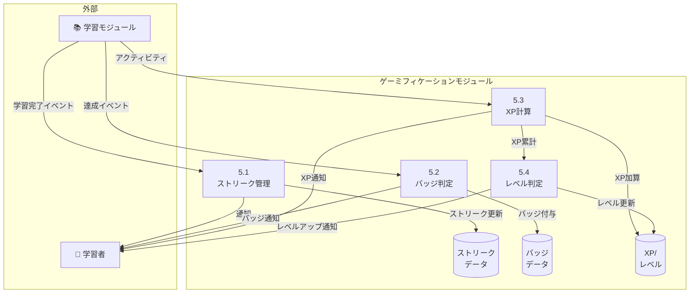

# ゲーミフィケーション - ユースケース詳細

## UC-018: 学習ストリーク

### 基本情報

| 項目     | 内容                     |
| -------- | ------------------------ |
| UC ID    | UC-018                   |
| UC 名    | 学習ストリーク           |
| アクター | System                   |
| 前提条件 | ユーザーが学習活動を完了 |
| 事後条件 | ストリークが更新される   |
| 関連 FR  | FR-018                   |
| 優先度   | Must                     |

### 基本フロー

1. 学習者が 1 日 1 回以上の学習活動を完了
2. システムがストリークを+1
3. ストリーク画面で 🔥 マークと日数を表示
4. マイルストーン達成時（7 日、30 日等）に通知
5. 未学習日があればストリークリセット

### ビジネスルール

| ルール ID | ルール内容                                 |
| --------- | ------------------------------------------ |
| BR-051    | 1 日 1 回以上の学習でストリーク維持        |
| BR-052    | 判定は毎日 00:00 UTC で実行                |
| BR-053    | ストリークフリーズ使用で 1 日スキップ可能  |
| BR-054    | フリーズは月 1 回まで使用可能（Plus 以上） |

---

## UC-019: 実績バッジ

### 基本情報

| 項目     | 内容                 |
| -------- | -------------------- |
| UC ID    | UC-019               |
| UC 名    | 実績バッジ           |
| アクター | System               |
| 前提条件 | ユーザーが条件を達成 |
| 事後条件 | バッジが付与される   |
| 関連 FR  | FR-019               |
| 優先度   | Should               |

### 基本フロー

1. 学習者が特定の条件を達成
2. システムがバッジ付与条件をチェック
3. 条件達成でバッジを付与
4. 通知と XP ボーナスを付与
5. バッジ一覧画面で確認可能

### バッジ例

| バッジ ID | バッジ名     | 条件               | XP ボーナス |
| --------- | ------------ | ------------------ | ----------- |
| B-001     | 初めての会話 | 初回会話完了       | 50          |
| B-002     | 会話マスター | 100 回会話完了     | 500         |
| B-003     | 週間戦士     | 7 日連続ストリーク | 100         |
| B-004     | 語彙収集家   | 100 語彙保存       | 200         |
| B-005     | レベルアップ | レベルアップ達成   | 100         |

### ビジネスルール

| ルール ID | ルール内容                         |
| --------- | ---------------------------------- |
| BR-055    | バッジ付与時に XP ボーナスを加算   |
| BR-056    | 同じバッジは 1 回のみ付与          |
| BR-057    | バッジはプロフィール画面で表示可能 |

---

## UC-020: 経験値＆レベル

### 基本情報

| 項目     | 内容                        |
| -------- | --------------------------- |
| UC ID    | UC-020                      |
| UC 名    | 経験値＆レベル              |
| アクター | System                      |
| 前提条件 | ユーザーが学習活動を完了    |
| 事後条件 | XP が加算、レベルアップ判定 |
| 関連 FR  | FR-020                      |
| 優先度   | Should                      |

### 基本フロー

1. 学習者が学習活動を完了
2. システムが XP を計算して加算
3. 累計 XP がレベルアップ閾値に達した場合
4. レベルアップ通知を表示
5. 新しいレベルをプロフィールに反映

### XP 計算ルール

| アクティビティ | XP 計算式          |
| -------------- | ------------------ |
| 会話           | 会話時間(分) × 10  |
| 訂正           | 訂正数 × 5         |
| 語彙保存       | 語彙数 × 3         |
| チャレンジ完了 | 基本 50 + ボーナス |
| バッジ獲得     | バッジ固有 XP      |

### レベルアップ閾値

| レベル | 必要累計 XP |
| ------ | ----------- |
| 1      | 0           |
| 2      | 100         |
| 3      | 300         |
| 4      | 600         |
| 5      | 1,000       |
| ...    | ...         |

### ビジネスルール

| ルール ID | ルール内容                  |
| --------- | --------------------------- |
| BR-058    | XP は減ることはない（累計） |
| BR-059    | レベルアップでバッジ獲得    |
| BR-060    | レベルはランキングに使用    |

---

## DFD レベル 2: ゲーミフィケーションモジュール

### データフローダイアグラム

### サブプロセス定義

| プロセス ID | プロセス名     | 入力             | 出力           | 説明                     |
| ----------- | -------------- | ---------------- | -------------- | ------------------------ |
| 5.1         | ストリーク管理 | 学習完了イベント | ストリーク更新 | 連続学習日数を管理       |
| 5.2         | バッジ判定     | 達成イベント     | バッジ付与     | 条件達成でバッジを付与   |
| 5.3         | XP 計算        | アクティビティ   | XP 加算        | 学習活動に応じた XP 計算 |
| 5.4         | レベル判定     | XP 累計          | レベル更新     | 閾値到達でレベルアップ   |

### データストア詳細

| ストア ID | ストア名         | 主要データ                           |
| --------- | ---------------- | ------------------------------------ |
| D5_1      | ストリークデータ | user_id, current_streak, last_active |
| D5_2      | バッジデータ     | badge_id, user_id, earned_at         |
| D5_3      | XP/レベル        | user_id, total_xp, current_level     |

---

_関連ファイル: [\_index.md](./_index.md) | [progress-01.md](./progress-01.md)_
_メインファイル: [../03-functional-design.md](../03-functional-design.md)_
