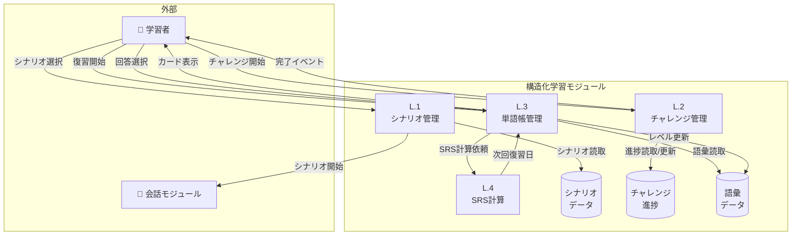

# 構造化学習 - ユースケース詳細

## UC-024: シナリオライブラリ

### 基本情報

| 項目     | 内容                       |
| -------- | -------------------------- |
| UC ID    | UC-024                     |
| UC 名    | シナリオライブラリ         |
| アクター | 学習者                     |
| 前提条件 | ユーザーはログイン済み     |
| 事後条件 | シナリオが選択され会話開始 |
| 関連 FR  | FR-024                     |
| 優先度   | Must                       |

### 基本フロー

1. 学習者がシナリオライブラリ画面を開く
2. カテゴリ一覧を表示（旅行、ビジネス、日常等）
3. カテゴリを選択
4. シナリオ一覧を表示
5. シナリオを選択
6. インストラクターモードでシナリオ開始

### シナリオカテゴリ

| カテゴリ | シナリオ例                     |
| -------- | ------------------------------ |
| 旅行     | 空港でチェックイン、ホテル予約 |
| ビジネス | 自己紹介、会議、プレゼン       |
| 日常     | 買い物、レストラン、道案内     |
| 就職活動 | 面接、自己 PR                  |
| 医療     | 病院受診、症状説明             |

### ビジネスルール

| ルール ID | ルール内容                        |
| --------- | --------------------------------- |
| BR-070    | Free プランは基本シナリオのみ     |
| BR-071    | Plus/Pro は全シナリオアクセス可能 |
| BR-072    | シナリオはレベル別に難易度表示    |

---

## UC-025: デイリーチャレンジ

### 基本情報

| 項目     | 内容                       |
| -------- | -------------------------- |
| UC ID    | UC-025                     |
| UC 名    | デイリーチャレンジ         |
| アクター | 学習者                     |
| 前提条件 | ユーザーはログイン済み     |
| 事後条件 | チャレンジが完了・報酬付与 |
| 関連 FR  | FR-025                     |
| 優先度   | Must                       |

### 基本フロー

1. 学習者がホーム画面でデイリーチャレンジを確認
2. チャレンジ内容を表示（例: 5 分間会話、10 語彙復習）
3. 「開始」をタップ
4. チャレンジを実行
5. 完了時に XP ボーナスを付与
6. ストリークにカウント

### チャレンジ例

| チャレンジ種別 | 内容                | XP 報酬 |
| -------------- | ------------------- | ------- |
| 会話           | 5 分間の会話を完了  | 50      |
| 語彙           | 10 語彙を復習       | 30      |
| ロールプレイ   | シナリオを 1 つ完了 | 40      |
| 訂正ゼロ       | 訂正なしで 3 ターン | 60      |

### ビジネスルール

| ルール ID | ルール内容                                    |
| --------- | --------------------------------------------- |
| BR-073    | デイリーチャレンジは毎日 00:00 UTC にリセット |
| BR-074    | 1 日 1 チャレンジのみ利用可能                 |
| BR-075    | チャレンジ完了でストリーク維持                |

---

## UC-026: 単語帳＆復習

### 基本情報

| 項目     | 内容                    |
| -------- | ----------------------- |
| UC ID    | UC-026                  |
| UC 名    | 単語帳＆復習            |
| アクター | 学習者                  |
| 前提条件 | ユーザーはログイン済み  |
| 事後条件 | 語彙が SRS で復習される |
| 関連 FR  | FR-026                  |
| 優先度   | Must                    |

### 基本フロー

1. 学習者が単語帳画面を開く
2. 保存済み語彙一覧を表示
3. 「復習開始」をタップ
4. SRS（間隔反復）に基づきカードを表示
5. 「覚えた」/「もう一度」を選択
6. 選択に応じて次回復習日を調整
7. 復習完了で XP 獲得

### SRS レベル

| レベル   | 次回復習間隔 |
| -------- | ------------ |
| new      | 即時         |
| learning | 1 日         |
| review   | 3-7 日       |
| mastered | 30 日+       |

### ビジネスルール

| ルール ID | ルール内容                     |
| --------- | ------------------------------ |
| BR-076    | 「もう一度」選択でレベルダウン |
| BR-077    | 「覚えた」選択でレベルアップ   |
| BR-078    | mastered 到達後も定期的に出題  |

---

## DFD レベル 2: 構造化学習モジュール

### データフローダイアグラム

### サブプロセス定義

| プロセス ID | プロセス名     | 入力           | 出力           | 説明                   |
| ----------- | -------------- | -------------- | -------------- | ---------------------- |
| L.1         | シナリオ管理   | カテゴリ選択   | シナリオデータ | シナリオを管理・提供   |
| L.2         | チャレンジ管理 | チャレンジ選択 | 進捗データ     | デイリーチャレンジ管理 |
| L.3         | 単語帳管理     | 語彙操作       | 語彙カード     | 語彙の保存・復習       |
| L.4         | SRS 計算       | 回答結果       | 次回復習日     | 間隔反復を計算         |

---

_関連ファイル: [\_index.md](./_index.md) | [social-01.md](./social-01.md)_
_メインファイル: [../03-functional-design.md](../03-functional-design.md)_
