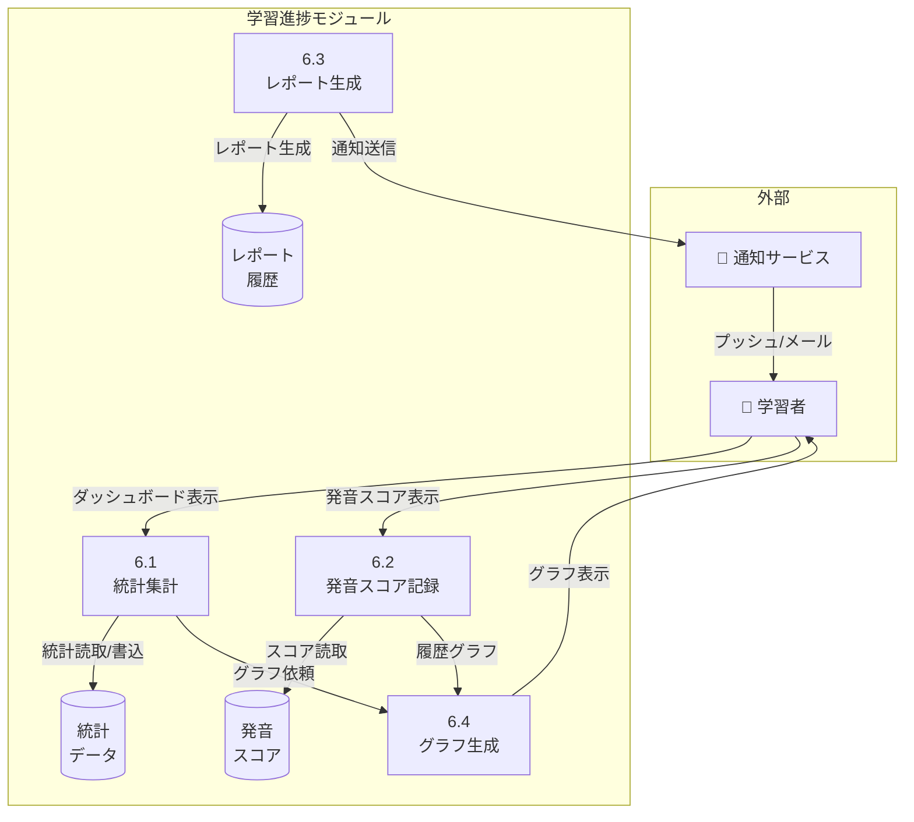

# 学習進捗 - ユースケース詳細

## UC-021: 統計ダッシュボード

### 基本情報

| 項目     | 内容                   |
| -------- | ---------------------- |
| UC ID    | UC-021                 |
| UC 名    | 統計ダッシュボード     |
| アクター | 学習者                 |
| 前提条件 | ユーザーはログイン済み |
| 事後条件 | 学習統計が表示される   |
| 関連 FR  | FR-021                 |
| 優先度   | Must                   |

### 基本フロー

1. 学習者が統計ダッシュボード画面を開く
2. システムが統計データを集計
3. 以下を表示:
   - 総会話時間
   - 今週/今月の会話回数
   - 訂正数の推移グラフ
   - 保存語彙数
   - ストリーク日数
   - レベル/XP 進捗

### ビジネスルール

| ルール ID | ルール内容                        |
| --------- | --------------------------------- |
| BR-061    | 統計データは 1 時間ごとに集計     |
| BR-062    | グラフは過去 30 日分を表示        |
| BR-063    | データは 1 年間保持               |
| BR-064    | エクスポート機能は Pro プランのみ |

---

## UC-022: 発音スコア履歴

### 基本情報

| 項目     | 内容                             |
| -------- | -------------------------------- |
| UC ID    | UC-022                           |
| UC 名    | 発音スコア履歴                   |
| アクター | 学習者                           |
| 前提条件 | 発音分析機能を使用したことがある |
| 事後条件 | 発音スコア推移が表示される       |
| 関連 FR  | FR-022                           |
| 優先度   | Should                           |

### 基本フロー

1. 学習者が発音スコア履歴画面を開く
2. 時系列グラフを表示
3. 特定の日付をタップで詳細確認
4. 改善ポイントのサマリーを表示

### ビジネスルール

| ルール ID | ルール内容               |
| --------- | ------------------------ |
| BR-065    | スコアは 0-100 の範囲    |
| BR-066    | 過去 90 日分の履歴を保持 |

---

## UC-023: 週間/月間レポート

### 基本情報

| 項目     | 内容                           |
| -------- | ------------------------------ |
| UC ID    | UC-023                         |
| UC 名    | 週間/月間レポート              |
| アクター | System                         |
| 前提条件 | ユーザーがレポート通知を有効化 |
| 事後条件 | レポートが送信される           |
| 関連 FR  | FR-023                         |
| 優先度   | Should                         |

### 基本フロー

1. システムが毎週/月末にレポートを生成
2. プッシュ通知またはメールで送信
3. レポート内容:
   - 学習時間サマリー
   - 達成したマイルストーン
   - 次週/月の目標提案
   - モチベーションメッセージ

### ビジネスルール

| ルール ID | ルール内容                                |
| --------- | ----------------------------------------- |
| BR-067    | 週間レポートは毎週月曜日 09:00 JST に送信 |
| BR-068    | 月間レポートは毎月 1 日 09:00 JST に送信  |
| BR-069    | 通知設定でオン/オフ切替可能               |

---

## DFD レベル 2: 学習進捗モジュール

### データフローダイアグラム

### サブプロセス定義

| プロセス ID | プロセス名     | 入力         | 出力       | 説明                  |
| ----------- | -------------- | ------------ | ---------- | --------------------- |
| 6.1         | 統計集計       | 学習ログ     | 統計データ | 学習活動を集計        |
| 6.2         | 発音スコア記録 | 発音分析結果 | スコア履歴 | 発音スコアを記録      |
| 6.3         | レポート生成   | 統計データ   | レポート   | 週間/月間レポート生成 |
| 6.4         | グラフ生成     | 統計/スコア  | グラフ画像 | 可視化グラフを生成    |

---

_関連ファイル: [\_index.md](./_index.md) | [learning-01.md](./learning-01.md)_
_メインファイル: [../03-functional-design.md](../03-functional-design.md)_
