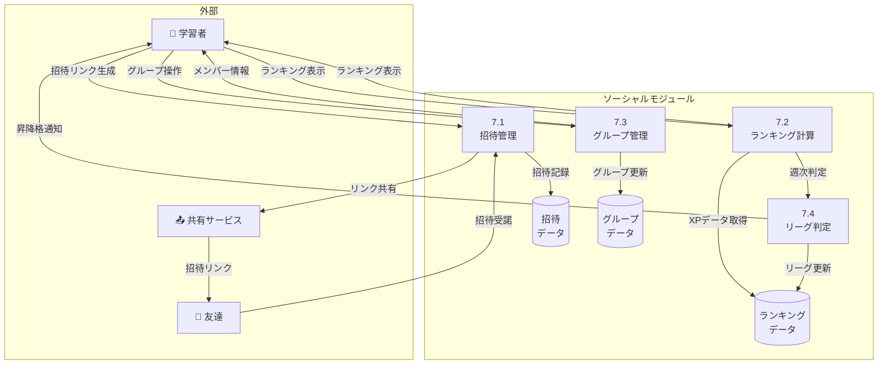

# ソーシャル - ユースケース詳細

## UC-027: 友達招待

### 基本情報

| 項目     | 内容                   |
| -------- | ---------------------- |
| UC ID    | UC-027                 |
| UC 名    | 友達招待               |
| アクター | 学習者                 |
| 前提条件 | ユーザーはログイン済み |
| 事後条件 | 招待リンクが共有される |
| 関連 FR  | FR-027                 |
| 優先度   | Should                 |

### 基本フロー

1. 学習者が招待画面を開く
2. 個人招待リンク/コードを表示
3. 「共有」ボタンで SNS/メッセージアプリへ共有
4. 招待された友達がリンクから登録
5. 両者に XP ボーナスを付与

### ビジネスルール

| ルール ID | ルール内容                                 |
| --------- | ------------------------------------------ |
| BR-074    | 招待リンクは無期限有効                     |
| BR-075    | 招待成功で招待者に 500XP、被招待者に 300XP |
| BR-076    | 1 アカウントあたり最大 50 人まで招待可能   |

---

## UC-028: 週間ランキング

### 基本情報

| 項目     | 内容                   |
| -------- | ---------------------- |
| UC ID    | UC-028                 |
| UC 名    | 週間ランキング         |
| アクター | 学習者                 |
| 前提条件 | ユーザーはログイン済み |
| 事後条件 | ランキングが表示される |
| 関連 FR  | FR-028                 |
| 優先度   | Should                 |

### 基本フロー

1. 学習者がランキング画面を開く
2. 週間 XP ランキングを表示（上位 100 名）
3. 自分の順位を強調表示
4. リーグ（ブロンズ/シルバー/ゴールド等）を表示
5. 週末にリーグ昇降格を判定

### リーグシステム

| リーグ       | 条件                       |
| ------------ | -------------------------- |
| ブロンズ     | 初期リーグ                 |
| シルバー     | 週間 Top 10 で昇格         |
| ゴールド     | シルバー週間 Top 10 で昇格 |
| ダイヤモンド | ゴールド週間 Top 5 で昇格  |

### ビジネスルール

| ルール ID | ルール内容                                  |
| --------- | ------------------------------------------- |
| BR-077    | ランキングは毎週月曜 00:00 UTC にリセット   |
| BR-078    | Top 10 は上位リーグへ昇格、Bottom 10 は降格 |
| BR-079    | 同点の場合は先に到達した方が上位            |

---

## UC-029: グループ学習

### 基本情報

| 項目     | 内容                               |
| -------- | ---------------------------------- |
| UC ID    | UC-029                             |
| UC 名    | グループ学習                       |
| アクター | 学習者                             |
| 前提条件 | ユーザーはログイン済み、Pro プラン |
| 事後条件 | グループが作成・参加される         |
| 関連 FR  | FR-029                             |
| 優先度   | Could                              |

### 基本フロー

1. 学習者がグループ画面を開く
2. 「グループ作成」または「参加」を選択
3. グループ作成: 名前設定 → 招待リンク生成
4. グループ参加: 招待リンク/コードで参加
5. グループ内チャット・進捗共有が可能に

### ビジネスルール

| ルール ID | ルール内容                            |
| --------- | ------------------------------------- |
| BR-080    | 1 グループ最大 20 人                  |
| BR-081    | 1 ユーザーは最大 5 グループに参加可能 |

---

## DFD レベル 2: ソーシャルモジュール

### データフローダイアグラム

### サブプロセス定義

| プロセス ID | プロセス名     | 入力           | 出力           | 説明                 |
| ----------- | -------------- | -------------- | -------------- | -------------------- |
| 7.1         | 招待管理       | 招待リンク     | 招待データ     | 友達招待を管理       |
| 7.2         | ランキング計算 | 週間 XP        | ランキング     | 週間ランキングを集計 |
| 7.3         | グループ管理   | グループ操作   | グループデータ | 学習グループを管理   |
| 7.4         | リーグ判定     | ランキング結果 | リーグ更新     | 昇降格を判定         |

---

_関連ファイル: [\_index.md](./_index.md) | [advanced-01.md](./advanced-01.md)_
_メインファイル: [../03-functional-design.md](../03-functional-design.md)_
