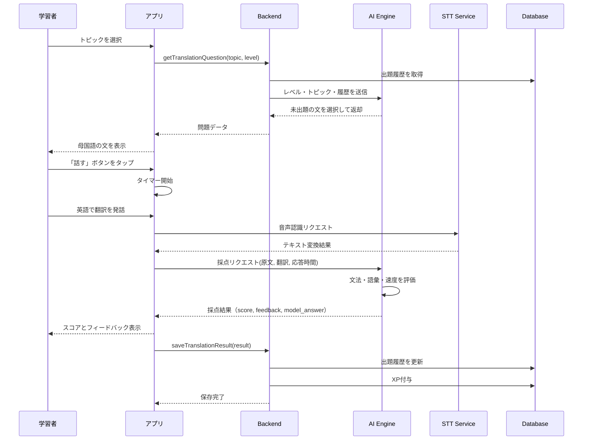
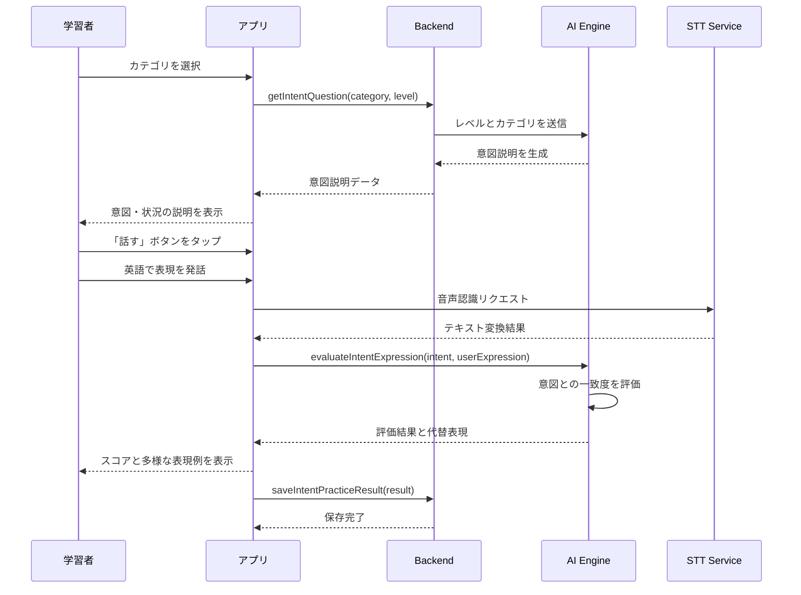
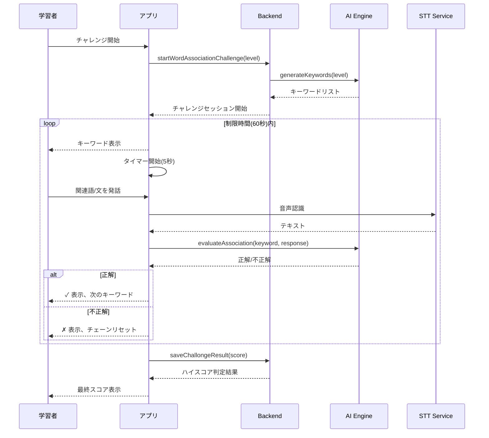
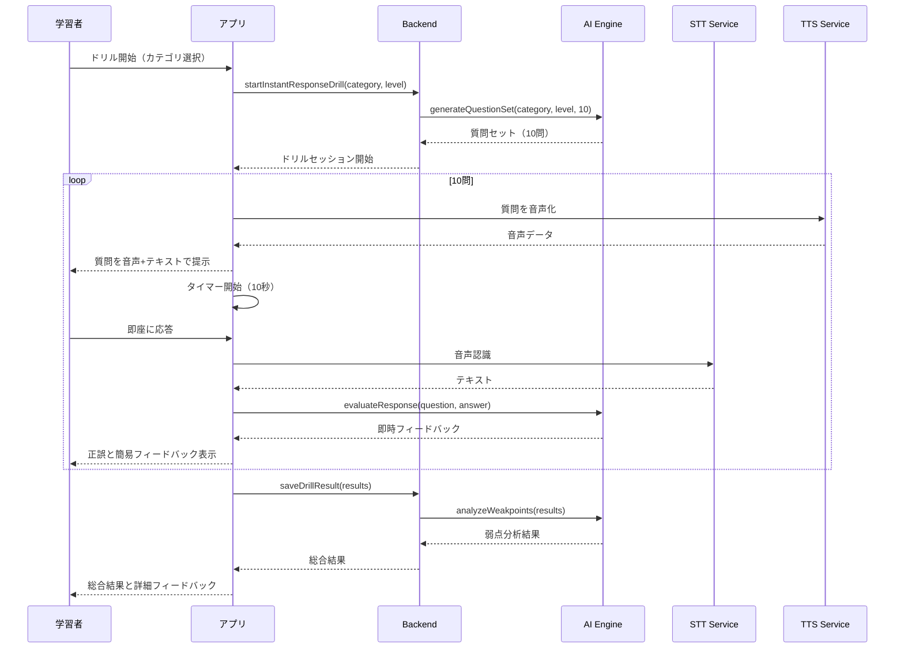
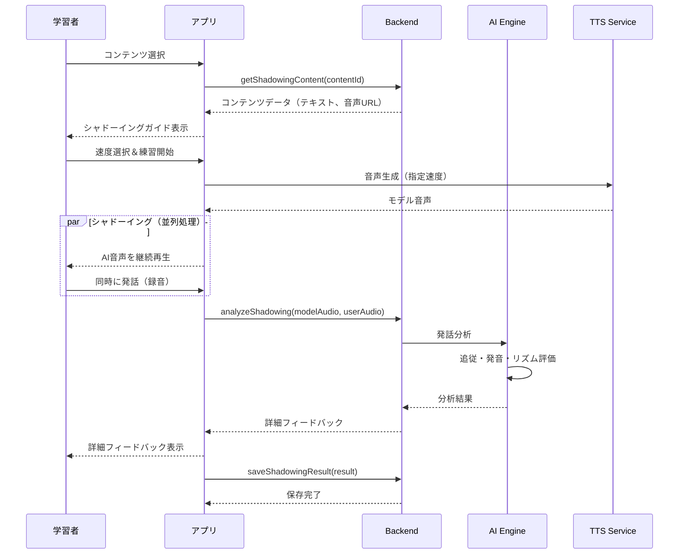
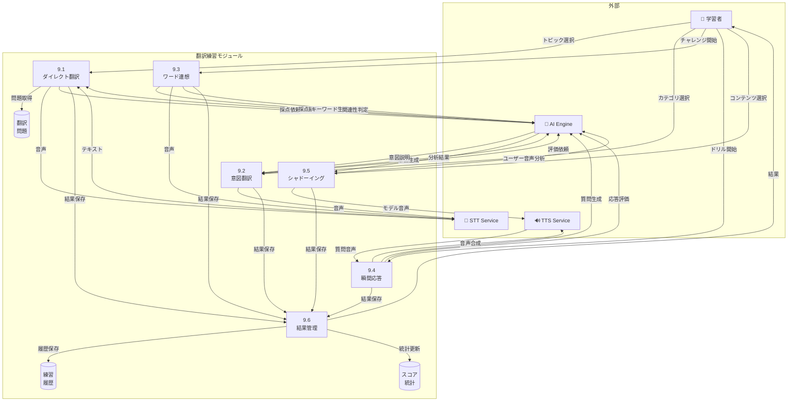
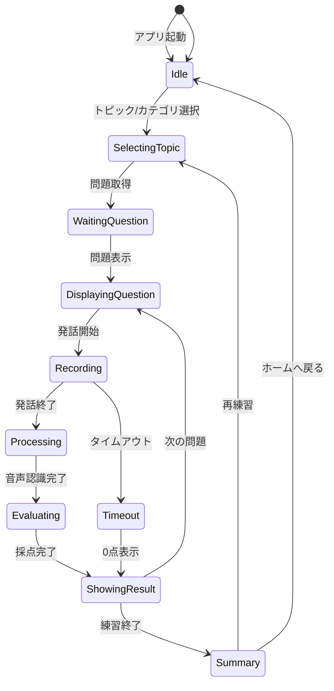

# 翻訳練習 - ユースケース詳細

> このファイルは翻訳練習機能に関するユースケース詳細を定義します: UC-034 〜 UC-038

---

## UC-034: ダイレクト翻訳練習

### 基本情報

| 項目     | 内容                                           |
| -------- | ---------------------------------------------- |
| UC ID    | UC-034                                         |
| UC 名    | ダイレクト翻訳練習                             |
| アクター | 学習者、AI                                     |
| 前提条件 | ログイン済み、レベル設定済み、トピック選択済み |
| 事後条件 | 翻訳結果が履歴に保存、XP 付与                  |
| 関連 FR  | FR-034                                         |
| 優先度   | Must                                           |

### 概要

選択したトピックと学習者のレベルに応じて、母国語（日本語/ベトナム語など）の文を表示し、学習者が英語で口頭翻訳する機能。AI が文法、語彙使用、応答速度を基に採点する。

### 基本フロー

1. 学習者がダイレクト翻訳練習画面を開く
2. トピックを選択する（日常会話、ビジネス、旅行など）
3. システムがレベルに応じた難易度の文を選択
4. 過去 7 日間に出題されていない文をランダムに選ぶ
5. 母国語の文を画面に表示する
6. 学習者が「話す」ボタンをタップする
7. タイマーが開始され、応答時間の計測を開始する
8. 学習者が英語で翻訳を口頭で発話する
9. システムが音声認識で発話をテキスト化する
10. AI が採点を実施する:
    - 文法正確性（40%）
    - 語彙の適切さ（30%）
    - 応答速度（30%）
11. 採点結果とフィードバックを表示する
12. 模範解答を表示し、比較できるようにする

### シーケンス図

### 代替フロー

| ケース ID | 条件                   | 処理                                       |
| --------- | ---------------------- | ------------------------------------------ |
| ALT-034-1 | 発話が認識されない場合 | 再度発話を促すメッセージを表示             |
| ALT-034-2 | タイムアウト（30 秒）  | 時間切れとして 0 点、模範解答を表示        |
| ALT-034-3 | 全文出題済みの場合     | トピック内の履歴をリセットして再出題可能に |
| ALT-034-4 | ネットワークエラー時   | オフライン用の文を表示、後で同期           |

### ビジネスルール

| ルール ID | ルール名           | ルール詳細                                                                    |
| --------- | ------------------ | ----------------------------------------------------------------------------- |
| BR-095    | 重複回避期間       | 同一トピック内で過去 7 日間に出題された文は再出題しない                       |
| BR-096    | レベル別文の難易度 | Beginner: 5-8 語、Intermediate: 8-12 語、Upper: 12-18 語、Advanced: 18 語以上 |
| BR-097    | 応答速度スコア     | 5 秒以内: 満点、10 秒以内: 80%、15 秒以内: 60%、20 秒以内: 40%、20 秒超: 20%  |
| BR-098    | XP 付与ルール      | 完了で 20XP、80 点以上で追加 10XP、連続 5 問正解でボーナス 30XP               |
| BR-099    | 日次制限           | Free プラン: 10 問/日、Pro: 50 問/日、Plus: 無制限                            |
| BR-100    | トピック管理       | Free プラン: 3 トピックまで、有料プラン: 全トピック利用可能                   |

### バリデーションルール

| ルール ID  | 対象フィールド | ルール               |
| ---------- | -------------- | -------------------- |
| VAL-034-01 | トピック選択   | 1 つ以上選択必須     |
| VAL-034-02 | 音声認識結果   | 1 語以上の認識が必要 |
| VAL-034-03 | 応答時間       | 30 秒以内であること  |

### エラーハンドリング

| エラー種別      | エラーコード | ユーザーメッセージ               | リカバリアクション                   |
| --------------- | ------------ | -------------------------------- | ------------------------------------ |
| マイク権限なし  | TRANS_001    | マイクへのアクセスを許可して下さ | 権限設定画面への誘導                 |
| AI サービス障害 | TRANS_002    | 採点サービスが一時的に利用不可   | リトライボタン表示、後で再試行       |
| 音声認識失敗    | TRANS_003    | 音声を認識できませんでした       | 手動入力オプション、静かな環境を推奨 |

---

## UC-035: 高度意図翻訳練習

### 基本情報

| 項目     | 内容                            |
| -------- | ------------------------------- |
| UC ID    | UC-035                          |
| UC 名    | 高度意図翻訳練習                |
| アクター | 学習者、AI                      |
| 前提条件 | ログイン済み、Intermediate 以上 |
| 事後条件 | 練習結果が履歴に保存、XP 付与   |
| 関連 FR  | FR-035                          |
| 優先度   | Must                            |

### 概要

母国語の文ではなく、伝えたい「意図・状況」を説明し、学習者がその意図を表現する英語フレーズを自由に発話する機能。表現の多様性と適切さを評価する。

### 基本フロー

1. 学習者が高度意図翻訳画面を開く
2. シチュエーションカテゴリを選択する
3. AI が意図・状況の説明を生成して表示する
   - 例:「**友達が落ち込んでいます。励ましの言葉をかけてください**」
4. 学習者が「話す」ボタンをタップする
5. 学習者が意図を表現する英語フレーズを発話する
6. AI が以下の観点で評価する:
   - 意図との一致度（40%）
   - 表現の自然さ（30%）
   - 語彙の適切さ／多様性（30%）
7. 評価結果を表示する
8. 同じ意図を表現する複数の代替フレーズを表示する

### シーケンス図

### 代替フロー

| ケース ID | 条件                 | 処理                                   |
| --------- | -------------------- | -------------------------------------- |
| ALT-035-1 | 意図と無関係な発話   | 意図の再確認を促し、ヒントを表示       |
| ALT-035-2 | 発話内容が短すぎる   | より詳細な表現を促すガイダンス表示     |
| ALT-035-3 | 複数の正解がある場合 | 複数パターンとそれぞれの使用場面を説明 |

### ビジネスルール

| ルール ID | ルール名         | ルール詳細                                               |
| --------- | ---------------- | -------------------------------------------------------- |
| BR-101    | レベル制限       | この機能は Intermediate 以上のレベルのユーザーのみ利用可 |
| BR-102    | 評価の柔軟性     | 同一意図に対して複数の正解表現を許容する                 |
| BR-103    | 代替表現数       | 各意図に対して最低 3 つの代替表現を提示する              |
| BR-104    | XP 付与ルール    | 完了で 30XP、優秀評価（85 点以上）で追加 20XP            |
| BR-105    | カテゴリ別難易度 | ビジネス＞日常＞挨拶 の順で難易度が高い                  |
| BR-106    | 日次制限         | Free プラン: 5 問/日、Pro: 30 問/日、Plus: 無制限        |

### バリデーションルール

| ルール ID  | 対象フィールド | ルール             |
| ---------- | -------------- | ------------------ |
| VAL-035-01 | カテゴリ選択   | 1 つ選択必須       |
| VAL-035-02 | 発話内容       | 3 語以上であること |

---

## UC-036: ワード連想チャレンジ

### 基本情報

| 項目     | 内容                               |
| -------- | ---------------------------------- |
| UC ID    | UC-036                             |
| UC 名    | ワード連想チャレンジ               |
| アクター | 学習者、AI                         |
| 前提条件 | ログイン済み、レベル設定完了       |
| 事後条件 | チャレンジ結果記録、ランキング反映 |
| 関連 FR  | FR-036                             |
| 優先度   | Should                             |

### 概要

AI が提示するキーワードから素早く関連語句や文を連想して発話するチャレンジ。語彙力と瞬発力を同時に鍛える機能。

### 基本フロー

1. 学習者がワード連想チャレンジを開始する
2. AI がキーワードを提示する（例:「Weather」）
3. 制限時間（5 秒）内に関連する単語、フレーズ、または文を発話する
4. AI が関連性を判定し、正解なら次のキーワードへ進む
5. 60 秒間で何問正解できるかを競う
6. チェーン（連続正解）でボーナスポイント獲得
7. 最終スコアとベスト記録を表示する

### シーケンス図

### ビジネスルール

| ルール ID | ルール名           | ルール詳細                                              |
| --------- | ------------------ | ------------------------------------------------------- |
| BR-107    | 制限時間           | 1 問あたり 5 秒、全体で 60 秒                           |
| BR-108    | チェーンボーナス   | 連続 5 問正解で 1.5 倍、10 問で 2 倍のポイント          |
| BR-109    | 重複禁止           | セッション内で同一の回答は不可                          |
| BR-110    | レベル別キーワード | レベルに応じてキーワードの難易度を調整                  |
| BR-111    | XP 付与            | 10 問正解で 50XP、20 問で 120XP、ハイスコア更新で +30XP |
| BR-112    | 日次チャレンジ     | 1 日 3 回まで無料、追加は有料                           |

---

## UC-037: 瞬間応答ドリル

### 基本情報

| 項目     | 内容                         |
| -------- | ---------------------------- |
| UC ID    | UC-037                       |
| UC 名    | 瞬間応答ドリル               |
| アクター | 学習者、AI                   |
| 前提条件 | ログイン済み、レベル設定完了 |
| 事後条件 | ドリル結果保存、弱点分析更新 |
| 関連 FR  | FR-037                       |
| 優先度   | Must                         |

### 概要

質問や状況が素早く次々と提示され、学習者が即座に英語で応答するドリル形式の練習。スピーキングの反射神経を鍛える機能。

### 基本フロー

1. 学習者がカテゴリを選択してドリルを開始する
   - カテゴリ例: 日常質問、意見表明、状況対応
2. AI が質問を音声とテキストで提示する
   - 例:「What do you usually have for breakfast?」
3. 学習者は 10 秒以内に即座に英語で応答する
4. AI が応答の完成度と自然さを即時評価する
5. 10 問連続で実施する
6. 終了後に総合スコアと改善点を表示する

### シーケンス図

### ビジネスルール

| ルール ID | ルール名     | ルール詳細                                 |
| --------- | ------------ | ------------------------------------------ |
| BR-113    | 応答時間制限 | 1 問あたり 10 秒                           |
| BR-114    | 質問数       | 1 セッション 10 問固定                     |
| BR-115    | 評価基準     | 速度 30%、正確性 40%、自然さ 30%           |
| BR-116    | XP 付与      | 完了で 40XP、平均 80 点以上で追加 25XP     |
| BR-117    | 日次制限     | Free: 2 回/日、Pro: 10 回/日、Plus: 無制限 |
| BR-118    | 弱点分析     | 3 回以上実施で弱点カテゴリを特定して表示   |

---

## UC-038: シャドーイング練習

### 基本情報

| 項目     | 内容                                      |
| -------- | ----------------------------------------- |
| UC ID    | UC-038                                    |
| UC 名    | シャドーイング練習                        |
| アクター | 学習者、AI                                |
| 前提条件 | ログイン済み、イヤホン/ヘッドホン使用推奨 |
| 事後条件 | 練習結果保存、発音改善トレンド更新        |
| 関連 FR  | FR-038                                    |
| 優先度   | Should                                    |

### 概要

AI が発話する英語をリアルタイムで聞きながら、同時に（または少し遅れて）真似して発話するシャドーイング練習機能。リスニングとスピーキングを同時に鍛える。

### 基本フロー

1. 学習者がシャドーイングするコンテンツを選択する
   - 会話スクリプト、ニュース、スピーチなど
2. 速度を選択する（0.75x / 1.0x / 1.25x）
3. AI がモデル音声を再生開始する
4. 学習者が AI の音声を聞きながら同時に発話する
5. システムが学習者の発話を録音する
6. AI が以下の観点で分析する:
   - 追従タイミング（AI との時間差）
   - 発音の正確性
   - イントネーション・リズム
   - 発話の完成度
7. 詳細フィードバックを表示する
8. 苦手な部分のみをリピート練習できる

### シーケンス図

### ビジネスルール

| ルール ID | ルール名       | ルール詳細                                   |
| --------- | -------------- | -------------------------------------------- |
| BR-119    | 速度調整       | 0.75x / 1.0x / 1.25x の 3 段階               |
| BR-120    | コンテンツ長   | 30 秒〜3 分のコンテンツを用意                |
| BR-121    | 評価基準       | 追従 20%、発音 40%、リズム 20%、完成度 20%   |
| BR-122    | XP 付与        | 完了で 35XP、90 点以上で追加 20XP            |
| BR-123    | 日次制限       | Free: 5 回/日、Pro: 20 回/日、Plus: 無制限   |
| BR-124    | コンテンツ制限 | Free: 基本コンテンツのみ、有料: 全コンテンツ |

---

## DFD レベル 2: 翻訳練習モジュール

### データフローダイアグラム

### サブプロセス定義

| プロセス ID | プロセス名     | 入力                 | 出力               | 説明                     |
| ----------- | -------------- | -------------------- | ------------------ | ------------------------ |
| 9.1         | ダイレクト翻訳 | トピック、音声       | 採点結果           | 母国語 → 英語翻訳練習    |
| 9.2         | 意図翻訳       | カテゴリ、音声       | 評価結果、代替表現 | 意図 → 英語表現練習      |
| 9.3         | ワード連想     | レベル、音声         | 正誤、スコア       | キーワード連想チャレンジ |
| 9.4         | 瞬間応答       | カテゴリ、音声       | 評価、弱点分析     | 即時応答ドリル           |
| 9.5         | シャドーイング | コンテンツ、録音音声 | 追従・発音分析     | シャドーイング練習       |
| 9.6         | 結果管理       | 各練習結果           | 履歴、統計         | 結果保存・統計更新       |

---

## 状態遷移図: 翻訳練習セッション

---

## Coverage Summary

| 項目        | 値  |
| ----------- | --- |
| Total UCs   | 5   |
| Must UCs    | 3   |
| Should UCs  | 2   |
| Sequence 図 | 5   |
| DFD Level 2 | 1   |
| 状態遷移図  | 1   |

---

_関連ファイル: [\_index.md](./_index.md) | [advanced-01.md](./advanced-01.md)_
_メインファイル: [../03-functional-design.md](../03-functional-design.md)_
