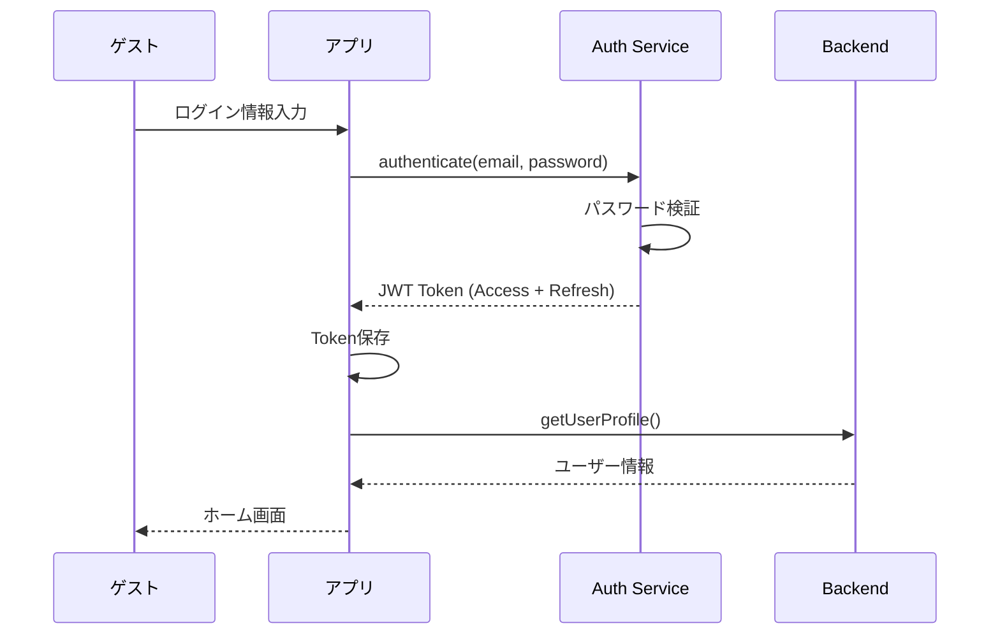
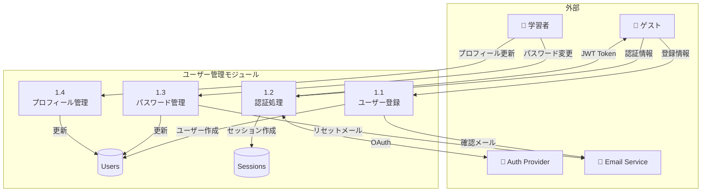

# ユーザー管理 - ユースケース詳細

## UC-011: ユーザー登録

### 基本情報

| 項目     | 内容                       |
| -------- | -------------------------- |
| UC ID    | UC-011                     |
| UC 名    | ユーザー登録               |
| アクター | ゲスト                     |
| 前提条件 | なし                       |
| 事後条件 | 新規アカウントが作成される |
| 関連 FR  | FR-011                     |
| 優先度   | Must                       |

### 基本フロー

1. ゲストが登録画面を開く
2. 以下を入力:
   - メールアドレス
   - パスワード
   - パスワード確認
3. 利用規約に同意
4. 「登録」ボタンをタップ
5. システムがメール確認リンクを送信
6. ユーザーがメールリンクをクリック
7. アカウントが有効化
8. レベル選択画面へ遷移

### 代替フロー

- A1: ソーシャルログイン
  1. 「Google で登録」または「Apple で登録」をタップ
  2. OAuth 認証フロー
  3. アカウント作成・レベル選択へ

### バリデーション

| フィールド     | ルール                 |
| -------------- | ---------------------- |
| メールアドレス | 有効なメール形式、一意 |
| パスワード     | 8 文字以上、英数字混合 |
| パスワード確認 | パスワードと一致       |

### ビジネスルール

| ルール ID | ルール内容                              |
| --------- | --------------------------------------- |
| BR-022    | メールアドレスはシステム内で一意        |
| BR-023    | パスワードは 8 文字以上、英数字混合必須 |
| BR-024    | メール確認リンクは 24 時間有効          |
| BR-025    | 新規登録時は Free プランに自動登録      |

---

## UC-012: ログイン/認証

### 基本情報

| 項目     | 内容                         |
| -------- | ---------------------------- |
| UC ID    | UC-012                       |
| UC 名    | ログイン/認証                |
| アクター | ゲスト                       |
| 前提条件 | アカウント登録済み           |
| 事後条件 | ユーザーがログイン状態になる |
| 関連 FR  | FR-012                       |
| 優先度   | Must                         |

### 基本フロー

1. ゲストがログイン画面を開く
2. メールアドレスとパスワードを入力
3. 「ログイン」ボタンをタップ
4. システムが認証を実行
5. JWT Token 発行
6. ホーム画面へ遷移

### 代替フロー

- A1: ソーシャルログイン
- A2: 生体認証（Face ID/Touch ID）
- A3: パスワード忘れ → パスワードリセットフロー

### シーケンス図

### ビジネスルール

| ルール ID | ルール内容                                      |
| --------- | ----------------------------------------------- |
| BR-026    | Access Token は 1 時間有効                      |
| BR-027    | Refresh Token は 30 日有効（リメンバーミー時）  |
| BR-028    | 5 回連続ログイン失敗でアカウントロック（30 分） |
| BR-029    | ロック解除はメール経由またはサポート連絡        |

---

## UC-013: パスワード変更

### 基本情報

| 項目     | 内容                   |
| -------- | ---------------------- |
| UC ID    | UC-013                 |
| UC 名    | パスワード変更         |
| アクター | 学習者                 |
| 前提条件 | ユーザーはログイン済み |
| 事後条件 | パスワードが変更される |
| 関連 FR  | FR-013                 |
| 優先度   | Must                   |

### 基本フロー（ログイン中）

1. 学習者が設定画面を開く
2. 「パスワード変更」をタップ
3. 現在のパスワードを入力
4. 新しいパスワードを入力
5. 新しいパスワード確認を入力
6. 「保存」をタップ
7. パスワード変更完了

### 代替フロー（パスワードリセット）

1. ゲストがログイン画面で「パスワードを忘れた」をタップ
2. メールアドレスを入力
3. システムがリセットリンクをメール送信
4. ユーザーがリンクをクリック
5. 新しいパスワードを設定
6. ログイン画面へ遷移

### ビジネスルール

| ルール ID | ルール内容                             |
| --------- | -------------------------------------- |
| BR-030    | パスワードリセットリンクは 24 時間有効 |
| BR-031    | リセットリンクは 1 回のみ使用可能      |
| BR-032    | 過去 5 回分のパスワードは再使用不可    |
| BR-033    | パスワード変更後、全セッションを無効化 |

---

## DFD レベル 2: ユーザー管理モジュール

### データフローダイアグラム

---

_関連ファイル: [\_index.md](./_index.md) | [subscription-01.md](./subscription-01.md)_
_メインファイル: [../03-functional-design.md](../03-functional-design.md)_
