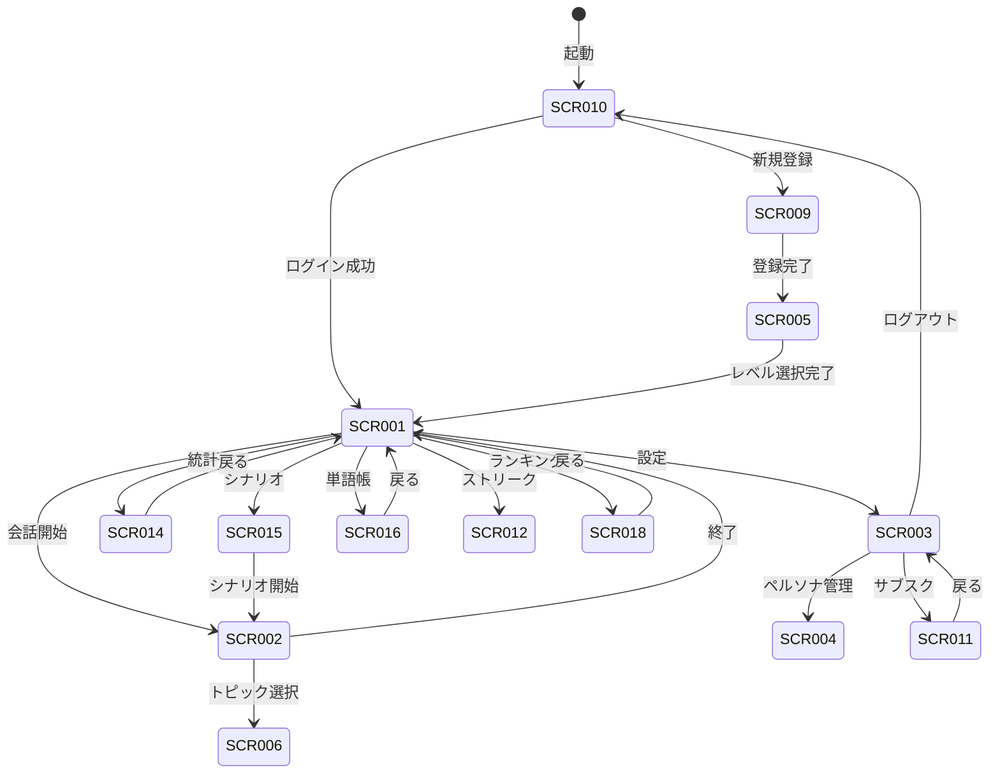

# 4. 画面設計

## 4.1. 概要

本章では、SpeakPal AI の画面設計を定義します。

### 統計情報

| 項目        | 内容 |
| ----------- | ---- |
| 総画面数    | 20   |
| Must 画面   | 12   |
| Should 画面 | 6    |
| Could 画面  | 2    |

---

## 4.2. ドキュメント構成

| ファイル名                                                  | 内容               | 画面数 |
| ----------------------------------------------------------- | ------------------ | ------ |
| [\_index.md](./04-screen-design/_index.md)                  | 共通コンポーネント | -      |
| [auth-01.md](./04-screen-design/auth-01.md)                 | 認証関連画面       | 2      |
| [home-01.md](./04-screen-design/home-01.md)                 | ホーム関連画面     | 2      |
| [conversation-01.md](./04-screen-design/conversation-01.md) | 会話関連画面       | 3      |
| [settings-01.md](./04-screen-design/settings-01.md)         | 設定関連画面       | 3      |
| [progress-01.md](./04-screen-design/progress-01.md)         | 進捗関連画面       | 4      |
| [learning-01.md](./04-screen-design/learning-01.md)         | 学習関連画面       | 3      |
| [social-01.md](./04-screen-design/social-01.md)             | ソーシャル関連画面 | 3      |

---

## 4.3. 画面遷移図



---

## 4.4. 画面一覧

| 画面 ID | 画面名                 | 関連 UC               | 優先度 | 詳細ファイル                                                |
| ------- | ---------------------- | --------------------- | ------ | ----------------------------------------------------------- |
| SCR-001 | ホーム画面             | UC-018, 021, 025      | Must   | [home-01.md](./04-screen-design/home-01.md)                 |
| SCR-002 | 会話画面               | UC-001〜006, 009, 010 | Must   | [conversation-01.md](./04-screen-design/conversation-01.md) |
| SCR-003 | 設定画面               | UC-007, 013           | Must   | [settings-01.md](./04-screen-design/settings-01.md)         |
| SCR-004 | ペルソナ管理画面       | UC-008                | Should | [settings-01.md](./04-screen-design/settings-01.md)         |
| SCR-005 | レベル選択画面         | UC-011                | Must   | [auth-01.md](./04-screen-design/auth-01.md)                 |
| SCR-006 | トピック選択画面       | UC-002                | Should | [conversation-01.md](./04-screen-design/conversation-01.md) |
| SCR-007 | 履歴画面               | UC-017                | Should | [progress-01.md](./04-screen-design/progress-01.md)         |
| SCR-008 | プロフィール画面       | UC-019, 020           | Should | [settings-01.md](./04-screen-design/settings-01.md)         |
| SCR-009 | 登録画面               | UC-011                | Must   | [auth-01.md](./04-screen-design/auth-01.md)                 |
| SCR-010 | ログイン画面           | UC-012                | Must   | [auth-01.md](./04-screen-design/auth-01.md)                 |
| SCR-011 | サブスクリプション画面 | UC-014, 016           | Must   | [settings-01.md](./04-screen-design/settings-01.md)         |
| SCR-012 | ストリーク画面         | UC-018                | Must   | [progress-01.md](./04-screen-design/progress-01.md)         |
| SCR-013 | バッジ一覧画面         | UC-019                | Should | [progress-01.md](./04-screen-design/progress-01.md)         |
| SCR-014 | 統計ダッシュボード画面 | UC-021, 022           | Must   | [progress-01.md](./04-screen-design/progress-01.md)         |
| SCR-015 | シナリオライブラリ画面 | UC-024, 031           | Must   | [learning-01.md](./04-screen-design/learning-01.md)         |
| SCR-016 | 単語帳画面             | UC-026                | Must   | [learning-01.md](./04-screen-design/learning-01.md)         |
| SCR-017 | 招待画面               | UC-027                | Should | [social-01.md](./04-screen-design/social-01.md)             |
| SCR-018 | ランキング画面         | UC-028                | Should | [social-01.md](./04-screen-design/social-01.md)             |
| SCR-019 | グループ画面           | UC-029                | Could  | [social-01.md](./04-screen-design/social-01.md)             |
| SCR-020 | 試験対策画面           | UC-032                | Could  | [learning-01.md](./04-screen-design/learning-01.md)         |

---

## 4.5. メイン会話画面レイアウト

```
┌─────────────────────────────────────────────────────────────────┐
│  【上部】ストリーミング字幕エリア                                │
│   "What do you like to do on weekends?" (ハイライト表示)        │
├─────────────────────────────────────────────────────────────────┤
│  【中央】ビジュアライザー（音声波形アニメーション）               │
│          ◉◉◉ AI発話中/聞き取り中 ◉◉◉                           │
├─────────────────────────────────────────────────────────────────┤
│  【オーバーレイ】訂正バブル                                      │
│   "I want go" → "I want to go" 🟡文法エラー                     │
├─────────────────────────────────────────────────────────────────┤
│  【下部】提案エリア                                              │
│   💡 "I usually [___] because [___]"                            │
│   📝 relax | exercise | hang out                                │
├─────────────────────────────────────────────────────────────────┤
│  🎤 マイクボタン                    ⏹ 終了ボタン                │
└─────────────────────────────────────────────────────────────────┘
```

---

## 4.6. レスポンシブ対応

| ブレークポイント | 対象デバイス       | 対応                   |
| ---------------- | ------------------ | ---------------------- |
| < 375px          | iPhone SE          | 最小レイアウト         |
| 375px - 428px    | iPhone Standard    | モバイルレイアウト     |
| 428px - 768px    | iPhone Plus/Tablet | 拡大モバイルレイアウト |
| 768px - 1024px   | iPad               | タブレットレイアウト   |
| > 1024px         | Desktop            | デスクトップレイアウト |

---

## 4.7. Coverage Summary

| Module     | Total Screens | Detailed | Coverage |
| ---------- | ------------- | -------- | -------- |
| 認証       | 3             | 3        | 100%     |
| ホーム     | 1             | 1        | 100%     |
| 会話       | 2             | 2        | 100%     |
| 設定       | 4             | 4        | 100%     |
| 進捗       | 4             | 4        | 100%     |
| 学習       | 3             | 3        | 100%     |
| ソーシャル | 3             | 3        | 100%     |
| **Total**  | **20**        | **20**   | **100%** |

---

← [目次](./_index.md) | _次のセクション: [05-data-design.md](./05-data-design.md)_
