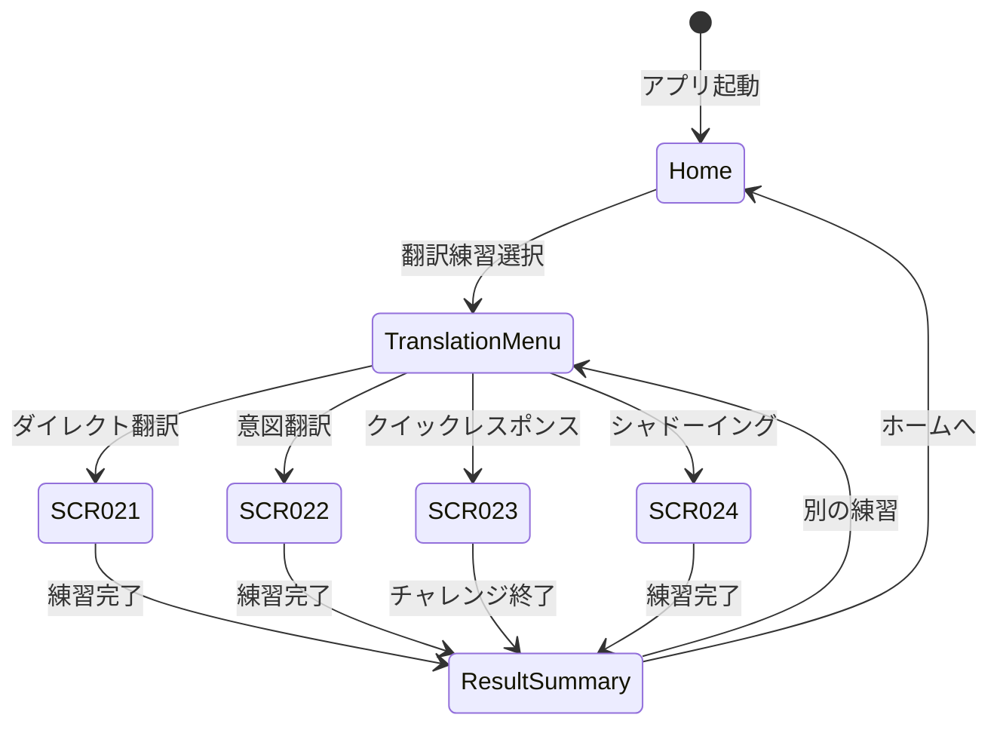

# 翻訳練習画面 - 画面設計詳細

> このファイルは翻訳練習機能に関する画面設計を定義します: SCR-021 〜 SCR-024

---

## SCR-021: ダイレクト翻訳練習画面

### 画面基本情報

| 項目       | 内容                   |
| ---------- | ---------------------- |
| 画面 ID    | SCR-021                |
| 画面名     | ダイレクト翻訳練習画面 |
| URL        | /translation/direct    |
| 認証       | 必須                   |
| 関連 UC    | UC-034                 |
| 画面タイプ | インタラクティブ       |

### ワイヤーフレーム

```
┌─────────────────────────────────────────────────────────────────┐
│  ← 戻る           ダイレクト翻訳練習           ⚙ 設定          │
├─────────────────────────────────────────────────────────────────┤
│  【トピック選択】                                                │
│   [日常会話▼] [ビジネス] [旅行] [ニュース]                       │
├─────────────────────────────────────────────────────────────────┤
│  📊 進捗: 5/10 問完了  |  🔥 連続正解: 3                        │
├─────────────────────────────────────────────────────────────────┤
│                                                                  │
│  【問題エリア】                                                  │
│  ┌────────────────────────────────────────────────────────────┐ │
│  │                                                            │ │
│  │   🇯🇵 「今日の天気はとても良いですね」                      │ │
│  │                                                            │ │
│  └────────────────────────────────────────────────────────────┘ │
│                                                                  │
│  【タイマー】  ⏱ 25秒                                           │
│                                                                  │
├─────────────────────────────────────────────────────────────────┤
│  【音声入力エリア】                                              │
│           ◉◉◉ 録音中... ◉◉◉                                    │
│           "The weather is very nice today..."                   │
├─────────────────────────────────────────────────────────────────┤
│  【結果エリア】(発話完了後)                                      │
│   スコア: 85/100 🌟🌟🌟🌟                                        │
│   文法: 90% | 語彙: 85% | 速度: 80%                             │
│                                                                  │
│   📝 あなたの翻訳: "The weather is very nice today"             │
│   ✓ 模範解答: "The weather is very nice today, isn't it?"       │
│   💡 ヒント: 付加疑問文を使うとより自然です                     │
├─────────────────────────────────────────────────────────────────┤
│                                                                  │
│        🎤 話す         ⏭ スキップ         🏠 終了              │
│                                                                  │
└─────────────────────────────────────────────────────────────────┘
```

### フィールド定義

| フィールド       | 型     | 必須 | バリデーション | 説明           |
| ---------------- | ------ | ---- | -------------- | -------------- |
| topic            | select | ○    | 1 つ選択必須   | トピック選択   |
| question_text    | text   | -    | -              | 母国語の問題文 |
| timer            | number | -    | 0-30 秒        | 残り時間       |
| user_translation | text   | -    | 1 語以上       | ユーザーの翻訳 |
| score            | number | -    | 0-100          | 総合スコア     |
| grammar_score    | number | -    | 0-100          | 文法スコア     |
| vocab_score      | number | -    | 0-100          | 語彙スコア     |
| speed_score      | number | -    | 0-100          | 速度スコア     |
| model_answer     | text   | -    | -              | 模範解答       |

### イベント定義

| イベント          | トリガー             | アクション               |
| ----------------- | -------------------- | ------------------------ |
| onTopicChange     | トピック選択変更     | 新しいトピックで問題取得 |
| onStartRecording  | 「話す」ボタンタップ | 録音開始、タイマー開始   |
| onStopRecording   | 録音停止             | 音声認識＆採点リクエスト |
| onTimeout         | タイマー 0 秒        | 録音停止、0 点表示       |
| onSkip            | 「スキップ」タップ   | 次の問題へ               |
| onFinish          | 「終了」タップ       | 結果サマリー画面へ遷移   |
| onPlayModelAnswer | 模範解答再生ボタン   | 模範解答を音声再生       |

---

## SCR-022: 高度意図翻訳練習画面

### 画面基本情報

| 項目       | 内容                      |
| ---------- | ------------------------- |
| 画面 ID    | SCR-022                   |
| 画面名     | 高度意図翻訳練習画面      |
| URL        | /translation/intent       |
| 認証       | 必須（Intermediate 以上） |
| 関連 UC    | UC-035                    |
| 画面タイプ | インタラクティブ          |

### ワイヤーフレーム

```
┌─────────────────────────────────────────────────────────────────┐
│  ← 戻る           高度意図翻訳練習           ⚙ 設定            │
├─────────────────────────────────────────────────────────────────┤
│  【カテゴリ選択】                                                │
│   [挨拶] [日常] [ビジネス▼] [感情表現]                          │
├─────────────────────────────────────────────────────────────────┤
│                                                                  │
│  【意図説明エリア】                                              │
│  ┌────────────────────────────────────────────────────────────┐ │
│  │  📋 シチュエーション:                                      │ │
│  │                                                            │ │
│  │  「会議で同僚の提案に反対したいのですが、               │ │
│  │   失礼にならないように丁寧に意見を述べてください」        │ │
│  │                                                            │ │
│  └────────────────────────────────────────────────────────────┘ │
│                                                                  │
├─────────────────────────────────────────────────────────────────┤
│  【音声入力エリア】                                              │
│           ◉◉◉ 録音中... ◉◉◉                                    │
│  "I appreciate your idea, but I have a different perspective..."│
├─────────────────────────────────────────────────────────────────┤
│  【評価結果】(発話完了後)                                        │
│   総合評価: 88/100 ⭐⭐⭐⭐                                       │
│   意図一致: 90% | 自然さ: 85% | 語彙: 88%                       │
│                                                                  │
│   ✅ 良い点: 丁寧な反対表現を使用                               │
│   💡 改善点: "However" を使うとより論理的                       │
├─────────────────────────────────────────────────────────────────┤
│  【代替表現】                                                    │
│   1. "I see your point, however..."    🔊                       │
│   2. "That's an interesting idea, but..." 🔊                    │
│   3. "I respectfully disagree because..." 🔊                    │
├─────────────────────────────────────────────────────────────────┤
│        🎤 話す         ⏭ 次へ             🏠 終了              │
└─────────────────────────────────────────────────────────────────┘
```

### フィールド定義

| フィールド         | 型     | 必須 | バリデーション | 説明                   |
| ------------------ | ------ | ---- | -------------- | ---------------------- |
| category           | select | ○    | 1 つ選択必須   | カテゴリ選択           |
| intent_description | text   | -    | -              | 意図・シチュエーション |
| user_expression    | text   | -    | 3 語以上       | ユーザーの表現         |
| intent_score       | number | -    | 0-100          | 意図一致スコア         |
| naturalness_score  | number | -    | 0-100          | 自然さスコア           |
| vocab_score        | number | -    | 0-100          | 語彙スコア             |
| alternatives       | array  | -    | -              | 代替表現リスト         |

---

## SCR-023: ワード連想＆瞬間応答画面

### 画面基本情報

| 項目       | 内容                     |
| ---------- | ------------------------ |
| 画面 ID    | SCR-023                  |
| 画面名     | ワード連想・瞬間応答画面 |
| URL        | /practice/quick-response |
| 認証       | 必須                     |
| 関連 UC    | UC-036, UC-037           |
| 画面タイプ | ゲーミフィケーション     |

### ワイヤーフレーム

```
┌─────────────────────────────────────────────────────────────────┐
│  ← 戻る          クイックレスポンス           ⚙ 設定           │
├─────────────────────────────────────────────────────────────────┤
│  【モード選択】                                                  │
│   [ワード連想🎯] [瞬間応答⚡]                                    │
├─────────────────────────────────────────────────────────────────┤
│  ┌────────────────────────────────────────────────────────────┐ │
│  │  ⏱ 残り時間: 45秒   |   🏆 スコア: 1,250   |   🔥 x5     │ │
│  └────────────────────────────────────────────────────────────┘ │
├─────────────────────────────────────────────────────────────────┤
│                                                                  │
│  【キーワード/質問エリア】                                       │
│  ┌────────────────────────────────────────────────────────────┐ │
│  │                                                            │ │
│  │              🎯 "WEATHER"                                  │ │
│  │                    (関連語を言ってください)                │ │
│  │                                                            │ │
│  │         ⏱ 5秒 ████████░░░                                 │ │
│  └────────────────────────────────────────────────────────────┘ │
│                                                                  │
├─────────────────────────────────────────────────────────────────┤
│  【回答履歴】                                                    │
│   ✓ TRAVEL → "passport" (+100)                                  │
│   ✓ FOOD → "delicious" (+100)                                   │
│   ✗ MUSIC → (timeout)                                           │
│   ✓ WEATHER → "sunny" (+150) 🔥CHAIN!                           │
├─────────────────────────────────────────────────────────────────┤
│                                                                  │
│              🎤 録音中...  "sunny"                              │
│                                                                  │
├─────────────────────────────────────────────────────────────────┤
│       [一時停止]          [終了]                                │
└─────────────────────────────────────────────────────────────────┘
```

### フィールド定義

| フィールド     | 型     | 必須 | バリデーション | 説明               |
| -------------- | ------ | ---- | -------------- | ------------------ |
| mode           | select | ○    | 1 つ選択必須   | モード選択         |
| remaining_time | number | -    | 0-60 秒        | 全体残り時間       |
| question_timer | number | -    | 0-10 秒        | 1 問あたり残り時間 |
| current_score  | number | -    | 0 以上         | 現在スコア         |
| chain_count    | number | -    | 0 以上         | 連続正解数         |
| keyword        | text   | -    | -              | 現在のキーワード   |
| user_response  | text   | -    | 1 語以上       | ユーザー回答       |
| history        | array  | -    | -              | 回答履歴           |

---

## SCR-024: シャドーイング練習画面

### 画面基本情報

| 項目       | 内容                   |
| ---------- | ---------------------- |
| 画面 ID    | SCR-024                |
| 画面名     | シャドーイング練習画面 |
| URL        | /practice/shadowing    |
| 認証       | 必須                   |
| 関連 UC    | UC-038                 |
| 画面タイプ | インタラクティブ       |

### ワイヤーフレーム

```
┌─────────────────────────────────────────────────────────────────┐
│  ← 戻る           シャドーイング練習           ⚙ 設定          │
├─────────────────────────────────────────────────────────────────┤
│  【コンテンツ選択】                                              │
│   [会話] [ニュース▼] [スピーチ] [ポッドキャスト]                 │
├─────────────────────────────────────────────────────────────────┤
│  【速度設定】                                                    │
│   [0.75x] [1.0x▼] [1.25x]    □ 字幕表示                         │
├─────────────────────────────────────────────────────────────────┤
│                                                                  │
│  【再生エリア】                                                  │
│  ┌────────────────────────────────────────────────────────────┐ │
│  │  ▶ ━━━━━━━━━━━━●━━━━━━━━━━━━━  01:23 / 02:30              │ │
│  │                                                            │ │
│  │  📝 字幕: "Climate change is one of the most pressing      │ │
│  │          issues facing our planet today..."                │ │
│  │                                                            │ │
│  │  🎤 あなた: "Climate change is one of the most..."        │ │
│  └────────────────────────────────────────────────────────────┘ │
│                                                                  │
├─────────────────────────────────────────────────────────────────┤
│  【リアルタイム分析】                                            │
│   追従: ████████░░ 80%                                          │
│   発音: █████████░ 90%                                          │
│   リズム: ███████░░ 75%                                         │
├─────────────────────────────────────────────────────────────────┤
│  【結果】（練習完了後）                                          │
│   総合スコア: 82/100 ⭐⭐⭐⭐                                     │
│                                                                  │
│   ✅ 良い点: 発音がクリア                                       │
│   💡 改善点: イントネーションをもう少し意識                     │
│                                                                  │
│   [🔄 もう一度] [📍 苦手部分を練習] [▶ 次のコンテンツ]          │
├─────────────────────────────────────────────────────────────────┤
│       ⏸ 一時停止       🎤 録音開始/停止       🏠 終了          │
└─────────────────────────────────────────────────────────────────┘
```

### フィールド定義

| フィールド          | 型      | 必須 | バリデーション | 説明             |
| ------------------- | ------- | ---- | -------------- | ---------------- |
| content_type        | select  | ○    | 1 つ選択必須   | コンテンツタイプ |
| playback_speed      | select  | ○    | 0.75/1.0/1.25  | 再生速度         |
| show_subtitle       | boolean | -    | -              | 字幕表示フラグ   |
| current_position    | number  | -    | 0 以上         | 再生位置（秒）   |
| total_duration      | number  | -    | 30-180 秒      | 総時間           |
| subtitle_text       | text    | -    | -              | 現在の字幕       |
| user_speech         | text    | -    | -              | ユーザー発話     |
| following_score     | number  | -    | 0-100          | 追従スコア       |
| pronunciation_score | number  | -    | 0-100          | 発音スコア       |
| rhythm_score        | number  | -    | 0-100          | リズムスコア     |

---

## 画面遷移



---

## Coverage Summary

| 画面 ID | 画面名             | 関連 UC        | 優先度 |
| ------- | ------------------ | -------------- | ------ |
| SCR-021 | ダイレクト翻訳練習 | UC-034         | Must   |
| SCR-022 | 高度意図翻訳練習   | UC-035         | Must   |
| SCR-023 | クイックレスポンス | UC-036, UC-037 | Should |
| SCR-024 | シャドーイング練習 | UC-038         | Should |

---

_関連ファイル: [\_index.md](./_index.md) | [learning-01.md](./learning-01.md)_
_メインファイル: [../04-screen-design.md](../04-screen-design.md)_
