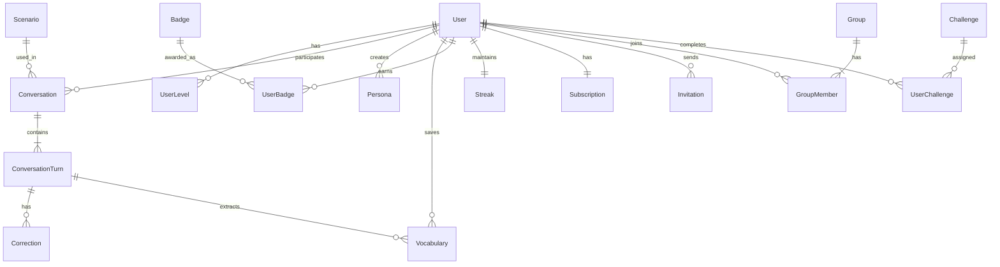

# 5. データ設計

## 5.1. 概要

本章では、SpeakPal AI のデータ設計を定義します。

### 統計情報

| 項目         | 内容                                                                 |
| ------------ | -------------------------------------------------------------------- |
| モジュール数 | 6 (User, Conversation, Learning, Gamification, Social, Subscription) |
| 総テーブル数 | 18                                                                   |

---

## 5.2. ドキュメント構成

| ファイル名                                                | 内容                 | テーブル数 |
| --------------------------------------------------------- | -------------------- | ---------- |
| [\_index.md](./05-data-design/_index.md)                  | ERD・共通カラム      | -          |
| [user-01.md](./05-data-design/user-01.md)                 | ユーザー関連         | 3          |
| [conversation-01.md](./05-data-design/conversation-01.md) | 会話関連             | 4          |
| [learning-01.md](./05-data-design/learning-01.md)         | 学習関連             | 4          |
| [gamification-01.md](./05-data-design/gamification-01.md) | ゲーミフィケーション | 4          |
| [social-01.md](./05-data-design/social-01.md)             | ソーシャル           | 3          |

---

## 5.3. ER 図（概要）

---

## 5.4. テーブル一覧

| No  | テーブル名         | 論理名             | モジュール   | 関連 FR          |
| --- | ------------------ | ------------------ | ------------ | ---------------- |
| 1   | users              | ユーザー           | User         | FR-011, 012, 013 |
| 2   | user_levels        | ユーザーレベル履歴 | User         | FR-020           |
| 3   | personas           | ペルソナ           | User         | FR-008           |
| 4   | conversations      | 会話セッション     | Conversation | FR-001〜003      |
| 5   | conversation_turns | 会話ターン         | Conversation | FR-002, 003      |
| 6   | corrections        | 訂正履歴           | Conversation | FR-006           |
| 7   | suggestions        | 提案履歴           | Conversation | FR-004           |
| 8   | vocabularies       | 語彙/単語帳        | Learning     | FR-017, 026      |
| 9   | scenarios          | シナリオ           | Learning     | FR-024, 031      |
| 10  | challenges         | チャレンジ定義     | Learning     | FR-025           |
| 11  | user_challenges    | ユーザーチャレンジ | Learning     | FR-025           |
| 12  | streaks            | ストリーク         | Gamification | FR-018           |
| 13  | badges             | バッジ定義         | Gamification | FR-019           |
| 14  | user_badges        | ユーザーバッジ     | Gamification | FR-019           |
| 15  | subscriptions      | サブスクリプション | Subscription | FR-014〜016      |
| 16  | invitations        | 招待               | Social       | FR-027           |
| 17  | groups             | グループ           | Social       | FR-029           |
| 18  | group_members      | グループメンバー   | Social       | FR-029           |

---

## 5.5. Coverage Summary

| Module       | Total Tables | Detailed | Coverage |
| ------------ | ------------ | -------- | -------- |
| User         | 3            | 3        | 100%     |
| Conversation | 4            | 4        | 100%     |
| Learning     | 4            | 4        | 100%     |
| Gamification | 4            | 4        | 100%     |
| Social       | 3            | 3        | 100%     |
| **Total**    | **18**       | **18**   | **100%** |

---

← [目次](./_index.md) | _次のセクション: [06-api-design.md](./06-api-design.md)_
