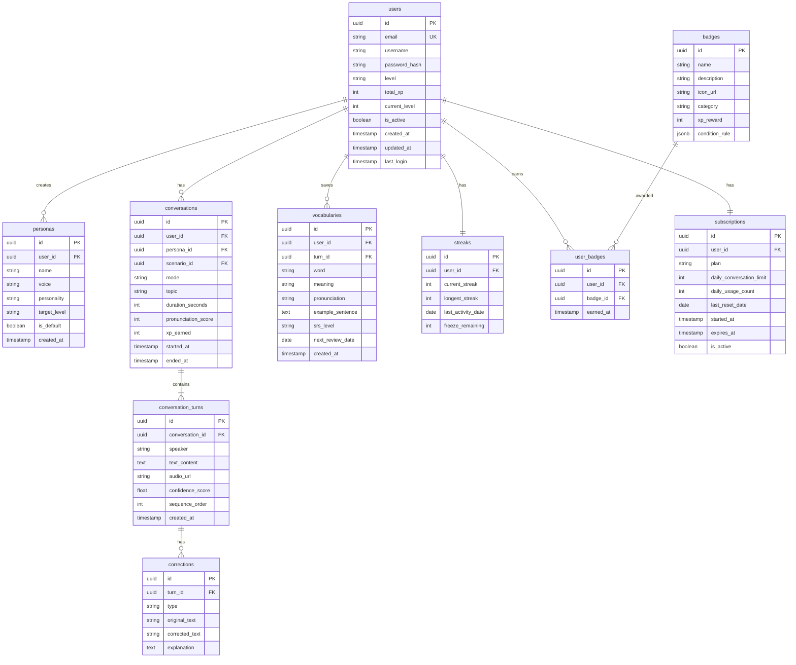

# データ設計 - 共通仕様

## 1. 概要

このフォルダには、SpeakPal AI のデータベース設計詳細が含まれています。

---

## 2. ER 図（詳細）

---

## 3. 共通カラム

すべてのテーブルに以下の共通カラムを含めます：

| カラム名   | データ型  | 説明             |
| ---------- | --------- | ---------------- |
| id         | UUID      | プライマリキー   |
| created_at | TIMESTAMP | 作成日時         |
| updated_at | TIMESTAMP | 更新日時（一部） |

---

## 4. 命名規則

| 対象           | 規則                    | 例                   |
| -------------- | ----------------------- | -------------------- |
| テーブル名     | スネークケース複数形    | users, conversations |
| カラム名       | スネークケース          | user_id, created_at  |
| プライマリキー | id                      | id                   |
| 外部キー       | {テーブル}\_id          | user_id, persona_id  |
| インデックス   | idx*{テーブル}*{カラム} | idx_users_email      |

---

## 5. データ型マッピング

| 論理型 | PostgreSQL        | 説明                 |
| ------ | ----------------- | -------------------- |
| ID     | UUID              | 一意識別子           |
| 文字列 | VARCHAR(n)        | 可変長文字列         |
| 長文   | TEXT              | 長いテキスト         |
| 整数   | INTEGER           | 32 ビット整数        |
| 小数   | NUMERIC(p,s)      | 精密小数             |
| 真偽値 | BOOLEAN           | true/false           |
| 日時   | TIMESTAMP WITH TZ | タイムゾーン付き日時 |
| 日付   | DATE              | 日付のみ             |
| JSON   | JSONB             | バイナリ JSON        |
| 列挙型 | VARCHAR(50)       | 文字列で管理         |

---

_メインファイル: [../05-data-design.md](../05-data-design.md)_
