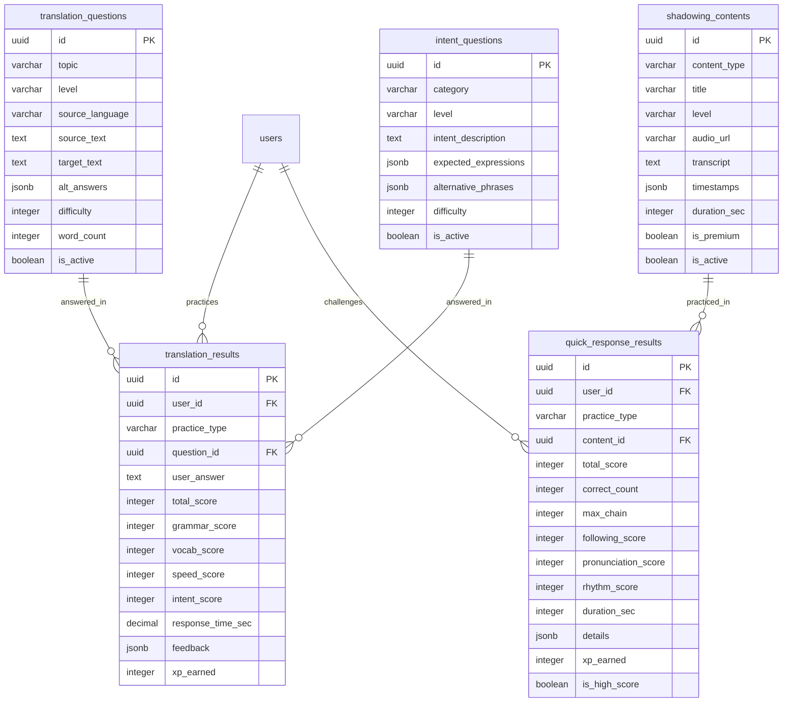

# 翻訳練習 - データ設計詳細

> このファイルは翻訳練習機能に関するデータ設計を定義します

---

## テーブル一覧

| No  | テーブル名             | 論理名                   | 説明                         |
| --- | ---------------------- | ------------------------ | ---------------------------- |
| 1   | translation_questions  | 翻訳問題                 | ダイレクト翻訳用の問題マスタ |
| 2   | translation_results    | 翻訳練習結果             | 翻訳練習の結果履歴           |
| 3   | intent_questions       | 意図問題                 | 意図翻訳用の問題マスタ       |
| 4   | shadowing_contents     | シャドーイングコンテンツ | シャドーイング用教材         |
| 5   | quick_response_results | クイック応答結果         | ワード連想・瞬間応答の結果   |

---

## TBL-019: translation_questions（翻訳問題）

### テーブル基本情報

| 項目       | 内容                             |
| ---------- | -------------------------------- |
| テーブル名 | translation_questions            |
| 論理名     | 翻訳問題                         |
| 種別       | マスタ                           |
| 関連 FR    | FR-034                           |
| 説明       | ダイレクト翻訳練習用の問題データ |

### カラム定義

| No  | カラム名        | 論理名       | 型          | PK  | FK  | NN  | デフォルト | 説明                       |
| --- | --------------- | ------------ | ----------- | --- | --- | --- | ---------- | -------------------------- |
| 1   | id              | ID           | UUID        | ○   | -   | ○   | gen_uuid() | 主キー                     |
| 2   | topic           | トピック     | VARCHAR(50) | -   | -   | ○   | -          | 日常会話/ビジネス/旅行等   |
| 3   | level           | レベル       | VARCHAR(20) | -   | -   | ○   | -          | Beginner/Intermediate/etc. |
| 4   | source_language | 元言語       | VARCHAR(10) | -   | -   | ○   | 'ja'       | ja/vi/ko 等                |
| 5   | source_text     | 元の文       | TEXT        | -   | -   | ○   | -          | 母国語の問題文             |
| 6   | target_text     | 模範訳       | TEXT        | -   | -   | ○   | -          | 英語の模範解答             |
| 7   | alt_answers     | 代替解答     | JSONB       | -   | -   | -   | '[]'       | 許容される代替解答リスト   |
| 8   | difficulty      | 難易度       | INTEGER     | -   | -   | ○   | 1          | 1-5 の難易度               |
| 9   | word_count      | 単語数       | INTEGER     | -   | -   | ○   | -          | 模範訳の単語数             |
| 10  | grammar_points  | 文法ポイント | JSONB       | -   | -   | -   | '[]'       | 含まれる文法項目           |
| 11  | is_active       | 有効フラグ   | BOOLEAN     | -   | -   | ○   | true       | 有効/無効                  |
| 12  | created_at      | 作成日時     | TIMESTAMP   | -   | -   | ○   | now()      | レコード作成日時           |
| 13  | updated_at      | 更新日時     | TIMESTAMP   | -   | -   | ○   | now()      | レコード更新日時           |

### インデックス

| インデックス名               | カラム            | 種別  | 説明                    |
| ---------------------------- | ----------------- | ----- | ----------------------- |
| idx_trans_q_topic_level      | topic, level      | INDEX | トピック × レベル検索用 |
| idx_trans_q_level_difficulty | level, difficulty | INDEX | レベル × 難易度検索用   |
| idx_trans_q_source_lang      | source_language   | INDEX | 言語別検索用            |

---

## TBL-020: translation_results（翻訳練習結果）

### テーブル基本情報

| 項目       | 内容                |
| ---------- | ------------------- |
| テーブル名 | translation_results |
| 論理名     | 翻訳練習結果        |
| 種別       | トランザクション    |
| 関連 FR    | FR-034, FR-035      |
| 説明       | 翻訳練習の結果履歴  |

### カラム定義

| No  | カラム名          | 論理名         | 型           | PK  | FK  | NN  | デフォルト | 説明                     |
| --- | ----------------- | -------------- | ------------ | --- | --- | --- | ---------- | ------------------------ |
| 1   | id                | ID             | UUID         | ○   | -   | ○   | gen_uuid() | 主キー                   |
| 2   | user_id           | ユーザー ID    | UUID         | -   | ○   | ○   | -          | users.id への FK         |
| 3   | practice_type     | 練習タイプ     | VARCHAR(20)  | -   | -   | ○   | -          | direct/intent            |
| 4   | question_id       | 問題 ID        | UUID         | -   | ○   | -   | -          | translation_questions.id |
| 5   | user_answer       | ユーザー回答   | TEXT         | -   | -   | ○   | -          | ユーザーの翻訳           |
| 6   | total_score       | 総合スコア     | INTEGER      | -   | -   | ○   | -          | 0-100                    |
| 7   | grammar_score     | 文法スコア     | INTEGER      | -   | -   | ○   | -          | 0-100                    |
| 8   | vocab_score       | 語彙スコア     | INTEGER      | -   | -   | ○   | -          | 0-100                    |
| 9   | speed_score       | 速度スコア     | INTEGER      | -   | -   | -   | -          | 0-100（direct のみ）     |
| 10  | intent_score      | 意図一致スコア | INTEGER      | -   | -   | -   | -          | 0-100（intent のみ）     |
| 11  | response_time_sec | 応答時間       | DECIMAL(5,2) | -   | -   | ○   | -          | 応答にかかった秒数       |
| 12  | feedback          | フィードバック | JSONB        | -   | -   | -   | -          | AI からのフィードバック  |
| 13  | xp_earned         | 獲得 XP        | INTEGER      | -   | -   | ○   | 0          | この練習で獲得した XP    |
| 14  | created_at        | 作成日時       | TIMESTAMP    | -   | -   | ○   | now()      | レコード作成日時         |

### インデックス

| インデックス名             | カラム              | 種別  | 説明                     |
| -------------------------- | ------------------- | ----- | ------------------------ |
| idx_trans_result_user      | user_id             | INDEX | ユーザー別検索用         |
| idx_trans_result_user_date | user_id, created_at | INDEX | ユーザー × 日付検索用    |
| idx_trans_result_question  | question_id         | INDEX | 問題別検索用（重複回避） |

---

## TBL-021: intent_questions（意図問題）

### テーブル基本情報

| 項目       | 内容                                   |
| ---------- | -------------------------------------- |
| テーブル名 | intent_questions                       |
| 論理名     | 意図問題                               |
| 種別       | マスタ                                 |
| 関連 FR    | FR-035                                 |
| 説明       | 高度意図翻訳用の意図・シチュエーション |

### カラム定義

| No  | カラム名             | 論理名         | 型          | PK  | FK  | NN  | デフォルト | 説明                       |
| --- | -------------------- | -------------- | ----------- | --- | --- | --- | ---------- | -------------------------- |
| 1   | id                   | ID             | UUID        | ○   | -   | ○   | gen_uuid() | 主キー                     |
| 2   | category             | カテゴリ       | VARCHAR(50) | -   | -   | ○   | -          | 挨拶/日常/ビジネス等       |
| 3   | level                | レベル         | VARCHAR(20) | -   | -   | ○   | -          | Intermediate 以上          |
| 4   | intent_description   | 意図説明       | TEXT        | -   | -   | ○   | -          | シチュエーションの説明     |
| 5   | expected_expressions | 期待される表現 | JSONB       | -   | -   | ○   | -          | 正解とみなせる表現パターン |
| 6   | alternative_phrases  | 代替フレーズ   | JSONB       | -   | -   | ○   | -          | 表示用の代替表現リスト     |
| 7   | difficulty           | 難易度         | INTEGER     | -   | -   | ○   | 1          | 1-5 の難易度               |
| 8   | is_active            | 有効フラグ     | BOOLEAN     | -   | -   | ○   | true       | 有効/無効                  |
| 9   | created_at           | 作成日時       | TIMESTAMP   | -   | -   | ○   | now()      | レコード作成日時           |
| 10  | updated_at           | 更新日時       | TIMESTAMP   | -   | -   | ○   | now()      | レコード更新日時           |

### インデックス

| インデックス名              | カラム          | 種別  | 説明                    |
| --------------------------- | --------------- | ----- | ----------------------- |
| idx_intent_q_category_level | category, level | INDEX | カテゴリ × レベル検索用 |
| idx_intent_q_difficulty     | difficulty      | INDEX | 難易度別検索用          |

---

## TBL-022: shadowing_contents（シャドーイングコンテンツ）

### テーブル基本情報

| 項目       | 内容                       |
| ---------- | -------------------------- |
| テーブル名 | shadowing_contents         |
| 論理名     | シャドーイングコンテンツ   |
| 種別       | マスタ                     |
| 関連 FR    | FR-038                     |
| 説明       | シャドーイング練習用の教材 |

### カラム定義

| No  | カラム名     | 論理名           | 型           | PK  | FK  | NN  | デフォルト | 説明                     |
| --- | ------------ | ---------------- | ------------ | --- | --- | --- | ---------- | ------------------------ |
| 1   | id           | ID               | UUID         | ○   | -   | ○   | gen_uuid() | 主キー                   |
| 2   | content_type | コンテンツ種別   | VARCHAR(30)  | -   | -   | ○   | -          | 会話/ニュース/スピーチ等 |
| 3   | title        | タイトル         | VARCHAR(200) | -   | -   | ○   | -          | コンテンツタイトル       |
| 4   | description  | 説明             | TEXT         | -   | -   | -   | -          | コンテンツの説明         |
| 5   | level        | レベル           | VARCHAR(20)  | -   | -   | ○   | -          | 対象レベル               |
| 6   | audio_url    | 音声 URL         | VARCHAR(500) | -   | -   | ○   | -          | 音声ファイルの URL       |
| 7   | transcript   | トランスクリプト | TEXT         | -   | -   | ○   | -          | 全文テキスト             |
| 8   | timestamps   | タイムスタンプ   | JSONB        | -   | -   | -   | -          | 文ごとの開始時間         |
| 9   | duration_sec | 再生時間         | INTEGER      | -   | -   | ○   | -          | 秒単位の再生時間         |
| 10  | is_premium   | プレミアム       | BOOLEAN      | -   | -   | ○   | false      | 有料ユーザー限定         |
| 11  | is_active    | 有効フラグ       | BOOLEAN      | -   | -   | ○   | true       | 有効/無効                |
| 12  | created_at   | 作成日時         | TIMESTAMP    | -   | -   | ○   | now()      | レコード作成日時         |
| 13  | updated_at   | 更新日時         | TIMESTAMP    | -   | -   | ○   | now()      | レコード更新日時         |

### インデックス

| インデックス名                | カラム              | 種別  | 説明                |
| ----------------------------- | ------------------- | ----- | ------------------- |
| idx_shadow_content_type_level | content_type, level | INDEX | 種別 × レベル検索用 |
| idx_shadow_premium            | is_premium          | INDEX | プレミアム検索用    |

---

## TBL-023: quick_response_results（クイック応答結果）

### テーブル基本情報

| 項目       | 内容                                       |
| ---------- | ------------------------------------------ |
| テーブル名 | quick_response_results                     |
| 論理名     | クイック応答結果                           |
| 種別       | トランザクション                           |
| 関連 FR    | FR-036, FR-037, FR-038                     |
| 説明       | ワード連想・瞬間応答・シャドーイングの結果 |

### カラム定義

| No  | カラム名            | 論理名        | 型          | PK  | FK  | NN  | デフォルト | 説明                         |
| --- | ------------------- | ------------- | ----------- | --- | --- | --- | ---------- | ---------------------------- |
| 1   | id                  | ID            | UUID        | ○   | -   | ○   | gen_uuid() | 主キー                       |
| 2   | user_id             | ユーザー ID   | UUID        | -   | ○   | ○   | -          | users.id への FK             |
| 3   | practice_type       | 練習タイプ    | VARCHAR(30) | -   | -   | ○   | -          | word_assoc/instant/shadowing |
| 4   | content_id          | コンテンツ ID | UUID        | -   | ○   | -   | -          | shadowing_contents.id        |
| 5   | total_score         | 総合スコア    | INTEGER     | -   | -   | ○   | -          | 0-100 または累積ポイント     |
| 6   | correct_count       | 正解数        | INTEGER     | -   | -   | -   | -          | ワード連想・瞬間応答用       |
| 7   | max_chain           | 最大チェーン  | INTEGER     | -   | -   | -   | -          | 最大連続正解数               |
| 8   | following_score     | 追従スコア    | INTEGER     | -   | -   | -   | -          | シャドーイング用（0-100）    |
| 9   | pronunciation_score | 発音スコア    | INTEGER     | -   | -   | -   | -          | シャドーイング用（0-100）    |
| 10  | rhythm_score        | リズムスコア  | INTEGER     | -   | -   | -   | -          | シャドーイング用（0-100）    |
| 11  | duration_sec        | 所要時間      | INTEGER     | -   | -   | ○   | -          | 練習にかかった秒数           |
| 12  | details             | 詳細          | JSONB       | -   | -   | -   | -          | 各問題/文ごとの詳細結果      |
| 13  | xp_earned           | 獲得 XP       | INTEGER     | -   | -   | ○   | 0          | この練習で獲得した XP        |
| 14  | is_high_score       | ハイスコア    | BOOLEAN     | -   | -   | ○   | false      | ハイスコア更新フラグ         |
| 15  | created_at          | 作成日時      | TIMESTAMP   | -   | -   | ○   | now()      | レコード作成日時             |

### インデックス

| インデックス名             | カラム                     | 種別  | 説明                        |
| -------------------------- | -------------------------- | ----- | --------------------------- |
| idx_quick_result_user      | user_id                    | INDEX | ユーザー別検索用            |
| idx_quick_result_user_type | user_id, practice_type     | INDEX | ユーザー × 練習タイプ検索用 |
| idx_quick_result_user_date | user_id, created_at        | INDEX | ユーザー × 日付検索用       |
| idx_quick_result_highscore | practice_type, total_score | INDEX | ランキング用                |

---

## ER 図（翻訳練習モジュール）

---

## Coverage Summary

| テーブル               | 関連 FR        | 種別             |
| ---------------------- | -------------- | ---------------- |
| translation_questions  | FR-034         | マスタ           |
| translation_results    | FR-034, FR-035 | トランザクション |
| intent_questions       | FR-035         | マスタ           |
| shadowing_contents     | FR-038         | マスタ           |
| quick_response_results | FR-036〜038    | トランザクション |

---

_関連ファイル: [\_index.md](./_index.md) | [learning-01.md](./learning-01.md)_
_メインファイル: [../05-data-design.md](../05-data-design.md)_
