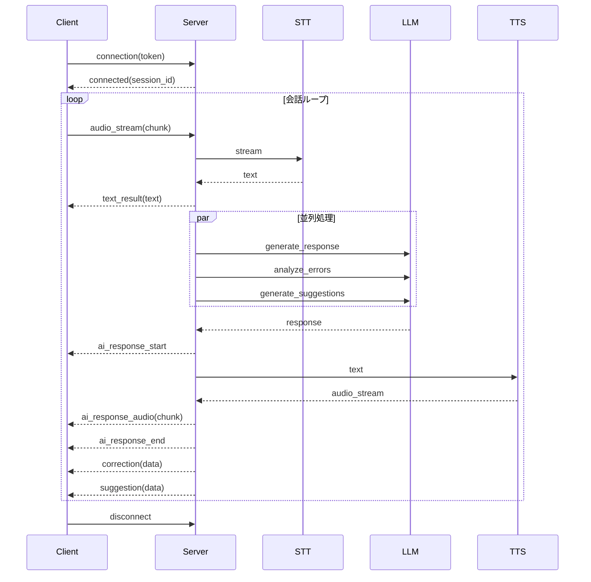

# 6. API 設計

## 6.1. 概要

本章では、SpeakPal AI の API 設計を定義します。

### 統計情報

| 項目          | 内容 |
| ------------- | ---- |
| API 総数      | 52   |
| REST API      | 42   |
| WebSocket API | 10   |

---

## 6.2. API 一覧

### 6.2.1. 認証 API

| HTTP | パス                          | 説明                   | 認証 |
| ---- | ----------------------------- | ---------------------- | ---- |
| POST | /api/v1/auth/register         | ユーザー登録           | ✗    |
| POST | /api/v1/auth/login            | ログイン               | ✗    |
| POST | /api/v1/auth/logout           | ログアウト             | ✓    |
| POST | /api/v1/auth/refresh          | トークン更新           | ✓    |
| POST | /api/v1/auth/forgot-password  | パスワードリセット要求 | ✗    |
| POST | /api/v1/auth/reset-password   | パスワードリセット     | ✗    |
| POST | /api/v1/auth/oauth/{provider} | OAuth 認証             | ✗    |

### 6.2.2. ユーザー API

| HTTP | パス                      | 説明             | 認証 |
| ---- | ------------------------- | ---------------- | ---- |
| GET  | /api/v1/users/me          | 自分の情報取得   | ✓    |
| PUT  | /api/v1/users/me          | プロフィール更新 | ✓    |
| PUT  | /api/v1/users/me/level    | レベル変更       | ✓    |
| PUT  | /api/v1/users/me/password | パスワード変更   | ✓    |
| GET  | /api/v1/users/me/stats    | 統計情報取得     | ✓    |

### 6.2.3. ペルソナ API

| HTTP   | パス                          | 説明             | 認証 |
| ------ | ----------------------------- | ---------------- | ---- |
| GET    | /api/v1/personas              | ペルソナ一覧取得 | ✓    |
| POST   | /api/v1/personas              | ペルソナ作成     | ✓    |
| GET    | /api/v1/personas/{id}         | ペルソナ詳細取得 | ✓    |
| PUT    | /api/v1/personas/{id}         | ペルソナ更新     | ✓    |
| DELETE | /api/v1/personas/{id}         | ペルソナ削除     | ✓    |
| PUT    | /api/v1/personas/{id}/default | デフォルト設定   | ✓    |

### 6.2.4. 会話 API

| HTTP | パス                             | 説明               | 認証 |
| ---- | -------------------------------- | ------------------ | ---- |
| GET  | /api/v1/conversations            | 会話履歴一覧取得   | ✓    |
| POST | /api/v1/conversations            | 会話セッション開始 | ✓    |
| GET  | /api/v1/conversations/{id}       | 会話詳細取得       | ✓    |
| PUT  | /api/v1/conversations/{id}/end   | 会話終了           | ✓    |
| GET  | /api/v1/conversations/{id}/turns | ターン一覧取得     | ✓    |

### 6.2.5. 学習 API

| HTTP | パス                             | 説明             | 認証 |
| ---- | -------------------------------- | ---------------- | ---- |
| GET  | /api/v1/vocabularies             | 単語帳取得       | ✓    |
| POST | /api/v1/vocabularies             | 語彙追加         | ✓    |
| PUT  | /api/v1/vocabularies/{id}/review | 復習結果更新     | ✓    |
| GET  | /api/v1/scenarios                | シナリオ一覧取得 | ✓    |
| GET  | /api/v1/scenarios/{id}           | シナリオ詳細取得 | ✓    |
| GET  | /api/v1/challenges/today         | 本日のチャレンジ | ✓    |
| PUT  | /api/v1/challenges/{id}/complete | チャレンジ完了   | ✓    |

### 6.2.6. ゲーミフィケーション API

| HTTP | パス                    | 説明           | 認証 |
| ---- | ----------------------- | -------------- | ---- |
| GET  | /api/v1/streaks         | ストリーク取得 | ✓    |
| POST | /api/v1/streaks/freeze  | フリーズ使用   | ✓    |
| GET  | /api/v1/badges          | バッジ一覧取得 | ✓    |
| GET  | /api/v1/badges/user     | 獲得バッジ一覧 | ✓    |
| GET  | /api/v1/rankings/weekly | 週間ランキング | ✓    |

### 6.2.7. サブスクリプション API

| HTTP | パス                         | 説明             | 認証 |
| ---- | ---------------------------- | ---------------- | ---- |
| GET  | /api/v1/subscriptions        | サブスク情報取得 | ✓    |
| POST | /api/v1/subscriptions/verify | 購入検証         | ✓    |
| PUT  | /api/v1/subscriptions/cancel | 解約             | ✓    |

### 6.2.8. ソーシャル API

| HTTP   | パス                         | 説明             | 認証 |
| ------ | ---------------------------- | ---------------- | ---- |
| GET    | /api/v1/invitations          | 招待履歴取得     | ✓    |
| POST   | /api/v1/invitations/generate | 招待コード生成   | ✓    |
| POST   | /api/v1/invitations/use      | 招待コード使用   | ✓    |
| GET    | /api/v1/groups               | グループ一覧取得 | ✓    |
| POST   | /api/v1/groups               | グループ作成     | ✓    |
| GET    | /api/v1/groups/{id}          | グループ詳細取得 | ✓    |
| POST   | /api/v1/groups/{id}/join     | グループ参加     | ✓    |
| DELETE | /api/v1/groups/{id}/leave    | グループ退出     | ✓    |
| GET    | /api/v1/groups/{id}/members  | メンバー一覧取得 | ✓    |

---

## 6.3. WebSocket API

### 6.3.1. 会話 WebSocket

| イベント名        | 方向 | 説明               |
| ----------------- | ---- | ------------------ |
| connection        | C→S  | 接続確立           |
| audio_stream      | C→S  | 音声ストリーム送信 |
| text_result       | S→C  | STT 結果           |
| ai_response_start | S→C  | AI 応答開始        |
| ai_response_audio | S→C  | AI 音声ストリーム  |
| ai_response_end   | S→C  | AI 応答終了        |
| correction        | S→C  | 訂正情報           |
| suggestion        | S→C  | 提案情報           |
| interrupt         | C→S  | 割り込み通知       |
| disconnect        | C→S  | 切断               |

### 6.3.2. 会話 WebSocket シーケンス



---

## 6.4. API 詳細

### 6.4.1. 認証 API

#### POST /api/v1/auth/register

| 項目       | 内容             |
| ---------- | ---------------- |
| 説明       | 新規ユーザー登録 |
| 認証       | 不要             |
| Rate Limit | 5 回/分          |

**Request Body:**

| パラメータ | 型     | 必須 | バリデーション         | 説明           |
| ---------- | ------ | ---- | ---------------------- | -------------- |
| email      | string | ○    | メール形式、最大 255   | メールアドレス |
| password   | string | ○    | 8-128 文字、英数字混合 | パスワード     |
| username   | string | ○    | 3-50 文字、英数字\_-   | ユーザー名     |

**Response (201):**

```json
{
  "success": true,
  "data": {
    "user_id": "550e8400-e29b-41d4-a716-446655440000",
    "email": "user@example.com",
    "username": "learner",
    "level": "Beginner",
    "is_verified": false
  },
  "message": "確認メールを送信しました"
}
```

**Error Responses:**

| HTTP | Code     | 条件                 |
| ---- | -------- | -------------------- |
| 400  | VAL_001  | バリデーションエラー |
| 409  | AUTH_006 | メール既に登録済み   |

---

#### POST /api/v1/auth/login

| 項目       | 内容     |
| ---------- | -------- |
| 説明       | ログイン |
| 認証       | 不要     |
| Rate Limit | 10 回/分 |

**Request Body:**

| パラメータ | 型     | 必須 | バリデーション | 説明           |
| ---------- | ------ | ---- | -------------- | -------------- |
| email      | string | ○    | メール形式     | メールアドレス |
| password   | string | ○    | 空でない       | パスワード     |

**Response (200):**

```json
{
  "success": true,
  "data": {
    "access_token": "eyJhbGciOiJIUzI1NiIsInR5cCI6IkpXVCJ9...",
    "refresh_token": "eyJhbGciOiJIUzI1NiIsInR5cCI6IkpXVCJ9...",
    "expires_in": 3600,
    "user": {
      "id": "550e8400-e29b-41d4-a716-446655440000",
      "email": "user@example.com",
      "username": "learner",
      "level": "Beginner",
      "total_xp": 0,
      "current_level": 1
    }
  }
}
```

---

### 6.4.2. 会話 API

#### POST /api/v1/conversations

| 項目       | 内容               |
| ---------- | ------------------ |
| 説明       | 会話セッション開始 |
| 認証       | Bearer Token       |
| Rate Limit | サブスクによる     |

**Request Body:**

| パラメータ  | 型     | 必須 | バリデーション        | 説明               |
| ----------- | ------ | ---- | --------------------- | ------------------ |
| mode        | string | ○    | instructor / freetalk | 会話モード         |
| persona_id  | uuid   | -    | 存在するペルソナ ID   | ペルソナ指定       |
| scenario_id | uuid   | -    | 存在するシナリオ ID   | シナリオ指定       |
| topic       | string | -    | 最大 100 文字         | トピック（フリー） |

**Response (201):**

```json
{
  "success": true,
  "data": {
    "conversation_id": "conv-123",
    "websocket_url": "wss://api.speakpal.ai/ws/conv-123",
    "mode": "instructor",
    "persona": { "id": "...", "name": "Lisa", "voice": "voice_1" },
    "started_at": "2025-12-29T10:00:00Z"
  }
}
```

---

#### GET /api/v1/conversations

| 項目 | 内容             |
| ---- | ---------------- |
| 説明 | 会話履歴一覧取得 |
| 認証 | Bearer Token     |

**Query Parameters:**

| パラメータ | 型      | 必須 | デフォルト | 説明             |
| ---------- | ------- | ---- | ---------- | ---------------- |
| page       | integer | -    | 1          | ページ番号       |
| limit      | integer | -    | 20         | 件数（最大 100） |
| mode       | string  | -    | -          | モードフィルター |
| from_date  | date    | -    | -          | 開始日           |
| to_date    | date    | -    | -          | 終了日           |

**Response (200):**

```json
{
  "success": true,
  "data": {
    "items": [
      {
        "id": "conv-123",
        "mode": "instructor",
        "topic": "旅行",
        "duration_seconds": 300,
        "pronunciation_score": 85,
        "xp_earned": 50,
        "started_at": "2025-12-29T10:00:00Z"
      }
    ],
    "pagination": {
      "page": 1,
      "limit": 20,
      "total_items": 45,
      "total_pages": 3
    }
  }
}
```

---

### 6.4.3. ペルソナ API

#### POST /api/v1/personas

| 項目 | 内容             |
| ---- | ---------------- |
| 説明 | ペルソナ作成     |
| 認証 | Bearer Token     |
| 上限 | ユーザーあたり 5 |

**Request Body:**

| パラメータ   | 型     | 必須 | バリデーション                             | 説明       |
| ------------ | ------ | ---- | ------------------------------------------ | ---------- |
| name         | string | ○    | 1-50 文字、ユーザー内ユニーク              | ペルソナ名 |
| voice        | string | ○    | voice_1 / voice_2 / voice_3                | 声         |
| personality  | string | ○    | cheerful / strict / sarcastic              | 性格       |
| target_level | string | ○    | Beginner / Basic / Intermediate / Advanced | 対象レベル |

**Response (201):**

```json
{
  "success": true,
  "data": {
    "id": "persona-456",
    "name": "Professor Smith",
    "voice": "voice_2",
    "personality": "strict",
    "target_level": "Advanced",
    "is_default": false,
    "created_at": "2025-12-29T10:00:00Z"
  }
}
```

---

### 6.4.4. 学習 API

#### GET /api/v1/vocabularies

| 項目 | 内容         |
| ---- | ------------ |
| 説明 | 単語帳取得   |
| 認証 | Bearer Token |

**Query Parameters:**

| パラメータ | 型      | 必須 | デフォルト | 説明                 |
| ---------- | ------- | ---- | ---------- | -------------------- |
| page       | integer | -    | 1          | ページ番号           |
| limit      | integer | -    | 50         | 件数                 |
| srs_level  | string  | -    | -          | SRS レベルフィルター |
| review_due | boolean | -    | false      | 復習予定のみ         |

**Response (200):**

```json
{
  "success": true,
  "data": {
    "items": [
      {
        "id": "vocab-789",
        "word": "opportunity",
        "meaning": "機会",
        "pronunciation": "/ˌɒpəˈtjuːnɪti/",
        "example_sentence": "This is a great opportunity.",
        "srs_level": "learning",
        "next_review_date": "2025-12-30",
        "created_at": "2025-12-28T10:00:00Z"
      }
    ],
    "pagination": { "page": 1, "limit": 50, "total_items": 120 }
  }
}
```

---

### 6.4.5. ゲーミフィケーション API

#### GET /api/v1/rankings/weekly

| 項目 | 内容           |
| ---- | -------------- |
| 説明 | 週間ランキング |
| 認証 | Bearer Token   |

**Query Parameters:**

| パラメータ | 型     | 必須 | デフォルト | 説明             |
| ---------- | ------ | ---- | ---------- | ---------------- |
| league     | string | -    | 自動       | リーグフィルター |

**Response (200):**

```json
{
  "success": true,
  "data": {
    "league": "gold",
    "week_ends_at": "2025-12-30T00:00:00Z",
    "my_rank": 12,
    "my_xp": 1250,
    "rankings": [
      { "rank": 1, "username": "champion", "xp": 2450, "trend": "up" },
      { "rank": 2, "username": "master", "xp": 2380, "trend": "up" }
    ],
    "promotion_line": 10,
    "demotion_line": 41
  }
}
```

---

## 6.5. WebSocket Payload Definitions

### 6.5.1. Client → Server Events

#### connection

```json
{
  "event": "connection",
  "data": {
    "token": "Bearer eyJhbG...",
    "conversation_id": "conv-123"
  }
}
```

#### audio_stream

```json
{
  "event": "audio_stream",
  "data": {
    "chunk": "<base64 encoded audio>",
    "sequence": 1,
    "is_final": false
  }
}
```

#### interrupt

```json
{
  "event": "interrupt",
  "data": {
    "reason": "user_speaking"
  }
}
```

### 6.5.2. Server → Client Events

#### text_result

```json
{
  "event": "text_result",
  "data": {
    "text": "I want to go to the airport",
    "is_final": true,
    "confidence": 0.95
  }
}
```

#### ai_response_start

```json
{
  "event": "ai_response_start",
  "data": {
    "response_id": "resp-456"
  }
}
```

#### ai_response_audio

```json
{
  "event": "ai_response_audio",
  "data": {
    "chunk": "<base64 encoded audio>",
    "sequence": 1
  }
}
```

#### correction

```json
{
  "event": "correction",
  "data": {
    "type": "grammar",
    "original": "I want go",
    "corrected": "I want to go",
    "explanation": "to 不定詞が必要"
  }
}
```

#### suggestion

```json
{
  "event": "suggestion",
  "data": {
    "template": "I usually [___] because [___]",
    "vocabulary": ["relax", "exercise", "hang out"]
  }
}
```

---

## 6.6. 共通仕様

### 6.6.1. 認証ヘッダー

```
Authorization: Bearer <access_token>
```

### 6.6.2. Pagination 共通

すべてのリスト API は以下の共通パラメータをサポート：

| パラメータ | 型      | デフォルト | 最大値 | 説明       |
| ---------- | ------- | ---------- | ------ | ---------- |
| page       | integer | 1          | -      | ページ番号 |
| limit      | integer | 20         | 100    | 件数       |

### 6.6.3. レスポンス形式

**成功時:**

```json
{
  "success": true,
  "data": { ... },
  "message": "操作が完了しました"
}
```

**エラー時:**

```json
{
  "success": false,
  "error": {
    "code": "AUTH_001",
    "message": "認証に失敗しました",
    "details": { ... }
  }
}
```

### 6.6.4. ステータスコード

| コード | 意味             |
| ------ | ---------------- |
| 200    | 成功             |
| 201    | 作成成功         |
| 400    | リクエストエラー |
| 401    | 認証エラー       |
| 403    | 権限エラー       |
| 404    | リソース未発見   |
| 429    | レート制限超過   |
| 500    | サーバーエラー   |

### 6.6.5. Rate Limiting

| エンドポイント種別 | 制限         | ヘッダー              |
| ------------------ | ------------ | --------------------- |
| 認証 API           | 10 req/min   | X-RateLimit-Limit     |
| 一般 API           | 60 req/min   | X-RateLimit-Remaining |
| WebSocket          | 接続数による | -                     |

---

## 6.7. UC → API Traceability Matrix

| UC ID  | UC 名                  | 関連 API                              | Status |
| ------ | ---------------------- | ------------------------------------- | ------ |
| UC-001 | モード切替             | POST /conversations                   | ✅     |
| UC-002 | トピック選択           | GET /scenarios                        | ✅     |
| UC-003 | リアルタイム会話       | WebSocket (audio_stream, ai_response) | ✅     |
| UC-004 | スマート提案表示       | WebSocket (suggestion)                | ✅     |
| UC-005 | ストリーミング字幕     | WebSocket (text_result)               | ✅     |
| UC-006 | 即時訂正               | WebSocket (correction)                | ✅     |
| UC-007 | AI 速度調整            | PUT /users/me                         | ✅     |
| UC-008 | ペルソナ作成           | POST /personas                        | ✅     |
| UC-009 | 会話割り込み           | WebSocket (interrupt)                 | ✅     |
| UC-010 | 発声確認モード         | PUT /users/me                         | ✅     |
| UC-011 | ユーザー登録           | POST /auth/register                   | ✅     |
| UC-012 | ログイン/認証          | POST /auth/login                      | ✅     |
| UC-013 | パスワード変更         | PUT /users/me/password                | ✅     |
| UC-014 | サブスクリプション管理 | GET /subscriptions                    | ✅     |
| UC-015 | 利用量制限             | GET /subscriptions                    | ✅     |
| UC-016 | プラン変更             | POST /subscriptions/verify            | ✅     |
| UC-017 | 語彙説明               | POST /vocabularies                    | ✅     |
| UC-018 | 学習ストリーク         | GET /streaks                          | ✅     |
| UC-019 | アチーブメントバッジ   | GET /badges/user                      | ✅     |
| UC-020 | 経験値/レベル          | GET /users/me/stats                   | ✅     |
| UC-021 | 統計ダッシュボード     | GET /users/me/stats                   | ✅     |
| UC-022 | 発音スコア履歴         | GET /conversations                    | ✅     |
| UC-023 | 週間/月間レポート      | N/A - Batch                           | N/A    |
| UC-024 | シナリオライブラリ     | GET /scenarios                        | ✅     |
| UC-025 | デイリーチャレンジ     | GET /challenges/today                 | ✅     |
| UC-026 | 単語帳＆復習           | GET /vocabularies                     | ✅     |
| UC-027 | 友達招待               | POST /invitations/generate            | ✅     |
| UC-028 | 週間ランキング         | GET /rankings/weekly                  | ✅     |
| UC-029 | グループ学習           | GET /groups, POST /groups             | ✅     |
| UC-030 | 発音詳細分析           | WebSocket + GET /conversations        | ✅     |
| UC-031 | ロールプレイモード     | GET /scenarios, POST /conversations   | ✅     |
| UC-032 | TOEIC/IELTS 対策       | GET /scenarios, POST /conversations   | ✅     |
| UC-033 | 会話サマリー           | PUT /conversations/{id}/end           | ✅     |

### Coverage Summary

| Category    | Total UCs | Covered | Background | Coverage |
| ----------- | --------- | ------- | ---------- | -------- |
| Must (17)   | 17        | 17      | 0          | 100%     |
| Should (14) | 14        | 13      | 1          | 100%     |
| Could (2)   | 2         | 2       | 0          | 100%     |
| **Total**   | **33**    | **32**  | **1**      | **100%** |

---

← [目次](./_index.md) | _次のセクション: [07-batch-design.md](./07-batch-design.md)_
