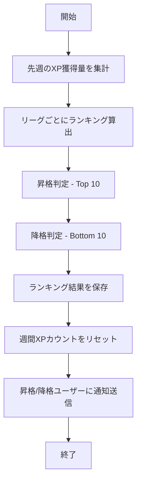
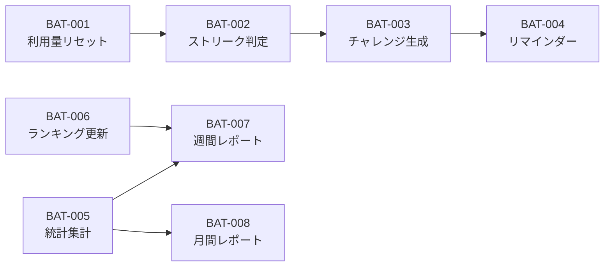

# 7. バッチ設計

## 7.1. 概要

本章では、SpeakPal AI のバッチ処理設計を定義します。

### 統計情報

| 項目       | 内容 |
| ---------- | ---- |
| バッチ総数 | 8    |
| 日次バッチ | 5    |
| 週次バッチ | 2    |
| 月次バッチ | 1    |

---

## 7.2. バッチ一覧

| No  | バッチ ID | バッチ名               | 実行頻度 | 実行時刻       | 優先度 |
| --- | --------- | ---------------------- | -------- | -------------- | ------ |
| 1   | BAT-001   | 日次利用量リセット     | 日次     | 00:00 UTC      | Must   |
| 2   | BAT-002   | ストリーク判定         | 日次     | 00:05 UTC      | Must   |
| 3   | BAT-003   | デイリーチャレンジ生成 | 日次     | 00:10 UTC      | Must   |
| 4   | BAT-004   | 復習語彙リマインダー   | 日次     | 09:00 JST      | Should |
| 5   | BAT-005   | 統計データ集計         | 日次     | 02:00 UTC      | Should |
| 6   | BAT-006   | 週間ランキング更新     | 週次     | 月曜 00:00 UTC | Must   |
| 7   | BAT-007   | 週間レポート送信       | 週次     | 月曜 09:00 JST | Should |
| 8   | BAT-008   | 月間レポート送信       | 月次     | 1 日 09:00 JST | Should |

---

## 7.3. バッチ詳細

### BAT-001: 日次利用量リセット

| 項目         | 内容                                   |
| ------------ | -------------------------------------- |
| バッチ ID    | BAT-001                                |
| バッチ名     | 日次利用量リセット                     |
| 説明         | 各ユーザーの日次利用カウントをリセット |
| 実行頻度     | 日次                                   |
| 実行時刻     | 00:00 UTC                              |
| 想定処理時間 | 5 分                                   |
| 関連 FR      | FR-015                                 |

**処理フロー:**

```
1. subscriptions テーブルを全件取得
2. daily_usage_count を 0 にリセット
3. last_reset_date を更新
4. 処理結果をログ出力
```

**エラー処理:**

- DB 接続エラー: リトライ 3 回、失敗時アラート
- 部分失敗: ロールバックせず続行、失敗レコードをログ

---

### BAT-002: ストリーク判定

| 項目         | 内容                                   |
| ------------ | -------------------------------------- |
| バッチ ID    | BAT-002                                |
| バッチ名     | ストリーク判定                         |
| 説明         | 前日の学習有無を判定し、ストリーク更新 |
| 実行頻度     | 日次                                   |
| 実行時刻     | 00:05 UTC                              |
| 想定処理時間 | 10 分                                  |
| 関連 FR      | FR-018                                 |

**処理フロー:**

```
1. streaks テーブルを全件取得
2. 各ユーザーについて:
   a. last_activity_date が昨日の場合 → current_streak +1
   b. last_activity_date が昨日以前の場合:
      - freeze_remaining > 0 → フリーズ使用、freeze_remaining -1
      - freeze_remaining = 0 → current_streak = 0
3. longest_streak を更新（必要に応じて）
4. ストリーク終了ユーザーに通知送信
```

---

### BAT-003: デイリーチャレンジ生成

| 項目         | 内容                                   |
| ------------ | -------------------------------------- |
| バッチ ID    | BAT-003                                |
| バッチ名     | デイリーチャレンジ生成                 |
| 説明         | 各ユーザーに本日のチャレンジを割り当て |
| 実行頻度     | 日次                                   |
| 実行時刻     | 00:10 UTC                              |
| 想定処理時間 | 15 分                                  |
| 関連 FR      | FR-025                                 |

**処理フロー:**

```
1. アクティブユーザー一覧を取得
2. 有効なチャレンジ定義を取得
3. 各ユーザーについて:
   a. ユーザーのレベル・履歴を考慮してチャレンジを選択
   b. user_challenges にレコード作成
4. 前日の未完了チャレンジを expired に更新
```

---

### BAT-004: 復習語彙リマインダー

| 項目         | 内容                                     |
| ------------ | ---------------------------------------- |
| バッチ ID    | BAT-004                                  |
| バッチ名     | 復習語彙リマインダー                     |
| 説明         | 復習予定の語彙があるユーザーに通知を送信 |
| 実行頻度     | 日次                                     |
| 実行時刻     | 09:00 JST                                |
| 想定処理時間 | 10 分                                    |
| 関連 FR      | FR-026                                   |

**処理フロー:**

```
1. vocabularies テーブルから next_review_date = 今日のレコードを取得
2. ユーザーごとにグループ化
3. 各ユーザーについて:
   a. 復習対象語彙数をカウント
   b. プッシュ通知を送信
   c. 通知設定がオフの場合はスキップ
4. 通知送信結果をログ出力
```

**エラー処理:**

- 通知送信失敗: リトライ 2 回、失敗時ログ記録
- 部分失敗: 続行、失敗ユーザーをログ

---

### BAT-005: 統計データ集計

| 項目         | 内容                                   |
| ------------ | -------------------------------------- |
| バッチ ID    | BAT-005                                |
| バッチ名     | 統計データ集計                         |
| 説明         | 日次統計データを集計してキャッシュ更新 |
| 実行頻度     | 日次                                   |
| 実行時刻     | 02:00 UTC                              |
| 想定処理時間 | 20 分                                  |
| 関連 FR      | FR-021, FR-022                         |

**処理フロー:**

```
1. 前日の会話データを集計:
   - 総会話時間
   - 会話回数
   - 訂正数
   - 獲得XP
2. ユーザーごとに統計サマリーを更新
3. 発音スコア推移データを更新
4. グローバル統計（全ユーザー合計）を更新
5. 古い詳細データをアーカイブ対象としてマーク
```

**エラー処理:**

- DB 接続エラー: リトライ 3 回
- 計算エラー: ロールバック、アラート送信

---

### BAT-006: 週間ランキング更新

| 項目         | 内容                                   |
| ------------ | -------------------------------------- |
| バッチ ID    | BAT-006                                |
| バッチ名     | 週間ランキング更新                     |
| 説明         | 週間 XP でランキング計算、リーグ昇降格 |
| 実行頻度     | 週次（月曜）                           |
| 実行時刻     | 00:00 UTC                              |
| 想定処理時間 | 30 分                                  |
| 関連 FR      | FR-028                                 |

**処理フロー:**



**処理詳細:**

```
1. 先週のXP獲得量を集計
   - conversations.xp_earned を週間合計
   - user_challenges 完了ボーナスを加算

2. リーグごとにランキング算出
   - Bronze, Silver, Gold, Platinum, Diamond リーグ
   - 各リーグ内でXP降順ランク付け

3. 昇格・降格判定
   - 上位10名: 次のリーグへ昇格
   - 下位10名: 前のリーグへ降格
   - Diamond は昇格なし、Bronze は降格なし

4. ランキング結果を保存
   - user_rankings テーブルに週次スナップショット
   - users.league フィールドを更新

5. 通知送信
   - 昇格者: 「おめでとうございます！」プッシュ通知
   - 降格者: 「次週頑張りましょう！」プッシュ通知
```

**エラー処理:**

- DB 接続エラー: リトライ 3 回、失敗時アラート
- 通知送信失敗: ログ記録、後続処理は続行
- 部分失敗: トランザクションロールバック、再実行

---

### BAT-007: 週間レポート送信

| 項目         | 内容                             |
| ------------ | -------------------------------- |
| バッチ ID    | BAT-007                          |
| バッチ名     | 週間レポート送信                 |
| 説明         | 先週の学習サマリーレポートを送信 |
| 実行頻度     | 週次（月曜）                     |
| 実行時刻     | 09:00 JST                        |
| 想定処理時間 | 30 分                            |
| 関連 FR      | FR-023                           |

**処理フロー:**

```
1. レポート通知が有効なユーザー一覧を取得
2. 各ユーザーについて:
   a. 先週の学習統計を取得
   b. レポートデータを生成:
      - 総学習時間
      - 会話回数
      - 獲得XP
      - 達成バッジ
      - ストリーク状況
   c. プッシュ通知を送信
   d. メール送信設定がある場合はメールも送信
3. 送信結果をログ出力
```

**エラー処理:**

- メール送信失敗: キューに追加して再試行
- 通知送信失敗: ログ記録のみ

---

### BAT-008: 月間レポート送信

| 項目         | 内容                             |
| ------------ | -------------------------------- |
| バッチ ID    | BAT-008                          |
| バッチ名     | 月間レポート送信                 |
| 説明         | 先月の学習サマリーレポートを送信 |
| 実行頻度     | 月次（1 日）                     |
| 実行時刻     | 09:00 JST                        |
| 想定処理時間 | 45 分                            |
| 関連 FR      | FR-023                           |

**処理フロー:**

```
1. レポート通知が有効なユーザー一覧を取得
2. 各ユーザーについて:
   a. 先月の学習統計を取得
   b. 月間レポートデータを生成:
      - 月間総学習時間
      - 週ごとの推移グラフデータ
      - 獲得総XP
      - レベルアップ状況
      - 発音スコア改善率
      - 学習した語彙数
      - 来月の目標提案
   c. プッシュ通知を送信
   d. メール送信（HTML形式）
3. 送信結果をログ出力
```

**エラー処理:**

- メール送信失敗: リトライキューに追加
- 部分失敗: 続行、失敗レコードをログ

---

## 7.4. バッチ監視

### 7.4.1. 監視項目

| 項目         | 閾値        | アラートレベル |
| ------------ | ----------- | -------------- |
| 実行時間超過 | 予定の 2 倍 | Warning        |
| 実行時間超過 | 予定の 5 倍 | Critical       |
| エラー率     | > 1%        | Warning        |
| エラー率     | > 5%        | Critical       |
| 実行スキップ | 1 回        | Warning        |
| 実行スキップ | 2 回連続    | Critical       |

### 7.4.2. ログ形式

```json
{
  "batch_id": "BAT-001",
  "execution_id": "exec-20251229-001",
  "started_at": "2025-12-29T00:00:00Z",
  "ended_at": "2025-12-29T00:02:30Z",
  "status": "success",
  "records_processed": 50000,
  "records_failed": 0,
  "duration_ms": 150000
}
```

---

## 7.6. 排他制御

### 7.5.1. 同時実行ポリシー

| バッチ ID | 同時実行 | ロック方式     | 説明                       |
| --------- | -------- | -------------- | -------------------------- |
| BAT-001   | 不可     | ファイルロック | 日次リセットは排他実行必須 |
| BAT-002   | 不可     | DB ロック      | ストリーク更新は排他       |
| BAT-003   | 不可     | DB ロック      | チャレンジ生成は排他       |
| BAT-004   | 可       | なし           | 通知は並列可               |
| BAT-005   | 不可     | DB ロック      | 統計集計は排他             |
| BAT-006   | 不可     | DB ロック      | ランキング更新は排他       |
| BAT-007   | 可       | なし           | レポート送信は並列可       |
| BAT-008   | 可       | なし           | レポート送信は並列可       |

### 7.5.2. ロック実装

```bash
# ファイルロック例
LOCK_FILE="/var/lock/speakpal_bat001.lock"
if [ -f "$LOCK_FILE" ]; then
    echo "Batch already running"
    exit 1
fi
touch "$LOCK_FILE"
trap "rm -f $LOCK_FILE" EXIT
```

---

## 7.7. 実行環境

### 7.7.1. スケジューラー

| 項目             | 内容                   |
| ---------------- | ---------------------- |
| スケジューラー   | Kubernetes CronJob     |
| 実行ユーザー     | batch-runner (非 root) |
| ログ出力先       | CloudWatch Logs        |
| メトリクス出力先 | Prometheus             |

### 7.7.2. Cron 設定

| バッチ ID | Cron 式      | タイムゾーン |
| --------- | ------------ | ------------ |
| BAT-001   | `0 0 * * *`  | UTC          |
| BAT-002   | `5 0 * * *`  | UTC          |
| BAT-003   | `10 0 * * *` | UTC          |
| BAT-004   | `0 0 * * *`  | Asia/Tokyo   |
| BAT-005   | `0 2 * * *`  | UTC          |
| BAT-006   | `0 0 * * 1`  | UTC (月曜)   |
| BAT-007   | `0 0 * * 1`  | Asia/Tokyo   |
| BAT-008   | `0 0 1 * *`  | Asia/Tokyo   |

### 7.7.3. リソース設定

| バッチ ID | CPU Request | Memory Request | Timeout |
| --------- | ----------- | -------------- | ------- |
| BAT-001   | 100m        | 256Mi          | 10 min  |
| BAT-002   | 200m        | 512Mi          | 20 min  |
| BAT-003   | 200m        | 512Mi          | 30 min  |
| BAT-004   | 100m        | 256Mi          | 20 min  |
| BAT-005   | 500m        | 1Gi            | 40 min  |
| BAT-006   | 500m        | 1Gi            | 60 min  |
| BAT-007   | 300m        | 512Mi          | 60 min  |
| BAT-008   | 500m        | 1Gi            | 90 min  |

### 7.7.4. 依存関係



---

## 7.8. FR → Batch Mapping

| FR ID  | FR 名              | Priority | Related Batch    | Covered |
| ------ | ------------------ | -------- | ---------------- | ------- |
| FR-015 | 利用量制限         | Must     | BAT-001          | ✅      |
| FR-018 | 学習ストリーク     | Must     | BAT-002          | ✅      |
| FR-021 | 統計ダッシュボード | Must     | BAT-005          | ✅      |
| FR-022 | 発音スコア履歴     | Should   | BAT-005          | ✅      |
| FR-023 | 週間/月間レポート  | Should   | BAT-007, BAT-008 | ✅      |
| FR-025 | デイリーチャレンジ | Must     | BAT-003          | ✅      |
| FR-026 | 単語帳＆復習       | Must     | BAT-004          | ✅      |
| FR-028 | 週間ランキング     | Should   | BAT-006          | ✅      |

### Coverage Summary

| Priority  | Total FRs | Covered | Coverage |
| --------- | --------- | ------- | -------- |
| Must      | 5         | 5       | 100%     |
| Should    | 3         | 3       | 100%     |
| **Total** | **8**     | **8**   | **100%** |

---

← [目次](./_index.md) | _次のセクション: [08-non-functional.md](./08-non-functional.md)_
