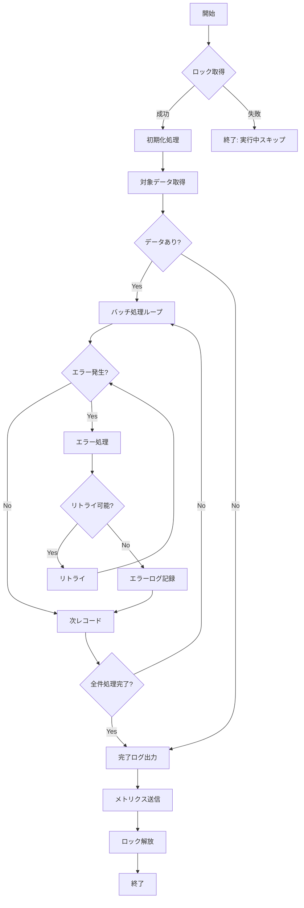

# バッチ設計 - 共通仕様

> 📌 このファイルでは、バッチ処理の共通仕様とパターンを定義します。

---

## 📋 概要

| 項目             | 内容                      |
| ---------------- | ------------------------- |
| スケジューラー   | Kubernetes CronJob        |
| 実行環境         | AWS EKS (Batch Namespace) |
| ログ出力先       | CloudWatch Logs           |
| メトリクス出力先 | Prometheus + Grafana      |
| アラート通知先   | Slack, PagerDuty          |

---

## 🕐 タイムゾーン規約

### 基準タイムゾーン

| 用途             | タイムゾーン | 備考                      |
| ---------------- | ------------ | ------------------------- |
| システム内部処理 | UTC          | すべての計算は UTC ベース |
| ユーザー通知     | Asia/Tokyo   | 日本ユーザー向け          |
| ログ記録         | UTC          | 統一のため                |
| スケジュール定義 | 各バッチ指定 | UTC or Asia/Tokyo         |

---

## 🔄 共通処理パターン

### バッチ実行フロー



---

## 🔒 排他制御

### ロック方式

| 方式           | 使用場面       | 実装例                           |
| -------------- | -------------- | -------------------------------- |
| ファイルロック | 単一ノード実行 | `/var/lock/speakpal_BAT001.lock` |
| DB ロック      | 複数ノード環境 | `batch_locks` テーブル           |
| Redis ロック   | 分散環境       | `SETNX batch:BAT001:lock`        |

### DB ロック実装

```sql
-- ロック取得
INSERT INTO batch_locks (batch_id, locked_at, locked_by)
VALUES ('BAT-001', NOW(), 'pod-abc123')
ON CONFLICT (batch_id) DO NOTHING;

-- ロック解放
DELETE FROM batch_locks
WHERE batch_id = 'BAT-001' AND locked_by = 'pod-abc123';
```

### Redis ロック実装

```python
# ロック取得 (TTL 付き)
acquired = redis.set(
    f"batch:{batch_id}:lock",
    pod_name,
    nx=True,
    ex=timeout_seconds
)

# ロック解放
if redis.get(f"batch:{batch_id}:lock") == pod_name:
    redis.delete(f"batch:{batch_id}:lock")
```

---

## 🔁 リトライ戦略

### Exponential Backoff

```python
def calculate_delay(attempt: int, base_delay: float = 1.0) -> float:
    """
    Exponential backoff with jitter
    attempt 1: ~1s
    attempt 2: ~2s
    attempt 3: ~4s
    ...
    """
    delay = base_delay * (2 ** (attempt - 1))
    jitter = random.uniform(0.5, 1.5)
    return min(delay * jitter, 300)  # max 5 minutes
```

### リトライ設定

| エラー種別             | リトライ回数 | 待機時間    |
| ---------------------- | ------------ | ----------- |
| DB 接続エラー          | 3            | Exponential |
| 外部 API エラー        | 3            | Exponential |
| ネットワークエラー     | 5            | Exponential |
| バリデーションエラー   | 0            | -           |
| ビジネスロジックエラー | 0            | -           |

---

## 📊 ログ形式

### 標準ログフォーマット

```json
{
  "timestamp": "2025-12-29T00:00:00.000Z",
  "level": "INFO",
  "batch_id": "BAT-001",
  "execution_id": "exec-20251229-001",
  "message": "バッチ処理開始",
  "context": {
    "pod_name": "batch-runner-abc123",
    "attempt": 1
  }
}
```

### 実行結果ログ

```json
{
  "batch_id": "BAT-001",
  "execution_id": "exec-20251229-001",
  "started_at": "2025-12-29T00:00:00Z",
  "ended_at": "2025-12-29T00:02:30Z",
  "status": "success",
  "statistics": {
    "records_total": 50000,
    "records_processed": 49995,
    "records_failed": 5,
    "records_skipped": 0
  },
  "duration_ms": 150000,
  "error_summary": [
    {
      "error_code": "DB_TIMEOUT",
      "count": 3,
      "user_ids": ["user-123", "user-456", "user-789"]
    }
  ]
}
```

---

## 📈 メトリクス定義

### Prometheus メトリクス

| メトリクス名                       | タイプ    | ラベル               | 説明           |
| ---------------------------------- | --------- | -------------------- | -------------- |
| `batch_execution_total`            | Counter   | batch_id, status     | 実行回数       |
| `batch_execution_duration_seconds` | Histogram | batch_id             | 実行時間       |
| `batch_records_processed_total`    | Counter   | batch_id             | 処理レコード数 |
| `batch_records_failed_total`       | Counter   | batch_id, error_type | 失敗レコード数 |
| `batch_last_success_timestamp`     | Gauge     | batch_id             | 最終成功時刻   |

### Grafana ダッシュボード

```
Dashboard: Batch Processing Overview
├── Panel: バッチ実行状況 (表)
├── Panel: 実行時間推移 (グラフ)
├── Panel: エラー率 (グラフ)
└── Panel: 処理レコード数 (グラフ)
```

---

## 🚨 アラート設定

### アラートルール

| 条件                   | 重要度   | 通知先            | 対応           |
| ---------------------- | -------- | ----------------- | -------------- |
| 実行時間 > 予定の 2 倍 | Warning  | Slack             | 確認           |
| 実行時間 > 予定の 5 倍 | Critical | PagerDuty + Slack | 即時対応       |
| エラー率 > 1%          | Warning  | Slack             | 調査           |
| エラー率 > 5%          | Critical | PagerDuty + Slack | 即時対応       |
| 2 回連続スキップ       | Critical | PagerDuty + Slack | 即時対応       |
| ロック取得失敗 > 10 分 | Warning  | Slack             | ロック状況確認 |

### アラート通知形式

```json
{
  "alert_name": "BatchExecutionTimeout",
  "batch_id": "BAT-005",
  "severity": "critical",
  "message": "バッチ BAT-005 の実行時間が予定の 5 倍を超えました",
  "details": {
    "expected_duration_minutes": 20,
    "actual_duration_minutes": 105,
    "execution_id": "exec-20251229-001"
  },
  "timestamp": "2025-12-29T02:45:00Z"
}
```

---

## 💾 データ処理パターン

### チャンク処理

```python
CHUNK_SIZE = 1000

def process_batch():
    offset = 0
    while True:
        records = fetch_records(limit=CHUNK_SIZE, offset=offset)
        if not records:
            break

        for record in records:
            try:
                process_record(record)
            except RetryableError as e:
                retry_with_backoff(record, e)
            except NonRetryableError as e:
                log_error(record, e)

        offset += CHUNK_SIZE

        # チェックポイント保存
        save_checkpoint(offset)
```

### トランザクション管理

| パターン     | 使用場面             | 説明                   |
| ------------ | -------------------- | ---------------------- |
| レコード単位 | エラー許容度高い処理 | 1 レコードずつコミット |
| チャンク単位 | パフォーマンス重視   | N レコードずつコミット |
| 全件単位     | 整合性必須           | 全件成功時のみコミット |

---

## ⚙️ リソース管理

### リソース設定ガイドライン

| バッチ規模      | CPU Request | Memory Request | Timeout |
| --------------- | ----------- | -------------- | ------- |
| 小規模 (< 1K)   | 100m        | 256Mi          | 10 min  |
| 中規模 (1K-10K) | 200-500m    | 512Mi-1Gi      | 30 min  |
| 大規模 (> 10K)  | 500m-1      | 1Gi-2Gi        | 60+ min |

### Pod 設定例

```yaml
apiVersion: batch/v1
kind: CronJob
metadata:
  name: bat-001-daily-reset
spec:
  schedule: "0 0 * * *"
  jobTemplate:
    spec:
      template:
        spec:
          containers:
            - name: batch
              image: speakpal/batch:latest
              resources:
                requests:
                  cpu: "100m"
                  memory: "256Mi"
                limits:
                  cpu: "500m"
                  memory: "512Mi"
          restartPolicy: OnFailure
```

---

## 📊 バッチ一覧

| バッチ ID | バッチ名               | 詳細ファイル                                                               |
| --------- | ---------------------- | -------------------------------------------------------------------------- |
| BAT-001   | 日次利用量リセット     | [07-batch-design.md](../07-batch-design.md#bat-001-日次利用量リセット)     |
| BAT-002   | ストリーク判定         | [07-batch-design.md](../07-batch-design.md#bat-002-ストリーク判定)         |
| BAT-003   | デイリーチャレンジ生成 | [07-batch-design.md](../07-batch-design.md#bat-003-デイリーチャレンジ生成) |
| BAT-004   | 復習語彙リマインダー   | [07-batch-design.md](../07-batch-design.md#bat-004-復習語彙リマインダー)   |
| BAT-005   | 統計データ集計         | [07-batch-design.md](../07-batch-design.md#bat-005-統計データ集計)         |
| BAT-006   | 週間ランキング更新     | [07-batch-design.md](../07-batch-design.md#bat-006-週間ランキング更新)     |
| BAT-007   | 週間レポート送信       | [07-batch-design.md](../07-batch-design.md#bat-007-週間レポート送信)       |
| BAT-008   | 月間レポート送信       | [07-batch-design.md](../07-batch-design.md#bat-008-月間レポート送信)       |

---

← [目次](../_index.md) | [バッチ詳細](../07-batch-design.md)
