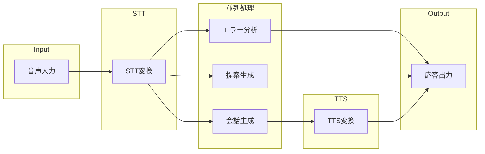
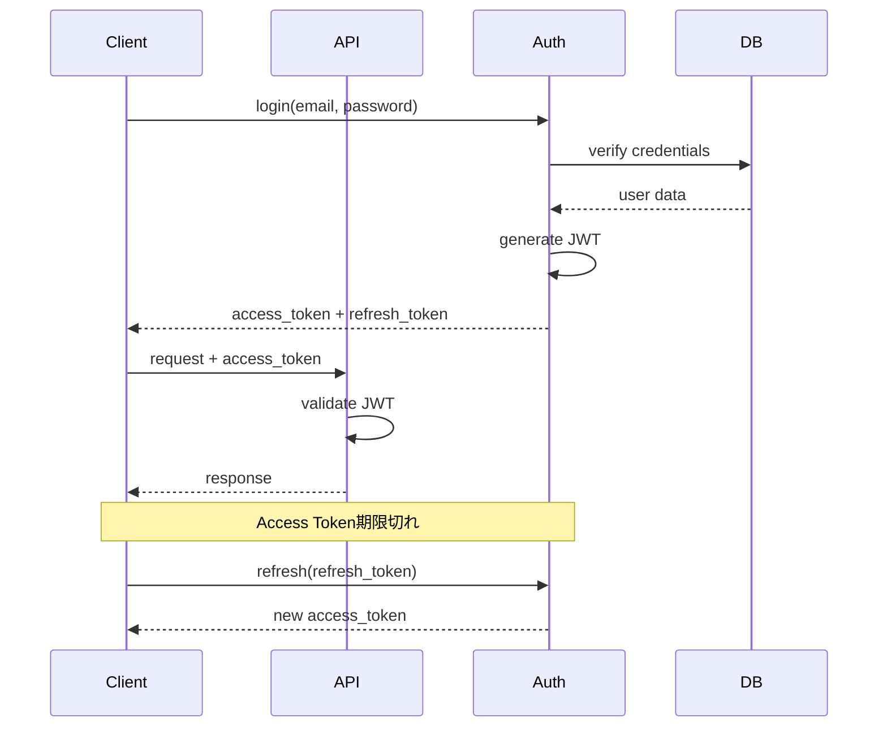

# 8. 非機能設計

## 8.1. 概要

本章では、SRS の非機能要件を実現するための設計方針を定義します。

---

## 8.2. パフォーマンス設計

### 8.2.1. レスポンスタイム目標

| 処理                      | 要件     | 設計方針                     |
| ------------------------- | -------- | ---------------------------- |
| ユーザー発話 →AI 応答開始 | < 1000ms | 並列処理、ストリーミング     |
| 割り込み検知 →AI 停止     | < 500ms  | クライアント側 VAD、即時中断 |
| 字幕表示遅延              | < 100ms  | WebSocket、差分送信          |
| API 応答時間              | < 200ms  | キャッシュ、DB 最適化        |

### 8.2.2. 並列処理設計

### 8.2.3. キャッシュ戦略

| データ種別           | キャッシュ層 | TTL     | 無効化条件         |
| -------------------- | ------------ | ------- | ------------------ |
| ユーザープロフィール | Redis        | 1 時間  | プロフィール更新時 |
| シナリオ一覧         | Redis        | 24 時間 | シナリオ更新時     |
| バッジ定義           | Redis        | 24 時間 | バッジ更新時       |
| ランキング           | Redis        | 5 分    | 週次リセット時     |
| セッション情報       | Redis        | 30 日   | ログアウト時       |

---

## 8.3. 可用性設計

### 8.3.1. 冗長構成

| コンポーネント   | 冗長化方式                 | フェイルオーバー時間 |
| ---------------- | -------------------------- | -------------------- |
| API Gateway      | 複数 Pod、ロードバランサー | 自動（即時）         |
| WebSocket Server | 複数 Pod、Sticky Session   | 再接続必要（5 秒）   |
| PostgreSQL       | Primary + Replica          | 自動（30 秒）        |
| Redis            | Cluster Mode               | 自動（10 秒）        |

### 8.3.2. ヘルスチェック

| エンドポイント   | チェック間隔 | タイムアウト | 失敗判定 |
| ---------------- | ------------ | ------------ | -------- |
| /health/live     | 10 秒        | 5 秒         | 3 回連続 |
| /health/ready    | 30 秒        | 10 秒        | 2 回連続 |
| 外部サービス依存 | 60 秒        | 30 秒        | 1 回     |

---

## 8.4. セキュリティ設計

### 8.4.1. 認証設計

### 8.4.2. トークン仕様

| トークン種別  | 有効期限 | 保存場所       | 用途           |
| ------------- | -------- | -------------- | -------------- |
| Access Token  | 1 時間   | メモリ         | API 認証       |
| Refresh Token | 30 日    | Secure Storage | トークン更新   |
| Session Token | 会話中   | メモリ         | WebSocket 認証 |

### 8.4.3. データ保護

| データ種別 | 保護方式                     |
| ---------- | ---------------------------- |
| パスワード | bcrypt（cost=12）            |
| 通信       | TLS 1.3                      |
| 保存データ | AES-256 暗号化（DB）         |
| 音声データ | 処理後即時削除（保存しない） |
| 個人情報   | アクセス制限、監査ログ       |

---

## 8.5. スケーラビリティ設計

### 8.5.1. 水平スケーリング

| コンポーネント  | 最小 | 最大 | スケール条件       |
| --------------- | ---- | ---- | ------------------ |
| API Gateway Pod | 2    | 10   | CPU > 70%          |
| WebSocket Pod   | 3    | 20   | Connections > 200  |
| Worker Pod      | 2    | 10   | Queue Length > 100 |

### 8.5.2. データベーススケーリング

| 負荷種別 | 対策                       |
| -------- | -------------------------- |
| 読み取り | Read Replica 追加          |
| 書き込み | シャーディング（将来対応） |
| 接続数   | Connection Pooling         |

---

## 8.6. 監視設計

### 8.6.1. メトリクス

| カテゴリ     | メトリクス           | 閾値（Warning） | 閾値（Critical） |
| ------------ | -------------------- | --------------- | ---------------- |
| インフラ     | CPU 使用率           | > 70%           | > 90%            |
| インフラ     | メモリ使用率         | > 80%           | > 95%            |
| アプリ       | API 応答時間（p95）  | > 500ms         | > 1000ms         |
| アプリ       | エラー率             | > 1%            | > 5%             |
| ビジネス     | 同時接続数           | > 800           | > 950            |
| 外部サービス | STT/LLM/TTS 応答時間 | > 800ms         | > 1500ms         |

### 8.6.2. ログ設計

| ログ種別     | 出力先             | 保持期間 | 用途             |
| ------------ | ------------------ | -------- | ---------------- |
| アクセスログ | CloudWatch/S3      | 30 日    | トラフィック分析 |
| アプリログ   | CloudWatch/S3      | 30 日    | デバッグ         |
| エラーログ   | CloudWatch/S3      | 90 日    | 障害調査         |
| 監査ログ     | CloudWatch/S3      | 1 年     | セキュリティ     |
| メトリクス   | Prometheus/Grafana | 30 日    | 可視化           |

---

## 8.7. 災害復旧設計

### 8.7.1. バックアップ

| データ     | バックアップ方式     | 頻度   | 保持期間 |
| ---------- | -------------------- | ------ | -------- |
| PostgreSQL | フルバックアップ     | 日次   | 30 日    |
| PostgreSQL | WAL アーカイブ       | 継続的 | 7 日     |
| Redis      | RDB スナップショット | 1 時間 | 24 時間  |
| S3         | バージョニング       | 継続的 | 30 日    |

### 8.7.2. 復旧目標

| 指標 | 目標   | 説明                           |
| ---- | ------ | ------------------------------ |
| RTO  | 4 時間 | 復旧目標時間                   |
| RPO  | 1 時間 | 復旧目標時点（データ損失許容） |

---

← [目次](./_index.md) | _次のセクション: [09-error-handling.md](./09-error-handling.md)_
