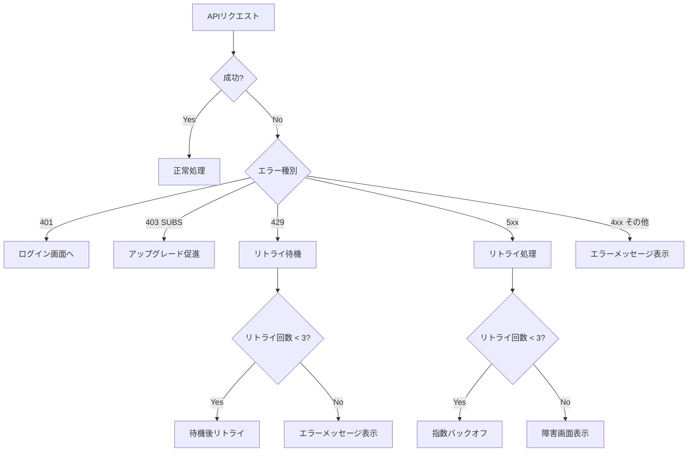
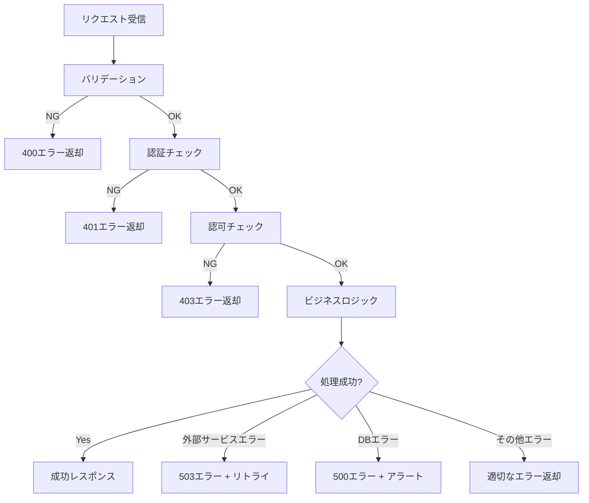

# 9. エラー処理設計

## 9.1. 概要

本章では、SpeakPal AI のエラー処理設計を定義します。

---

## 9.2. エラーコード体系

### 9.2.1. コード形式

```
{カテゴリ}_{連番}

例: AUTH_001, CONV_003
```

### 9.2.2. カテゴリ定義

| カテゴリ | 説明                     | コード範囲   |
| -------- | ------------------------ | ------------ |
| AUTH     | 認証・認可エラー         | AUTH_001-099 |
| USER     | ユーザー関連エラー       | USER_001-099 |
| CONV     | 会話関連エラー           | CONV_001-099 |
| SUBS     | サブスクリプションエラー | SUBS_001-099 |
| AI       | AI 処理エラー            | AI_001-099   |
| DB       | データベースエラー       | DB_001-099   |
| EXT      | 外部サービスエラー       | EXT_001-099  |
| SYS      | システムエラー           | SYS_001-099  |

---

## 9.3. エラーコード定義

### 9.3.1. 認証エラー (AUTH)

| コード   | HTTP ステータス | メッセージ           | ユーザー表示                                             |
| -------- | --------------- | -------------------- | -------------------------------------------------------- |
| AUTH_001 | 401             | Invalid credentials  | メールアドレスまたはパスワードが正しくありません         |
| AUTH_002 | 401             | Token expired        | セッションの有効期限が切れました。再ログインしてください |
| AUTH_003 | 401             | Invalid token        | 認証に失敗しました                                       |
| AUTH_004 | 403             | Account locked       | アカウントがロックされています                           |
| AUTH_005 | 403             | Email not verified   | メールアドレスの確認が完了していません                   |
| AUTH_006 | 409             | Email already exists | このメールアドレスは既に登録されています                 |

### 9.3.2. 会話エラー (CONV)

| コード   | HTTP ステータス | メッセージ            | ユーザー表示                                   |
| -------- | --------------- | --------------------- | ---------------------------------------------- |
| CONV_001 | 400             | Invalid mode          | 会話モードが不正です                           |
| CONV_002 | 400             | Session not found     | 会話セッションが見つかりません                 |
| CONV_003 | 500             | STT processing failed | 音声認識に失敗しました。もう一度お試しください |
| CONV_004 | 500             | TTS processing failed | 音声生成に失敗しました                         |
| CONV_005 | 500             | LLM processing failed | AI 応答の生成に失敗しました                    |
| CONV_006 | 408             | Audio stream timeout  | 音声入力がタイムアウトしました                 |

### 9.3.3. サブスクリプションエラー (SUBS)

| コード   | HTTP ステータス | メッセージ               | ユーザー表示                                       |
| -------- | --------------- | ------------------------ | -------------------------------------------------- |
| SUBS_001 | 403             | Daily limit exceeded     | 本日の利用上限に達しました。明日リセットされます   |
| SUBS_002 | 403             | Feature not available    | この機能はプランをアップグレードすると利用できます |
| SUBS_003 | 400             | Invalid purchase receipt | 購入情報の検証に失敗しました                       |
| SUBS_004 | 400             | Subscription expired     | サブスクリプションの有効期限が切れています         |

### 9.3.4. 外部サービスエラー (EXT)

| コード  | HTTP ステータス | メッセージ                  | ユーザー表示                             |
| ------- | --------------- | --------------------------- | ---------------------------------------- |
| EXT_001 | 503             | STT service unavailable     | 音声認識サービスが一時的に利用できません |
| EXT_002 | 503             | LLM service unavailable     | AI サービスが一時的に利用できません      |
| EXT_003 | 503             | TTS service unavailable     | 音声生成サービスが一時的に利用できません |
| EXT_004 | 503             | Payment service unavailable | 決済サービスが一時的に利用できません     |

---

## 9.4. エラー処理フロー

### 9.4.1. クライアント側



### 9.4.2. サーバー側



---

## 9.5. リトライ戦略

### 9.5.1. クライアント側リトライ

| エラー種別         | リトライ回数 | 待機間隔             | 備考           |
| ------------------ | ------------ | -------------------- | -------------- |
| ネットワークエラー | 3            | 1s, 2s, 4s           | 指数バックオフ |
| 5xx エラー         | 3            | 1s, 2s, 4s           | 指数バックオフ |
| 429 エラー         | 3            | Retry-After ヘッダー | サーバー指定   |
| WebSocket 切断     | 5            | 1s, 2s, 4s, 8s, 16s  | 自動再接続     |

### 9.5.2. サーバー側リトライ（外部サービス）

| 外部サービス | リトライ回数 | 待機間隔  | フォールバック    |
| ------------ | ------------ | --------- | ----------------- |
| STT Service  | 2            | 500ms, 1s | 代替 STT サービス |
| LLM Service  | 2            | 500ms, 1s | 代替 LLM サービス |
| TTS Service  | 2            | 500ms, 1s | 代替 TTS サービス |

---

## 9.6. ユーザー向けエラー表示

### 9.6.1. 表示形式

| エラー重要度 | 表示形式       | 自動消去 |
| ------------ | -------------- | -------- |
| Info         | トースト       | 3 秒     |
| Warning      | トースト       | 5 秒     |
| Error        | ダイアログ     | 手動     |
| Critical     | フルスクリーン | 手動     |

### 9.6.2. 多言語対応

```json
{
  "AUTH_001": {
    "ja": "メールアドレスまたはパスワードが正しくありません",
    "en": "Invalid email or password"
  },
  "SUBS_001": {
    "ja": "本日の利用上限に達しました",
    "en": "Daily usage limit reached"
  }
}
```

---

← [目次](./_index.md) | _次のセクション: [10-appendix.md](./10-appendix.md)_
