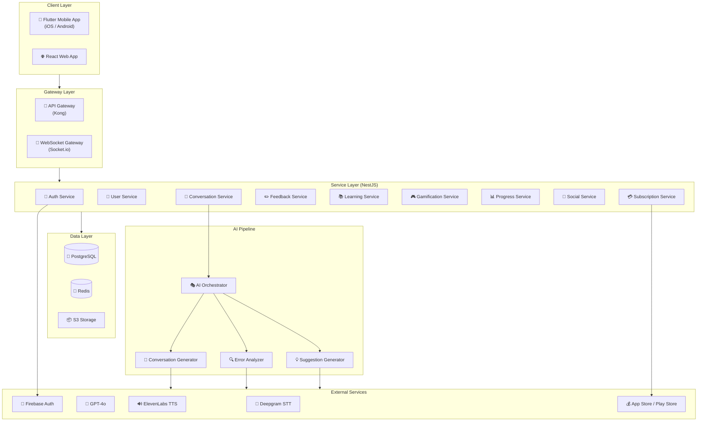
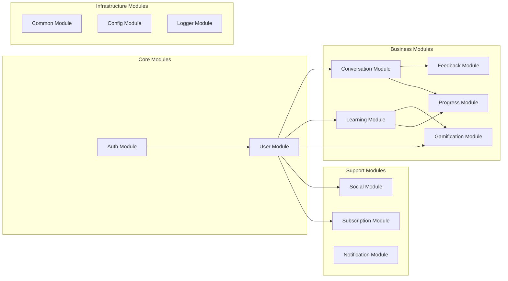

# 3. システム概要

## 3.0. ドキュメント情報

| 項目       | 内容                |
| ---------- | ------------------- |
| バージョン | 1.0                 |
| 作成日     | 2025 年 12 月 29 日 |
| 作成者     | AI Assistant        |
| 最終更新日 | 2025 年 12 月 29 日 |
| ステータス | Draft               |

### 3.0.1. フェーズスコープ

| 項目         | Phase 1 (MVP) | Phase 2    | Phase 3    |
| ------------ | ------------- | ---------- | ---------- |
| 機能数       | 33 UC         | +10 UC     | +5 UC      |
| 画面数       | 20 Screens    | +5 Screens | +3 Screens |
| API 数       | 52 APIs       | +15 APIs   | +10 APIs   |
| 対象ユーザー | 日本市場      | アジア展開 | グローバル |
| 対象言語     | 英語学習      | 多言語対応 | -          |

### 3.0.2. マイルストーン

| マイルストーン | 目標日     | 成果物                   | ステータス |
| -------------- | ---------- | ------------------------ | ---------- |
| DD 完了        | 2025-01-15 | 詳細設計書               | 🔄 進行中  |
| 開発開始       | 2025-01-20 | プロジェクトセットアップ | ⬜ 未着手  |
| Alpha リリース | 2025-03-31 | 機能テスト版             | ⬜ 未着手  |
| Beta リリース  | 2025-05-31 | ユーザーテスト版         | ⬜ 未着手  |
| GA リリース    | 2025-07-31 | 正式版                   | ⬜ 未着手  |

---

## 3.1. システムアーキテクチャ

### 3.1.1. アーキテクチャ図



### 3.1.2. 技術スタック詳細

| レイヤー          | 技術                | バージョン | 用途                         |
| ----------------- | ------------------- | ---------- | ---------------------------- |
| **Mobile**        | Flutter / Dart      | 3.x        | クロスプラットフォームアプリ |
| **Mobile State**  | Riverpod            | 2.x        | 状態管理                     |
| **Web**           | React               | 18.x       | Web アプリケーション         |
| **Web State**     | Redux Toolkit       | 2.x        | 状態管理                     |
| **Backend**       | NestJS / TypeScript | 10.x       | API サービス                 |
| **WebSocket**     | Socket.io           | 4.x        | リアルタイム通信             |
| **ORM**           | Prisma              | 5.x        | DB アクセス                  |
| **DB**            | PostgreSQL          | 15.x       | メインデータストア           |
| **Cache**         | Redis               | 7.x        | セッション・キャッシュ       |
| **Queue**         | BullMQ              | 4.x        | ジョブキュー                 |
| **Container**     | Docker              | 24.x       | コンテナ化                   |
| **Orchestration** | Kubernetes          | 1.28       | コンテナ管理                 |

---

## 3.2. モジュール構成

### 3.2.1. モジュール一覧



### 3.2.2. モジュール責務

| モジュール   | 責務                                 | 主要クラス                             |
| ------------ | ------------------------------------ | -------------------------------------- |
| Auth         | 認証、トークン管理、OAuth            | AuthService, JwtStrategy               |
| User         | ユーザー管理、プロフィール、ペルソナ | UserService, PersonaService            |
| Conversation | 会話セッション、音声処理             | ConversationService, AIOrchestrator    |
| Feedback     | 訂正生成、提案生成、発音分析         | FeedbackService, ErrorAnalyzer         |
| Learning     | 語彙管理、シナリオ、チャレンジ       | VocabularyService, ScenarioService     |
| Gamification | XP、バッジ、ストリーク、レベル       | XPService, BadgeService, StreakService |
| Progress     | 統計、レポート生成                   | StatsService, ReportService            |
| Social       | 招待、ランキング、グループ           | InvitationService, RankingService      |
| Subscription | プラン管理、利用制限、決済連携       | SubscriptionService, UsageLimitService |
| Notification | プッシュ通知、メール通知             | NotificationService                    |
| Common       | 共通ユーティリティ、例外、DTO        | BaseService, CustomException           |
| Config       | 環境設定、シークレット管理           | ConfigService                          |
| Logger       | ログ出力、監査ログ                   | LoggerService                          |

---

## 3.3. アクターと権限

### 3.3.1. アクター定義

| アクター | 説明                 | 認証方式           |
| -------- | -------------------- | ------------------ |
| Guest    | 未認証ユーザー       | なし               |
| Learner  | 登録済み学習者       | JWT                |
| Premium  | Premium プラン加入者 | JWT + Subscription |
| Admin    | 管理者（将来実装）   | JWT + Role         |

### 3.3.2. 権限マトリクス

| 機能                  | Guest | Learner | Premium | Admin |
| --------------------- | ----- | ------- | ------- | ----- |
| アプリダウンロード    | ✅    | ✅      | ✅      | ✅    |
| 登録・ログイン        | ✅    | ✅      | ✅      | ✅    |
| 会話（1 日 3 回まで） | -     | ✅      | ✅      | ✅    |
| 会話（無制限）        | -     | -       | ✅      | ✅    |
| 全ペルソナ利用        | -     | -       | ✅      | ✅    |
| 発音詳細分析          | -     | -       | ✅      | ✅    |
| 統計閲覧              | -     | ✅      | ✅      | ✅    |
| ランキング参加        | -     | ✅      | ✅      | ✅    |
| 管理機能              | -     | -       | -       | ✅    |

### 3.3.3. アクター → サービスマッピング

| アクター | 利用可能サービス                                                                                    |
| -------- | --------------------------------------------------------------------------------------------------- |
| Guest    | Auth (register, login), App Store page                                                              |
| Learner  | Auth, User, Conversation (limited), Learning, Gamification, Progress                                |
| Premium  | Auth, User, Conversation (unlimited), Learning, Gamification, Progress, Feedback (詳細分析), Social |
| Admin    | 全サービス + Admin Panel (将来)                                                                     |

---

## 3.4. デザインパターン

### 3.4.1. 採用パターン一覧

| パターン           | 適用箇所             | 目的                         |
| ------------------ | -------------------- | ---------------------------- |
| Repository Pattern | データアクセス層     | DB 実装の抽象化              |
| Service Pattern    | ビジネスロジック層   | ビジネスロジックのカプセル化 |
| DTO Pattern        | API 境界             | 入出力データの型安全         |
| Factory Pattern    | LLM プロンプト生成   | プロンプトの動的生成         |
| Strategy Pattern   | 発音評価アルゴリズム | 評価ロジックの切り替え       |
| Observer Pattern   | イベント通知         | 非同期イベント処理           |
| Decorator Pattern  | ログ、キャッシュ     | 横断的関心事の分離           |
| Singleton Pattern  | 設定、DB 接続        | リソースの共有               |

### 3.4.2. レイヤードアーキテクチャ

```
┌─────────────────────────────────────────────────────────────┐
│                    Presentation Layer                        │
│   Controller / Gateway / Event Handler                       │
├─────────────────────────────────────────────────────────────┤
│                    Application Layer                         │
│   Service / Use Case / Orchestrator                          │
├─────────────────────────────────────────────────────────────┤
│                      Domain Layer                            │
│   Entity / Value Object / Domain Service                     │
├─────────────────────────────────────────────────────────────┤
│                  Infrastructure Layer                        │
│   Repository / External Service / Database                   │
└─────────────────────────────────────────────────────────────┘
```

---

## 3.5. 設計決定

### 3.5.1. アーキテクチャ決定

| ID     | 決定                           | 理由                              | 代替案                |
| ------ | ------------------------------ | --------------------------------- | --------------------- |
| AD-001 | マイクロサービスアーキテクチャ | スケーラビリティ、独立デプロイ    | モノリス              |
| AD-002 | WebSocket for リアルタイム通信 | 低遅延双方向通信が必須            | HTTP Long Polling     |
| AD-003 | PostgreSQL + Redis             | トランザクション + 高速キャッシュ | MongoDB               |
| AD-004 | JWT 認証                       | ステートレス、スケーラブル        | Session Based         |
| AD-005 | Flutter for Mobile             | 共通コードベース、開発効率        | Native (Swift/Kotlin) |

### 3.5.2. 技術選定理由

| 技術       | 選定理由                                              |
| ---------- | ----------------------------------------------------- |
| Flutter    | iOS/Android 共通コードベース、モダン UI、高い開発効率 |
| NestJS     | TypeScript 対応、エンタープライズ向け、モジュール構造 |
| Prisma     | 型安全な ORM、マイグレーション管理、優れた DevEx      |
| Socket.io  | WebSocket 抽象化、自動再接続、フォールバック対応      |
| Deepgram   | 高精度 STT、低遅延、ストリーミング対応                |
| GPT-4o     | 高品質会話生成、文脈理解、マルチタスク対応            |
| ElevenLabs | 自然な音声、多様な声、低遅延ストリーミング            |

---

## 3.6. 外部システム連携

| サービス       | プロバイダ | 用途                   | 統合方式 | フォールバック   |
| -------------- | ---------- | ---------------------- | -------- | ---------------- |
| STT            | Deepgram   | 音声 → テキスト変換    | REST/WS  | Whisper API      |
| LLM            | OpenAI     | 会話生成、分析         | REST     | Claude 3.5       |
| TTS            | ElevenLabs | テキスト → 音声変換    | REST/WS  | Google Cloud TTS |
| Authentication | Firebase   | OAuth、ユーザー管理    | SDK      | Auth0            |
| Payment        | App Store  | サブスクリプション決済 | IAP      | -（必須）        |
| Storage        | AWS S3     | ファイル保存           | SDK      | Azure Blob       |
| Monitoring     | Datadog    | メトリクス・ログ       | Agent    | CloudWatch       |

---

## 3.7. 前提条件と制約

### 3.7.1. 前提条件

| ID      | 前提条件                           | 影響                     |
| ------- | ---------------------------------- | ------------------------ |
| ASM-001 | ユーザーはインターネット接続が必要 | オフライン対応は Phase 2 |
| ASM-002 | デバイスにマイクがある             | 音声入力が可能           |
| ASM-003 | 外部 AI サービスは 99.9%可用性     | フォールバック設計必要   |

### 3.7.2. 制約

| ID      | 制約                                 | 対応策             |
| ------- | ------------------------------------ | ------------------ |
| CON-001 | AI 応答遅延は 1 秒未満が必須         | ストリーミング処理 |
| CON-002 | 音声データは保存不可（プライバシー） | 処理後即時削除     |
| CON-003 | Free プランは 1 日 3 回の会話制限    | 利用量管理         |

> 📖 詳細は [04-design-considerations.md](./04-design-considerations.md) を参照

---

## 3.8. 用語リファレンス

> 📖 完全な用語集は [02-references-terminology.md](./02-references-terminology.md) を参照

| 用語 | 意味                                     |
| ---- | ---------------------------------------- |
| STT  | Speech-to-Text（音声 → テキスト変換）    |
| TTS  | Text-to-Speech（テキスト → 音声変換）    |
| LLM  | Large Language Model（大規模言語モデル） |
| XP   | Experience Points（経験値）              |
| SRS  | Spaced Repetition System（間隔反復学習） |

---

← [目次](./_index.md) | _次のセクション: [04-design-considerations.md](./04-design-considerations.md)_
