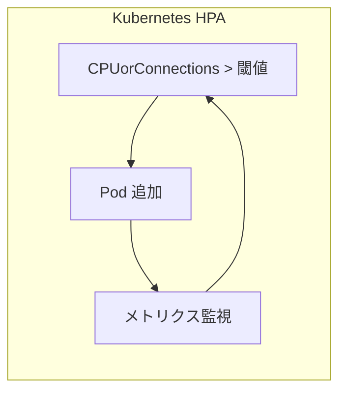
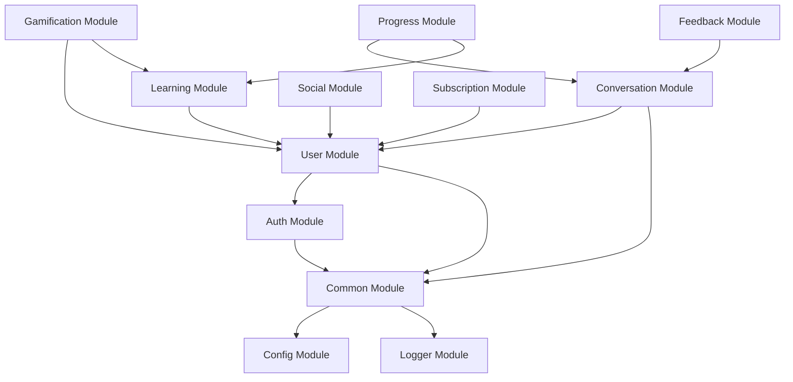

# 4. 設計考慮事項

## 4.1. 前提条件

### 4.1.1. ビジネス前提

| ID      | 前提条件                       | 影響                            |
| ------- | ------------------------------ | ------------------------------- |
| ASM-001 | ターゲット市場は日本           | UI/UX は日本語ユーザー向け      |
| ASM-002 | 学習者は英語初心者～中級者が主 | 難易度調整機能が必要            |
| ASM-003 | モバイルファーストで利用される | モバイル UX を優先              |
| ASM-004 | 主な利用時間は通勤・休憩時間   | 短いセッション（5-15 分）を想定 |

### 4.1.2. 技術前提

| ID      | 前提条件                           | 影響                      |
| ------- | ---------------------------------- | ------------------------- |
| ASM-101 | ユーザーはインターネット接続が必要 | オフライン対応は Phase 2  |
| ASM-102 | デバイスにマイクがある             | 音声入力が可能            |
| ASM-103 | 外部 AI サービスは 99.9% 可用性    | フォールバック設計が必要  |
| ASM-104 | App Store / Play Store での配信    | IAP（アプリ内課金）を使用 |

---

## 4.2. 制約条件

### 4.2.1. 技術制約

| ID      | 制約条件                                    | 対応策                       |
| ------- | ------------------------------------------- | ---------------------------- |
| CON-001 | AI 応答遅延は 1 秒未満が必須                | ストリーミング処理、並列呼出 |
| CON-002 | 音声データは保存不可（プライバシー）        | 処理後即時削除               |
| CON-003 | 外部 AI API の利用コストを最適化            | キャッシュ、バッチ処理       |
| CON-004 | WebSocket 接続は同時 1,000 CCU からスタート | 水平スケーリング設計         |

### 4.2.2. ビジネス制約

| ID      | 制約条件                         | 対応策                         |
| ------- | -------------------------------- | ------------------------------ |
| CON-101 | 無料プランは 1 日 3 回の会話制限 | 利用量管理、日次リセットバッチ |
| CON-102 | 初期リリースは英語学習のみ       | 多言語対応は将来拡張可能に設計 |
| CON-103 | 管理者機能は MVP 対象外          | 管理 API は基本機能のみ        |

---

## 4.3. 非機能要件実現方針

### 4.3.1. パフォーマンス (NFR-001 ～ NFR-003)

| 要件         | 目標値   | 実現方針                                |
| ------------ | -------- | --------------------------------------- |
| AI 応答開始  | < 1000ms | STT/LLM/TTS 並列処理、ストリーミング    |
| 割り込み検知 | < 500ms  | クライアント側 VAD、即時送信            |
| 字幕遅延     | < 100ms  | WebSocket、差分送信                     |
| API 応答時間 | < 200ms  | Redis キャッシュ、DB インデックス最適化 |

**実装詳細:**

```
会話処理パイプライン:
1. Client: VAD で音声区間検出 → 即時ストリーミング開始
2. Gateway: 音声チャンクを並列で STT に送信
3. STT: ストリーミング変換、中間結果をリアルタイム返却
4. Orchestrator: テキスト受信と同時に LLM 3 並列呼出
   - LLM-1: 会話応答生成
   - LLM-2: エラー分析
   - LLM-3: 提案生成
5. TTS: 応答テキストをストリーミング変換
6. Client: 音声チャンクを順次再生
```

### 4.3.2. スケーラビリティ (NFR-004 ～ NFR-005)

| メトリック     | 初期値     | 目標値      | 実現方針                 |
| -------------- | ---------- | ----------- | ------------------------ |
| 同時接続数     | 1,000 CCU  | 10,000 CCU  | Pod Auto-scaling         |
| 日次アクティブ | 10,000 DAU | 100,000 DAU | Read Replica, キャッシュ |
| API リクエスト | 1,000 RPS  | 10,000 RPS  | 水平スケーリング         |

**スケーリング戦略:**



### 4.3.3. 可用性 (NFR-006)

| 要件   | 目標値 | 実現方針                             |
| ------ | ------ | ------------------------------------ |
| 稼働率 | 99.9%  | 冗長構成、自動フェイルオーバー       |
| RTO    | 4 時間 | バックアップ、リストア手順整備       |
| RPO    | 1 時間 | WAL アーカイブ、定期スナップショット |

### 4.3.4. セキュリティ (NFR-007 ～ NFR-009)

| 要件         | 実現方針                                        |
| ------------ | ----------------------------------------------- |
| 認証         | JWT + Refresh Token、OAuth 2.0 対応             |
| 認可         | RBAC、エンドポイントレベルのアクセス制御        |
| 通信暗号化   | TLS 1.3 必須                                    |
| データ暗号化 | AES-256 (at rest)、センシティブデータマスキング |
| 脆弱性対策   | OWASP Top 10 対応、定期的な脆弱性スキャン       |

---

## 4.4. 依存関係

### 4.4.1. 外部サービス依存

| サービス      | 提供元       | 用途 | フォールバック   |
| ------------- | ------------ | ---- | ---------------- |
| Deepgram      | Deepgram     | STT  | Whisper API      |
| GPT-4o        | OpenAI       | LLM  | Claude 3.5       |
| ElevenLabs    | ElevenLabs   | TTS  | Google Cloud TTS |
| Firebase Auth | Google       | 認証 | Auth0            |
| App Store IAP | Apple/Google | 決済 | -（必須）        |

### 4.4.2. モジュール依存関係



---

## 4.5. リスクと対策

### 4.5.1. 技術リスク

| ID      | リスク                      | 影響度 | 発生確率 | 対策                        |
| ------- | --------------------------- | ------ | -------- | --------------------------- |
| RSK-001 | 外部 AI サービス障害        | 高     | 低       | フォールバックサービス実装  |
| RSK-002 | WebSocket スケーリング問題  | 高     | 中       | Sticky Session + 負荷テスト |
| RSK-003 | AI 応答遅延が目標を超える   | 高     | 中       | 並列処理、キャッシュ        |
| RSK-004 | 音声品質による STT 精度低下 | 中     | 高       | ノイズ除去、再送信機能      |

### 4.5.2. ビジネスリスク

| ID      | リスク                 | 影響度 | 発生確率 | 対策                         |
| ------- | ---------------------- | ------ | -------- | ---------------------------- |
| RSK-101 | AI API コスト超過      | 高     | 中       | 利用量監視、コスト最適化     |
| RSK-102 | 競合他社の類似サービス | 中     | 高       | 差別化機能（ペルソナ等）強化 |
| RSK-103 | ユーザー継続率低下     | 高     | 中       | ゲーミフィケーション強化     |

---

## 4.6. 将来拡張性

### 4.6.1. 拡張予定機能

| フェーズ | 機能               | 設計上の考慮           |
| -------- | ------------------ | ---------------------- |
| Phase 2  | オフラインモード   | ローカル DB 同期設計   |
| Phase 2  | 多言語対応         | i18n 対応、言語設定 DB |
| Phase 2  | 管理者画面         | 管理者 Role、管理 API  |
| Phase 3  | AI チューター機能  | LLM プロンプト拡張     |
| Phase 3  | グループビデオ通話 | WebRTC 基盤            |

### 4.6.2. 拡張性設計ポイント

| 設計ポイント               | 実装方針                               |
| -------------------------- | -------------------------------------- |
| プラグイン可能な LLM       | Strategy Pattern で LLM 実装を切替可能 |
| 多言語対応準備             | 翻訳キー方式、DB に言語コード追加      |
| 新しい会話モード追加       | モード定義を DB 管理、動的ロード       |
| 新しいゲーミフィケーション | バッジ・チャレンジ定義を DB 管理       |

---

← [目次](./_index.md) | _次のセクション: [05-module-design.md](./05-module-design.md)_
