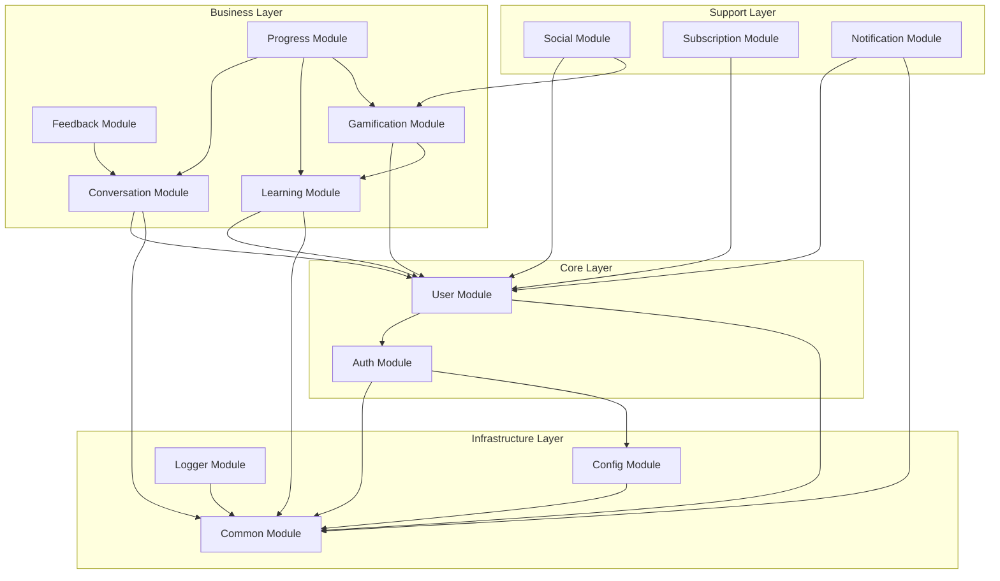
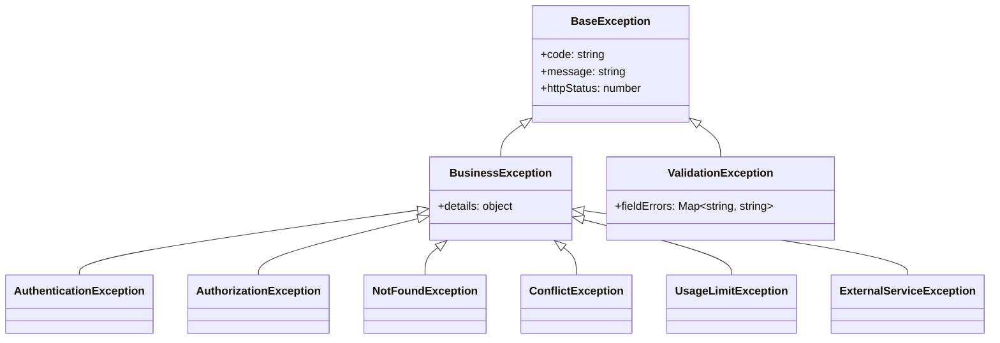

# 5. モジュール設計

> 📋 このドキュメントはモジュール設計の概要と各セクションへのリンクを提供します。

---

## 5.1. 概要

### 5.1.1. 統計情報

| 項目               | 数量 |
| ------------------ | ---- |
| モジュール総数     | 13   |
| コアモジュール     | 2    |
| ビジネスモジュール | 7    |
| サポートモジュール | 2    |
| インフラモジュール | 2    |

### 5.1.2. モジュール一覧

| Module ID | モジュール名 | パッケージ           | レイヤー | 関連 UC                |
| --------- | ------------ | -------------------- | -------- | ---------------------- |
| MOD-001   | Auth         | auth-service         | Core     | UC-011, UC-012, UC-013 |
| MOD-002   | User         | user-service         | Core     | UC-007, UC-008         |
| MOD-003   | Conversation | conversation-service | Business | UC-001~010, UC-033     |
| MOD-004   | Feedback     | conversation-service | Business | UC-004, UC-006, UC-030 |
| MOD-005   | Learning     | learning-service     | Business | UC-017, UC-024~026     |
| MOD-006   | Gamification | gamification-service | Business | UC-018~020, UC-028     |
| MOD-007   | Progress     | progress-service     | Business | UC-021~023             |
| MOD-008   | Social       | social-service       | Support  | UC-027, UC-029         |
| MOD-009   | Subscription | subscription-service | Support  | UC-014~016             |
| MOD-010   | Notification | notification-service | Support  | (Cross-cutting)        |
| MOD-011   | Common       | common-lib           | Infra    | (Shared)               |
| MOD-012   | Config       | config-lib           | Infra    | (Shared)               |
| MOD-013   | Logger       | logger-lib           | Infra    | (Shared)               |

### 5.1.3. モジュール依存関係テーブル

| モジュール   | 依存先 (Depends On)            | 依存元 (Depended By)                 |
| ------------ | ------------------------------ | ------------------------------------ |
| Common       | -                              | All modules                          |
| Config       | Common                         | Auth, User, All Services             |
| Logger       | Common                         | All modules                          |
| Auth         | Common, Config                 | User                                 |
| User         | Auth, Common                   | Conv, Learning, Gamify, Social, Subs |
| Conversation | User, Common, Feedback         | Progress, Feedback                   |
| Feedback     | Conversation, Common           | -                                    |
| Learning     | User, Common                   | Gamification, Progress               |
| Gamification | User, Learning, Common         | Progress, Social                     |
| Progress     | Conv, Learning, Gamify, Common | -                                    |
| Social       | User, Gamify, Common           | -                                    |
| Subscription | User, Common                   | -                                    |
| Notification | User, Common                   | -                                    |

---

## 5.2. 目次

| セクション | ファイル                                                         | 内容                   |
| ---------- | ---------------------------------------------------------------- | ---------------------- |
| 5.3        | [Auth Module](./05-module-design/auth-module.md)                 | 認証・認可             |
| 5.4        | [User Module](./05-module-design/user-module.md)                 | ユーザー・ペルソナ管理 |
| 5.5        | [Conversation Module](./05-module-design/conversation-module.md) | 会話処理・AI 連携      |
| 5.6        | [Feedback Module](./05-module-design/feedback-module.md)         | フィードバック生成     |
| 5.7        | [Learning Module](./05-module-design/learning-module.md)         | 学習管理               |
| 5.8        | [Gamification Module](./05-module-design/gamification-module.md) | ゲーミフィケーション   |
| 5.9        | [Progress Module](./05-module-design/progress-module.md)         | 進捗・統計             |
| 5.10       | [Social Module](./05-module-design/social-module.md)             | ソーシャル機能         |
| 5.11       | [Subscription Module](./05-module-design/subscription-module.md) | サブスクリプション     |
| 5.12       | [Common Module](./05-module-design/common-module.md)             | 共通コンポーネント     |

---

## 5.3. モジュール依存関係



---

## 5.4. パッケージ構成

```
services/
├── auth-service/
│   ├── src/
│   │   ├── auth/
│   │   │   ├── auth.module.ts
│   │   │   ├── auth.controller.ts
│   │   │   ├── auth.service.ts
│   │   │   ├── strategies/
│   │   │   │   ├── jwt.strategy.ts
│   │   │   │   └── oauth.strategy.ts
│   │   │   └── guards/
│   │   │       ├── jwt-auth.guard.ts
│   │   │       └── roles.guard.ts
│   │   └── ...
│   └── ...
├── user-service/
│   ├── src/
│   │   ├── user/
│   │   │   ├── user.module.ts
│   │   │   ├── user.controller.ts
│   │   │   ├── user.service.ts
│   │   │   └── entities/
│   │   │       └── user.entity.ts
│   │   ├── persona/
│   │   │   ├── persona.module.ts
│   │   │   ├── persona.controller.ts
│   │   │   └── persona.service.ts
│   │   └── ...
│   └── ...
├── conversation-service/
│   ├── src/
│   │   ├── conversation/
│   │   ├── orchestrator/
│   │   ├── stt/
│   │   ├── llm/
│   │   └── tts/
│   └── ...
└── ...
```

---

## 5.5. 共通設計パターン

### 5.5.1. Service クラス構造

```typescript
// 共通 Service 構造
@Injectable()
export class [Name]Service {
  constructor(
    private readonly repository: [Name]Repository,
    private readonly configService: ConfigService,
    private readonly logger: LoggerService,
  ) {}

  // CRUD メソッド
  async create(dto: Create[Name]Dto): Promise<[Name]Entity> { ... }
  async findById(id: string): Promise<[Name]Entity> { ... }
  async findAll(query: QueryDto): Promise<PaginatedResult<[Name]Entity>> { ... }
  async update(id: string, dto: Update[Name]Dto): Promise<[Name]Entity> { ... }
  async delete(id: string): Promise<void> { ... }

  // ビジネスロジック
  async [businessMethod](...): Promise<...> { ... }
}
```

### 5.5.2. Repository クラス構造

```typescript
// 共通 Repository 構造
@Injectable()
export class [Name]Repository {
  constructor(private readonly prisma: PrismaService) {}

  async create(data: Prisma.[Name]CreateInput): Promise<[Name]> { ... }
  async findUnique(where: Prisma.[Name]WhereUniqueInput): Promise<[Name] | null> { ... }
  async findMany(params: FindManyParams): Promise<[Name][]> { ... }
  async update(where: ..., data: ...): Promise<[Name]> { ... }
  async delete(where: ...): Promise<[Name]> { ... }
}
```

### 5.5.3. DTO パターン

```typescript
// Request DTO
export class Create[Name]Dto {
  @IsString()
  @IsNotEmpty()
  name: string;

  @IsOptional()
  @IsString()
  description?: string;
}

// Response DTO
export class [Name]ResponseDto {
  id: string;
  name: string;
  createdAt: Date;

  static fromEntity(entity: [Name]Entity): [Name]ResponseDto {
    return {
      id: entity.id,
      name: entity.name,
      createdAt: entity.createdAt,
    };
  }
}
```

---

## 5.6. クラス命名規則

| 種類           | 命名規則          | 例                    |
| -------------- | ----------------- | --------------------- |
| Module         | [Name]Module      | AuthModule            |
| Controller     | [Name]Controller  | AuthController        |
| Service        | [Name]Service     | AuthService           |
| Repository     | [Name]Repository  | UserRepository        |
| Entity         | [Name]Entity      | UserEntity            |
| DTO (Create)   | Create[Name]Dto   | CreateUserDto         |
| DTO (Update)   | Update[Name]Dto   | UpdateUserDto         |
| DTO (Response) | [Name]ResponseDto | UserResponseDto       |
| Guard          | [Name]Guard       | JwtAuthGuard          |
| Strategy       | [Name]Strategy    | JwtStrategy           |
| Exception      | [Name]Exception   | UserNotFoundException |

---

## 5.7. 列挙型定義

| Enum 名          | 値                                      | モジュール   |
| ---------------- | --------------------------------------- | ------------ |
| UserLevel        | Beginner, Basic, Intermediate, Advanced | User         |
| League           | Bronze, Silver, Gold, Platinum, Diamond | Gamification |
| ConversationMode | instructor, freetalk, roleplay          | Conversation |
| VoiceType        | voice_1, voice_2, voice_3               | User         |
| PersonalityType  | cheerful, strict, sarcastic             | User         |
| CorrectionType   | grammar, vocabulary, pronunciation      | Feedback     |
| SRSLevel         | new, learning, young, mature, mastered  | Learning     |
| SubscriptionPlan | free, premium, premium_plus             | Subscription |
| ChallengeType    | conversation, vocabulary, pronunciation | Learning     |
| BadgeCategory    | streak, level, conversation, vocabulary | Gamification |

---

## 5.8. ユーティリティクラス

| クラス名       | パッケージ | 用途                   |
| -------------- | ---------- | ---------------------- |
| DateUtil       | common-lib | 日付操作、フォーマット |
| StringUtil     | common-lib | 文字列操作             |
| HashUtil       | common-lib | ハッシュ生成 (bcrypt)  |
| JwtUtil        | auth-lib   | JWT 生成・検証         |
| AudioUtil      | conv-lib   | 音声処理ヘルパー       |
| PaginationUtil | common-lib | ページネーション計算   |
| ValidationUtil | common-lib | カスタムバリデーション |

---

## 5.9. 例外クラス階層



| 例外クラス               | HTTP | 用途                 |
| ------------------------ | ---- | -------------------- |
| AuthenticationException  | 401  | 認証失敗             |
| AuthorizationException   | 403  | 権限不足             |
| NotFoundException        | 404  | リソース未発見       |
| ConflictException        | 409  | データ重複           |
| ValidationException      | 400  | バリデーションエラー |
| UsageLimitException      | 429  | 利用制限超過         |
| ExternalServiceException | 503  | 外部サービス障害     |

---

## 5.10. 公開インターフェース一覧

| モジュール   | サービス            | 公開メソッド                             |
| ------------ | ------------------- | ---------------------------------------- |
| Auth         | AuthService         | register, login, logout, refreshToken    |
| User         | UserService         | findById, updateProfile, addXP, getStats |
| User         | PersonaService      | create, update, delete, setDefault       |
| Conversation | ConversationService | create, end, getTurns, generateSummary   |
| Conversation | AIOrchestrator      | processAudioStream, stopProcessing       |
| Feedback     | FeedbackService     | analyzeAndCorrect, generateSuggestions   |
| Learning     | VocabularyService   | addWord, getDueForReview, recordReview   |
| Learning     | ScenarioService     | list, getById, startScenario             |
| Gamification | StreakService       | getStreak, recordActivity, useFreeze     |
| Gamification | BadgeService        | checkAndAward, getUserBadges             |
| Progress     | StatsService        | getDashboard, getHistory                 |
| Social       | InvitationService   | create, accept, getByUser                |
| Subscription | SubscriptionService | getByUser, checkLimit, updatePlan        |

---

## 5.11. BD 参照マトリクス

| DD Section   | BD Section           | Coverage |
| ------------ | -------------------- | -------- |
| 5.3 Auth     | BD 03-UC-011~013     | ✅ 100%  |
| 5.4 User     | BD 03-UC-007~008     | ✅ 100%  |
| 5.5 Conv     | BD 03-UC-001~010     | ✅ 100%  |
| 5.6 Feedback | BD 03-UC-004,006     | ✅ 100%  |
| 5.7 Learning | BD 03-UC-017,024-026 | ✅ 100%  |
| 5.8 Gamify   | BD 03-UC-018~020     | ✅ 100%  |
| 5.9 Progress | BD 03-UC-021~023     | ✅ 100%  |
| 5.10 Social  | BD 03-UC-027,029     | ✅ 100%  |
| 5.11 Subs    | BD 03-UC-014~016     | ✅ 100%  |

> 📋 BD Reference: [基本設計書/03-functional-design.md](../基本設計書/03-functional-design.md)

---

← [目次](./_index.md) | _次のセクション: [06-component-design.md](./06-component-design.md)_
