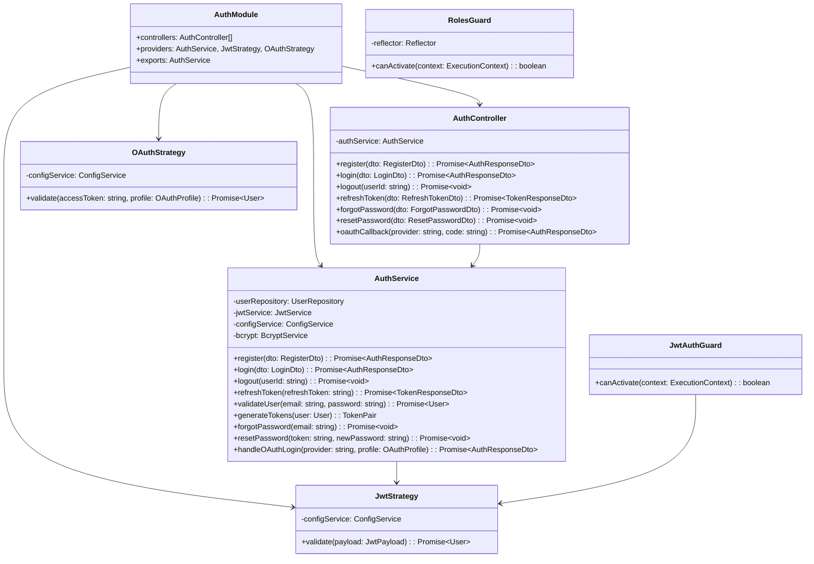

# 5.3. Auth Module

## 概要

| 項目         | 内容                           |
| ------------ | ------------------------------ |
| モジュール名 | AuthModule                     |
| 責務         | 認証、トークン管理、OAuth 連携 |
| 依存         | CommonModule, ConfigModule     |
| 関連 UC      | UC-011, UC-012, UC-013         |

---

## クラス図



---

## メソッド詳細

### register()

**目的:** 新規ユーザー登録

**処理フロー:**

1. メールアドレスの重複チェック
2. パスワードを bcrypt でハッシュ化（cost=12）
3. ユーザーレコード作成（初期レベル=Beginner, XP=0）
4. ストリークレコード作成（current_streak=0）
5. 確認メール送信キュー追加
6. JWT トークンペア生成・返却

**入力:**
| パラメータ | 型 | 必須 | バリデーション |
| ---------- | ------ | ---- | ------------------------ |
| email | string | ○ | メール形式、最大 255 文字 |
| password | string | ○ | 8-128 文字、英数字混合 |
| username | string | ○ | 3-50 文字、英数字\_- |

**出力:**

```typescript
interface AuthResponseDto {
  accessToken: string;
  refreshToken: string;
  expiresIn: number; // 3600 (1時間)
  user: {
    id: string;
    email: string;
    username: string;
    level: UserLevel;
    isVerified: boolean;
  };
}
```

**例外:**
| 例外 | 条件 | HTTP ステータス |
| ---------------------- | ---------------------- | -------------- |
| EmailAlreadyExistsException | メール重複 | 409 |
| ValidationException | バリデーションエラー | 400 |

---

### login()

**目的:** ユーザー認証

**処理フロー:**

1. メールアドレスでユーザー検索
2. パスワード検証（bcrypt compare）
3. アカウントロック状態確認
4. メール確認状態確認
5. JWT トークンペア生成
6. 最終ログイン日時更新
7. トークンペア返却

**入力:**
| パラメータ | 型 | 必須 | バリデーション |
| ---------- | ------ | ---- | ------------------ |
| email | string | ○ | メール形式 |
| password | string | ○ | 空でない |

**例外:**
| 例外 | 条件 | HTTP ステータス |
| ---------------------- | ---------------------- | -------------- |
| InvalidCredentialsException | 認証失敗 | 401 |
| AccountLockedException | アカウントロック中 | 403 |
| EmailNotVerifiedException | メール未確認 | 403 |

---

### generateTokens()

**目的:** JWT トークンペア生成

**トークン仕様:**

| トークン種別  | 有効期限 | ペイロード                    |
| ------------- | -------- | ----------------------------- |
| Access Token  | 1 時間   | userId, email, role, iat, exp |
| Refresh Token | 30 日    | userId, tokenId, iat, exp     |

**Access Token ペイロード:**

```typescript
interface JwtPayload {
  sub: string; // userId
  email: string;
  role: UserRole;
  iat: number;
  exp: number;
}
```

---

## セキュリティ設計

### パスワードハッシュ

```
アルゴリズム: bcrypt
コスト: 12
ソルト: 自動生成
```

### トークン署名

```
アルゴリズム: HS256
シークレット: 環境変数 JWT_SECRET (最小256ビット)
```

### Rate Limiting

| エンドポイント             | 制限     |
| -------------------------- | -------- |
| POST /auth/login           | 10 回/分 |
| POST /auth/register        | 5 回/分  |
| POST /auth/forgot-password | 3 回/時  |

---

← [モジュール設計](../05-module-design.md) | _次: [User Module](./user-module.md)_
