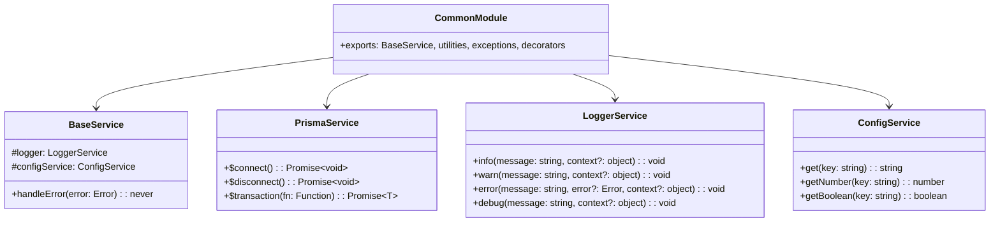

# 5.12. Common Module

## 概要

| 項目         | 内容                                    |
| ------------ | --------------------------------------- |
| モジュール名 | CommonModule                            |
| 責務         | 共通ユーティリティ、例外、DTO、ヘルパー |
| 依存         | なし (最下位レイヤー)                   |
| 関連 UC      | 全モジュールから参照                    |

---

## クラス図



---

## ユーティリティクラス

### DateUtil

```typescript
export class DateUtil {
  static getToday(): Date { ... }
  static getYesterday(): Date { ... }
  static isSameDay(a: Date, b: Date): boolean { ... }
  static getWeekNumber(date: Date): number { ... }
  static formatISO(date: Date): string { ... }
  static addDays(date: Date, days: number): Date { ... }
}
```

### StringUtil

```typescript
export class StringUtil {
  static generateRandomCode(length: number): string { ... }
  static slugify(text: string): string { ... }
  static maskEmail(email: string): string { ... }
  static truncate(text: string, maxLength: number): string { ... }
}
```

### HashUtil

```typescript
export class HashUtil {
  static hashPassword(password: string): Promise<string> { ... }
  static comparePassword(password: string, hash: string): Promise<boolean> { ... }
}
```

---

## デコレータ

| デコレータ     | 用途                 |
| -------------- | -------------------- |
| @LogMethod     | メソッド実行ログ出力 |
| @CacheResult   | 結果をキャッシュ     |
| @Transactional | トランザクション管理 |
| @Retry         | 失敗時リトライ       |
| @RateLimit     | レート制限           |

### 使用例

```typescript
@Injectable()
export class ExampleService {
  @LogMethod()
  @CacheResult({ ttl: 300 })
  async getCachedData(id: string): Promise<Data> {
    // ...
  }

  @Transactional()
  async complexOperation(): Promise<void> {
    // ...
  }

  @Retry({ attempts: 3, delay: 1000 })
  async callExternalAPI(): Promise<Response> {
    // ...
  }
}
```

---

## 共通 DTO

### PaginationDto

```typescript
export class PaginationDto {
  @IsOptional()
  @IsInt()
  @Min(1)
  page?: number = 1;

  @IsOptional()
  @IsInt()
  @Min(1)
  @Max(100)
  limit?: number = 20;
}
```

### PaginatedResultDto

```typescript
export class PaginatedResultDto<T> {
  data: T[];
  pagination: {
    page: number;
    limit: number;
    total: number;
    totalPages: number;
    hasNext: boolean;
    hasPrev: boolean;
  };
}
```

---

← [Subscription Module](./subscription-module.md) | _戻る: [モジュール設計](../05-module-design.md)_
