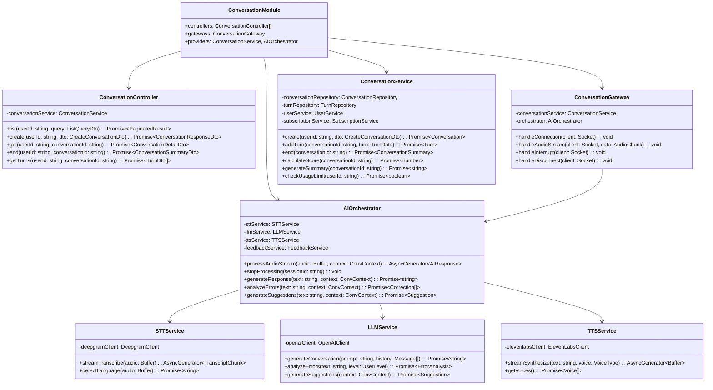
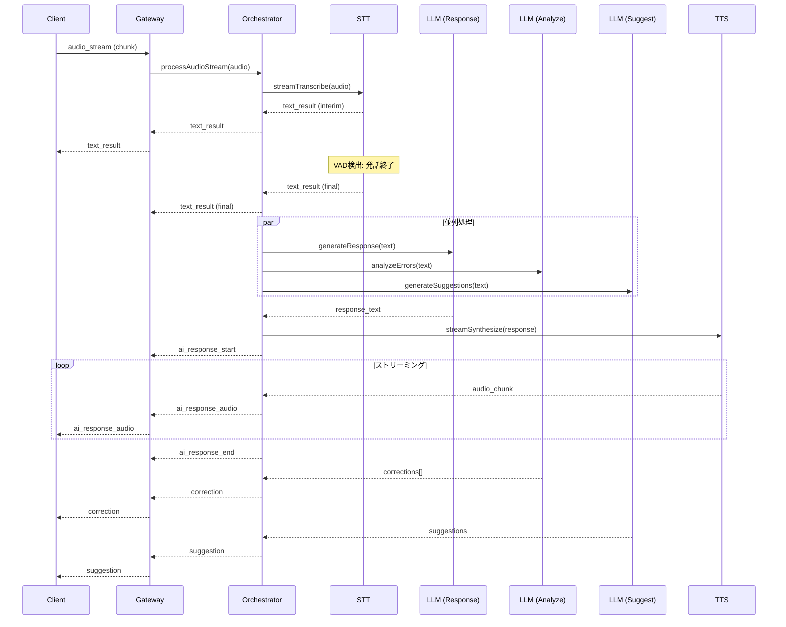

# 5.5. Conversation Module

## 概要

| 項目         | 内容                                              |
| ------------ | ------------------------------------------------- |
| モジュール名 | ConversationModule                                |
| 責務         | 会話セッション管理、AI 連携、リアルタイム音声処理 |
| 依存         | UserModule, CommonModule                          |
| 関連 UC      | UC-001~010, UC-033                                |

---

## クラス図



---

## AIOrchestrator 詳細設計

### processAudioStream()

**目的:** 音声入力をリアルタイム処理し、AI 応答を生成

**処理フロー:**



**Pseudocode:**

```typescript
async function* processAudioStream(
  audio: Buffer,
  context: ConversationContext
): AsyncGenerator<AIResponse> {
  // 1. STT でテキスト変換（ストリーミング）
  for await (const transcript of sttService.streamTranscribe(audio)) {
    yield { type: "text_result", data: transcript };

    if (transcript.is_final) {
      // 2. 並列で LLM 処理開始
      const [responsePromise, errorsPromise, suggestionsPromise] = [
        generateResponse(transcript.text, context),
        analyzeErrors(transcript.text, context),
        generateSuggestions(transcript.text, context),
      ];

      // 3. 応答テキストが得られたら TTS 開始
      const responseText = await responsePromise;
      yield { type: "ai_response_start" };

      for await (const audioChunk of ttsService.streamSynthesize(
        responseText,
        context.voice
      )) {
        yield { type: "ai_response_audio", data: audioChunk };
      }

      yield { type: "ai_response_end" };

      // 4. 訂正・提案を返却
      const errors = await errorsPromise;
      if (errors.length > 0) {
        yield { type: "correction", data: errors };
      }

      const suggestions = await suggestionsPromise;
      yield { type: "suggestion", data: suggestions };
    }
  }
}
```

---

### stopProcessing()

**目的:** 割り込み時に AI 処理を即時停止

**処理フロー:**

1. 現在の TTS ストリーミングをキャンセル
2. 進行中の LLM リクエストをキャンセル
3. クライアントに停止通知

**レスポンス時間目標:** < 500ms

---

## LLMService プロンプト設計

### 会話生成プロンプト

```typescript
const CONVERSATION_PROMPT = `
You are ${persona.name}, an AI English conversation partner.

**Personality:** ${persona.personality}
**Target Level:** ${persona.targetLevel}
**Current Topic:** ${topic}

**Conversation History:**
${history.map((m) => `${m.role}: ${m.content}`).join("\n")}

**Instructions:**
1. Respond naturally to the student's message
2. Match their language level (${persona.targetLevel})
3. Keep responses concise (1-3 sentences)
4. If in "instructor" mode, gently correct major errors
5. If in "freetalk" mode, prioritize natural conversation flow

**Student's message:** ${userMessage}

Respond as ${persona.name}:
`;
```

### エラー分析プロンプト

```typescript
const ERROR_ANALYSIS_PROMPT = `
Analyze the following English text for errors.
Student Level: ${level}

Text: "${userText}"

Return JSON with corrections:
{
  "corrections": [
    {
      "type": "grammar" | "vocabulary" | "pronunciation",
      "original": "incorrect phrase",
      "corrected": "correct phrase",
      "explanation": "brief explanation in Japanese"
    }
  ]
}

Only include significant errors appropriate for the student's level.
Maximum 3 corrections per message.
`;
```

---

## WebSocket イベント仕様

### Client → Server

| イベント     | ペイロード                                               | 説明     |
| ------------ | -------------------------------------------------------- | -------- |
| connection   | `{ token: string, conversationId: string }`              | 接続確立 |
| audio_stream | `{ chunk: Buffer, sequence: number, is_final: boolean }` | 音声送信 |
| interrupt    | `{ reason: 'user_speaking' }`                            | 割り込み |
| disconnect   | -                                                        | 切断     |

### Server → Client

| イベント          | ペイロード                                                | 説明         |
| ----------------- | --------------------------------------------------------- | ------------ |
| connected         | `{ sessionId: string }`                                   | 接続完了     |
| text_result       | `{ text: string, is_final: boolean, confidence: number }` | STT 結果     |
| ai_response_start | `{ responseId: string }`                                  | AI 応答開始  |
| ai_response_audio | `{ chunk: Buffer, sequence: number }`                     | 音声チャンク |
| ai_response_end   | -                                                         | AI 応答終了  |
| correction        | `{ corrections: Correction[] }`                           | 訂正情報     |
| suggestion        | `{ template: string, vocabulary: string[] }`              | 提案情報     |
| error             | `{ code: string, message: string }`                       | エラー       |

---

## ConversationService メソッド詳細

### create()

**目的:** 新規会話セッション開始

**入力:**
| パラメータ | 型 | 必須 | バリデーション |
| ----------- | ------ | ---- | ------------------------- |
| mode | string | ○ | instructor / freetalk |
| personaId | string | - | 存在するペルソナ ID |
| scenarioId | string | - | 存在するシナリオ ID |
| topic | string | - | 最大 100 文字 |

**処理フロー:**

1. 利用量制限チェック（Free: 3 回/日）
2. ペルソナ取得（指定なしはデフォルト）
3. シナリオ取得（指定時）
4. 会話レコード作成
5. WebSocket URL 生成
6. レスポンス返却

**出力:**

```typescript
interface ConversationResponseDto {
  conversationId: string;
  websocketUrl: string;
  mode: ConversationMode;
  persona: PersonaDto;
  startedAt: Date;
}
```

---

### end()

**目的:** 会話終了、サマリー生成

**処理フロー:**

1. 会話時間計算
2. 発音スコア計算（全ターンの平均）
3. XP 計算・付与
4. LLM でサマリー生成
5. 会話レコード更新（ended_at, summary, score）
6. サマリー返却

**XP 計算ロジック:**

```
基本XP = 会話時間(分) × 10
ボーナスXP = (発音スコア - 70) × 0.5 (スコア70以上の場合)
合計XP = 基本XP + ボーナスXP
```

---

← [User Module](./user-module.md) | _次: [Feedback Module](./feedback-module.md)_
